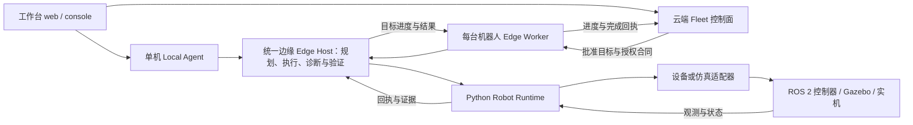

# 躺营 · Tangying Robot AgentOS

[](LICENSE)
[](CHANGELOG.md)
[](go.mod)
[](pyproject.toml)
[](#跑起来)
[](#跑起来)

### 说一句中文，机器人自己把它做完——而且**每一步都能证明自己真做了**。

一套面向家庭场景与具身机器人的**分布式 AgentOS**：把大模型规划、任务编排、世界裁决与机器人实时执行，拆成可替换的控制面与边缘运行时。

**第一次来：**先看[项目框架](#项目框架)和[目录说明](#目录说明)，再按[你的工作选择入口](#新人从哪里开始)。想直接体验，跳到[跑起来](#跑起来)。

边缘实机集成从[ROS 2 设备侧测试指南](docs/operations/edge-field-testing.md)开始：覆盖单机长任务、持久通信与无人车/足式/无人机能力合同。具体驱动和现场物理验收按型号完成，软件模板不代替硬件测试。

单机器人长任务的恢复规则和新数据见[鲁棒性实现](docs/development/2026-10-15-single-robot-robustness.md)与[实验报告](docs/experiments/2026-10-15-single-robot-robustness.md)：连续长步骤链、故障注入、重启不重复动作、上下文投影和原始研究证据分别留存。

空间能力见[统一 2D、地形与 3D 导航](docs/development/spatial-navigation.md)：保留二维 SLAM/Nav2，扩展 SE3 注册点云建图、完整定位、空中体素路径与地面支撑约束，通过 ROS 2 路径和观测协议接入异构控制器。实现边界与实际任务记录见[空间导航实验](docs/experiments/2026-10-14-spatial-navigation.md)。

```text
从客厅出发，去厨房拿杯子，放进收纳盘，然后回到客厅
```

这条固定家庭基线会展开为 12 个受核验的子步骤：走到厨房 → 感知陶瓷杯 → 抓稳 → 放进收纳盘 → 回到客厅。
**物理结果用命令之后的新鲜观测验证，不只看工具返回的“成功”。**

| | |
| --- | --- |
| 🦾 **真闭环** | 改变物理世界的工具返回成功只是**触发观察**，缺新鲜证据就是没做完 |
| 🧠 **模型不碰底层** | 工具由目录、Server/Edge 角色与目标合同过滤；模型提出受限业务参数，驱动与实时控制归设备侧 |
| 🌐 **一开始就是分布式** | Local Agent + SQLite 单机自治，云端 Fleet 统一管机群；同一 Agent 内核按角色装配模型和工具 |
| 🔌 **开箱即用** | 默认 Gazebo + ROS 2 Jazzy，同源 XLeRobot 四房间家庭；需要 Docker，支持 CPU 软件渲染。旧 MuJoCo 任务基线保留显式入口 |
| 🔬 **工程可见** | Go/Python/Web 回归、仿真与部署合同、[软件验收记录](docs/production/agent-harness-docker-acceptance.md)和[实机前就绪审计](docs/production/field-readiness-2026-09-26.md)；实机与规模结论单独认证 |

---

## 跑起来

前置：Go 1.26、Python 3.11、Node.js 22、Git、Make，以及已启动的 Docker（含 Compose）。默认引擎为 **Gazebo Harmonic + ROS 2 Jazzy**，首次启动自动构建运行镜像。

```bash
git clone https://github.com/SUSTechWLA/tangying-robot-agent-os.git
cd tangying-robot-agent-os
make setup
make home-furnished  # 首次体验启动这一套：Gazebo 家庭，http://127.0.0.1:8897/
```

打开工作台后，先查看机器人连接与相机，再按 [Gazebo 指南](docs/guides/gazebo-default.md)完成标定、建图/启用和定位准备，核对草案后批准首个巡检任务。`make sim-start` 是另一套使用 8787 端口的默认场景入口，可按需求选择。

工作台的底盘、头部 RGB-D 均来自 Gazebo 相机。建图通过注册的 mapping 服务运行，导航使用 RTAB-Map / Nav2；地图、日志和 journal 按场景持久化。场景切换、验收命令与当前功能边界见 [Gazebo 默认引擎指南](docs/guides/gazebo-default.md)。2026-09-27 同一场景的巡检、厨房往返、拿杯放盘并返回客厅已完成严格自然语言验收；4 个任务、34 步与 76 张原始图像记录见[本次闭环报告](docs/experiments/2026-09-26-gazebo-xlerobot-home-closure.md)。以运行时 capability catalogue 与对应版本实测报告为准。

开头的杯具转运任务来自旧 MuJoCo 家庭基线，需要显式选择该后端复现：

```bash
SIM_STACK_ENGINE=mujoco make home-furnished
.venv/bin/python scripts/run_home_task_suite.py \
  --base-url http://127.0.0.1:8897 \
  --output artifacts/acceptance/my-household-run-1 \
  --scenario patrol --scenario inspect-kitchen --scenario mug-transfer --timeout 600
```

## 项目框架

项目由 **Go 任务与 Agent 层、Python 机器人执行层、Web 工作台**组成。Go 管理目标、计划、批准、步骤和恢复；Python 连接机器人或仿真，检查命令、调用驱动并提供观测；Web 展示任务与证据。两端通过版本化的 gRPC/数据合同交互。

一个任务沿着这条主线推进：**输入目标 → 提出计划 → 核对并批准 → 边缘逐步执行 → 机器人动作 → 用新观测验证 → 保存任务与证据**。



| 先理解的概念 | 在项目中的职责 |
| --- | --- |
| **Local Agent** | 一台机器人上的完整任务入口，使用 SQLite 保存任务；新人从这条部署路线开始 |
| **Task / Ops / Recovery** | 目标通道的逻辑角色：规划推进、根据持久回执诊断、提出有界恢复建议；Host 检查权限和预算后执行。Local 另有事件式协作运行时 |
| **Fleet / Edge Worker** | 云端保存目标与协作权限，Worker 接收已批准目标；本机共享 Edge Host 自主编排工具、执行和验证，Worker 负责续租与回传 |
| **Edge Host / 目标合同** | `internal/edgeagent` 共用目标规划/执行器；`core/objective` 限定工具参数、效果、预算和完成条件，保留父目标与子计划因果链 |
| **Robot Runtime / Backend** | Runtime 管命令准入、幂等日志、停止和证据；Backend 对接具体驱动或仿真 |
| **地图 / 定位 / 导航** | 分别提供空间依据、当前位置和可通行路径；设备控制器完成实际运动跟踪 |

Local Agent 和 Fleet Worker 是两种边缘部署入口，共用目标核心；同一台机器人选择其中一种控制方式。新增 `POST /v1/objectives` 走“云端给粗目标、边缘自主细化”路径；原 `/v1/tasks` 与现有表单保持已规划任务兼容。边缘只能在批准包络内重规划，未知动作结果停下对账。学习单机路线时无需先部署 Fleet、MySQL 或 Redis。先读[分层目标架构](docs/architecture/hierarchical-edge-objectives.md)和[接入指南](docs/guides/delegated-edge-goals.md)，再查[模块边界](docs/architecture/modular-extensibility.md)与[任务例子](docs/guides/natural-language-task-lifecycle.md)。

## 目录说明

先按职责找目录，再从程序入口追调用。下面覆盖项目自身的顶层目录；机器人侧最常读的是 `edge/`、`robot/`、`examples/robots/` 和相关部署配置。

### 任务、Agent 与云边协作

| 目录 | 放什么、什么时候看 |
| --- | --- |
| [cmd/](cmd/) | 可执行程序入口与依赖装配。先看 local-agent；机群看 fleet-control-plane、edge-worker；设备数据交换看 edge-exchange，其他入口用于 CLI、评测和导出 |
| [agent/](agent/) | Agent 的决策和意图解析，包括中文请求如何转成结构化目标 |
| [agentruntime/](agentruntime/) | Task/Ops/Recovery 等角色的注册、事件通信、权限与协作生命周期 |
| [tasks/](tasks/) | 任务、批准、不可变版本、步骤状态、事件与上下文投影，是任务记录的核心 |
| [orchestration/](orchestration/) | 计划编排、守卫、云边执行内容校验与评测逻辑 |
| [skills/](skills/) | 复合技能的意图和执行模板，例如抓放、导航与语义目标；新增任务能力时查阅 |
| [core/](core/) | 共享领域类型与契约：能力、观测、世界模型、闭环判据、上下文、资源和云边合同 |
| [internal/](internal/) | 应用内部实现与装配：共享 edgeagent.Host、Local 应用、模型路由、能力规划、Agent Harness、恢复执行和配置 |
| [edge/](edge/) | 边缘执行、Runtime 客户端、Worker 检查点、任务通知、策略/恢复及持久设备数据交换 |
| [fleet/](fleet/) | 云端机群 API、协调器、设备身份、资源租约、世界投影，以及 MySQL/Redis/Outbox 实现 |
| [middleware/](middleware/) | 本地存储等基础设施适配器，包括 SQLite 和内存实现 |

### 机器人、仿真与工作台

| 目录 | 放什么、什么时候看 |
| --- | --- |
| [robot/](robot/) | 机器人侧 Python Gateway、设备契约、安全监督、命令 journal、SLAM/空间导航，以及 ROS 2 与 MCP 接口；接实机从这里开始 |
| [sim/](sim/) | Gazebo、MuJoCo、RoboCasa 的场景、仿真适配与资源说明；改仿真环境时查阅 |
| [policy/](policy/) | 动作策略 HTTP sidecar 与输入/输出校验，用于对接学习型策略服务 |
| [examples/](examples/) | 适配器示例和机器人 Profile 模板，包括无人车、足式、无人机；按设备细化参数 |
| [console/](console/) | Local 工作台的 Go HTTP API、任务查询与服务端交互逻辑 |
| [web/](web/) | 浏览器 UI、相机/地图/三维视图、前端资源与测试；Fleet 的服务端 API 在 fleet/ |

`robot/` 中三个常用入口：`gateway/tangying_robot_gateway/` 是 Python Runtime 与算法模块，`ros2_ws/src/` 是 ROS 2 消息、网关和导航包，`mcp/` 是外部 Agent 使用的粗粒度工具桥。完整接入步骤见[ROS 2 异构设备合同](docs/development/heterogeneous-mobility.md)。

### 协议、工程工具与学习资料

| 目录 | 放什么、什么时候看 |
| --- | --- |
| [proto/](proto/) | Go/Python 两端的 gRPC / protobuf 源合同；修改接口先改这里并验证双方 |
| [gen/](gen/) | 从 proto/ 生成的 Go 消息和客户端/服务端代码，通过生成脚本维护 |
| [python/](python/) | 从 proto/ 生成的 Python 消息和 gRPC 存根；Python Runtime 使用它们 |
| [scripts/](scripts/) | 安装、启动、资源构建、验收、故障诊断和文档/书籍生成脚本 |
| [deploy/](deploy/) | Local、云端、机器人、Orin 等部署配置与服务模板 |
| [tests/](tests/) | 跨模块合同、端到端、安装/部署、架构和文档测试；模块自身测试也可能就在源码目录内 |
| [docs/](docs/) | 学习、开发、运维、接口及实验报告；从[总导航](docs/README.md)按用途查找 |
| [book/](book/) | 系统教材、分章、习题、课程与历史版次；从[书籍入口](book/README.md)连续学习 |
| [incidents/](incidents/) | 异常任务证据包的生成代码；实际输出通常在 artifacts/incidents/ |
| [latency/](latency/) | 排队、准入、执行、验证等阶段的耗时记录与统计 |
| [training/](training/) | 只读导出任务轨迹、拒绝样本和数据量化工具，为训练/研究准备资料 |
| [train/](train/) | 模型检查点的晋级门禁，按同一冻结评测集比较候选与基线 |
| [.github/](.github/) | CI 工作流，定义构建、测试、ROS、仿真和出版检查 |

### 本地产物与上游依赖

| 目录 | 含义与维护方式 |
| --- | --- |
| artifacts/ | 地图、运行日志、任务数据库、实验原始证据与出版输出；多数不进 Git，保留规则见[产物管理](docs/operations/artifact-retention.md) |
| bin/ | make build 生成的可执行程序 |
| datasets/、XLeRobot/、vendor/ | 下载的上游资产、参考检出或依赖代码，按安装流程和各自版本管理 |
| .venv/、.venv-book/、*.egg-info/ | Python 运行/出版环境与安装元数据，由环境准备步骤生成 |
| .gocache/、.gomodcache/、.pytest_cache/、.ruff_cache/、__pycache__/ | 编译、依赖和检查缓存；是否出现取决于本地工具配置 |
| .worktrees/ | 本地隔离工作区；其他托管 worktree 也可能位于仓库之外 |
| .git/ | Git 历史与仓库元数据 |

这些本地目录可能只在安装或运行后出现。`artifacts/` 同时保存任务状态和论文证据，清理前需要核对用途与引用。常用根文件：`Makefile` 定义命令入口，`go.mod` / `pyproject.toml` / `web/package.json` 定义依赖，`VERSION` / `CHANGELOG.md` 记录软件版本与变化，`tools.json` 是经检查生成的工具清单。

## 新人从哪里开始

| 你的目标 | 第一条路线 |
| --- | --- |
| 先体验项目 | [跑起来](#跑起来) → [Gazebo 操作指南](docs/guides/gazebo-default.md) → 在工作台核对计划、批准和完成证据 |
| 开发 Agent / 后端 | [开发上手](docs/development/getting-started.md) → cmd/local-agent → tasks/ → internal/edgeagent → internal/capabilityagent → edge/robotclient |
| 开发边缘、SLAM 或接 ROS 2 机器人 | [边缘部署](docs/operations/edge-field-testing.md) → examples/robots → robot/gateway → robot/ros2_ws；空间模块见[建图](docs/development/spatial-mapping.md)与[导航](docs/development/spatial-navigation.md) |
| 修改界面 | web/ → console/；先按[前端指南](docs/frontend/console-v1.md)运行对应检查 |
| 系统学习或写论文 | [book](book/README.md) → [学习路线](docs/learning/README.md) / [研究路线](docs/research/README.md) → 对应实验报告与原始证据 |

**第一小时只追一条任务：**从 [Local 程序入口](cmd/local-agent/main.go)看实际装配，经[任务服务](tasks/service.go)与[能力规划](internal/capabilityagent/planner.go)，找到[Runtime 客户端](edge/robotclient/client.go)，最后看[Python 执行服务](robot/gateway/tangying_robot_gateway/service.py)。用 taskId / commandId / observationId 串起“提出、执行、验证”，就能定位多数模块的作用。

## 为什么值得一看

市面上讲「大模型控制机器人」的项目，大多数停在**工具调用成功**这一步：调用 `pick` 返回 `SUCCESS`，任务就标记完成了。

物理世界不是这样工作的。杯子可能没夹住、可能滑了、可能夹的是旁边那个。所以这个项目把边界划在了别处：

> **工具返回成功，只是「去看一眼世界」的触发器，永远不是「世界已经按预期改变」的证明。**

这一条假设，往下推出了整套设计——闭环契约、证据校验、八类失败分类、结果未知禁止重试。这是它和普通机器人 Demo 最根本的区别，也是[第 3 期长文](artifacts/marketing/03-工具调用/小红书长文-03-软件MCP与物理世界工具调用.md)专门在讲的事。

## v0.7.0：长程任务与协作机制

指定 Gazebo 家庭场景已完成一个约 19 分 19 秒的自然语言长任务：标定读取、移动 SLAM 并启用新地图、卧室/卫生间巡检、厨房杯子抓放及返回、最终状态报告，共 7 个能力阶段、23 个子步骤和 6 次实际抵达。一次只读 RPC 故障经 Task/Ops/Recovery 因果链诊断、独立复验后重读原命令并继续。模型实际请求、上下文压缩、命令身份与原始失败均可回溯；暂停由操作员发起，原末尾导航 ready=false 与后续交接 ready=true 分别保留。

[**实现说明：Agent 如何通讯、异构机器人如何接入、长程协作如何推进**](docs/architecture/long-horizon-collaboration.md)解释事件总线与持久账本、云边执行契约、上下文作用域、资源 fencing 和完成回执。单机器人多 Agent 恢复与 Fleet 双机器人交接分别有证据；异构接入不等于自动异构调度，实体机器人长程验收仍需完成。软件发布见 [v0.7.0](docs/releases/v0.7.0.md)，失败过程和严格证据见[长程验收报告](docs/experiments/2026-10-10-long-horizon-protocol.md)。

## 从一句话到机器人执行

想快速理解当前 Agent 架构，先看这条**真实运行过的 Gazebo 任务**：“重新按家庭巡检路线完成 SLAM 建图，启用新地图，确认卧室可导航，前往卧室并报告定位状态。”配置 GOAL 模型后，Agent 逐轮读取标定、地图目录和语义地点的**结构化状态**，再自主提出 `mapping.build → mapping.status → semantic.resolve → robot.task → navigation.status`。计划经契约校验和操作员审批后才执行；机器人侧完成传感器融合、SLAM、Nav2 导航和独立到位核验。该次任务 5/5 项能力完成核验，保存了模型决策、操作回执与物理证据。

[**逐阶段图解：自然语言如何成为机器人任务**](docs/guides/natural-language-task-lifecycle.md)给出原句、六轮模型决策、冻结计划、执行事件和故障回溯；[实验报告与证据清单](docs/experiments/2026-09-28-complex-model-led-goals.md)保留成功与失败样本。GOAL 规划上下文不接收原始 IMU、图像或点云；底层感知和控制仍在机器人 Runtime。该结果来自指定 Gazebo 场景，实机要另行验收。

## 关于 API Key：什么时候需要，什么时候不需要

这里容易产生歧义，所以说清楚：

| 场景 | 要不要 LLM API Key | 说明 |
| --- | --- | --- |
| **固定句式仿真演示、离线回归** | **不需要** | 默认 `AGENT_PROVIDER=deterministic`，走确定性解析器。开头那句演示指令就是它的固定用例（见 [`agent/intent/home_route_test.go`](agent/intent/home_route_test.go)），其物理闭环不依赖模型服务；复现上面的模型编排实验则需要 GOAL 模型 |
| **开发 / 自用：想让模型编排更多自然表达** | **需要** | 配置 GOAL 模型后，每条自然语言目标都由它选择能力与顺序；没有 GOAL 模型时只支持保守的完整句式离线语法。旧导航/抓放解析器仍可解析复合子任务；不完整或不支持的目标会要求澄清 |
| **实机部署或对外提供自然语言入口** | **需要** | 否则只能处理解析器已覆盖的句式；不是不能跑，是能听懂的说话方式有限 |

配置方式（本地 Console 的"开发模式 → 开发诊断"，或私有配置文件）：

```text
AGENT_PROVIDER=openai          # OpenAI 兼容接口；默认 deterministic
AGENT_BASE_URL=https://your-provider.example/v1
AGENT_API_KEY=...              # 你的 key，只放在本机
AGENT_MODEL=your-model
```

`AGENT_*` 是各阶段的默认路由；可用 `AGENT_GOAL_PROVIDER/BASE_URL/API_KEY/MODEL` 单独指定能力目标模型。需要让模型编排 SLAM、标定和导航时，确认 GOAL 路由已配置并检查草案的 `source=llm`；具体步骤见[统一能力目标指南](docs/guides/unified-capability-goals.md#模型调用点)。

**关于密钥安全，几个关键约束**（这些是代码里的边界，不是承诺）：

- `AGENT_API_KEY` 及阶段专用密钥**只在 Agent 进程内使用**，不会发往机器人，也不会出现在浏览器端状态里（[配置与安全](docs/production/configuration-and-security.md)）。
- 云端机群控制与 Orin NX 单机器人 Agent 使用同一有界 Agent 内核、按角色限制模型与工具；同一多架构 Docker 镜像可在云端运行系统任务 Agent，在 Orin 运行单机 Agent 或 Fleet Worker。各模型调用阶段可独立配置，边缘端可按阶段调用云端只读推理。见 [Harness / Docker 升级规范](docs/superpowers/specs/2026-09-25-role-specific-agent-harness-docker-adr.md)、[Fleet 架构](docs/architecture/fleet-cloud.md) 与 [Orin NX 部署](docs/install/edge-orin.md)。
- 模型可参与**理解、规划、恢复建议和机群草案**，只在角色 Harness 给出的工具范围内做选择；它不接触适配器 SDK、gRPC 消息或安全字段，也不因此获得硬件动作权限——轨迹生成、关节/轮速实时控制和设备安全限制仍由 Runtime 与控制器落实。
- 请把 key 放进**私有配置文件**：`*.env` 已在 [`.gitignore`](.gitignore) 中全局忽略（包括 `artifacts/` 下生成的环境文件），只有 `*.env.example` 占位模板会被跟踪。
- 私有配置应保持在 Git 之外；提交前检查暂存区、文件历史和密钥扫描结果，发现泄露立即轮换相关凭据。

## 一、闭环契约：返回成功不算完成

`mutates_world=True` 的工具（导航、抓取、放置、恢复位姿）返回成功后，系统会把它推进一个独立状态——**待取证**。物理结果此刻仍然未知，必须附上一条**命令之后采集、带观测标识、来源没过期**的新鲜证据，才允许记为完成。

判定与失败分类在 [`core/closedloop`](core/closedloop/closedloop.go)：证据缺 ID、缺采集时间、早于命令下发、或来源判定为 `STALE`，一律拒绝。失败不是笼统重试，而是分成八类（Transient / Perception / Planning / Permission / Resource / Validation / UnknownOutcome / Fatal），每一类唯一安全的下一步都不同；其中**「结果未知」禁止自动重试**，必须先对账。

### 可选的物理接地验证（GVF）

新增 GCL 合约与独立边缘验证器，默认关闭。开启后，抓取、放置、导航的工具回执还需通过传感器证据校验；缺证据返回 `UNKNOWN` 并持久阻断后续物理动作。报告、中文模板和原始证据引用可以回放。

```bash
make gvf-demo       # Gazebo 接触夹具：工具 SUCCESS，实际漏夹
make gvf-experiment # 30 个任务模板 × 5 个种子，生成对照报告
```

需要已安装项目依赖、Docker 和 `tangying-navigation:dev` 镜像。详细开关、合约扩展和复现方式见[单机器人闭环指南](docs/development/single-robot-loop.md#物理接地验证-gvf可选)。[实验报告](docs/experiments/2026-09-21-grounded-verification.md)区分实测验证结果与离线恢复估计；没有模型响应的 LLM 对照不计作已完成。

## 二、分布式：不是把程序拆到多台机器上

「分布式」在这套系统里不是部署姿势，是**故障假设**。它意味着四件具体的事：

| 设计 | 解决的问题 |
| --- | --- |
| **单写协调 + 资源归属** | 多个写者不会同时改同一个物理世界（地图、位姿、谁抓着什么、充电位） |
| **租约 + 单调递增的 fencing token** | 旧持有者拿着过期授权写入，会被直接拒绝——脑裂挡在数据层，不靠人盯 |
| **事件与 Outbox + 幂等键** | 先落盘事实再投递；进程重启/队列宕机后能接着做，而不是从头再来 |
| **云端慢环 + 边缘任务环 + 控制器快环** | 云端分配粗目标，边缘在授权内细化与恢复，实时控制和安全监督留在设备；Fleet 失去父 claim 后停止并对账 |

两种形态共享同一套 Runtime、工具目录、观测契约与世界快照格式：

```text
云端 Fleet（系统任务与机群）               本地 Local Brain（默认单机演示）
浏览器 ── Fleet API ── Server Harness       浏览器 ── Local Agent + SQLite
              ── 任务/协调器                             ── Edge Harness
              ── EventLog + Outbox                        │
              ── WorldHub + Harness                       │
                    │ mTLS                                │
              Edge ── Robot Runtime              同一 Robot Runtime
                    │                                    │
              实机 / 仿真工具                       实机 / Gazebo / MuJoCo 仿真
```

**不同机器人复用任务与 Runtime 边界**：新本体通过 `RobotProfile → PluginBackend → RobotRuntimeService` 接入，并交付对应驱动、感知、控制、停止与物理验证。审批、租约、日志、取消和急停契约复用；跨不同 adapter 的统一任务分工仍需扩展每节点契约与验收，见[异构接入与调度的区别](docs/architecture/long-horizon-collaboration.md#6-为什么能接入不同结构的机器人)。

> 当前验证以单机器人受限场景为主。共享 Host、持久检查点、云边补传和 ROS 2 异构合同已有软件验证；目标 GPU/Orin、实体设备、异构机群、跨主机共识和大规模生产仍需独立验收。

## 三、模型能做什么、不能做什么

| 工具层 | 内容 |
| --- | --- |
| 暴露给大模型 | 按运行时目录、角色 Harness 与目标授权筛选的能力；目录会随设备变化，会改变世界的工具必须声明效果并接受验证 |
| 业务参数与底层控制 | 模型可读取结构化地图/位姿并按 Schema 提出目标、区域或路径请求；批准包络与 Provider 再校验。直接关节控制、驱动 SDK 与实时控制不授予语言模型 |
| 执行通道 | 注册能力服务经类型化调用、持久操作与完成验证；复合 `robot.task` 进入 Runner，再通过 Runtime `ExecuteSkill` 执行低层技能，各层保留自己的准入与证据 |
| 外部接入 | [MCP 桥接](robot/mcp/README.md) 只给 8 个粗粒度工具，不提供批准、不提供自动批准、不暴露关节控制；外部 Agent 建的任务一样要人工审批 |

## 四、已经验证了什么

| 能力 | 状态 | 怎么验证 |
| --- | --- | --- |
| 家居自然语言拆解（客厅/厨房、拿取、放置与返回） | ✅ Gazebo 仿真已验证 | [同源完整家庭验收](docs/experiments/2026-09-26-gazebo-xlerobot-home-closure.md)：4 个任务、34 步与 76 张原始图像；实机另需验收 |
| 返程导航（回到出发房间） | ✅ 完整实测地图上已验证 | 当前 Gazebo 家庭已有返程闭环；历史欠覆盖地图的 `GOAL_NOT_CLEAR` 样本保留。未知空间仍拒绝通行 |
| 底盘导航 | ✅ 已验证 | `navigation.navigate` + `verify_arrival` |
| 机械臂抓取与放置 | ✅ 已验证 | `manipulation.pick` / `manipulation.place` + 两个 `verify_*` |
| 相机感知（头部 + 底盘双 RGB-D、深度、点云） | ✅ 已验证 | 工作台"机器人视野"，以及每步绑定的采集 |
| 完成后确认（闭环契约） | ✅ 已验证 | 写工具缺新鲜证据即失败关闭 |
| 整机标定与自行录入 | ✅ 已接通注册服务 | 工作台"去处理"→标定；支持算法结果录入、版本校验和应用 |
| RGB-D 稠密 SLAM、保存和 WebGL 展示 | ✅ Gazebo 移动建图已验证 | [标定与建图操作指南](docs/guides/robot-service-workflow.md)，[本轮 SLAM 测量](docs/experiments/2026-09-27-gazebo-slam-semantic-navigation.md) |
| SLAM 语义地点与工作区导航 | ✅ Gazebo 仿真已验证 | [操作指南](docs/guides/slam-semantic-navigation.md)：自动几何分区、显式功能标注与任务验收 |
| 三维点云语义到长程导航 | ✅ Gazebo 五站任务与只读故障恢复已验证 | [点云语义指南](docs/guides/semantic-point-cloud.md)、[五站实测与失败记录](docs/experiments/2026-10-13-semantic-execution.md)：人工三维标注、版本绑定、可达候选、任务检查点及新鲜到位证据；自动全图识别与真机仍未验证 |
| 保存关键帧的图像、位姿与配准诊断 | ✅ 已验证 | [关键帧检查指南](docs/guides/slam-keyframe-inspection.md) |
| 安全工具（急停、恢复安全位姿、限速） | ✅ 已注册 | `emergency_stop`、`recover_to_safe_pose`、`set_speed_limit` |
| RTAB-Map + Nav2 | ✅ Gazebo 移动建图与定位导航已验证 | [本轮实测](docs/experiments/2026-09-27-gazebo-slam-semantic-navigation.md)，先建图再定位，未知区域仍拒绝 |
| 实机（XLeRobot） | ⚠️ 需现场验收 | [真机路径](#六真机sim2real) |

一条指令的完整链路（每一步的回执都绑定该步的 RGB-D 采集）：

| # | 步骤 | 工具 | 这一步在证明什么 |
| --- | --- | --- | --- |
| 1 | 看一眼现场 | `observe_scene` | 当前能看到哪些物体与房间 |
| 2 | 走到厨房 | `navigation.navigate` | 底盘真的移动了 |
| 3 | 确认到达 | `verify_arrival` | 用**新的**底盘相机与位姿误差确认，不是相信回执 |
| 4 | 重新观察 | `observe_scene` | 到达后重新感知，不复用出发前的画面 |
| 5 | 解析目标 | `resolve_targets` | 陶瓷杯与收纳盘在场景中的身份 |
| 6 | 规划抓取 | `plan_grasp` | 抓取位姿可行性 |
| 7 | 拿起 | `manipulation.pick` | 物理动作 |
| 8 | 确认拿起 | `verify_grasp` | 物体确实离桌并在夹爪中 |
| 9 | 放下 | `manipulation.place` | 物理动作 |
| 10 | 确认放好 | `verify_placement` | 连续三帧稳定处于 `inside:kitchen-tray` |
| 11 | 回到客厅 | `navigation.navigate` | 底盘再次移动 |
| 12 | 确认回到客厅 | `verify_arrival` | 同第 3 步的判据 |

Gazebo 家庭入口现已统一为同源 XLeRobot CAD 与完整家庭资源。部署见[Gazebo 操作指南](docs/guides/gazebo-default.md)，当前真实闭环进度与修复点见[验收记录](docs/experiments/2026-09-26-gazebo-xlerobot-home-closure.md)。旧彩色工位实验不作为全屋验收。

## 五、真实 SLAM 建图与 Nav2

默认工作台通过机器人注册的 `calibration.*`、`mapping.*` 和 `navigation.map` 服务运行。OS 不按仿真或实机选择实现。当前参考驱动支持实际移动采集、平面 RGB-D ICP/位姿图 SLAM、不可变地图保存、栅格路径规划和在线碰撞检查。完整步骤见[标定与建图操作指南](docs/guides/robot-service-workflow.md)。

最新[装修家庭验收记录](docs/development/2026-09-13-furnished-home-acceptance.md)记录新场景、实际移动扫描、关键帧浏览、任务证据及失败修复。此前的[注册服务验收记录](docs/development/2026-09-13-robot-workflow-acceptance.md)保留为历史基线。

需要 RTAB-Map 与 Nav2 实现时，可启动独立导航服务（需要 Docker）：

```bash
make navigation-restart NAVIGATION_ARGS='--build --mode mapping --scene home'
make navigation-status
```

`navigation-status` 就绪时会打印 `ready: true`、`mode: mapping`、`mapRevision`（地图身份）与 `poseSource: rtabmap_tf`。地图持久化在容器卷 `/data/maps/home/rtabmap.db`。

**建图阶段的行为是刻意设计的安全门禁**：全局代价地图的 `allow_unknown=false`，Nav2 拒绝规划穿过尚未建图的区域。所以冷启动后只能导航到已覆盖范围（例如客厅），去厨房会以 `NAV_FAILED NAV2_ACTION_ENDED` 结束——这不是缺陷，而是"不知道的地方不进去"。因此正确顺序是：

1. **建图**：`--mode mapping` 下按场景、传感器与预算逐步探索，确认视觉词典、占据图与定位更新；房间覆盖范围以实际地图和验收证据为准；
2. **执行**：`--mode localization --scene home` 复用同一张地图，再运行自然语言路线；
3. **抓取**：Gazebo 使用 `--scene home_furnished` 的陶瓷杯与收纳盘；MuJoCo 使用 `--scene home_task --home-assets artifacts/sim-assets/furnished-home`。不带家庭资产包的彩色模型仅保留为历史测试基线。

首次进入未知场景使用 `mapping.build(mode=explore)`：有界主动环视、基于实测自由空间的 frontier 选点、局部受阻重规划、预算停止与分段地图发布。`survey` 使用驱动注册路线，手动扫描用于调试；三种模式分别留痕。当前自主探索适配器是平面移动机器人，三维点云保存不等于三维自主探索。开始方式、模块边界与最新验收见[首次扫描升级记录](docs/development/2026-10-17-exploration-first-scan.md)和[实验协议](docs/experiments/2026-10-17-exploration-first-scan-protocol.md)；地图发布成功不代表全环境覆盖。RTAB-Map 操作详见[家庭场景操作](docs/guides/home-scene-operations.md)。

## 六、真机（Sim2Real）

同一套任务、工具与证据合同在实机上不变，替换的是适配器、感知、标定与现场安全配置：

```bash
./install.sh robot-pi --dry-run --yes     # 先预览安装计划
./install.sh robot-pi                     # 树莓派 / 机器人上位机
robot-agent doctor robot-pi               # 上电前离线检查
```

真机放行前必须完成：双 RGB-D 与里程计标定、地图覆盖、刹车与实体急停、机械臂碰撞边界、以及至少 30 次受监护的路线/抓取验收。逐步清单见[家庭 Sim2Real](docs/guides/home-sim2real.md)与[发布检查清单](docs/operations/release-checklist.md)。

**软件发布与实机放行是两项独立结论**——仿真通过不等于实机可用，这是刻意的。

## 七、日常使用

| 入口 | 用途 |
| --- | --- |
| 工作台 | 输入任务、核对拆解、批准执行、看机器人相机画面 |
| 任务记录 | 按任务编号查找历史任务，筛选成功/失败 |
| 任务全过程回放 | 逐步对齐工具调用、观测证据与恢复状态，列出不一致项 |
| 我的机器人 | 连接状态、运行环境、相机画面 |
| 开发诊断 | 需要"开发模式"；事件、命令编号与底层状态 |

一次启动全部组件（默认仿真 + 本地控制台）：

```bash
./scripts/start-all.sh up          # 也可以用 make up / make down / make stack-status
./scripts/start-all.sh status
./scripts/start-all.sh down
```

停止与查看仿真栈：

```bash
bash scripts/sim-stack.sh status --artifacts-dir artifacts/sim-stack/furnished-home
bash scripts/sim-stack.sh logs   --artifacts-dir artifacts/sim-stack/furnished-home
bash scripts/sim-stack.sh stop   --artifacts-dir artifacts/sim-stack/furnished-home
```

验收输出目录必须是新目录；脚本不会自动重试物理操作或重置场景。杯子收纳需要初始未放置状态，重复测试前应完成或停止当前任务，再显式重启场景并确认地图有效。`make home-start` 默认同样使用 Gazebo 家庭。复现旧 MuJoCo 彩色杯基线需显式设置 `SIM_STACK_ENGINE=mujoco` 后运行 `make home-start` / `make home-accept`，使用独立的默认运行目录和 8787 端口；该旧验收不能替代上面的完整家庭套件。

## 八、仓库里有什么

完整目录职责见前面的[目录说明](#目录说明)。部署时再按运行位置选择角色，权威说明见[部署目标与代码归属](docs/operations/deployment.md)：

| 目标 | 内容 | 入口 |
| --- | --- | --- |
| 本地单机 | Local Agent、工作台、任务账本（**当前主线**） | `./install.sh local` |
| 机器人端 | ROS 2 网关与安全监督、xlerobot 驱动 | `./install.sh robot-pi` |
| 云端 | Fleet 控制面 + Server Harness 系统任务 Agent（软件候选，待目标服务器与机群验收） | `./scripts/fleet-up.sh up` |
| Orin NX | 单机器人 Edge Harness 或 Fleet Worker（互斥 profile，待目标设备验收） | [Orin NX Docker 安装](docs/install/edge-orin.md) |
| 仿真 | 默认 Gazebo / ROS 2，MuJoCo 保留回归 | `./install.sh sim`，然后 `make sim-start` |

任务与设备的完整调用链见上方[项目框架](#项目框架)，源码阅读顺序见[新人入口](#新人从哪里开始)。

## 九、开发与验证

```bash
make build           # 二进制
make test            # Go + Python + Web 全部单元与契约测试
make lint            # gofmt + ruff + tools.json 一致性
make generate-check  # proto 生成物是否与仓库一致
```

常见 CLI（按所在机器选角色）：

```text
robot-agent doctor ROLE
robot-agent configure ROLE KEY=VALUE
robot-agent pair ROBOT_HOST --ssh-user USER
robot-agent start ROLE
robot-agent status ROLE
robot-agent logs ROLE --follow
robot-agent demo
```

第一次来？走一遍[新人第一小时](docs/README.md#新人第一小时)，里面有"每类东西放在哪个目录"的[仓库地图](docs/README.md#仓库地图每类东西放在哪)。

文档入口：[总导航](docs/README.md) · [系统学习](docs/learning/README.md) · [开发升级](docs/development/README.md) · [部署运维](docs/operations/README.md) · [研究与论文](docs/research/README.md) · [全量分类目录](docs/catalog.md)。本版变更见 [Changelog](CHANGELOG.md)，发布身份见 [v0.7.0 发布记录](docs/releases/v0.7.0.md)。架构评估、工具安全修复、地图/工作区规划与真实验收边界见[系统审查与升级记录](docs/development/2026-09-13-system-audit.md)。

云边和算法扩展的当前能力、模块职责与后续门槛见[模块化与扩展性评价](docs/architecture/modular-extensibility.md)；新的建图实现按[SLAM Provider 指南](docs/development/slam-providers.md)接入。

**想系统读懂这套系统？** [`book/`](book/README.md) 提供数字版2.2.0教材与工程参考版：四篇、19章、9附录、离线HTML/EPUB；以通用原理、当前实现与完整长任务讲清分布式机器人AgentOS。提供57道分层习题、[十二组实验](book/appendix/F-learning-labs.md)、[16周课程](book/appendix/G-course-design.md)和[工程手册](book/appendix/H-engineering-playbook.md)，面向软件、机器人、科研与大学教学。正文纳入目标委托、共享 Edge Host、持久恢复和最新单机器人实验；旧版出版身份与历史实验分别保留。

## 十、这个仓库故意不做什么

一个项目的取舍比功能列表更能说明它的判断。以下都是**刻意的非目标**，写在[完整架构文档](docs/production/architecture.md)里：

- **不用软件急停替代实体急停。** 软件状态永远低于硬件限制。
- **不把仿真模型当作未经标定的实机真值。**
- **不在观测陈旧、资源冲突或证据缺失时猜测成功**——宁可失败关闭。
- **不承诺单机开发栈已经具备跨地域生产级高可用**（那属于 Fleet 的待验证清单）。
- **不让大模型输出关节角。** 物理动作的粒度是任务，不是电机。

## 其他路线（保留但暂不聚焦）

以下能力保留且仍有测试，只是当前不投入：

- **多机器人 / Fleet**：`cmd/fleet-control-plane`、`fleet/`、`edge/`。单机器人把自己的任务做完即可；多机协调属于调度层，不影响上面的闭环。
- **RoboCasa 双机交接**：`./scripts/fleet-sim.sh handoff`；Compose 云端流程为 `./scripts/fleet-up.sh up`。旧 `./install.sh cloud` 只返回迁移提示。
- **固定工位桌面任务**：`make rgbd-start`（显式 MuJoCo 历史 `tabletop` 夹具）。

架构决策见 [World/Harness 设计](docs/superpowers/specs/2026-08-20-distributed-agentos-world-harness-design.md)与[早期 Local-first 设计](docs/superpowers/specs/2026-08-18-local-first-runtime-design.md)。

## 关于这个项目与作者

我把它当成一套**写给物理世界的操作系统**在做，而不是一个 Demo：所以有闭环契约、有证据链、有 fencing token、有失败分类，也有[公开的"仍须独立验证"清单](docs/architecture/distributed-agentos.md)。

系列文章（按主题逐期讲清一个设计决策）都在 [`artifacts/marketing/`](artifacts/marketing/README.md)：

| 期 | 主题 |
| --- | --- |
| 01 | [总体架构](artifacts/marketing/01-总体架构/小红书长文-01-总体架构.md) |
| 02 | [为什么要分布式](artifacts/marketing/02-为什么要分布式/小红书长文-02-为什么要分布式.md) |
| 03 | [软件 MCP 与物理世界工具调用](artifacts/marketing/03-工具调用/小红书长文-03-软件MCP与物理世界工具调用.md) |

**如果这套设计对你正在做的事有用，欢迎 star、提 issue，或者直接来聊。** 我在找具身智能 / 机器人软件方向的工作（机器人 Agent 与系统、SLAM 与导航），缺人的话求内推 🙏

MIT License · [分类文档](docs/catalog.md) · 源码含 1451 个 Go 测试函数 + 2208 个 Python 测试函数（静态计数，非已运行结果；通过/跳过以 CI 和实验记录为准）

### Agent 上下文评测

任务、编排、工具结果和恢复轨迹可投影为带来源与有效期的自然语言事实包，支持 JSON 和两种自然语言渲染。默认关闭，`TANGYING_AGENT_CONTEXT=json` 启用本轮开发集选中的表达。`make test-agent-context` 验证接入，`make eval-agent-context-replay` 离线重放真实模型响应。参见 [使用与训练接口](docs/development/natural-language-evaluation.md#agent-全程上下文与能力评测2026-09-21) 和 [量化实验报告](docs/experiments/2026-09-21-agent-context-evaluation.md)。

第二轮已支持 **按关键环节选择表达**：`TANGYING_AGENT_CONTEXT=stage` 使用经开发选择和留出门禁的内置策略；工具结果/反思、恢复、诊断/交接等环节可以使用不同格式。运行 `make test-agent-stages`、`make eval-agent-stages-replay`；实验对比与退化案例记录在同一报告第 12 节。

第三轮补充 **两模型因子实验、反事实字段必要性证明、形式化检查、结构与决策契约消融**。`make test-agent-factorial` 与 `make eval-agent-factorial-replay` 可离线验收；逐环节结果和未通过项见报告第 13 节，完整字段设计见 [生产者字段字典](docs/development/decision-context-fields.md)。研究模式默认关闭；最终模型绑定配置会拒绝已观测到危险建议或零完整成功的环节，不把相对基线持平当作可上线。

### 统一能力目标（2026-09-27 增量）

标定、自动 SLAM、地图激活、语义读工具与旧导航抓放已接入同一任务计划、审批、持久操作与验证链路。可输入“运行标定，巡检建图，然后去厨房”，前端展示执行记录；云端规划、认证 Worker 使用同一执行器，边缘与服务器模型按阶段独立配置。见[统一目标操作](docs/guides/unified-capability-goals.md)、[实施规格](docs/development/2026-09-27-capability-goal-implementation-spec.md)、[实际验收](docs/experiments/2026-09-27-capability-goal-closure.md)。实机与机群规模仍需现场认证。

2026-10-05 增量接通 Task / Ops / Recovery 的只读故障闭环：具体步骤失败后，监督 Agent 定位、恢复 Agent 限定范围调查并独立复验，执行 Agent 最多重读一次后继续原计划。持久预算、物理未知结果停止和审批边界保持。完整建图、巡检、抓放、暂停续跑与真实故障样本见[长程实测报告](docs/experiments/2026-10-05-long-horizon-recovery.md)及[复现命令](docs/experiments/long-horizon-harness.md)。

2026-10-10 增量补齐[多 Agent 身份、主题权限与恢复因果协议](docs/development/2026-10-10-agent-interaction-protocol.md)和[云边完成回执及持久协调收尾](docs/development/2026-10-10-cloud-edge-protocol.md)。上下文归档与模型输入保存精确原文，GOAL 规划轮次进入不可变任务版本；详情、实际故障及修复后的仿真结果见[本轮长程任务报告](docs/experiments/2026-10-10-long-horizon-protocol.md)。
