# 深入理解分布式机器人 Agent 系统

从故障反例到边缘实现：协议、上下文与计算预算

数字版 3.2.0 · 2026-10-28 · Copyright © 2026 SUSTechWLA · MIT License

<!-- GENERATED by scripts/build_book.py; edit chapter sources, not this file. -->

## 目录

- [出版说明与阅读约定](#part-01)
- [前言：读完之后，应该能设计出什么](#part-02)
- [学习导读：围绕六个问题读，而不是平均用力](#part-03)

### 第一篇 基础与体系

- [第 1 章 从一句巡检指令推导系统需求](#part-04)
- [第 2 章 一张架构图背后的责任与取舍](#part-05)
- [第 3 章 一次动作怎样获得可信的完成结论](#part-06)
- [第 4 章 从传感器到地图、语义与可行动的世界](#part-07)

### 第二篇 执行与分布式机制

- [第 5 章 Harness：把模型建议约束成设备调用](#part-08)
- [第 6 章 多 Agent 协作：分工、消息与执行权](#part-09)
- [第 7 章 从自然语言目标到有界子计划](#part-10)
- [第 8 章 分布式故障：超时、重复与恢复窗口](#part-11)
- [第 9 章 单机器人边缘系统与多机器人工作台](#part-12)

### 第三篇 工程与研究方法

- [第 10 章 异构 ROS 2 接入与 Sim2Real 的实际边界](#part-13)
- [第 11 章 可观测性与恢复：从报错走到有依据的决定](#part-14)
- [第 12 章 怎样证明一个设计更好：实验与消融](#part-15)
- [第 13 章 部署与升级也是系统协议](#part-16)
- [第 14 章 开发者第一周：沿一条任务读懂系统](#part-17)

### 第四篇 扩展与系统综合

- [第 15 章 可扩展性：哪些地方应该可替换](#part-18)
- [第 16 章 软件 Agent 经验怎样迁移到机器人](#part-19)
- [第 17 章 云边与机器人之间究竟传递什么](#part-20)
- [第 18 章 模型究竟看见什么：上下文、KV cache 与长程决策](#part-21)
- [第 19 章 完整案例：先预测，再核对真实记录](#part-22)

### 参考、实验与教学资料

- [附录 A · 按问题阅读源码](#part-23)
- [附录 B · 设计、变更与交付检查表](#part-24)
- [附录 C · 案例与实验的来源索引](#part-25)
- [附录 D · 术语、时钟与信任假设](#part-26)
- [附录 E · 理论文献、规范与项目依据](#part-27)
- [附录 F · 分级学习路线与可检查实验](#part-28)
- [附录 G · 大学课程与综合项目设计](#part-29)
- [附录 H · 行业工程手册与记录模板](#part-30)
- [附录 I · 分层习题的参考要点与示例解答](#part-31)


---

<a id="part-01"></a>

# 出版说明与阅读约定

<a id="part-01-h002"></a>

## 本版范围

《深入理解分布式机器人 Agent 系统》数字版 **3.2.0，2026-10-28**，副标题“从故障反例到边缘实现：协议、上下文与计算预算”。本版在十九章教材基础上深化第 8、17、18 章，以跨域仓库任务串联协议、模型输入、上下文与一致性；配套第 12、19 章的指标与综合设计，增加时钟界、误差雅可比、历史增长下界、等待与停止预算，包含 23 幅 SVG、2 幅概念插画。

本版解释的实现固定到 `63af99305fd8204c0a54d86145cb94d89b754326`，配套项目文档固定到 `63af99305fd8204c0a54d86145cb94d89b754326`。书籍版号独立于软件发布标签；本次同时修复边缘执行/通信和模型交互代码，仍不以书籍版号替代机器人软件发布标签。历史实验继续使用各自记录的源码、二进制、场景和时间，不能用本版代码身份替代。

<a id="part-01-h003"></a>

## 阅读中的四种材料

“教学设定”“算例”“伪代码”用于推导设计，不代表实测或可直接发送的请求；“当前项目”指固定快照的实现；“实际实验”指有原始报告的记录；“建议”“后续扩展”表示尚待实现或验证的设计。代码片段若是实际摘录，会标明文件。

正文主要讲机制与取舍，完整运行身份、实验索引及理论资料分别放在附录 A、C、E。图中箭头表示逻辑调用或信息流，具体传输与持久化语义由相邻文字说明。

<a id="part-01-h004"></a>

## 历史与复现

上一版 3.1.0 的源清单、插图及提示词哈希与恢复步骤见 `book/editions/3.1.0/`，书稿提交为 `0b42b87d729b9c9adcd192d563450fd342583560`。3.0.0 及更早档案继续保留。

更早 2.2.0 的全部正文、合订本、README、原生成器和固定依赖可从 `9e6a58f6ad48c6d9441e95511ddb4d503ea6449e` 恢复，逐文件清单位于 `book/editions/2.2.0/source-manifest.json`。更早版本档案继续保留。本版不修改旧实验结论，也不删除失败记录。

```bash
git show 9e6a58f6ad48c6d9441e95511ddb4d503ea6449e:book/book.md > /tmp/tangying-book-2.2.0.md
python3 scripts/build_book_figures.py --check
python3 scripts/build_book.py --check
```

分章 Markdown 是编辑源；合订本、离线 HTML 与 EPUB 统一构建，图形随出版物打包，不依赖 CDN 或在线 Mermaid 渲染。源码与项目文档链接需要网络；正文、图和包内目录可离线阅读。

<a id="part-01-h005"></a>

## 授权与使用

Copyright © 2026 SUSTechWLA，代码与书稿按项目 MIT LICENSE 分发，保留完整许可。外部文献和上游资产保留各自权利。本书提供本科/研究生教学与工程参考，不声称教材审定、行业标准认可或实体安全认证。

本次完成受影响 Go 包的定向 race 回归、重复长程故障软件实验和本地出版核对；统计范围见本轮开发记录，不把软件夹具算作新增模型性能、实机或 Gazebo 运动数据。第 17/18 章场景插图由内置 imagegen 生成，提示词与来源记录在 `book/assets/ILLUSTRATION.md` 和 `book/assets/EDGE-AUTONOMY-ILLUSTRATION.md`；它们是教学示意，不是系统观测。勘误请注明版次、章节、原句和对应实现或证据；设计局限应被说明，而不是通过改写历史来隐藏。


---

<a id="part-02"></a>

# 前言：读完之后，应该能设计出什么

设想你已经做出一个演示：用户说“去 B 区看看”，语言模型调用导航，机器人动了。接下来问题来了：响应丢失后能否再调一次？另一台机器人说通道已清空，能否直接采信？任务执行一小时后，模型忘了禁止区域怎么办？程序重启后该继续哪一步？

本书从这些问题出发，教你把一个 Agent 演示发展成职责清楚、行为可解释、故障可分析的分布式机器人系统。Tangying Robot AgentOS 是贯穿的实现案例，读者不仅看到“应该怎样”，还会追到接口、持久对象和测试中具体的设计决定。

<a id="part-02-h002"></a>

## 六项核心学习成果

| 读完应能做的事 | 你应交出的产物 | 重点章节 |
| --- | --- | --- |
| 把一句话变成可验证任务 | 目标、约束、完成证据和反例 | 1、3、7 |
| 划分云、边缘与控制器职责 | 架构图、权威数据表、调用时序 | 2、5、9、17 |
| 处理超时、重复与重启 | 崩溃窗口矩阵和恢复判据 | 6、8、11 |
| 管理上下文并评价缓存 | 精确事实、有界投影、受限回查、KV 显存/收益推导 | 18 |
| 设计异构接入与共享空间信息 | Profile、坐标依据、数据消息合同 | 4、10、17 |
| 评价一个设计是否更好 | 有对照、分母和原始记录的实验 | 12、15、19 |

这六项成果比记住模块名更重要。能解释设计取舍、找到反例并提出可测试修复，才算掌握系统。

<a id="part-02-h003"></a>

## 一条任务贯穿，一层问题展开

教学任务是“从 A 出发，巡检 B、C 两区，记录阻塞，再回到 A”。先只考虑一台 AGV，再加入通道阻塞、请求丢失、进程重启、长历史和 UAV 的高位观测建议。每增加一个条件，推导一个必要机制，而不是一开始展示几十个模块。

教学编号、时间与算例都明确作为推演。第 19 章再核对真实保存的 Gazebo 和软件实验，说明哪些机制实际发生、哪些只在测试中覆盖。实验细节和版本身份集中到出版说明与附录，正文优先解释因果。

<a id="part-02-h004"></a>

## 这本书怎样使用

软件背景读者应特别关注坐标、采集时间和停止；机器人背景读者应关注事务、重复消息和权威版本；研究生应关注机制是否真正接线、实验单位和外推边界。数学需求以向量、矩阵乘法、基本概率和简单代数为主；注意力、显存与延迟公式均逐项定义符号，源码涉及 Go、Python 和 ROS 2。

每章先给问题，再解释选择、项目实现与失败分支，最后提供课堂推演和 B/E/R 分层习题。附录 F 包含可运行实验，附录 G 提供 16 周授课方案，附录 I 给出参考解答。没有硬件也可以完成核心软件与故障实验。

本书并不试图证明“模型足够强就能解决所有机器人问题”。它希望你学会让模型承担适合它的决策，让确定性机制维护权限和事实，让控制器承担物理闭环，并能说明这三者之间每一条消息意味着什么。


---

<a id="part-03"></a>

# 学习导读：围绕六个问题读，而不是平均用力

<a id="part-03-h002"></a>

## 先做一个五分钟自测

尝试回答：工具超时是否表示机器人没有动？两个 frame 都叫 map 是否能直接合并？模型摘要说已完成能否关闭 unknown？消息 ACK 是否等于业务采纳？换模型服务地址是否会改变谁拥有执行权？

若任何一题只能凭直觉回答，先读下列核心路线。书的目的就是把这些直觉变成有依据的判断。

<a id="part-03-h003"></a>

## 核心路线与阅读深度

| 层次 | 阅读路线 | 完成后检验 |
| --- | --- | --- |
| 第一轮：建立全貌 | 1 → 2 → 3 → 9 | 画出目标、Host、Runtime、观测与任务库 |
| 第二轮：执行与失败 | 5 → 7 → 8 → 11 | 为丢响应和重启写出恢复表 |
| 第三轮：分布式与记忆 | 6 → 17 → 18 | 为消息和上下文标明身份、权威、时效 |
| 机器人专题 | 4 → 10 | 给出坐标、地图、控制与停止假设 |
| 研究与工程落地 | 12 → 13 → 14 → 15 → 16 → 19 | 做一项小改动或一个机制对照实验 |

本科课程建议把 2、3、5、7、8、17、18 作为讲授重点；其余章节提供背景、应用与综合训练。研究生在相同主线上增加原论文阅读、复杂故障和量化分析。无需给每章分配相同课时。

<a id="part-03-h004"></a>

## 五个核心问题的最短学习路径

先读第 17 章 17.8—17.12，画出云、AGV、UAV、模型各传什么；接着读第 18 章 18.2—18.7，拆请求与事实管理；再读 18.8—18.14 推导缓存和收益；回到第 8 章 8.7—8.13，解释不同层的一致性。最后用第 12 章 2×2 对照设计与附录 I 工作纸检查自己是否能独立论证。

公式使用可离线阅读的数学符号与等式编号，每个参数在相邻段落定义。读到数值先手算，再检查单位与假设：KiB/GiB 与十进制带宽不同，字节与 token 不同，模型等待与机器人任务时间也不同。

<a id="part-03-h005"></a>

## 读每张图时做四个标记

标出哪条箭头携带动作授权，哪条只携带数据；哪个节点持久化；在哪里产生物理效果；箭头断开后接收方还能知道什么。图表示逻辑职责，不承诺每个框是独立进程，也不保证所有协议都原子提交。

正文图后的解释和表格是图的一部分。尤其是检查点与恢复图，需要结合旁边的分支条件阅读，不能把 unknown 当成正常成功流程中必然会通过的一站。

<a id="part-03-h006"></a>

## 读代码时只追一个决定

先找入口，再找合同，再找校验和持久写，最后找反例测试。不要从文件第一行一直读到最后一行却没有问题。推荐起点：第 2 章的 Host 装配、第 8 章的 pending、第 17 章的 CoverageView、第 18 章的 ProjectManaged。

书中的源码链接在 HTML/EPUB 中指向固定实现快照；与本地分支不同的行为应先比较版本。文档中的教学伪代码不属于公开 API，算例阈值不属于设备默认配置。

<a id="part-03-h007"></a>

## 三种学习产物

基础产物是一页图和一段因果解释；工程产物是合同、实现或测试，能让错误输入被明确拒绝；研究产物是机制假设、对照设计和可复算结果。漂亮的演示可以辅助说明，不能代替这些产物。

先运行附录 F 的无硬件小实验，再运行相应仓库测试；具备环境时才进入 ROS/Gazebo。每一步都注明使用 fixture、回放、动力学仿真还是实机，避免在学习报告中混写证据。

<a id="part-03-h008"></a>

## 本版新增的故障推理课

用 90 分钟走完一个闭环：先在第 8 章 8.14–8.16 推演取消竞态、队首阻塞和预算错误，猜测修复会改变哪条不变量；再读对应测试，看拒绝或停止是否被误记为成功；最后用第 18 章 18.16 的 12 秒算例为模型分配等待时间。作业只要求解释一个失败，不要求堆更多 Agent：指出失败前提、最小改动、可检验结果与尚未覆盖的物理风险。


---

<a id="part-04"></a>

# 第 1 章 从一句巡检指令推导系统需求

读完本章，你应能把一句自然语言变成可执行、可判断、可追责的任务说明，并解释为什么一个语言模型加几个 ROS 工具还不足以构成机器人 Agent 系统。先修知识只需函数调用、网络请求和基本坐标概念。

<a id="part-04-h002"></a>

## 1.1 贯穿案例：巡检 B、C 区，再回到 A

教师给 AGV 下达一句话：“从 A 出发，检查 B、C 两个区域，记录堵塞的通道，最后回到 A；遇到无法确认的情况先停下。”这是一条**教学任务**，下文的 A/B/C、时间和命令号用于推演，不冒充实测数据。第 19 章再对照项目实际保存的 Gazebo 任务。

先不要讨论选哪个模型。试着回答四个问题：B 是地图坐标、房间名字还是视觉对象？“检查”是到场、拍一张照片，还是看完规定区域？门被堵住时可以改道到哪里？返回 A 但漏查 C，算不算完成？如果这些问题没有答案，模型即使正确调用所有工具，也可能完成另一件事。

我们将任务分成三个对象：**目标**描述希望达到的世界状态；**约束**描述允许的过程；**证据**说明怎样判断结果。示例目标是 B/C 均有本次巡视观测且最终位于 A；约束是限定区域、运动能力和总时间；证据必须能关联到本任务、设备、地图与动作后的采集。语言模型帮助解释和组织，但不能替代这些判据。

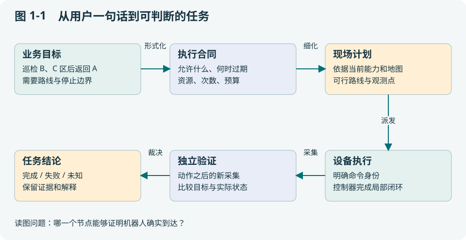

图中最容易被省掉的是“独立验证”。省掉之后，系统只能证明调用链跑通，不能证明用户目标成立。

<a id="part-04-h003"></a>

## 1.2 第一个错误设计：把一段提示词直接接到 cmd_vel

设模型每次输出速度，ROS 节点立即发布。它看起来简单：不用任务图、不用批准、不用数据库。问题出现在模型延迟、旧图像和重试三处。

一次模型请求卡住时，底盘是否继续保持上一次速度？一张两秒前的图像没有人，能否用于当前运动？HTTP 超时后自动再调用一次“前进一米”，是否变成前进两米？这些都不是更详细提示词就能保证消除的故障。模型无法决定网络中已经发生了什么，也不应承担高频控制器的定时职责。

因此我们把工作切开：模型输出较粗的意图和候选步骤；确定性执行层核对权限、状态和预算；设备控制器执行局部控制；观测与验证器判断效果。这里的“确定性”意味着相同受控输入按明确规则判决，不意味着传感器或物理世界没有随机性。

<a id="part-04-h004"></a>

## 1.3 三种“成功”分别证明什么

| 看到的结果 | 确实知道的事 | 仍不知道的事 |
| --- | --- | --- |
| HTTP 200 / 消息 ACK | 某层接受或返回了请求 | 控制器是否执行、目标是否完成 |
| 工具或 Action 返回成功 | 工具声明它完成了约定工作 | 声明是否对应本次命令、新观测是否支持它 |
| 后置条件验证通过 | 指定证据支持指定判据 | 判据是否覆盖了完整业务目标 |

例如导航终点正确，但相机一直拍到镜头盖，巡检仍未完成。再例如机器人完成巡视，最后的上报丢失，任务也不应该为了“补一个成功响应”重新巡视整条路线。第 3 章分析证据，第 8 章分析丢响应。

<a id="part-04-h005"></a>

## 1.4 状态、事实和建议为什么分开存

“任务正在执行”是业务状态；“位姿采集于 t、序号为 102”是观测事实；“也许左侧通道可行”是推断。三者的更新规则不同。任务状态由任务服务推进，位姿由传感器链产生，推断由模型或规则产生。

若都写进一段聊天历史，下一轮摘要可能把“也许可行”压缩成“可行”，把旧位姿当成当前位姿。更稳妥的设计是用结构化记录保留身份、时间和来源，模型只读投影。发生冲突时能够回到原记录，而不是请另一个模型猜哪个说法可靠。

当前项目对应的对象包括 `tasks/` 的任务与版本、Runtime journal 的命令记录、`core/worldmodel/` 的世界投影以及 `core/agentcontext/` 的模型输入。它们没有被统一成一个万能“记忆库”，因为权威来源不同。

<a id="part-04-h006"></a>

## 1.5 在风险与可用性之间作选择

对于只读状态查询，重试主要消耗时间与带宽；对于运动，重试可能改变世界。系统通常愿意用多一次查询换取信息，却不愿意用多一次运动验证上一条运动是否执行。这造成一种有意的取舍：在不确定时牺牲任务完成速度，保留可解释的停止状态。

这也有成本。如果每个短暂网络抖动都要求人工介入，系统会很难用。正确优化目标是**缩小必须人工核对的范围**：记录发送前检查点、命令身份和独立回执；对明确未产生效果的失败允许有界处理；对未知效果保持停止。它比“总是重试”复杂，也比“遇错全部停机”更有可用性。

<a id="part-04-h007"></a>

## 1.6 课堂推演：先给系统找反例

两人一组。一人设计巡检系统，另一人只允许提出三个事件：动作返回前网络断开、地图在动作中切换、同一任务被两台进程领取。画出每个事件后谁还有权动作、谁保存事实、用户看到什么。

合格答案应指出至少一个“无法判断，先冻结”的状态。如果所有分支都自然回到成功，通常不是系统特别可靠，而是设计遗漏了未知结果。下一章把这些问题落实到具体模块。

**本章可带走的方法**：先定义任务判据和失败模型，再画模块图。源码入口：[tasks/service.go](https://github.com/SUSTechWLA/tangying-robot-agent-os/blob/63af99305fd8204c0a54d86145cb94d89b754326/tasks/service.go)、`core/closedloop/`、`edge/runtime/`。

<a id="part-04-h008"></a>

## 1.7 分层习题

基础题 B：举例说明命令被接收、控制结束和任务完成的差别。

工程题 E：给配送机器人划分云端、边缘、控制器责任，并指出失联时的权威来源。

研究题 R：设计一项实验判断模型延迟是否影响任务层性能；解释为何它不能单独证明控制安全。

作答应写明假设、判据与证据。评价要点见[附录 I](#part-31)，实践路线见[附录 F](#part-28)。


---

<a id="part-05"></a>

# 第 2 章 一张架构图背后的责任与取舍

本章要解决一个实际设计问题：云端、边缘模型、任务执行器和 ROS 控制器都能“做决定”，为什么它们不会争抢同一台机器人？读完后应能画出部署图、调用图和权威数据表，而不把三者混为一张框图。

<a id="part-05-h002"></a>

## 2.1 先按责任拆，再按机器部署

贯穿任务仍是 A→B→C→A 巡检。云端适合决定巡检哪栋楼、分配哪台设备及批准范围；边缘适合根据本机能力和现场观测组织下一步；控制器适合在本体约束下连续跟踪轨迹。分层理由是**信息位置、延迟要求和失效后果不同**。

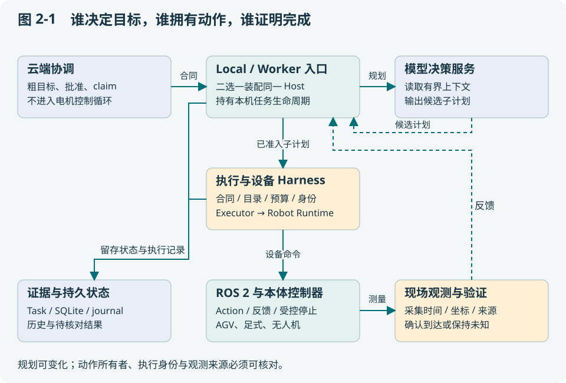

从中间列往下读是动作路径，从右下返回上层是反馈路径，左下保存可回放事实。模型服务可在云端或本地，但只改变推理发生的位置，不改变 Host、任务库或机器人执行权的归属。画图时若把“远端模型”直接画成“云端任务负责人”，就混淆了部署和权威。

<a id="part-05-h003"></a>

## 2.2 Local Agent、Worker 与 Host 的关系

项目有两种入口。[cmd/local-agent/main.go](https://github.com/SUSTechWLA/tangying-robot-agent-os/blob/63af99305fd8204c0a54d86145cb94d89b754326/cmd/local-agent/main.go) 装配本地 Console、任务服务、持久库、模型与 Runtime 客户端；[cmd/edge-worker/main.go](https://github.com/SUSTechWLA/tangying-robot-agent-os/blob/63af99305fd8204c0a54d86145cb94d89b754326/cmd/edge-worker/main.go) 装配云端任务领取、续租、边缘执行与回执。它们复用 [internal/edgeagent/host.go](https://github.com/SUSTechWLA/tangying-robot-agent-os/blob/63af99305fd8204c0a54d86145cb94d89b754326/internal/edgeagent/host.go) 的目标生命周期。

**Host 是共享业务核心，Local 和 Worker 是不同运行入口。** Local 自己接受操作者任务；Worker 接受云端批准并领取的任务。不要为了复用而同时启动两种入口控制同一 Runtime，那会制造两个生命周期所有者。若需要切换，应按运行合同和未决命令检查完成移交。

有一个容易误解的细节：已有 UI 的 `/v1/tasks` 主要走冻结能力计划路径；`/v1/objectives` 才是带授权包络的粗目标委托入口。增加机器人选择器并没有把所有 UI 任务自动改成粗目标接口。读者应沿入口核对真实路径，不能只凭“有 Agent”推断执行方式。

<a id="part-05-h004"></a>

## 2.3 不同数据由谁说了算

| 数据 | 权威拥有者 | 其他模块能做什么 |
| --- | --- | --- |
| 原始目标、批准版本 | Task 与不可变 Revision / 目标合同 | 提议修改；不能悄悄覆盖已批准内容 |
| 子计划与剩余预算 | Host 持久状态 | 模型提出候选；Host 决定是否接受 |
| 命令可能已经产生效果 | Runtime journal、执行记录 | 结合精确回执对账；不能从聊天摘要推断 |
| 世界观测 | 具备来源与采集身份的观测链 | 建索引和投影；不得凭接收时间刷新旧采集 |
| 页面当前设备 | 浏览器 URL 与已验证注册项 | 选择读写路径；不迁移 Host 或任务 |

表的用途是在评审时发现双写：若两个模块都能独立宣布同一事实，必须说明冲突规则。仅在两个对象中都放一个 `status` 字段并不会获得一致性。

<a id="part-05-h005"></a>

## 2.4 一次任务经过哪些持久边界

用教学编号 `task-P` 表示巡检目标。入口保存原请求和批准依据；Host 读取合同，生成子计划 `task-P-edge-r1-p1`；执行器给步骤绑定 commandId；Runtime 在设备调用周围留下 journal；验证结果进入子账本；Host 再推进父进度。模型 trace、任务事件和观测索引用这些身份关联。

为什么不只存一张最终 Task 表？因为执行中断后，“父步骤未完成”可能有两种原因：设备没动，或者设备已动且子验证成功、父进度还没来得及写入。这两种恢复动作相反。保留分层记录才能识别窗口，代价是对账逻辑和存储结构更复杂。

这也是事件、状态快照和检查点并存的理由：事件解释怎样走到这里，快照支持当前读取，检查点支持规定位置恢复。它们必须有版本关联；并非任意事件日志都可以自动重建所有物理事实。

<a id="part-05-h006"></a>

## 2.5 三种可选架构，为什么选分层自治

| 方案 | 好处 | 主要代价 | 适用情况 |
| --- | --- | --- | --- |
| 云端直接编排每个工具 | 全局容易观察，端侧逻辑少 | 每步依赖链路；云端承受本体细节 | 网络稳定、流程固定的早期系统 |
| 云端给合同、边缘细化 | 现场决策更及时；本体封装可复用 | 两级状态、预算和完成语义必须对齐 | 本项目目标架构 |
| 各边缘完全自治、对等协商 | 中心失效影响小 | 全局资源、冲突和任务完整性难证明 | 能明确建模协商协议的研究系统 |

当前实现选择第二种，同时保留独立 Local 入口。注意，分层自治不等于任何断网下都可继续：Worker 受云 claim 约束，失效后停止继续派发；Local 本地任务则不依赖云 claim。若未来要离线执行，必须增加明确的离线授权范围和重连对账协议，不能靠缓存旧任务实现。

<a id="part-05-h007"></a>

## 2.6 怎么从图找到实际代码

先在组合根搜索 `edgeagent.New`、Host 或对应装配，再读 `internal/edgeagent/host.go` 的校验和循环，随后读 `journal.go` 的持久提交。[console/objective.go](https://github.com/SUSTechWLA/tangying-robot-agent-os/blob/63af99305fd8204c0a54d86145cb94d89b754326/console/objective.go) 与 [fleet/objective.go](https://github.com/SUSTechWLA/tangying-robot-agent-os/blob/63af99305fd8204c0a54d86145cb94d89b754326/fleet/objective.go) 展示不同入口如何生成目标；[core/objective/contract.go](https://github.com/SUSTechWLA/tangying-robot-agent-os/blob/63af99305fd8204c0a54d86145cb94d89b754326/core/objective/contract.go) 定义共同约束。

课堂上可要求学生交一张“箭头清单”：每条箭头写消息对象、谁生成身份、是否持久、失败后谁负责。比如“模型→Host”传的是候选计划，尚不授予动作；“Runtime→验证层”传的是结果与观测，不自动等于父目标成功。这比背包名更接近架构设计能力。

**本章检查点**：能否不看图解释 Local、Worker、Host、模型服务四者的关系？若能，后续新增一个边缘部署入口时就知道哪些核心逻辑应复用。

<a id="part-05-h008"></a>

## 2.7 分层习题

基础题 B：描述TaskRevision、WorldSnapshot和Runtime journal分别保存什么。

工程题 E：为一个“已执行但完成响应丢失”的故障标出受影响的层及恢复入口。

研究题 R：比较单机自治和集中机群方案，提出至少两个可测量的架构选择指标。

作答应写明假设、判据与证据。评价要点见[附录 I](#part-31)，实践路线见[附录 F](#part-28)。


---

<a id="part-06"></a>

# 第 3 章 一次动作怎样获得可信的完成结论

本章用一次“导航到 B”拆解闭环。你将学会设计前置条件、后置条件和证据基线，判断工具成功与任务成功之间还差什么。

<a id="part-06-h002"></a>

## 3.1 先写判据，再写执行函数

教学设定：B 的目标位置为 (4, 2)，允许的位置误差为 0.2 米，最后位姿必须来自命令之后的有效采集。这里数值仅为计算示例，项目实际阈值由技能与设备配置决定。最小到达判据可写为：

```text
位置误差 = sqrt((x - 4)^2 + (y - 2)^2)
到达 = 同一机器人 ∧ 同一地图依据 ∧ 新鲜采集
       ∧ 采集晚于本次动作基线 ∧ 位置误差 ≤ 0.2
```

如果机器人还要面对货架拍照，就应再加朝向或视域条件；如果是无人机，需要保留 z 和姿态。判据描述“业务需要的状态”，不能由某个工具恰好返回哪些字段反向决定。


看图时留意第 4 和第 6 条消息：工具结果会触发下一步观察，但最终记录完成仍需要验证。控制器内部已经有到达判据，并不意味着上层可以忽略任务身份和证据来源；两层回答不同问题。

<a id="part-06-h003"></a>

## 3.2 两张同样清晰的图片，为什么只有一张有效

假设命令开始前保存 `source=camera-A, sequence=81`。动作后收到两次响应，画面看起来都在 B：第一张仍是 sequence=81，只是网络接收时间更新；第二张是 sequence=83，采集时间晚于命令，并绑定当前地图。

第一张不能证明本次动作完成。它可能来自机器人上一次到 B 的历史缓存。第二张也不是自动有效，还要核对内容、frame、来源和该技能的后置条件。清晰度、文件 SHA 正确和业务真实性分别是三个层次：SHA 证明所读字节一致，不证明采集发生在指定时刻。

当前实现的闭环机制可从 `core/closedloop/` 阅读；具体物体放置裁决还涉及 [core/harness/evaluator.go](https://github.com/SUSTechWLA/tangying-robot-agent-os/blob/63af99305fd8204c0a54d86145cb94d89b754326/core/harness/evaluator.go)。不要把一个放置 evaluator 当成所有异构机器人的通用物理验证器。

<a id="part-06-h004"></a>

## 3.3 “不知道”应该是可保存的结果

考虑工具调用超时。可能是请求未到设备，也可能是设备已经完成、响应丢失。若执行器没有更多证据，就必须留下 unknown。这个状态的价值在于明确限制后续行为：不能按“失败等于没动”重新执行，也不能按“可能成功”推进依赖它的步骤。

| 结果类别 | 推理依据 | 允许的下一步 |
| --- | --- | --- |
| 只读失败 | 无物理副作用，来源可核对 | 在权限和预算内有界重读 |
| 明确拒绝且未产生效果 | 设备/执行层有该语义的证据 | 可评估重规划或更正参数 |
| 已确认完成 | 精确绑定的动作后证据 | 记账并推进依赖步骤 |
| 写效果未知 | 派发边界或完成证据不确定 | 停止后续写，调查和对账 |

这张表把“重试策略”变成证据驱动的决定，而不是按 HTTP 状态码统一重试。

<a id="part-06-h005"></a>

## 3.4 Gate 的顺序为什么会影响行为

一个合理的裁决顺序是先核对身份与版本，再核对采集来源和时间，最后计算业务误差。若顺序倒过来，旧地图中看似很小的误差可能提前让系统接受错误动作。

项目的 Runner、Provider 和技能判据共同完成检查。不同路径的验证强度必须沿装配确认：例如语义目标存在，只能证明地图里登记过该地点；不能据此证明机器人已经到达。当前目标合同的 completion read 对返回值作显式检查，但这些读取背后的 Provider 必须真的产生可信观测。

<a id="part-06-h006"></a>

## 3.5 算一遍误差，再找一个反例

观测一为 (4.1, 2.1)，误差约 0.141 米；观测二为 (4.3, 2.0)，误差 0.3 米。在其他条件相同且有效时，前者满足示例阈值，后者不满足。

现在把观测一的地图 revision 从 7 改成 6。误差仍为 0.141，但证据失效。这个练习说明：几何计算正确只是验证链的一部分。再把两次“独立样本”改成同一个 sequence 重复发送，即使数量达到门槛也不能支持稳定性结论。

<a id="part-06-h007"></a>

## 3.6 为什么需要严格的失败样本

验证器应至少测试旧采集、错机器人、错命令、错地图、重复样本、单位不符和真实未到达。若只用成功截图测验证器，它很容易变成“输入任何成功字段就返回通过”的包装器。

2026-10-20 工作台修复提供了一个小而重要的例子：数据库 Task 为 SUCCEEDED，但工具历史为空时，页面现在报告 `SUCCESS_WITHOUT_EXECUTION_HISTORY`。UI 不修改 Task 的结果，却不再把它显示成证据完整。这体现了展示层也要区分状态与依据。

**源码练习**：阅读 [web/task_trace.js](https://github.com/SUSTechWLA/tangying-robot-agent-os/blob/63af99305fd8204c0a54d86145cb94d89b754326/web/task_trace.js) 的 `analyseAlignment` 与 `core/closedloop/` 的验证入口，列出它们分别能够证明什么。前者检查已存记录的一致性，后者参与执行闭环；两者不能互相替代。

<a id="part-06-h008"></a>

## 3.7 分层习题

基础题 B：为什么“没有看到杯子”不等于“杯子不在盘里”？

工程题 E：为导航设计带时间、身份和误差门槛的后置条件及五个反例。

研究题 R：研究验证器同源偏差：改变一个证据来源后，如何检验完成判据是否仍有效？

作答应写明假设、判据与证据。评价要点见[附录 I](#part-31)，实践路线见[附录 F](#part-28)。


---

<a id="part-07"></a>

# 第 4 章 从传感器到地图、语义与可行动的世界

本章的重点是信息加工，而不是罗列 SLAM 算法。读完应能追踪一个点如何进入地图、解释为什么点云不能直接等同于可通行空间，并为跨机器人数据选择正确的坐标和版本依据。

<a id="part-07-h002"></a>

## 4.1 一帧点云到底告诉了我们什么

AGV 在 A 看见货架表面的一组点。每个点首先属于传感器坐标系，不属于天然共享的“世界”。需要传感器外参、采集时刻的机器人位姿和地图依据，才能把点放到地图里。若拿当前位姿去变换两秒前的点，行驶中的机器人就可能把静态货架画成移动障碍。

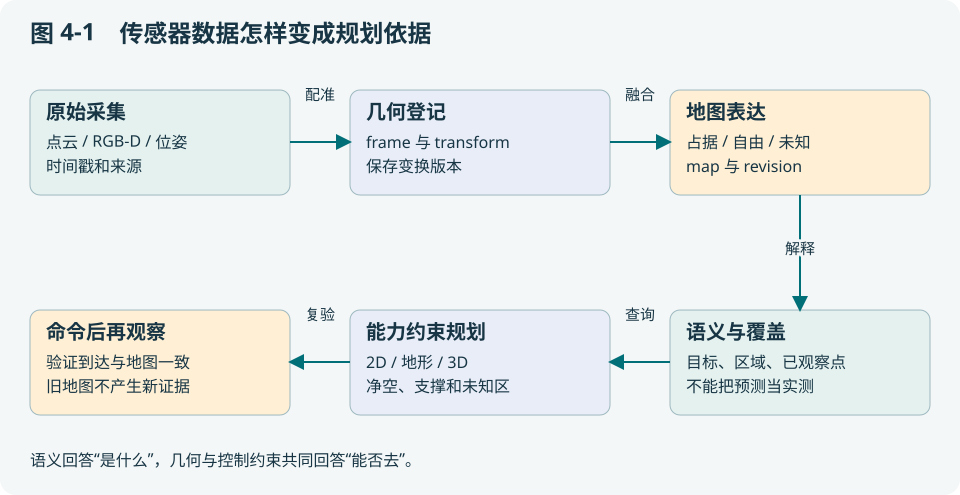

图中每次加工都应留下输入身份。输出越抽象，越容易隐藏误差来源，所以语义对象至少需要能回溯到几何和观测。给点云标注“门”，不能顺带证明门是开着的或机器人能穿过它。

<a id="part-07-h003"></a>

## 4.2 用一个数值例子理解坐标变换

记 `T_AB` 为把 B 系坐标变到 A 系的变换，齐次列向量满足 `p_A = T_AB p_B`。假设传感器里一点为 (1, 0)，传感器相对地图旋转 90°，再平移 (2, 1)。旋转后是 (0, 1)，平移后是 (2, 2)。若先平移再旋转，结果为 (-1, 3)，完全不同。

因此系统要保存变换方向、单位、采集时间和 revision。两个机器人都把坐标系叫 `map`，不代表两个原点或朝向相同。跨机交换时不能直接把 A 的 (2,2) 写入 B 的局部地图；需要登记并验证跨域变换，或者拒绝合并。

<a id="part-07-h004"></a>

## 4.3 点云、占据图和语义图各回答一个问题

| 表达 | 回答的问题 | 单独使用的缺口 |
| --- | --- | --- |
| 表面点云 | 哪些位置测到了返回点？ | 没有点的地方可能只是没看见 |
| free / occupied / unknown 地图 | 哪些体素有空闲、障碍或未知证据？ | 不说明对象用途与业务意义 |
| 地形/支撑表达 | 地面高度、支撑与坡度是否允许通过？ | 不提供足式步态或完整动力学 |
| 语义地点/对象 | B 区、门、货架分别对应什么？ | 语义标签可能错误或过时 |

当前 `spatial_mapping.py` 从有来源的测量与射线信息构造空间证据；`semantic_cloud.py`、相关语义服务提供几何到任务目标的解释入口；`spatial_navigation.py` 读取空间依据规划。它们不是一个“理解地图”的黑盒模型。

<a id="part-07-h005"></a>

## 4.4 为什么未知空间不应该自动当成空地

相机看见货架前表面，货架后方没有点。如果将所有“没有点”的体素设为空闲，规划器就可能穿过货架内部或尚未扫描的墙后区域。射线从光心到有效返回点之前的区段，才提供一定条件下的空闲证据；返回点之后保持未知。

保守处理 unknown 会降低初始可达范围，这正是探索模块的任务：选择能安全到达、又有望增加观测的点，而不是让导航器假设未知区一定可走。探索追求信息增益，导航保证局部可行，两者协作但职责分开。

<a id="part-07-h006"></a>

## 4.5 同一张三维地图，三种可行域

地面 AGV 的路线需要支撑、净空和底盘约束；足式机器人可以允许部分高度变化，但仍需支撑与本体控制器确认；无人机在三维体积中运动，必须检查整段轨迹的净空，而非只检查端点。

当前模式包括 planar2d、terrain25d、volume3d，并通过后续空间能力处理多层支撑等问题。阅读时应按地图合同与具体测试区分单层高度表达、多层几何和真正的本体运动能力。允许台阶高度的几何参数并不会自动生成稳定步态，三维折线也不是可直接交给所有飞控的轨迹。

`spatial_localization.py` 将定位依据与路径、到达验证关联。即使路径创建时有效，执行中地图或定位依据变化也需要重新判断，不能把路径文件当成永久通行证。

<a id="part-07-h007"></a>

## 4.6 覆盖、探索与跨机建议的区别

已知地图覆盖先定义应检查的目标集合，例如货架面的采样区域；未知环境探索则不断发现新可观察区域，分母可能随建图变化。比较两种系统时如果不固定分母，“覆盖率 90%”可能没有共同含义。

项目的 `spatial_exploration.py`、`spatial_mission.py` 与覆盖账本把目标、预测与已观察证据分开。来自另一台机器人的 coverage report 进入 [edge/exchange/coverage.go](https://github.com/SUSTechWLA/tangying-robot-agent-os/blob/63af99305fd8204c0a54d86145cb94d89b754326/edge/exchange/coverage.go) 时还要核对 mission、geometry、空间 Basis、TTL 和来源。输出明确为 advisory，不能凭远端一句“看过了”自动判本机任务完成。

**课堂练习**：画一堵只扫描了正面的墙，分别标注 occupied、free、unknown，再为 AGV 和 UAV 画允许路径。解释你额外假设了哪些传感器覆盖、本体尺寸和控制能力。源码阅读顺序：`spatial_mapping.py` → `spatial_navigation.py` → `spatial_localization.py`。

<a id="part-07-h008"></a>

## 4.7 分层习题

基础题 B：区别原始点云、语义实体和地图地点。

工程题 E：给两个局部odom机器人设计共同world转换和版本更新流程。

研究题 R：设计来源冲突实验，分别评测实体关联正确性、过期拒绝和错误目标停止率。

作答应写明假设、判据与证据。评价要点见[附录 I](#part-31)，实践路线见[附录 F](#part-28)。


---

<a id="part-08"></a>

# 第 5 章 Harness：把模型建议约束成设备调用

读完本章应能设计一项新能力的契约，解释“支持、可用、允许、已完成”四种不同状态，并找到项目里负责每层检查的实现。Harness 在这里指包围决策和执行的约束、记录与验证机制，并非一个万能类名。

<a id="part-08-h002"></a>

## 5.1 为什么不能只写一个 navigate(x, y)

普通函数签名表达不了设备属于谁、参数使用什么坐标、调用会产生何种效果、失败后是否能重试、怎样验证完成。对于机器人，这些内容决定函数能不能被安全地组合。

能力目录因此除了名称和参数 schema，还需要效果、资源、可用状态以及验证语义。模型据目录提出计划，执行层仍要按当前冻结目录重新验证。模型看见一项能力，只说明它可以讨论该能力，不说明当前已获得执行权。

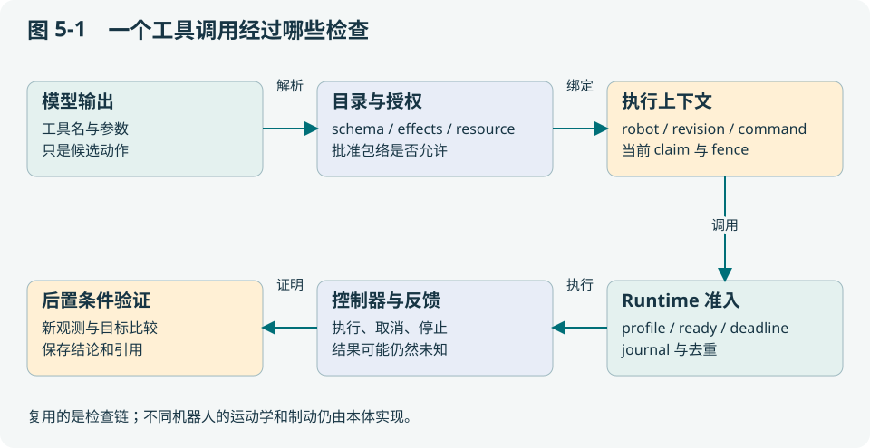

<a id="part-08-h003"></a>

## 5.2 一个调用需要通过两种参数检查

设目录允许某导航参数在较大场地范围内取值，而当前目标只授权进入 B/C 区。即便参数符合工具 schema，也可能超出本次目标范围。当前 [core/objective/contract.go](https://github.com/SUSTechWLA/tangying-robot-agent-os/blob/63af99305fd8204c0a54d86145cb94d89b754326/core/objective/contract.go) 的 Authorize 先检查 grant 参数域，再检查能力输入 schema，并校验效果与资源。

这相当于求两个集合的交集：**设备能做的 ∩ 本次允许做的**。前者变化要更新能力目录，后者变化要更新目标授权。把两者都写在提示词里，无法在模型输出之后给出独立拒绝。

```text
候选 navigate(B)
  ├─ 工具目录：参数类型、单位、效果、资源
  ├─ 目标 grant：B 在允许地点集合内吗？
  ├─ 运行依据：目录 revision、robotId、deadline 是否仍一致？
  └─ 物理准入：定位、地图、控制器、停止链是否满足条件？
```

这是说明检查顺序的伪代码，不是公开接口请求体。

<a id="part-08-h004"></a>

## 5.3 四种状态决定不同用户提示

| 状态 | 示例 | 系统如何回应 |
| --- | --- | --- |
| 不支持 | 无人机没有地面夹爪能力 | 不把工具放入该设备可用目录 |
| 支持但当前不可用 | 定位未准备好 | 显示原因，不能靠批准消除 |
| 当前可用但未授权 | 用户只批准读取，模型要求运动 | 拒绝该候选，保留拒绝原因 |
| 已执行且验证通过 | 同命令的新观测满足判据 | 记录证据后推进任务 |

“重试更多次”只适用于部分临时失败，不能将前三种状态统统变成成功。良好 UI 应把不可用原因展示给用户，而不是只显示一个统一红灯。

<a id="part-08-h005"></a>

## 5.4 Runtime 与 ROS 2 Profile 如何实现复用

Go 侧使用 [proto/robot/v1/robot.proto](https://github.com/SUSTechWLA/tangying-robot-agent-os/blob/63af99305fd8204c0a54d86145cb94d89b754326/proto/robot/v1/robot.proto) 定义的 Runtime 接口；Python gateway 通过 Backend、Provider 与 ROS 2 Profile 将工具映射到设备。[robot/ros2_ws/src/tangying_robot_msgs/action/ProfiledExecute.action](https://github.com/SUSTechWLA/tangying-robot-agent-os/blob/63af99305fd8204c0a54d86145cb94d89b754326/robot/ros2_ws/src/tangying_robot_msgs/action/ProfiledExecute.action) 与 [robot/gateway/tangying_robot_gateway/ros2_profile.py](https://github.com/SUSTechWLA/tangying-robot-agent-os/blob/63af99305fd8204c0a54d86145cb94d89b754326/robot/gateway/tangying_robot_gateway/ros2_profile.py) 是接入阅读入口。

Profile 负责明确本体身份、能力、话题/Action 和观测约定；控制器负责实际运动和反馈。AGV、足式和 UAV 可以复用命令身份、任务预算、证据和错误分类，同时保留不同坐标、到达标准与停止方式。没有厂商控制接口时，通用 Profile 不会自动获得 DJI 接管或 Unitree 步态能力。

取舍是：统一协议减少上层分叉，但适配成本不会消失，只会集中到可测试的设备边界。过度统一会抹平飞行与地面的关键差异；过度定制则让每个任务都依赖设备品牌。

<a id="part-08-h006"></a>

## 5.5 长操作为什么需要 operation，而不仅是超时更长

建图、标定或探索可能远长于一次普通 RPC。若连接一直挂着，断线时无法区分仍在运行和已经结束。操作句柄与查询接口让执行身份与 HTTP 连接寿命分离，取消、进度和最终结果各有明确含义。

但“取消请求已接受”仍不证明设备停止，取消之后必须观察停止或约定的安全保持。重复查询是只读；重新开始一次建图是新的副作用，两者不能用同一个自动重试规则处理。

<a id="part-08-h007"></a>

## 5.6 实际开发：给系统增加 inspect_shelf

先写能力说明：输入货架身份和观测范围，效果是 READ 还是包含运动，使用什么资源，输出原观测引用与覆盖判据。然后设计两个反例：到位但镜头被挡住、图像属于上一轮任务。若验证器无法拒绝它们，先补观测链，再接模型。

接着选择 Provider 实现，注册目录，冻结参数域，接入执行器和相应验证。测试覆盖正常、不可用、超出 grant、超时未知与重复命令。最后才让模型尝试使用它。项目中的 `internal/capabilityagent/` 和 `core/capability/` 展示计划与执行契约；它们并没有自动实现这个教学能力。

**设计要点**：工具接口的价值不在工具数量，而在能否把不同能力组合后仍保留权限、身份、效果和完成语义。

<a id="part-08-h008"></a>

## 5.7 分层习题

基础题 B：解释工具已注册、available与已批准的区别。

工程题 E：为“生成地图并启用”写输入、效果、资源、操作和验证合同。

研究题 R：如何比较两个抓取Provider？提出任务控制变量、完成判据和未知结果的计量方式。

作答应写明假设、判据与证据。评价要点见[附录 I](#part-31)，实践路线见[附录 F](#part-28)。


---

<a id="part-09"></a>

# 第 6 章 多 Agent 协作：分工、消息与执行权

本章用一个只读失败解释多 Agent 的实际价值。读完应能设计角色权限和消息边界，避免把多个聊天窗口误当成可靠协作系统。

<a id="part-09-h002"></a>

## 6.1 为什么要拆 Task、Ops 与 Recovery

巡检到 B 后，下一次状态查询失败。Task 角色最关心如何推进目标，容易倾向“再试一次”；Ops 角色调查故障位置；Recovery 角色提出恢复方案；确定性执行与验证层决定方案是否允许执行。这是责任分离，而不是为了增加模型数量。

当前项目的 Ops / Recovery 主要是确定性角色，部分路径使用本地 Agent runtime，目标 Host 另有 supervision 接线。读源码时必须区分这些路径，不能把系统里存在的所有角色都画成同时运行的三个独立大模型。

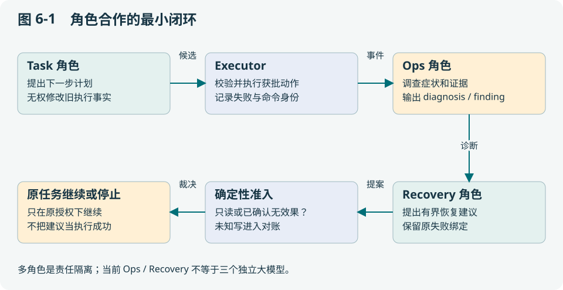

<a id="part-09-h003"></a>

## 6.2 消息体要回答“谁在说哪件事”

消息至少需要发送身份、主题、任务或作用域、事件身份、发生时间及可回查的依据。只有文本“导航失败，请恢复”是不够的：失败属于哪一代计划、哪条命令、哪个异常？恢复建议究竟要改变什么？

本地 `agent.event.v1` 的角色事件与跨设备 `agent.data.v1` 的数据通道用途不同。前者在 `core/agentcontract/`、`agentruntime/` 中组织发布订阅权限与审计；后者通过 `edge/exchange/` 的持久 inbox/outbox 处理跨进程传输。既有业务协议应该携带结构化依据，不要求 Agent 互发整段聊天记录。

<a id="part-09-h004"></a>

## 6.3 一次只读恢复如何走完

教学轨迹如下：Task 的 navigation.status 返回 UNAVAILABLE；原任务事件留下失败 command；Ops 判断该工具为只读并关联原异常；Recovery 提出一次受限的历史调查/重读；执行层重新核对原 revision、权限和失败 binding；结果通过复验后才允许任务继续。

如果 Ops 只凭错误字符串断言“没有移动”，这个结论还不够。只有工具语义和派发记录支持“只读”或“确定没有效果”，恢复才可以进入相应路径。第 19 章会给出项目实际保留的只读故障因果链。

<a id="part-09-h005"></a>

## 6.4 恢复 binding 防止解决错问题

设任务 P 的命令 c1 失败，之后 c2 成功。若恢复判据只看工具名相同，就可能用 c2 的成功清除 c1 的未知状态。正确做法是把建议和验证绑定到原 task、revision、step、command、异常与计划版本；旧绑定不匹配时应拒绝。

`internal/recoveryexec/` 与 `internal/autorecovery/` 可用来学习这一机制。目标 Host 的 [internal/edgeagent/recovery.go](https://github.com/SUSTechWLA/tangying-robot-agent-os/blob/63af99305fd8204c0a54d86145cb94d89b754326/internal/edgeagent/recovery.go) 又处理另一类窗口：子动作和验证已经完成，但父检查点没更新。两类恢复共享“精确证据”原则，具体持久对象不能混用。

<a id="part-09-h006"></a>

## 6.5 为什么事件总线不能成为唯一事实库

内存事件通道延迟低、组合方便，但进程重启或消费者落后可能丢失消息。有界缓冲保护内存，代价是需要丢弃指标和恢复读取。若仅凭“没收到完成事件”推断动作没发生，就把传输缺失误当成世界事实。

项目将任务与执行账本作为持久来源，实时事件帮助更新 UI 和触发调查。Host 子事件向父任务提供 advisory 进度，但子账本才是恢复原执行结果的重要来源。设计新角色时应先决定它能读取哪个权威存储，再决定订阅什么事件。

<a id="part-09-h007"></a>

## 6.6 多角色何时值得，何时徒增成本

单一顺序、没有恢复分支的小任务，确定性状态机可能更清楚。多角色适合职责需要独立审查、故障调查需要不同工具或长任务需要持续诊断的场景。成本包括额外延迟、消息关联、权限配置和更多需要测试的失效窗口。

一个有用的消融是保持模型、任务和设备相同，只去掉 Ops 的结构化诊断，观察恢复准确性、人工介入率和无效重试。不能把“单模型小预算”与“三模型大预算”直接比较后声称角色分工有效；第 12 章讨论如何分离变量。

**课堂交付**：写出 Task、Ops、Recovery 各自允许读取、发布和执行的对象，并找出一种任意角色都不能单独解除的 unknown。源码入口：`agentruntime/`、[internal/edgeagent/supervision.go](https://github.com/SUSTechWLA/tangying-robot-agent-os/blob/63af99305fd8204c0a54d86145cb94d89b754326/internal/edgeagent/supervision.go)、`internal/recoveryexec/`。

<a id="part-09-h008"></a>

## 6.7 分层习题

基础题 B：说明三个Agent不等于三个独立模型。

工程题 E：设计一次跨revision消息串线的反例，指出必须拒绝的字段组合。

研究题 R：关闭Ops与Recovery分别影响哪些指标？提出配对故障矩阵，不只比较最终成功率。

作答应写明假设、判据与证据。评价要点见[附录 I](#part-31)，实践路线见[附录 F](#part-28)。


---

<a id="part-10"></a>

# 第 7 章 从自然语言目标到有界子计划

本章解释边缘自主性具体发生在哪里。读完应能区分冻结计划和目标委托，手算任务预算，并说明重新规划为何不能重做已经确认的动作。

<a id="part-10-h002"></a>

## 7.1 冻结整张计划，还是批准一个目标范围

A→B→C→A 巡检可以预先生成完整工具列表，批准后逐步执行。优点是操作员能检查每一步；缺点是遇到 B→C 通道堵塞时，原计划无法直接表达新的现场决定。另一种方式是批准目标、工具范围、参数域和预算，让边缘在范围内生成下一代子计划。

项目同时保留这两条路：`/v1/tasks` 对应既有冻结能力计划；`/v1/objectives` 创建 `robot.objective.v1` 合同，形成未批准的 `edge.goal` 父任务，再交给 Host。它们共享部分基础设施，但批准对象和恢复粒度不同。

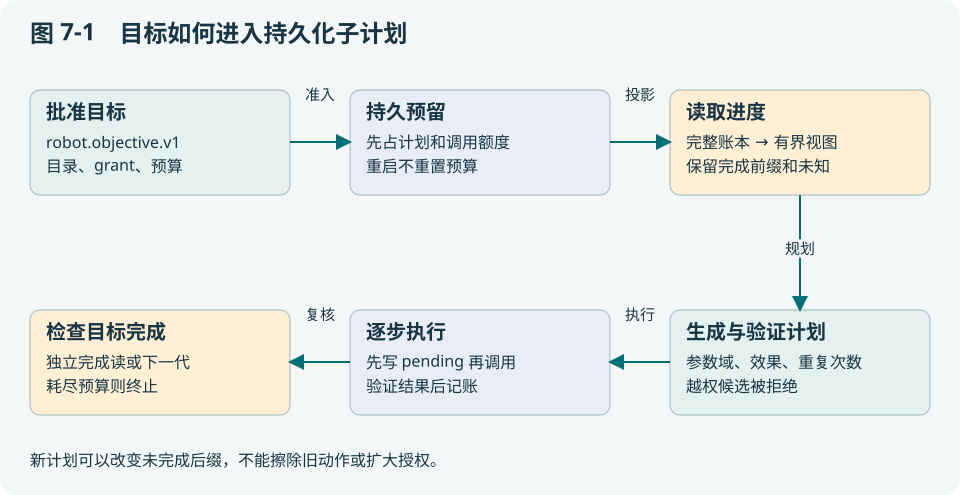

<a id="part-10-h003"></a>

## 7.2 “粗目标”也必须足够精确

目标可以粗到“完成 B/C 巡检”，执行授权不能粗到“想做什么就做什么”。当前 [core/objective/contract.go](https://github.com/SUSTechWLA/tangying-robot-agent-os/blob/63af99305fd8204c0a54d86145cb94d89b754326/core/objective/contract.go) 包括 robotId、goal、catalogRevision、grants、effects、resources、completion、budget 和 expiresAt。

| 字段组 | 为什么存在 | 漏掉后会发生什么 |
| --- | --- | --- |
| robotId / catalogRevision | 固定本体与能力语义 | 同名工具可能被换成另一设备或新语义 |
| grants / effects / resources | 限制工具、参数和副作用 | 模型为达到目标可能扩大动作范围 |
| completion | 给出明确的完成检查 | “模型觉得完成”替代业务判据 |
| budget / expiresAt | 限制次数和有效期 | 反复重规划或持旧授权无限执行 |

当前 v1 的资源只委托绑定的 `robot`，不是任意共享物体或空域的通用资源系统。扩大自主性时应显式升级合同，而不是暗中解释出新的资源权。

<a id="part-10-h004"></a>

## 7.3 用代码中的四个预算单位算一遍

当前合同 Budget 的实际字段为：

```go
type Budget struct {
    MaxPlans       int `json:"maxPlans"`
    MaxSteps       int `json:"maxSteps"`
    MaxReads       int `json:"maxReads"`
    TimeoutSeconds int `json:"timeoutSeconds"`
}
```

这是 `core/objective/contract.go` 的字段摘录。教学设定给 3 代计划、10 次子能力、20 次 Host 业务读和 600 秒。第一次计划使用 4 个子能力；第二次尝试准备再调用 7 个，则不能因“还有 2 代计划”而越过总 10 次额度。一个复合 `robot.task` 内可能有多次物理动作，MaxSteps 计量的是该层能力调用，不等于底层电机命令数。

Host 在工作前持久预留预算。否则进程可以在调用后、计数前崩溃，重启又获得同一份额度。计划数、业务读和超时各保护一种资源；内部控制查询也有自己的约束，不能简单把全部网络包都算成 MaxReads。

任务版本也有两种用途。TaskRevision 固定需要批准的业务定义；aggregate version 随状态和事件提交递增，用于 CAS 检测并发覆盖。例如业务仍是 revision 1，规划、批准、开始执行可使聚合版本多次变化。重试不能把两者混用，否则会把“状态更新”误当成“用户批准了新目标”。

<a id="part-10-h005"></a>

## 7.4 已完成前缀与未完成后缀

假设已经完成 A→B 和 B 区观测，B→C 被明确拒绝且没有产生效果。新计划可选择许可范围内的绕行，但应保留前两个已确认结果。若把任务重新交给模型而只告诉它“原计划失败了”，模型可能再次巡视 B，甚至耗尽重复动作额度。

Host 保留完整 completed 记录，将精确进度投影给规划器；每代子计划有独立身份和摘要，不能重用旧键覆盖历史。授权的 `maxExecutions` 表达业务确实需要重复的次数，默认不能无限重复。相同工具名不代表同一效果，相同参数的重复也不能靠生成新 commandId 绕过次数限制。

<a id="part-10-h006"></a>

## 7.5 规划失败应留存什么

模型遗漏 C 区、生成越权工具或提出目录不存在的参数，都属于规划层可解释失败，不应降格为“随便执行一个合法前缀”。项目保留 planning attempt 与模型 trace，让开发者区分没生成计划、计划被拒绝和已经执行失败。

目标覆盖检查与工具参数检查是互补的：每个调用都合法，仍可能漏掉返回 A 的要求。当前合同与完成检查只能验证已经形式化的部分，并没有证明任意自然语言目标的语义完整性。开发者仍须把“必须检查 C 并返回 A”绑定到可核验的目标与证据，不能仅靠 Planner 给出的解释。教学上可给学生两张都符合 schema 的计划，一张漏查 C，一张重复去 B，让他们分别指出覆盖和次数约束的拒绝层。

<a id="part-10-h007"></a>

## 7.6 模型能否修改自己的失败

它可以提出新计划，但不能改原 journal、批准版本或 unknown 分类。[internal/edgeagent/host.go](https://github.com/SUSTechWLA/tangying-robot-agent-os/blob/63af99305fd8204c0a54d86145cb94d89b754326/internal/edgeagent/host.go)、`journal.go`、`recovery.go` 展示这种边界：规划、持久提交、调用、验证分开；新计划接受前重新检查当前权威。

这种设计比纯 ReAct 循环更繁琐，收益是停止、重启与审计有明确对象。代价是合同设计不良时会过早拒绝合理行为；应通过扩大明确 grant 或改进模型可见的原因解决，而不是放松所有检查。

**本章交付**：给巡检任务写出一个目标字段表和两代候选计划，逐项算预算。参考 [internal/capabilityagent/planner.go](https://github.com/SUSTechWLA/tangying-robot-agent-os/blob/63af99305fd8204c0a54d86145cb94d89b754326/internal/capabilityagent/planner.go)，标注模型建议在哪一步变成持久的可执行计划。

<a id="part-10-h008"></a>

## 7.7 分层习题

基础题 B：区别TaskRevision和aggregate版本。

工程题 E：为条件巡检目标画状态读取、提案、批准和拒绝路径。

研究题 R：提出一个评测“完整目标覆盖”的方法，处理创建拒绝、未批准与执行失败三类分母。

作答应写明假设、判据与证据。评价要点见[附录 I](#part-31)，实践路线见[附录 F](#part-28)。


---

<a id="part-11"></a>

# 第 8 章 分布式故障：超时、重复与恢复窗口

本章的核心问题是：网络只能告诉我们“没收到回复”时，如何避免把一个物理动作执行两次？读完应能列举崩溃窗口，并为每个窗口指定恢复依据。

<a id="part-11-h002"></a>

## 8.1 先推演两个看起来相同的超时

场景一：请求没有送到 Runtime，客户端超时。场景二：机器人已到 B，回包丢失，客户端超时。客户端看到相同错误，但第一次可能需要执行，第二次重做可能浪费路线、破坏物品或扩大风险。

仅靠重试次数和指数退避不能区分两者。它们解决发送节奏，不解决效果身份。系统需要稳定 commandId、设备侧 journal、执行检查点和命令后证据，才能把“不知道”缩小到确定的窗口。

<a id="part-11-h003"></a>

## 8.2 幂等、租约和 fence 分别防什么

| 机制 | 防止的问题 | 不能代替的机制 |
| --- | --- | --- |
| 幂等键 / commandId | 同一请求重复到达造成重复处理 | 不证明设备效果已发生或已停止 |
| claim / lease | 两个 Worker 同时获得当前任务权 | 旧 Worker 在网络分区中可能仍存活 |
| fencing token | 资源拒绝旧持有者的写 | 仅在接收端实际检查时有效 |
| CAS 聚合版本 | 并发写覆盖新状态 | 不把设备动作纳入数据库事务 |
| Outbox / Inbox | 落库与消息投递之间丢通知 | 不提供物理动作 exactly-once |

例如新 Worker 使用 fence=12，旧 Worker 仍带 11；真正接收命令的边界必须拒绝 11。只在云端页面显示新持有者，对设备没有约束作用。当前租约和资源机制也不等同于 Raft 共识系统。

<a id="part-11-h004"></a>

## 8.3 四个持久化位置决定重启行为


| 崩溃位置 | 现有证据 | 正确恢复方向 |
| --- | --- | --- |
| 持久接单之前 | 没有本次检查点 | 在当前权限仍有效时判断是否首次执行 |
| 接单后、结果确定前 | ACCEPTED 或 pending | 可能有物理效果；调查而非盲重做 |
| 子执行已验证、父记录未推进 | 精确绑定的完整子账本 | 重新核对权限后只补父记账 |
| 完成证明已落盘、上报或响应丢失 | EXECUTED 与原 completion | 补传原报告，不重做动作 |
| 完成确认已持久化 | COMPLETED | 返回已知结果 |

[edge/worker/context.go](https://github.com/SUSTechWLA/tangying-robot-agent-os/blob/63af99305fd8204c0a54d86145cb94d89b754326/edge/worker/context.go) 处理 Worker 检查点，[internal/edgeagent/recovery.go](https://github.com/SUSTechWLA/tangying-robot-agent-os/blob/63af99305fd8204c0a54d86145cb94d89b754326/internal/edgeagent/recovery.go) 处理目标内子账本窗口。表中相似原则不能使两种状态结构互换。

<a id="part-11-h005"></a>

## 8.4 为什么先写 pending，再调用设备

考虑伪代码：

```text
提交：本步骤 pending=true，预留预算，绑定 command
调用：执行器 → Runtime → 验证
提交：保存精确结果，pending=false，推进索引
```

如果把第一次提交移到调用之后，在设备执行与落盘之间崩溃，重启会误以为动作尚未开始。先落盘虽然不能消除未知窗口，却能把它标出来。进一步用子账本的完整绑定结果缩小未知范围，而不是假装窗口不存在。

当前 [internal/edgeagent/journal.go](https://github.com/SUSTechWLA/tangying-robot-agent-os/blob/63af99305fd8204c0a54d86145cb94d89b754326/internal/edgeagent/journal.go) 使用 ExpectedVersion，将聚合状态、事件和检查点提交到同一 eventstore 事务。Runtime 的物理世界仍在事务外；外部资源 Transfer 与云端成功事务之间也存在需对账窗口，不能因此宣称端到端 exactly-once。

<a id="part-11-h006"></a>

## 8.5 完成响应丢失后，为何不能套用新 revision

任务 revision 1 已完成并上报，但响应丢失；期间用户创建 revision 2。Worker 重传时应拿 revision 1 的原执行摘要和完成证明对照不可变回执。若拿当前 revision 2 去解释旧结果，可能把未执行的新目标标成成功。

[core/contextcontract/basis.go](https://github.com/SUSTechWLA/tangying-robot-agent-os/blob/63af99305fd8204c0a54d86145cb94d89b754326/core/contextcontract/basis.go) 通过 taskRevision、claimVersion、stepId、commandId、robotId、executionDigest 等字段表达执行依据；[fleet/coordinator/completion.go](https://github.com/SUSTechWLA/tangying-robot-agent-os/blob/63af99305fd8204c0a54d86145cb94d89b754326/fleet/coordinator/completion.go) 与 `finalization.go` 负责相应完成和收尾。digest 用于验证字段组合，仍不能代替设备真实性与通信身份。

<a id="part-11-h007"></a>

## 8.6 用最小反例学习恢复

阅读并运行以下软件测试，不会驱动机器人：

```bash
go test ./internal/edgeagent -run 'TestDelegatedVerifiedCrash|TestDelegatedExpiredUnknown' -count=1
```

先预测三个结果：完整匹配证据、缺失 StepCompleted、相同工具但错误 binding。再看测试如何要求后两者保持拒绝。若只记得“有检查点就可以恢复”，你会在最危险的分支作错判断。

**设计取舍**：越精确的日志通常能提高自动恢复范围，但会增加写放大、存储压力和对账成本。优化方向是保留决定执行权与效果身份的最小充分记录，而不是删掉所有中间状态追求速度。

<a id="part-11-h008"></a>

## 8.7 “保证一致性”必须指明哪一种状态

同一系统内可以同时存在强约束写入和延迟可见的观察。把“所有节点最终一致”当成统一承诺，会遗漏旧 Worker 继续驱动电机的窗口；把“所有数据必须立即一致”当成要求，又可能让一条非关键 telemetry 拖住全系统。

| 状态对象 | 需要维持的关系 | 当前机制与限制 |
| --- | --- | --- |
| 一个聚合的状态、事件、检查点 | 同一次提交一起成功或一起失败 | eventstore 事务与 ExpectedVersion；限于对应存储边界 |
| 当前动作所有者 | 旧持有者不能凭旧许可继续写 | claim/期限、fence、接收端核对；依赖每个写边界实施 |
| 一条 peer 消息 | 同身份重投不变成不同消息 | Outbox/Inbox、稳定请求身份、sequence 与冲突检查 |
| 业务覆盖视图 | 只采纳相容、有效的同行信息 | 有界 feed 与 Basis/TTL 过滤；不是全局同步地图 |
| 物理动作结果 | 结论与原命令及后置观测匹配 | journal/观测/恢复；外部效果无法加入普通 SQL 事务 |
| 模型视图 | 从指定事实版本产生，不能覆写原事实 | 投影、scope、哈希与请求归档；不是数据库副本 |

本地事务原子性、每个资源的排他权、消息去重、因果追踪和全局线性一致性是不同性质。本项目没有因此成为一个跨所有云边节点运行共识协议的全局数据库。

<a id="part-11-h009"></a>

## 8.8 用两个并发写者推导 CAS 为什么必要

设聚合状态为 S_v，版本 v。两个处理者 A、B 都读到 v=17，并各自计算下一状态。一次合法提交应满足：

> Commit(expected=v, next=S′) 成功 ⇒ 当前版本为 v，且新版本为 v+1。　（8-1）


A 先提交版本 18；B 再带 expected=17 提交就必须失败，或遇到存储锁/事务冲突后重新读取再判断。若 B 不比较版本直接写，其旧状态可能抹掉 A 刚记录的 pending/预算，从而让同一步再次被执行。

实际 [middleware/sqlite/fleet.go](https://github.com/SUSTechWLA/tangying-robot-agent-os/blob/63af99305fd8204c0a54d86145cb94d89b754326/middleware/sqlite/fleet.go) 在事务中检查当前版本与 next=expected+1，并对已有聚合使用带版本条件的 UPDATE；事件、Outbox 与检查点在该事务内提交。调用者必须处理冲突，不能把数据库错误变成“默认成功”。该结论限于此 Store 和同一聚合，不证明另一个数据库或机器人也原子更新。

若用归纳法理解：初始状态符合约束；每次转换基于当前版本并检查不变量；成功提交序列便可保持该约束。它仍依赖正确的转换函数、持久存储和所有写者都经过此接口。绕开 Store 直接改库，或在提交前已经驱动了外部设备，都会超出这个论证。

<a id="part-11-h010"></a>

## 8.9 消息可重投，为什么物理动作不能简单重投

把事件与 Outbox 一起落库，可以避免“状态已完成、通知永久没入队”。但发送与对方 ACK 不在本地事务里，所以重投仍然必要。

| 中断窗口 | 重启后可知什么 | 恢复动作 |
| --- | --- | --- |
| 本地事务未提交 | 没有持久 Outbox 项 | 按原业务身份重新判断/提交 |
| Outbox 已提交，尚未发出 | 已有待投递消息 | 发原消息 |
| 对端 Inbox 已提交，ACK 丢失 | 发送端无法确定是否送达 | 重发原消息；对端识别 duplicate |
| ACK 已收，业务消费者未处理 | 只知道信封已接受 | 消费者按游标处理；不能声称业务完成 |
| 业务处理含外部动作后崩溃 | 外部效果可能已发生 | 查命令 journal 与证据，不能仅重放消息 |

因此去重能提供的是某个明确定义边界内的处理语义。即使 Inbox 中 messageId 只出现一次，消费者调用的机械臂也可能在崩溃前动过。端到端应以稳定 command、持久未决状态和效果核对贯穿，而不是把消息中间件的 exactly-once 名称外推到物理世界。

<a id="part-11-h011"></a>

## 8.10 网络分区时，一致性与继续服务的冲突在哪里

考虑 A 持有共享资源 fence=11，随后与协调端失联；协调端将资源交给 B、fence=12。如果 A 的设备接受所有命令而不检查 fence，A 与 B 都可能认为自己合法。任何“最终会同步”的方案都无法撤回已经发生的碰撞。

安全方向是让真正执行写的资源边界拒绝旧 token，并在无法确认当前权限、期限或设备状态时拒绝扩大动作。若资源边界本身分裂成两份互不协调的独立实现，单独带一个递增数字也不够；需要唯一权威、可证明的共享裁决或任务空间隔离。这个反例解释了为何网络分区下不能同时承诺“任何一端一直可写同一排他资源”和“始终唯一所有者”。它不是对本项目已经实现通用共识的证明。

Local 任务与云端 Worker 还要区分：Local 可在自己的有效批准、本机传感器与约束下运行，不依赖每步访问云端；Worker 对云端领取的任务受其 claim/Basis 与恢复规则约束。不能由“边缘自治”推导断网后旧云端授权无限有效。是否继续某个本地阶段，需要合同预先允许、期限有效且本地边界可核对。

活性和安全性分别讨论：安全性要求坏事不发生，如未知写不被自动重放；活性要求在明确前提下最终推进，如网络恢复、权限仍有效、证据可得且重试调度公平时补传能完成。安全停止可能暂时损失活性，应报告原因与持续时间，不能为了完成率掩盖停止。

<a id="part-11-h012"></a>

## 8.11 事件顺序、因果顺序与墙钟时间

同一 stream 的 sequence 表示该流顺序；两个机器人各自的 sequence=42 没有跨流大小关系。墙钟用于年龄和 TTL，但时钟偏移意味着时间戳排序不一定是因果排序。

Lamport 的 happened-before 关系由三条规则构成：同进程先后、发送先于对应接收，以及传递性。教学逻辑时钟可用本地事件加一，收到时间 c 的消息时更新为 `max(local,c)+1`。于是：

> a → b ⇒ L(a) < L(b)，反向不成立。　（8-2）

L(a)<L(b) 也可能只是给并发事件排了顺序。向量时钟能进一步表达并发：对两个分量，(3,1) 与 (2,2) 各有一项更大，因此不可比较。它们不能直接按字典序当成“新的覆盖旧的”。概念出处见 [Lamport 原论文](https://lamport.azurewebsites.net/pubs/time-clocks.pdf)；向量例子是课堂解释。

**实现对应**：当前合同使用聚合版本、每流序号、命令/因果绑定和空间 Basis，不是完整 Lamport 或向量时钟实现。跨流分析应追发送/接收与 causation，而非假设已经有全局单调时钟。若跨域新鲜度预算要求真实年龄 ≤Δ，且时钟差绝对值有可靠界 ε，可保守要求估计年龄+ε≤Δ；没有时钟差界时，就不能只凭两台机器的墙钟证明严格年龄上界。

<a id="part-11-h013"></a>

## 8.12 为什么有些信息可以合并，有些必须拒绝

假设同一 geometry、同一观测规则且只讨论历史观察，A 的已观察集合是 {u,v}，B 是 {v,w}。集合并集得到 {u,v,w}，满足交换、结合和幂等：

> A∪B=B∪A；(A∪B)∪C=A∪(B∪C)；A∪A=A。　（8-3）

这些性质使重排与重复消息容易处理，是学习可合并状态的好起点。但“曾经看到”与“当前可安全通行”不同：障碍可移动，地图会换版，旧观察会过期；一旦删除/撤销与时间窗加入，简单只增集合就不再足够。任务授权和当前动作所有者也不能用并集，否则两份授权会变成更大的权限。

当前 CoverageView 先检查身份、空间与任务依据，再产生 advisory，未实现通用 CRDT 地图或分布式授权合并。未来适合研究的对象是带来源的单调观察事实；合并策略应与本地执行账本分开，错配版本继续拒绝。

<a id="part-11-h014"></a>

## 8.13 用不变量组织系统审查

下面是审查目标的形式化表达，是否成立要逐条验证接线和设备前提：

> Admit(command) ⇒ CurrentAuthority ∧ CompatibleBasis ∧ WithinBudget。　（8-4）
>
> RecordPhysicalComplete(command) ⇒ BoundEvidence ∧ FreshEnough ∧ Postcondition。　（8-5）
>
> UnknownEffect(command) ⇒ 禁止普通自动重放该效果。　（8-6）

第一个防越权，第二个防把“发出”当“完成”，第三个防重复效果。对一次失败，先指出哪条不变量受到威胁，再确定应查什么证据。实践中，物理停止也要核对控制器和实际状态；形式化箭头不会自动赋予厂商接口这些能力。

用这个框架比较方案：单节点事务易实现但不能跨设备原子；消息队列能解耦和重投但要补幂等；共识能在其故障模型内协调复制状态但增加延迟/部署复杂度，且仍不能把电机效果变成 SQL 数据；结构化账本加保守恢复适合当前边缘执行，但要接受不确定时停止与人工核对的代价。

<a id="part-11-h015"></a>

## 8.14 一次慢读取为何会让取消失效

先假设任务 revision=3 且 Approved=true。Host 检查通过，随后远程读取工具目录；目录 RPC 等待时操作员取消任务。若目录返回后直接派发，使用的仍是旧许可。这不是模型不听话，而是 **检查时刻与使用时刻之间状态变化**，通常称为 TOCTOU。

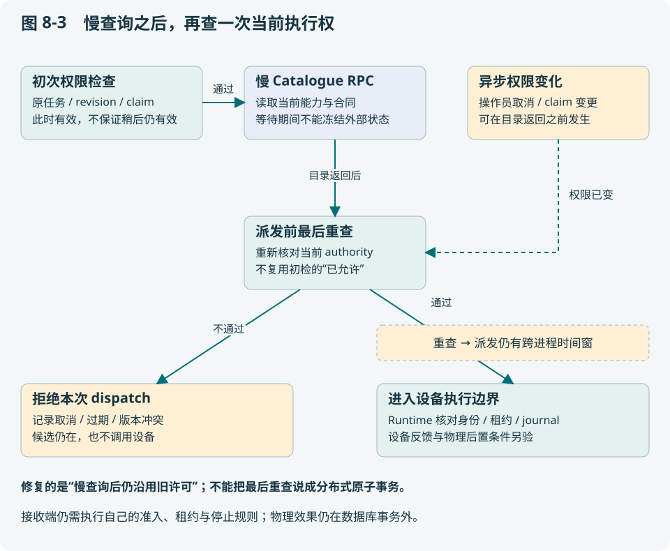

令 C 表示目录调用耗时，L 表示其余本地工作耗时。旧顺序中，从任务权限检查到派发的窗口约为 Δ_old=C+L；把目录读取移到前面，再检查当前任务、外部控制和 context，可移走这段 C。若只为教学假设撤销事件服从速率 λ 的泊松过程，一段窗口中发生至少一次撤销的概率为：

> P(stale window)=1−exp(−λΔ)。　（8-7）

这不是系统实测故障率：真实撤销常与任务异常相关，不满足独立泊松假设。公式只说明，即使最后还剩窗口，移走不受控的 RPC 耗时也有明确意义。比如 C=2 s、L=0.01 s、λ=0.1/s，概率从约 18.2% 变为约 0.10%；参数是课堂设定，不可写成论文实测收益。

当前 [Host](https://github.com/SUSTechWLA/tangying-robot-agent-os/blob/63af99305fd8204c0a54d86145cb94d89b754326/internal/edgeagent/host.go) 已调整此顺序。[故障测试](https://github.com/SUSTechWLA/tangying-robot-agent-os/blob/63af99305fd8204c0a54d86145cb94d89b754326/internal/edgeagent/authority_test.go) 在 StepStarted 已持久化但设备尚未调用时阻塞目录，然后分别取消、换 revision、撤销批准、撤销外部执行控制，验证不分发动作。检查之后到 Runtime 执行动作之间仍不属于一个原子事务；Runtime 的 lease/fence 和本地停止继续承担最后边界。也不能把派发未发生的个别测试，外推成任何 unknown 都可自动清除。

<a id="part-11-h016"></a>

## 8.15 为什么身份正确仍可能永远收不到新消息

消息安全性说“不发给错误身份”，活性说“合法消息最终有机会发出”。两个要求可以同时失败在队列头部：旧 peer 的 agentId=A、domain=D1，后来 A 被重配到 D2；旧信封仍在 outbox。若先按 agentId 选唯一最早项，再因 domain 不同跳过，新 D2 的消息可能一直排在后面。

设 Q 为待发序列，I 为当前完整接收身份。一般而言：

> Filter_I(Head_agentId(Q)) ≠ Head_agentId(Filter_I(Q))。　（8-8）

取 Q=[旧 D1 消息，新 D2 消息]，左式为空，右式是新消息；这就是可手算的反例。当前 SQLite 的 `PendingFor` 先按当前 sender 与完整 recipient 身份过滤，再执行 stream FIFO 与 peer head 选择。旧消息保留 pending 和原身份，不重定向、不伪造 ACK；它仍遵循原 TTL 与保留策略。第三方 Journal 若只实现旧 Pending 接口，逐条身份拒绝仍有效，但必须实现 PendingFor 才获得该重配活性保证。

凭据分配也必须与身份一致。若 incoming[B]=K，又把 K 配成 outgoing[C]，系统会主动把 B 的身份凭据发给 C。TLS 保护传输，不能修复这个错误授权关系。现在启动配置拒绝出站令牌等于**另一个** peer 的入站令牌；同 peer 的对称配置仍兼容。源码和测试在 [edge-exchange](https://github.com/SUSTechWLA/tangying-robot-agent-os/blob/63af99305fd8204c0a54d86145cb94d89b754326/cmd/edge-exchange/main.go) 与 [exchange service](https://github.com/SUSTechWLA/tangying-robot-agent-os/blob/63af99305fd8204c0a54d86145cb94d89b754326/edge/exchange/service_test.go)。这些是可信管理员下的配置防错，不是拜占庭群体共识。

<a id="part-11-h017"></a>

## 8.16 预算耗尽不应变成一秒千次的无效轮询

控制器已经接受一个异步 operation，执行器正在查状态。Host 达到持久读预算后返回 `ErrNeedsInput`。它与临时网络错误不同：继续轮询不会重新获得预算，只会拖延收尾并掩盖原故障。

当前 [Executor.wait](https://github.com/SUSTechWLA/tangying-robot-agent-os/blob/63af99305fd8204c0a54d86145cb94d89b754326/internal/capabilityagent/executor.go) 遇该错误直接进入现有 owned stop：只能读取和取消已绑定的 operation/owner，不能续租、停止别人的操作或启动新动作。若停止确认成功，保留原预算拒绝原因；状态读取或取消失败，仍返回 outcome unknown。这个例子展示“失败分类”为什么必须参与控制流，而不能只用来美化日志。

<a id="part-11-h018"></a>

## 8.17 分层习题

基础题 B：为什么队列ACK不等于物理成功？

工程题 E：分别在ACCEPTED、EXECUTED及中心成功后丢响应，列出可恢复事实和禁止动作。

研究题 R：设计跨存储Transfer故障矩阵，说明哪些结论需要共识/事务或对账来支撑。

作答应写明假设、判据与证据。评价要点见[附录 I](#part-31)，实践路线见[附录 F](#part-28)。


---

<a id="part-12"></a>

# 第 9 章 单机器人边缘系统与多机器人工作台

本章把架构落到可运行进程。读完应能说明一个边缘 Agent 的最小组成，追踪 taskId 的持久位置，并理解切换工作台设备为何不应热换 Runtime。

<a id="part-12-h002"></a>

## 9.1 一台机器人也需要完整的系统边界

最小边缘系统包含任务入口、Host/执行器、能力与 Runtime 客户端、持久任务和检查点、观测索引及操作界面。移到单机运行只减少网络跨域，不会消除崩溃、旧数据或物理副作用。

[cmd/local-agent/main.go](https://github.com/SUSTechWLA/tangying-robot-agent-os/blob/63af99305fd8204c0a54d86145cb94d89b754326/cmd/local-agent/main.go) 是组合根：把依赖装起来，不应该塞入全部业务规则。主逻辑位于 `internal/edgeagent/`、`internal/capabilityagent/`、`tasks/` 等模块，SQLite 实现在 `middleware/sqlite/`。这个结构让相同业务核心能够被 Worker 入口复用。

<a id="part-12-h003"></a>

## 9.2 浏览器选择 B，不能把 A 的执行器换成 B

一种危险实现是在服务器全局变量里写 `currentRobot=B`，所有 API 都读取它。两个标签页分别操作 A、B 时，最后一次切换会影响另一页；A 的迟到响应也可能显示在 B 页面。如果 A 正在执行长任务，热换 Runtime 还可能把下一步派发给 B。

当前工作台采用 URL 作用域：`/` 对应入口绑定设备，`/robots/<id>/` 对应已注册的独立 Local Agent。选择器使用整页导航清理旧页面的轮询与回调；各设备保留自己的 Host、SQLite 和控制权。

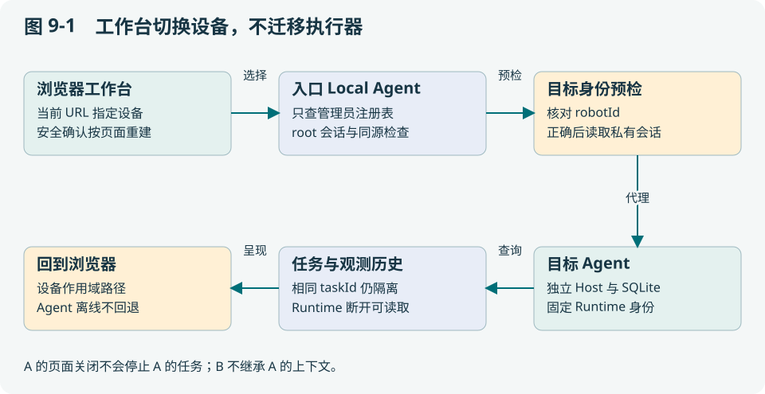

<a id="part-12-h004"></a>

## 9.3 从一次读取看清信任边界

浏览器读取 `/robots/uav/v1/tasks/P`。入口先检查自身会话与同源，再用无凭据请求核对目标 Agent 的不可变 robotId，随后读取私有 sessionFile，携带目标令牌及预期设备身份转发。目标 Agent 再次检查身份，避免预检后端点换机。

身份错误、未注册路径、离线和会话缺失都明确失败，不回退到入口机器人。同一主机不同端口的 Console 使用不同 Cookie 名，避免相互覆盖。地图与文件标定还核对产物 robotId，防止共享目录把另一设备的“已就绪”借过来。

这些机制解决设备隔离和误路由，**没有提供用户角色授权或公网多租户认证**。相关实现为 [console/workspaces.go](https://github.com/SUSTechWLA/tangying-robot-agent-os/blob/63af99305fd8204c0a54d86145cb94d89b754326/console/workspaces.go)、[console/guard.go](https://github.com/SUSTechWLA/tangying-robot-agent-os/blob/63af99305fd8204c0a54d86145cb94d89b754326/console/guard.go) 与 [web/edge_workspace.js](https://github.com/SUSTechWLA/tangying-robot-agent-os/blob/63af99305fd8204c0a54d86145cb94d89b754326/web/edge_workspace.js)。

<a id="part-12-h005"></a>

## 9.4 历史可回溯需要什么条件

| 情况 | 能读什么 | 不能据此推断什么 |
| --- | --- | --- |
| Agent 与 Runtime 都在线 | 当前查询和该设备历史 | 当前状态必然适合运动 |
| 已运行 Agent 在线，Runtime 断开 | 已保存任务、事件和观测索引 | 旧观测等于当前现场 |
| Agent 本身离线 | 页面保留设备选择和错误 | 入口拥有它的完整历史副本 |
| 重启 Agent | 通过运行身份检查后读取原数据库 | 自动重做未决动作 |

当前回溯基于任务留存，未新增全天候原始传感器录像。若论文需要连续轨迹，必须显式录制并记录采样、时钟和丢帧；不能从任务页面有几张图片推断全程可重建。

<a id="part-12-h006"></a>

## 9.5 两台设备相同 taskId 的实验

运行：

```bash
go test ./console -run TestWorkspaceRealTaskHistoryAndEventsRemainIsolatedAcrossRestart -count=1
go run ./console/testdata/workspace-preview
```

第一条使用真实 SQLite 和 HTTP/WebSocket，检查不同设备相同任务编号、并发读写、会话轮换和重启历史。第二条打开明确标为样例的工作台，包含 Runtime 离线和 Agent 离线情况，executor 拒绝物理执行。退出预览按 Ctrl+C。

练习不是“点一下下拉框就成功”，而是：在 A 选择某任务，切到 B，核对请求路径和内容，再返回 A；关闭页面后观察订阅是否结束；解释为什么任务执行本身不应被取消。

<a id="part-12-h007"></a>

## 9.6 持久化与部署的实际成本

每台设备需要独立 data-dir、Runtime 身份与产物目录。入口注册多个 Agent 使操作方便，但新增单入口依赖和代理开销；当前入口自身启动仍需要绑定自己的 Runtime，并非独立无机器人聚合服务。

未来可增加只读历史副本、独立聚合服务器和用户授权，但这些扩展应保持设备执行权不依赖浏览器选中项。按设备划分数据库的代价是全局查询复杂，收益是单机故障与上下文边界清楚。

操作配置见[工作空间部署指南](https://github.com/SUSTechWLA/tangying-robot-agent-os/blob/63af99305fd8204c0a54d86145cb94d89b754326/docs/operations/edge-robot-workspaces.md)。本章强调设计原因；实际连接设备前应按该指南配置私有会话与路径。

<a id="part-12-h008"></a>

## 9.7 分层习题

基础题 B：为什么healthz正常但readiness为false可能是正确状态？

工程题 E：设计包含任务库、命令journal、地图和配置身份的一致备份清单。

研究题 R：比较单机与机群控制端切换的故障假设，设计不会重复派发的验证方法。

作答应写明假设、判据与证据。评价要点见[附录 I](#part-31)，实践路线见[附录 F](#part-28)。


---

<a id="part-13"></a>

# 第 10 章 异构 ROS 2 接入与 Sim2Real 的实际边界

本章要回答：统一 Runtime 合同能复用多少工作，为什么接上 ROS 2 还不能直接宣称支持某品牌机器人？读完应能制定一份可验收的本体适配方案。

<a id="part-13-h002"></a>

## 10.1 统一的是任务语言，不是运动学

“到指定区域观察”可以是共同目标，但 AGV 可能只能沿地面行驶，足式机器人要考虑支撑和步态，无人机要考虑净空、飞控状态和安全保持。若上层统一要求二维 (x,y)，会丢失无人机的高度；若一律规划自由三维曲线，又会让 AGV 穿过没有支撑的区域。

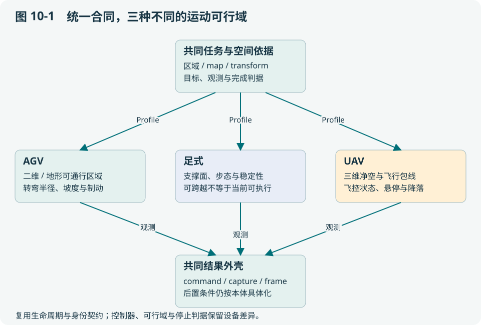

合理复用发生在目标生命周期、工具身份、预算、journal、观测封装和恢复规则。路径可行性和控制命令仍需要本体专属约束。Profile 是这些差异的显式配置和适配边界，不是消除差异的魔法。

<a id="part-13-h003"></a>

## 10.2 ROS 2 接通后，还要核对五个语义

第一是单位与坐标，例如米与厘米、ENU 与设备自身坐标；第二是时间，采集时间不能用桥接接收时间替代；第三是命令身份，重发同一命令是否被识别；第四是状态与错误，Action 成功、取消接受和物理停止分别表示什么；第五是 capability 与 commissioning，当前真实硬件是否已验证该能力。

项目通过 `ros2_profile.py` 和 `ProfiledExecute.action` 等接口接入，而具体 DJI、Unitree、AGV 型号仍需提供厂商控制与反馈绑定。通用 ROS 2 模板是接入骨架，不保证已完成所有型号的飞控权限、步态或底盘制动验收。

<a id="part-13-h004"></a>

## 10.3 用停止距离说明端侧闭环为什么必要

教学假设：地面车速度 v=0.5 m/s，检测与命令延迟合计 τ=0.3 s，可保证减速度 a=0.5 m/s²。忽略坡度和轮胎打滑时，停止距离下界估计为：

```text
d = vτ + v²/(2a) = 0.15 + 0.25 = 0.40 m
```

这不是现场安全距离，实际还要加测量误差、控制裕量并核验模型假设。它说明，即使模型最终作出正确停止决定，远端延迟也会吃掉物理余量。局部避障、失联处理和停止必须由可靠的设备侧链路承担；LLM 不应替代该闭环。

<a id="part-13-h005"></a>

## 10.4 标定和地图对齐怎样影响上层任务

外参错误会让相机中的障碍投影到错误位置；跨机变换错误会让两台机器人对“同一个交接点”理解不同。只看文件中存在一组矩阵不够，还需要知道它怎样估计、残差多大、适用设备与版本，以及控制链是否实际采用。

`registered_alignment.py` 与 Gazebo commissioning 相关模块提供当前工程入口。教学时应区分配置标定、测量估计与控制采用的坐标依据。不要把三者混成一个“标定通过”布尔值；第 19 章的案例索引保留这些不同证据层次。

<a id="part-13-h006"></a>

## 10.5 仿真分四层，每层回答不同问题

| 层次 | 主要用途 | 不能证明 |
| --- | --- | --- |
| 软件 fixture | 合同、恢复窗口、重复与预算 | 真实传感器和动力学 |
| 真实 DDS/gRPC + 记录式控制 | 通信、参数和 XYZ 身份 | 机器人实际可走/可飞 |
| Gazebo 动力学与独立测量 | 控制响应、避碰、停止和观测闭环 | 厂商硬件、现场网络和真实接触误差 |
| 受监护实机 | 指定设备与场地的系统表现 | 任意环境下的无人值守可靠性 |

项目现有 Gazebo 物理控制使用经典控制，未要求强化学习。其价值在于用可重复场景暴露整条链路问题；不是把仿真得分直接换成实机认证。

<a id="part-13-h007"></a>

## 10.6 接入方案应该怎样验收

从静态能力读取开始，确认身份与 sensor contract；再验证只读观测；随后验证受限单动作、取消和停止；最后加入定位退化、响应丢失与重启。每次升级只扩大一个已验证边界。这样发生失败时容易定位到新增加的一层。

对于三种本体，交付表至少包含能力目录、坐标/单位、控制接口、反馈来源、command 绑定、停止测量和未知结果处理。再定义本体特有项：AGV 转弯与制动、足式支撑/姿态、UAV 飞控接管/安全保持。复用的测试骨架一样，测试参数和判据不同。

**课堂交付**：给一种设备写一页适配设计，明确三个可以复用的模块和三个不能复用的假设。参考[设备绑定指南](https://github.com/SUSTechWLA/tangying-robot-agent-os/blob/63af99305fd8204c0a54d86145cb94d89b754326/docs/operations/ros2-device-bindings.md)，不要用“支持 ROS 2”代替验收项目。

<a id="part-13-h008"></a>

## 10.7 分层习题

基础题 B：列出仿真成功无法直接证明的三类实机性质。

工程题 E：为一个新移动操作本体制作型号资料和分级验收表。

研究题 R：选择一类Sim2Real差距，提出控制变量、故障注入和迁移有效性指标。

作答应写明假设、判据与证据。评价要点见[附录 I](#part-31)，实践路线见[附录 F](#part-28)。


---

<a id="part-14"></a>

# 第 11 章 可观测性与恢复：从报错走到有依据的决定

本章让你学会从日志找到可行动结论。不是日志越多越好，而是能否回答：哪件事失败、是否已经产生效果、哪条证据允许继续。

<a id="part-14-h002"></a>

## 11.1 给故障画一条因果链

巡检任务 P 的子计划 p1、步骤 s3、命令 c3 在 B→C 导航时超时。用户只看见“连接错误”，开发者需要进一步区分：模型还没完成规划、请求未派发、控制器执行中、已到达但观测缺失、验证已过但报告丢失。

因此记录要能按 taskId、revision、childId、stepId、commandId 和原观测引用串起来。墙钟接近只能帮助搜索，不能替代因果绑定。来自另一机器人、另一命令的成功日志不能清除 c3 的未知。

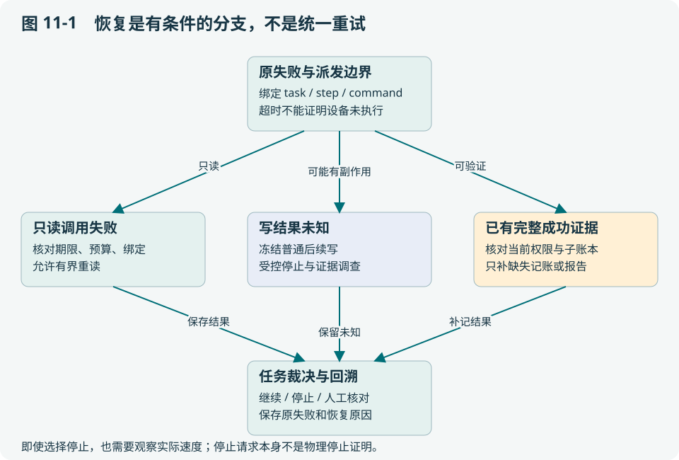

<a id="part-14-h003"></a>

## 11.2 哪些指标值得放在运维页

| 指标 | 它帮助判断什么 | 常见误读 |
| --- | --- | --- |
| 未决写数量及年龄 | 是否积累了无法确认的效果 | 把它归入普通网络错误 |
| completion outbox 年龄 | 已完成结果是否滞留未送达 | 为了清零而重做动作 |
| 观测采集年龄、序号推进 | 当前感知是否持续有效 | 用接收时间替代采集时间 |
| 消费游标缺口、丢弃数 | 是否遗漏了可见事件 | 显示订阅在线就认为历史完整 |
| 预算拒绝和规划拒绝原因 | 目标是否不合理或模型反复越界 | 直接提高所有预算掩盖问题 |

当前不同模块暴露的指标和告警接线不完全相同，不能因表中建议合理就声称全部已经接入统一告警中心。实现核对从 `agentruntime/`、Host 事件和工作台问题页开始。

<a id="part-14-h004"></a>

## 11.3 只读失败和未知写应走不同通道

只读恢复通常可以在原授权内进行有界重读和复验；未知写需要冻结后续写，核对 Runtime 与子执行证据。两者都要保留原错误，而不是成功后清空历史。

Host 的 completion read 还存在独立的持久重试机制：即便完成检查只是读，也不能在每次重启时重新获得无限尝试次数。检查点中的重试与 pending 状态让中断后的处理有边界。软件测试可从 [internal/edgeagent/completion_test.go](https://github.com/SUSTechWLA/tangying-robot-agent-os/blob/63af99305fd8204c0a54d86145cb94d89b754326/internal/edgeagent/completion_test.go) 阅读。

<a id="part-14-h005"></a>

## 11.4 三种恢复动作的代价不同

重新读取是增加信息；重新规划是修改未来动作；重新派发是再次影响世界。故障诊断应先选择足够解决问题且副作用最小的动作。例如已验证子结果只差父记账时，应补记账，而不是重规划一条同路线。

但保守恢复也有代价：证据缺失可能导致本来可以继续的任务停住。应通过改善命令绑定、观测留存和持久化窗口减少这类停顿。用忽略 unknown 的开关“提高成功率”，只是把未确认风险藏起来。

<a id="part-14-h006"></a>

## 11.5 UI 也属于可观测性系统

当前工作台将 Agent 可达、Runtime 可达、相机可用、任务状态和执行证据分开显示。Runtime 离线时保留历史读取；缺少工具步骤的成功任务显示证据不足。页面不能用后来的健康状态覆盖过去任务当时的失败证据。

关闭页面后，任务和 World WebSocket 会监听连接关闭并释放服务端订阅；这只停止观察资源，不停止后台任务。若把浏览器生命周期当成执行生命周期，用户刷新一次就可能改变机器人行为。

<a id="part-14-h007"></a>

## 11.6 一次事故复盘的课堂模板

先写未经解释的症状，再列已知事实与缺失信息，然后给出两个竞争假设。对每个假设提出一个只读检查，最后决定继续、停止还是人工核对，并给出否决条件。

示例：“c3 超时”有两个假设：请求未送达；运动完成但响应丢失。检查 journal 与动作后观测可以区分部分情况；都缺失时应保留 unknown。这样的复盘比“网络不好，重启恢复”更有教学价值，也更容易形成可测试的修复。

源码：`internal/recoveryexec/`、[internal/edgeagent/recovery.go](https://github.com/SUSTechWLA/tangying-robot-agent-os/blob/63af99305fd8204c0a54d86145cb94d89b754326/internal/edgeagent/recovery.go)、[console/server.go](https://github.com/SUSTechWLA/tangying-robot-agent-os/blob/63af99305fd8204c0a54d86145cb94d89b754326/console/server.go)。实际恢复案例见第 19 章，物理停止仍需设备测量而不是日志中一句 stop accepted。

<a id="part-14-h008"></a>

## 11.7 分层习题

基础题 B：为什么读历史成功不能证明原抓取成功？

工程题 E：制作一次恢复的字段核对表，并列出五种不应放行的消息。

研究题 R：如何评测诊断是否改善系统？区分检出、定位、允许处置、实际恢复和错误放行。

作答应写明假设、判据与证据。评价要点见[附录 I](#part-31)，实践路线见[附录 F](#part-28)。


---

<a id="part-15"></a>

# 第 12 章 怎样证明一个设计更好：实验与消融

本章把架构选择变成可以检验的研究问题。读完应能定义实验单位、评价指标和对照条件，并避免把测试通过数量当成机器人可靠性。

<a id="part-15-h002"></a>

## 12.1 先写一个可被推翻的主张

“多 Agent 更智能”无法直接检验。可以改成：“在固定任务、模型和总预算下，结构化 Ops 诊断减少无效重试，并降低因错误恢复导致的越权动作。”它指定了机制、条件和可观察结果，也允许结果证明设计没有帮助。

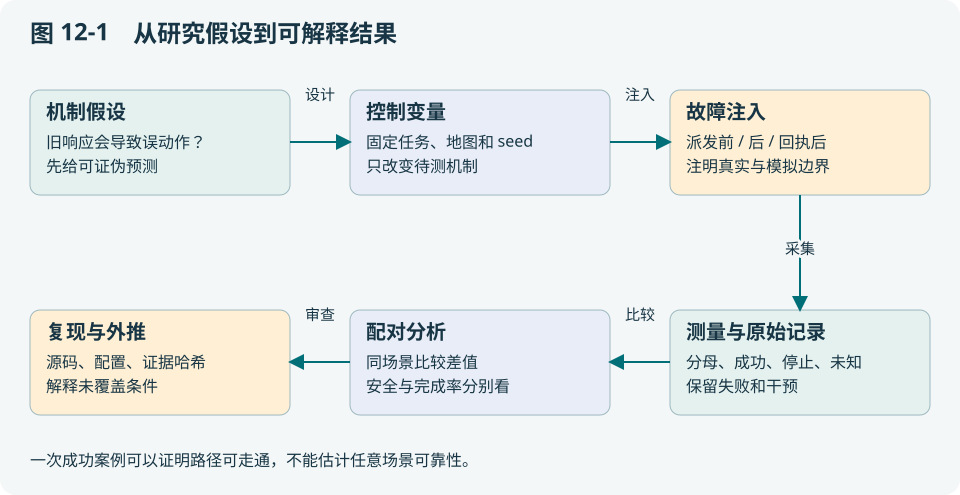

上下文压缩也同理：不要只比较 token 数，要同时检查目标遗漏、约束遗漏、已完成动作重复和回查成本。一个把 guard 全删掉的摘要可能最短，却不符合系统目标。

<a id="part-15-h003"></a>

## 12.2 什么算一个样本

一个任务含 100 个步骤，不能自动算成 100 个独立任务样本。同一地图、同一初始状态、同一模型会造成相关性；同一任务修复代码后再跑，也不是同版本的重复试验。

| 统计单位 | 合理指标 | 必须注明 |
| --- | --- | --- |
| 一次模型决策 | 输入大小、延迟、拒绝率 | 模型、提示词、上下文和预算 |
| 一条能力调用 | 延迟、返回与验证结果 | 是否复合动作、是否重试 |
| 一次完整任务 | 目标完成、停止、unknown、人工介入 | 环境、源码、种子与故障计划 |
| 一次部署运行 | 长期可用性、恢复与资源压力 | 持续时间、负载和网络条件 |

本项目软件 campaign、Gazebo 物理案例和真实 DDS 接线回答不同问题，第 19 章逐项区分，不能合成一个漂亮的统一成功率。

<a id="part-15-h004"></a>

## 12.3 做一张最小配对对照表

教学示例：固定 20 个场景种子，同一任务分别使用“全历史输入”和“有界投影”。每个种子运行两种配置，记录完成、unknown、安全停止、重复写、token、端到端时间和冷回查次数。

| 比较维度 | 可能发生的取舍 |
| --- | --- |
| token 与延迟 | 投影更短，但额外回查增加往返 |
| 任务完成率 | 信息太少可能漏目标，过多噪声也可能损害决策 |
| 错误执行 | 摘要遗漏 guard 的代价可能高于少量 token 节省 |
| 可解释性 | 有 scope 与归档的投影更易还原决策输入 |

先报告每个种子的配对差值，再总结均值或分位数。模型随机性需要重复和置信区间；测试顺序也要控制，避免第二组总是继承第一组扫描好的地图。

<a id="part-15-h005"></a>

## 12.4 零失败不等于已经证明可靠

若假设 n 次任务独立同分布且都没有失败，单侧 95% 的失败概率上界可由 `(1-p)^n=0.05` 得到 `p=1-0.05^(1/n)`。n=20 时约 14%，n=100 时约 3%。这不是系统当前的实测指标，而是说明小样本的结论边界。

现实机器人任务往往不满足独立同分布，因此应先分层报告场景和失败模式，而非机械套公式。一次成功长任务能证明某条路径实际走通，不能证明任意任务都会成功。

<a id="part-15-h006"></a>

## 12.5 消融应放在哪一层

可替换上下文 renderer、探索策略、任务分解策略和诊断提案策略，同时固定下层执行授权与物理停止。需要研究“没有某个检查会怎样”时，在软件 fixture 中明确限制副作用，不应在真实机器人上直接关闭基础安全边界。

项目已有空间规划/覆盖的插件与消融入口，以及 `core/agentcontext/` 的不同投影实现。研究时要验证待测策略是否接入实际运行路径：代码里有一个类不等于生产请求经过它。推荐保留配置、最终请求 SHA、策略身份和实际被调用次数。

<a id="part-15-h007"></a>

## 12.6 论文材料从哪些原始对象生成

每次运行保存源码/二进制身份、场景和地图、原目标、批准版本、模型配置、故障注入点、所有终态、干预记录和证据索引。图表应能从这些对象重算，而不是人工摘出最好的一次。

训练数据另需注意：失败后的纠错不能被标成原计划成功；开发集与评测场景要分离；人工恢复应标注。基于错误时间戳或错设备观测构造的“成功示例”会把系统缺陷固化到模型学习中。

**课堂交付**：写一页实验计划，只研究一个机制，列出至少两项负面指标和一个可能推翻主张的结果。具体历史数据见[实验索引](#part-25)，可运行练习见[实验附录](#part-28)。

<a id="part-15-h008"></a>

## 12.7 给上下文与 KV cache 设计一个可解释实验

先提出可证伪假设：“固定信息与动作权限时，前缀缓存减少模型等待；保护投影减少约束遗失；两者对任务完成时间的作用不同。”用 2×2 设计区分变量：

| 组 | 输入策略 | 前缀缓存 | 要解释的差值 |
| --- | --- | --- | --- |
| A | 可容纳的完整事实 | 关闭 | 共同基线 |
| B | 与 A 完全相同的输入 | 开启 | B−A 主要研究计算复用 |
| C | 保护投影与冷回查 | 关闭 | C−A 研究信息选择，可能影响质量 |
| D | 与 C 相同的策略 | 开启 | D−C 研究缓存；D−B 研究投影 |

“相同策略”不意味着各次模型输出自然相同。固定模型/模板/目录/任务、记录实际请求与候选，并配对场景；若研究纯缓存耗时，可先回放同一批冻结请求，另跑闭环评价行为。保护性准入规则四组完全一致。不能为了凑长输入重复无意义文本，再宣称解决了长程任务。

冷请求要定义是否清空缓存、是否更换隔离域、是否等待过期；暖请求要说明哪个前缀预热、是否计入预热成本、并发请求和缓存逐出情况。供应商不提供清空或命中观测时，写“缓存状态不可确定”，不能用第一次/第二次请求代替真实 cold/warm 标签。

令 S 为同时报告合法输入 token Pᵢ 与缓存读取 token Cᵢ 的请求集合，N=|S|；同一比较中使用相同的可观测样本，且 ΣPᵢ>0：

> 请求命中率 H_req = Σᵢ∈S 1[Cᵢ>0] / N（N>0）。
> 输入加权复用率 H_token = Σᵢ∈S Cᵢ / Σᵢ∈S Pᵢ。　（12-1）

这两个分母不同。十次请求里只有一次长请求命中，H_req 可能很低而 H_token 很高。无 usage、invalid usage 和缺必要字段的请求分别计数；整体报告可观测率 |S|/全部请求数，不当成 Cᵢ=0。若只知 Cᵢ 而不知 Pᵢ，可以单独报告另一组请求命中率，但必须注明分母变化。缓存写入与读取分开记录；字节预算不能替代 tokenizer 的输入 token。

| 观测层 | 建议记录 | 常见误读 |
| --- | --- | --- |
| 模型服务 | prefill、decode、排队、输入/输出与缓存读写 | 总延迟下降全部归因于缓存 |
| 客户端 | 请求总时长；若流式才测 TTFT | 当前非流式请求总耗时冒充首 token 延迟 |
| 上下文 | 字节/token、保护约束、冷读、重建与超预算 | 压缩率高就称任务更稳定 |
| 任务 | 完成、正确拒绝、unknown、误重放、干预、总时长 | 只报告模型 token 费用，忽略机器人动作 |
| 网络与设备 | payload/带宽、消息迟延、采集年龄、物理执行 | 把 ACK 率当作任务完成率 |

当前客户端已在 `Projection.ModelCall` 记录服务端报告的可选 usage、总耗时和失败分类；尚无流式 TTFT、引擎 prefill/decode 或 GPU 计量，后几类仍需独立采集，不能从请求 SHA 或总耗时补造。平均值之外报告中位数与 p95，原始任务数和每任务调用数分开。若同一任务内多轮强相关，用任务级配对/重采样报告不确定性，而不是把 token 当独立样本。

<a id="part-15-h009"></a>

## 12.8 从理论预算到实测结论的四层证据

第一层是手算：第 18 章的 1 GiB、8.59 s 和 24% 可由给定参数复算。第二层是引擎测量：实际缓存显存、命中、逐出和延迟。第三层是软件闭环：缓存失效与压缩发生时，约束、未知命令和恢复是否仍正确。第四层才是固定场景下的 Gazebo/实机任务效果。

低层结果不能直接替代高层结论。模型等待减少 0.6 s 可能对一分钟运动任务影响很小，却可能改善高频交互；上下文更短可能省钱，却因少了关键旧失败而增加规划重试。应先给目标函数，例如在误动作率与权限约束不退化的前提下，最小化任务总时长和推理成本，再讨论最佳策略。

<a id="part-15-h010"></a>

## 12.9 分层习题

基础题 B：为什么一条轨迹257事件不是257次独立安全试验？

工程题 E：制定比较两个恢复策略的故障矩阵、指标与分母。

研究题 R：针对上下文格式提出可证伪假设和配对实验，处理预算超限、未批准与缺制品样本。

作答应写明假设、判据与证据。评价要点见[附录 I](#part-31)，实践路线见[附录 F](#part-28)。


---

<a id="part-16"></a>

# 第 13 章 部署与升级也是系统协议

读完本章应能解释“进程启动成功”与“可以接新任务”的区别，并设计一次不丢失未决动作的升级。部署不是把二进制复制到机器人，而是建立身份、状态与控制权之间的关系。

<a id="part-16-h002"></a>

## 13.1 从一台设备的目录开始

一个 Local Agent 应有独立 data-dir、Runtime 地址、设备身份、证书与产物路径。数据库记录任务和检查点；Runtime 合同固定它所连接的设备依据；地图、标定和事故记录也必须有设备归属。

若把机器人 A 的数据目录复制给 B 并只改显示名称，历史 taskId、地图和未知命令仍属于 A。系统拒绝身份冲突是在防止错用状态，不应该通过清空合同或给地图改名来“修复启动”。备份可以复制字节，恢复必须核对语义。

<a id="part-16-h003"></a>

## 13.2 健康检查应分层

`/healthz` 回答进程是否活着；`/v1/runtime` 查询当前运行时；准备检查和能力目录回答现在能否接受某类工作。它们不是同一个布尔量。

例如 Runtime 在线、模型配置正常，但有一条未对账的运动命令，正确行为仍可能是拒绝新任务。再如相机不可用不必然表示任务数据库不可读。工作台按这些不同对象呈现状态，使排障能够定位到一层，而不把所有问题统称“机器人离线”。

<a id="part-16-h004"></a>

## 13.3 为什么会话、TLS 与执行授权都需要

会话与同源守卫减少浏览器误写和跨源请求；TLS 保护通信身份与内容；目标批准与 claim 限定业务执行权。它们互不替代。拥有网络访问权限，不等于被批准执行任何运动；一个正确 robotId 字符串，也不能代替设备身份认证。

当前工作空间代理支持 loopback HTTP 或正常校验的 HTTPS，并使用服务器私有会话文件。它适合受控边缘部署；公网接入还需要独立用户认证和授权。详见[工作空间指南](https://github.com/SUSTechWLA/tangying-robot-agent-os/blob/63af99305fd8204c0a54d86145cb94d89b754326/docs/operations/edge-robot-workspaces.md)，不要把会话令牌写进前端构建或教材示例。

<a id="part-16-h005"></a>

## 13.4 升级按状态推进，不按时间硬切

一次可审查的升级顺序是：冻结新派发；列出活动任务和未决命令；按既有停止/对账流程确定边界；备份任务库、journal 与产物；部署新版本；核对身份、schema 和恢复状态；再开放新任务。

最关键的是第三步。停止进程可能使任务中断，却不证明设备已经停稳；新进程启动也不能重置旧预算和 unknown。回滚还要检查旧版本是否能读新格式，二进制可回退不意味着状态可逆。

<a id="part-16-h006"></a>

## 13.5 两种断网策略不能混用

独立 Local 任务不依赖云 claim，因此模型和所需资源都在本地时可以继续本地闭环；Worker 的受委托任务受有效 claim 和期限约束，当前实现不提供失效后离线继续权。若部署要求离线任务，需要明确额外合同，而不是把网络错误吞掉。

多机环境还应监测 outbox 年龄、证书过期、存储空间和时钟偏差。它们会改变恢复能力和数据新鲜度，即使 CPU 与内存看起来正常。

<a id="part-16-h007"></a>

## 13.6 升级演练要留下什么

记录旧新代码与二进制、升级前活动任务、未知命令、备份位置、启动核对结果及恢复后的实际行为。用“升级后仍能打开页面”作为验收是不够的，应至少证明旧历史可读、未决写未重放、新任务仍按当前授权执行。

教学作业可使用软件数据库和 fixture 演练，无需机器人运动。源码入口：[cmd/local-agent/main.go](https://github.com/SUSTechWLA/tangying-robot-agent-os/blob/63af99305fd8204c0a54d86145cb94d89b754326/cmd/local-agent/main.go)、[edge/worker/context.go](https://github.com/SUSTechWLA/tangying-robot-agent-os/blob/63af99305fd8204c0a54d86145cb94d89b754326/edge/worker/context.go)、`middleware/sqlite/`。

<a id="part-16-h008"></a>

## 13.7 分层习题

基础题 B：列出版本基线中至少八个不同对象。

工程题 E：为一次有活动任务的云边升级制定停止条件、证据及回退检查。

研究题 R：如何研究pending收尾对可用性的影响？提出窗口故障、持久状态和可恢复性指标。

作答应写明假设、判据与证据。评价要点见[附录 I](#part-31)，实践路线见[附录 F](#part-28)。


---

<a id="part-17"></a>

# 第 14 章 开发者第一周：沿一条任务读懂系统

本章给出可执行的学习顺序。读完不是“知道目录很多”，而是能提出一个小改动，找到正确模块，写出能揭示错误的测试。

<a id="part-17-h002"></a>

## 14.1 第一小时只画三张图

第一张是第 2 章的职责图；第二张是一次命令的时序图；第三张是数据所有权表。每张图限制在一页，每个框必须能对应到一个源码入口。画不出来的部分先写问号，带着问题读代码。

从 [cmd/local-agent/main.go](https://github.com/SUSTechWLA/tangying-robot-agent-os/blob/63af99305fd8204c0a54d86145cb94d89b754326/cmd/local-agent/main.go) 找 Console、任务服务、Host、Runtime 和数据库装配；从 [console/objective.go](https://github.com/SUSTechWLA/tangying-robot-agent-os/blob/63af99305fd8204c0a54d86145cb94d89b754326/console/objective.go) 找粗目标入口；从 [internal/edgeagent/host.go](https://github.com/SUSTechWLA/tangying-robot-agent-os/blob/63af99305fd8204c0a54d86145cb94d89b754326/internal/edgeagent/host.go) 跟到 `journal.go`。暂时不要把整个 ROS workspace 和全部前端文件逐个读完。

<a id="part-17-h003"></a>

## 14.2 用一个失败测试建立控制感

选择 `TestDelegatedUnknownPhysicalResultNeverReplansOrReplays`。先不运行，写下预期：设备效果未知时规划器不会被当作恢复手段再次派发。再读 fixture 如何制造 unknown，以及断言如何检查调用次数和持久结果。

```bash
go test ./internal/edgeagent -run '^TestDelegatedUnknownPhysicalResultNeverReplansOrReplays$' -count=1
```

命令通过后，回答“若删除哪条检查，这个测试会失败”。这使你理解行为因果，而不是把绿色测试结果当成阅读完成。

<a id="part-17-h004"></a>

## 14.3 一个具体改动：加入新的定位来源

需求是接入另一种 ROS 位姿来源。先保持上层目标和工具名不变，定义来源身份、采集时间、frame、变换依据、协方差或质量字段，以及 lost 状态。然后检查 `spatial_localization.py` 的绑定和到达验证，最后接入设备 Provider。

反例包括：时间倒退、旧采集换新接收时间、z 丢失、错误 mapId、部署偏移重复计算。若为了接入只把新 topic 数值拷到现有字段，正例可能通过，错误变换却很难发现。

这个改动应落在观测和适配边界，不应该让云端规划器遍布品牌判断。真正需要上层新语义时，再升级共同合同。

<a id="part-17-h005"></a>

## 14.4 修改不同层，测试也要不同

| 改动 | 先读 | 最有价值的反例 |
| --- | --- | --- |
| 新能力 | 目录、grant、Executor、验证器 | 参数合法但超出本次授权 |
| 新恢复策略 | 原失败 binding、journal、checkpoint | 另一命令成功被误用于原 unknown |
| 新上下文投影 | 原事实、guard、归档、实际请求 | 压缩后丢失一条活动约束 |
| 新机器人工作空间 | 注册、身份代理、独立数据库 | 相同 taskId 和端点换机 |
| 新覆盖策略 | 目标集合、几何依据、覆盖账本 | 预测可见被计成已观察 |

<a id="part-17-h006"></a>

## 14.5 从小增量到可审查交付

先写一页说明：要改变的行为、保持的合同、引入的失败窗口与验证方法。实现后让测试覆盖业务反例，检查代码和文档是否说同一件事，再记录运行来源和结果。不要用“大重构”同时改变协议、存储和设备行为，否则失败难以归因。

本书的源码链接固定到代码快照。读更新的仓库时先比较接口和测试，再执行命令。路径没变不表示行为没变；另一方面，不需要把完整源码复制进书，书应解释读代码时寻找的关键决定。

<a id="part-17-h007"></a>

## 14.6 一周成果应该是什么

第 1 天完成职责与所有权图；第 2 天跟踪一条任务；第 3 天解释一个恢复反例；第 4 天修改一个局部策略并增加负例；第 5 天提交设计说明、实验结果和限制。成果是一项别人可以复核的小改进，而不是读过多少文件。

**检验理解的问题**：你的改动出错时，是降低完成率、增加等待，还是可能让错误机器人运动？失败后哪条记录可以帮助回滚或对账？这决定代码评审需要关注的层次。

<a id="part-17-h008"></a>

## 14.7 分层习题

基础题 B：给新增工具和新增Agent分别列出必要文件/契约类别。

工程题 E：制定一个两天可审查的小改动方案，包括目标、正反例、回放和文档。

研究题 R：比较故障驱动测试与纯成功路径测试，对可检出性和外推范围提出实验。

作答应写明假设、判据与证据。评价要点见[附录 I](#part-31)，实践路线见[附录 F](#part-28)。


---

<a id="part-18"></a>

# 第 15 章 可扩展性：哪些地方应该可替换

本章把“未来很强”拆成可评审的设计。读完应能区分稳定合同、可替换策略和尚未实现的系统能力，并选择有价值的研究扩展点。

<a id="part-18-h002"></a>

## 15.1 扩展性不是接口越多越好

如果每种机器人都需要改任务服务、模型提示词、数据库和 UI，系统耦合很强；如果增加所有抽象层却不能指出实际替换场景，复杂度又没有收益。应先列变更：换本体、换地图来源、换规划器、换模型、换传输。每类变更尽量停留在一个职责边界。

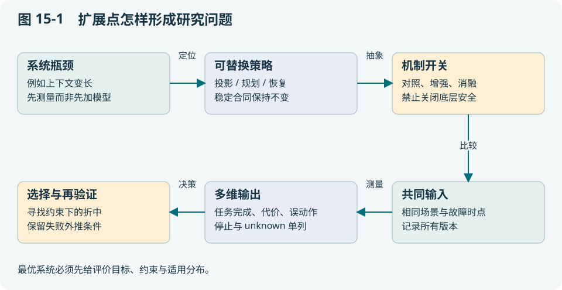

稳定层包括命令身份、授权、unknown 和证据语义；可替换层包括规划、上下文投影、探索评分和设备适配。不能为了做消融，让新策略绕过稳定层。

<a id="part-18-h003"></a>

## 15.2 当前系统已提供的扩展基础

共享 Host 降低 Local/Worker 重复实现；能力目录与 Profile 降低本体分叉；空间规划和覆盖模块提供策略入口；agent.data.v1 让跨设备数据有明确身份和时效；工作空间路由让操作界面不依赖具体型号。

这些基础并不自动组合成最优异构群体调度。云端分工、共同地图注册、资源冲突和物理避碰仍需分别实现和验证。模块都存在与模块端到端联调成功，是两种证据。

<a id="part-18-h004"></a>

## 15.3 三个值得研究的缺口

第一，如何在完成率、通信成本与信息新鲜度之间选择共享内容。第二，如何在多个机器人争用区域或物体时维护可恢复的资源所有权。第三，如何让上下文压缩降低模型成本同时保留决定动作合法性的最小充分信息。

每个问题都应有对照和反例。例如共享更多点云可能提高地图质量，却占用链路导致控制或状态信息延迟；更激进任务分配可能减少总时间，却增加避碰等待。不能只优化单一指标后称“整体最优”。

<a id="part-18-h005"></a>

## 15.4 怎样定义一个策略插件

输入应是冻结的任务、地图/能力依据与明确资源预算；输出应是候选或建议，带来源和适用条件；调用方独立验证输出。插件不直接修改权威任务库、Runtime journal 或全局机器人选择。

这种窄接口限制了插件自由度，却使消融公平、测试可复现。若策略必须获得新的事实或权限，应先扩展合同，而不是偷偷读取任意全局状态。

<a id="part-18-h006"></a>

## 15.5 当前边界应如何表达

建议用三列：接口已存在、装配已接通、实际证据覆盖。比如 UAV 几何规划接口与 ROS 参数贯通，不能直接推出某 DJI 型号已实飞；覆盖建议可以跨 Agent 传递，不能直接推出共同地图已对齐。

边界写清楚并不削弱研究价值。它让下一轮实验有明确目的，也避免重复验证已经成熟的层而忽略真正薄弱的设备或网络环节。

<a id="part-18-h007"></a>

## 15.6 从需求到扩展路线

若下一个目标是陌生环境异构协作，先固定一台设备闭环与日志，再验证两台设备的空间依据和数据消费，最后加入共同任务与动态冲突。每一步都应能在前一步保持不变时单独失败和回滚。

**研究作业**：选择一个扩展点，写出稳定合同、可替换策略、三个性能指标和两个禁止突破的约束。参考 `spatial_exploration.py`、[edge/exchange/coverage.go](https://github.com/SUSTechWLA/tangying-robot-agent-os/blob/63af99305fd8204c0a54d86145cb94d89b754326/edge/exchange/coverage.go)、`core/agentcontext/`，把自己的建议标成提案，不写成已有功能。

<a id="part-18-h008"></a>

## 15.7 分层习题

基础题 B：区分“接口存在”“软件测试通过”“物理闭环通过”。

工程题 E：给异构运输—抓放任务设计分阶段交付和验收矩阵。

研究题 R：从一个未闭合窗口提出可证伪问题，说明对照、指标和失败条件。

作答应写明假设、判据与证据。评价要点见[附录 I](#part-31)，实践路线见[附录 F](#part-28)。


---

<a id="part-19"></a>

# 第 16 章 软件 Agent 经验怎样迁移到机器人

本章用对照帮助软件背景读者建立直觉。关键是找出可以复用的机制，以及物理副作用使哪些默认假设失效。

<a id="part-19-h002"></a>

## 16.1 同样是工具调用，事务边界不同

编程 Agent 修改文件后通常可以用 Git 查看差异并回退；机器人夹起物体后，世界不会因为回滚数据库而自动复位。软件系统也有不可逆副作用，例如发邮件和转账，因此区别不在“软件永远安全”，而在具体动作是否可逆、可验证和可隔离。

将工具按只读、可补偿、不可确认写分类，比按“软件/机器人”二分更有用。运动、接触和释放往往需要现场新证据，不只是一个返回码。

<a id="part-19-h003"></a>

## 16.2 哪些机制可以直接借鉴

角色权限、有限工具目录、版本化计划、测试先行、审计日志、结构化错误和上下文预算都值得复用。把模型置于受约束的 Harness 内，也与成熟软件 Agent 的做法一致。

但文件 diff 不能直接替代传感器后置条件，沙箱不能完整隔离真实动量，多次模拟通过不能消除真实传感器误差。迁移时应指出机制保护的对象，而不是只迁移名称。

<a id="part-19-h004"></a>

## 16.3 比较两个“超时后重试”

重复读取同一文件通常只是增加开销；重复发送“释放物体”可能在不同现场状态下产生不同结果。给请求加幂等键有帮助，但必须有持久记录和接收端实现，而且还要处理“设备已作用、记录未完成”的窗口。

因此机器人执行系统通常更重视明确的 unknown、停止和对账。更保守不等于更笨：它是在信息不足时避免扩大不可逆副作用。

<a id="part-19-h005"></a>

## 16.4 共享聊天记录为什么不是共享上下文一致性

软件 Agent 常把协作者摘要合并到对话。若机器人 A 把“我认为 B 区已检查”发给机器人 B，B 必须先核对任务 revision、空间依据和观测来源，再决定是否采纳。摘要可以提供线索，不能修改权威覆盖账本或获得执行权限。

第 17 章的数据合同与第 18 章的有界投影，分别解决跨设备信息表达和单次模型输入。把两者都称为 memory 会隐藏一致性问题。

<a id="part-19-h006"></a>

## 16.5 一个迁移评审例子

团队想引入“失败后自动修代码并重启”。在软件测试沙箱中，它可以提高开发效率；在执行中的机器人上，重启可能中断控制、遗失未决状态或改变能力语义。更合适的流程是保留原失败、停在可核对边界、生成可审查补丁、完成测试后按升级协议部署。

项目 Gazebo 的 Host01 失败后修复再运行 Host02，是开发调试过程，不是机器人在运动中自主修改自己。这一区别必须写进论文与产品说明。

<a id="part-19-h007"></a>

## 16.6 用同一张评审表判断能否迁移

对候选机制逐项问：效果是否可逆？哪里持久化？哪个层检查权限？什么证据支持完成？重启后依据什么继续？答不出的项目就是需要补充的机器人机制。

**本章方法**：复用 Agent 的工程组织方式，重新设计与物理世界相连的验证和失效语义。阅读 `internal/agentharness/` 与 `internal/actionloop/` 时，将角色工具权限和设备准入分开标注。

<a id="part-19-h008"></a>

## 16.7 分层习题

基础题 B：举例说明软件Agent也可能产生未知外部效果。

工程题 E：把一个部署Agent的checkpoint方法迁移到抓取任务，指出必须改变的判据。

研究题 R：比较分角色与单角色的效果时，如何控制模型、工具权限、预算及证据输入？

作答应写明假设、判据与证据。评价要点见[附录 I](#part-31)，实践路线见[附录 F](#part-28)。


---

<a id="part-20"></a>

# 第 17 章 云边与机器人之间究竟传递什么

本章是全书的通信总图。读完应能为一条消息确定发送者、接收者、字段、持久化位置和 ACK 的含义，并解释为什么数据共享不会自动获得动作授权。

<a id="part-20-h002"></a>

## 17.1 先分三条通道，再选传输技术

| 通道 | 主要内容 | 权威效果 |
| --- | --- | --- |
| 云边任务控制 | 目标合同、批准、claim、执行 Basis、完成回执 | 在合同与当前执行权内委托任务 |
| Agent 角色事件 | 原失败、诊断、恢复提案、进度 | 驱动协作；必须回查绑定与权限 |
| 机器人间数据 | 观测、地图依据、覆盖建议、经验引用 | 提供信息；不授予运动或覆盖本地权威 |

HTTP、gRPC、Redis Streams、ROS 2 都是承载方式。先问消息允许接收方改变什么，再选择传输；“用了可靠消息队列”并不能回答任务是否已完成。

<a id="part-20-h003"></a>

## 17.2 云端给目标，边缘负责现场细化

云端提交 `robot.objective.v1`，批准目标与授权包络；Worker 领取后以当前 claim/Basis 进入共享 Host。Host 生成受限子计划，调用 Runtime，验证并留下完成证明。Local 入口也可运行同一 Host，只是没有云端领取这一步。


云端同事实现时最容易漏的是“完成上报丢响应”分支。若完成证明已经持久化，边缘应补传原证明；云端用不可变完成回执识别重复，不能要求机器人再跑一次才返回成功。

<a id="part-20-h004"></a>

## 17.3 Basis 的字段为什么不能只留 taskId

[core/contextcontract/basis.go](https://github.com/SUSTechWLA/tangying-robot-agent-os/blob/63af99305fd8204c0a54d86145cb94d89b754326/core/contextcontract/basis.go) 的执行依据包含以下关键维度：

| 维度 | 典型字段 | 区分的冲突 |
| --- | --- | --- |
| 业务版本 | taskId、taskRevision、executionDigest | 原目标与修改后的目标 |
| 派发权 | claimVersion、resourceId、fencingToken | 当前 Worker 与旧持有者 |
| 动作身份 | stepId、commandId、intentIndex | 相同工具的不同调用 |
| 设备与能力 | robotId、adapter、catalogRevision | 错设备或能力语义变化 |
| 世界依据 | WorldBasis 内的 revision、来源等 | 用旧世界解释新动作 |

这些字段共同描述“这次动作为什么被允许”。只留 taskId，无法识别同任务的新 revision 或重复领取。序列号和 fence 还要保持精确整数，跨动态 JSON 边界时避免浮点舍入改变身份。

<a id="part-20-h005"></a>

## 17.4 点对点数据的实际信封

[core/exchangecontract/contract.go](https://github.com/SUSTechWLA/tangying-robot-agent-os/blob/63af99305fd8204c0a54d86145cb94d89b754326/core/exchangecontract/contract.go) 的 Envelope 使用 `schemaVersion=agent.data.v1`，带 messageId、sender/recipient（agentId、robotId、domain）、stream、kind、sequence、createdAtMs、expiresAtMs、basis 与 payload。sequence 的 JSON 编码为字符串，以保留 uint64 精度。

空间 Basis 包括 worldId、frameId、transformRevision，可带 mapId/mapRevision。payload 描述具体业务，而信封负责身份、顺序与时效。发送请求的 requestId 用于稳定发布身份；重试同一请求但改变内容应成为冲突，不能默默覆盖。


发送端 Outbox 保留待投递数据，接收端 Inbox 持久接受后返回 accepted 或 duplicate。业务消费者随后按 feed 游标读取。**投递成功、业务采纳和物理完成是三个独立结果**，监控与论文指标必须分开。

下面是符合实际 Envelope 校验规则的**教学消息**，不是本次抓取的运行日志。时间设为课堂时钟 T=1000000 毫秒，便于手算 60 秒 TTL；真实服务会按真实时钟拒绝这个过期示例。messageId 是正文按当前规范计算的内容摘要，不能随意起名为 `message-42`。持久化时还需正确配置双方身份；通过信封校验不等于已获得任务权限。

```json
{
  "schemaVersion": "agent.data.v1",
  "messageId": "sha256:be921b7d618f8d8114a4abf83ca45443f6e3fc399f2f8ad19f34dc9ede1ee3d0",
  "sender": {"agentId": "uav-edge", "robotId": "uav-1", "domain": "lab"},
  "recipient": {"agentId": "agv-edge", "robotId": "agv-1", "domain": "lab"},
  "stream": "coverage-M",
  "kind": "observation",
  "sequence": "42",
  "createdAtMs": 1000000,
  "expiresAtMs": 1060000,
  "basis": {
    "worldId": "warehouse", "frameId": "world", "transformRevision": "R4",
    "mapId": "M2", "mapRevision": "8"
  },
  "payload": {
    "schemaVersion": "agent.coverage.advisory.v1",
    "missionId": "M", "missionRevision": "3", "geometryId": "G7",
    "observedAtMs": 999500,
    "observedTargetIds": ["shelf-top-2"]
  }
}
```

把 JSON 保存为 `envelope.json` 后，下面的 Go 片段可以在本仓库模块内校验，而不需要启动机器人。它只调用纯合同函数，不发送消息：

```go
package main

import (
    "encoding/json"
    "os"
    "github.com/SUSTechWLA/tangying-robot-agent-os/core/exchangecontract"
)

func main() {
    raw, err := os.ReadFile("envelope.json")
    if err != nil { panic(err) }
    var envelope exchangecontract.Envelope
    if err := json.Unmarshal(raw, &envelope); err != nil { panic(err) }
    if err := envelope.Validate(); err != nil { panic(err) }
    if err := envelope.Fresh(1001000); err != nil { panic(err) }
}
```

`Digest()` 先规范化 JSON，排除 messageId，再计算 SHA-256。它不是对带缩进的展示文本直接求哈希。更改 transformRevision、payload 或 sequence 后，必须重新调用 `Digest()` 设置新的 messageId；否则测试首先命中校验和冲突，根本到不了空间依据检查。若要测试“同发布 requestId 换正文”的冲突，应通过发布接口重用 requestId；它与内容摘要是不同身份。

假设 T=1001000、peer 已配置、目标属于当前集合，而且发送与接收共用课堂时钟：信封年龄是 1000 毫秒，观测年龄是 1500 毫秒，它们不是同一个数。信封未过期仍可能不满足消费者的 MaxAgeMS。例如 MaxAgeMS=1000 时，应拒绝采纳。现在改变 transformRevision 并重算 messageId，推演下一节的空间冲突。

**换成真实两台机器后，1500 毫秒还可靠吗？** 令估计年龄 Â=t_recv−t_obs，接收与发送时钟差的可靠上界为 ε，真实年龄为 A，则：

> A ≤ Â + ε；要求真实年龄不超过 Δ，可保守检查 Â + ε ≤ Δ。　（17-0）

例如 Â=800 ms、ε=300 ms、Δ=1000 ms，直接比较 800≤1000 会接受，但保守上界 1100 ms 已超限。这个判断需要事先验证 ε，并不是给时间戳附一个字段就能获得。当前 `Fresh` 允许最多 30000 ms 的未来发送时间，`CoverageView` 也有未来采集时间容差，并以接收端墙钟计算年龄；这是容忍偏差的接收策略，没有实施上式的严格年龄证明。没有可靠时钟界时，涉及安全的消费者应采用本地重新观测或拒绝，不能把负年龄解释为“特别新鲜”。详见第 8 章的墙钟与因果顺序。

<a id="part-20-h006"></a>

## 17.5 一个跨机地图冲突的完整推演

UAV 报告目标 shelf-top-2 已观察，任务为 M/revision 3，geometry=G7，map=M2/revision 8，transform=R4。AGV 当前任务相同但使用 transform=R5。即使 payload 中坐标数值一样，也不能合并：变换版本变化可能改变实际区域。

当前 [edge/exchange/coverage.go](https://github.com/SUSTechWLA/tangying-robot-agent-os/blob/63af99305fd8204c0a54d86145cb94d89b754326/edge/exchange/coverage.go) 对 peer 身份、最新流序号、TTL、空间 Basis、mission revision、geometry、采集年龄与目标集合逐项检查。输出携带 rejected 原因，且 `advisoryOnly=true`、`grantsExecution=false`、`physicalCompletion=false`。如果持久快照被限额截断，返回空建议而不是假装读完全部数据。

代价是保守拒绝可能造成重复巡视。收益是不会为了节省路程把不兼容地图的数据当作完成依据。未来可增加经验证的坐标重映射，但必须保留变换来源和误差范围，不能简单改 revision 字符串。

<a id="part-20-h007"></a>

## 17.6 多机器人合作还缺哪几项决定

通信让 A 知道 B 说了什么；合作还需要谁分配子目标、共享资源怎么占用、冲突如何裁决、最终联合目标怎样验证。工作台切换器只路由访问，peer 覆盖建议只传信息，二者都不是任务调度器。

当前存在按序交接和异构探索/覆盖的工程基础，但通用联合资源、任意设备动态编组、共同地图误差与无线网络故障下的实机群体长稳，仍需针对性验证。云端粗目标应给每台设备明确范围，边缘保持单机闭环并按协议上报。

<a id="part-20-h008"></a>

## 17.7 对接时用三个故障检验协议

先丢一条通知：重新投递不能重复物理动作。再丢一条完成响应：原证明可以重传。最后让 peer 发布一条新 sequence 但旧地图依据的报告：接收方应拒绝业务采纳，不能为了“保持在线”回用更旧报告。

这些软件行为可从 [edge/exchange/coverage_test.go](https://github.com/SUSTechWLA/tangying-robot-agent-os/blob/63af99305fd8204c0a54d86145cb94d89b754326/edge/exchange/coverage_test.go)、`edge/tasksource/` 和 `edge/worker/` 测试阅读。真实无线网络的带宽、乱序、重连和证书生命周期仍需另外实验。

**本章交付**：为三条通道各画一条完整消息链，给每个 ACK 写一句准确承诺。详细字段与现有接线参见[通信、上下文与 Harness 专题](https://github.com/SUSTechWLA/tangying-robot-agent-os/blob/63af99305fd8204c0a54d86145cb94d89b754326/docs/architecture/edge-agent-communication-and-context.md)。

<a id="part-20-h009"></a>

## 17.8 信息跨域前，先回答五个问题

本书的域是**身份、权威和数据生命周期的边界**，不只是不同机器或子网。云端任务协调、AGV 边缘、UAV 边缘、模型服务可以在一台开发机上模拟，也可以位于不同网络；不能由 IP 相近推断信任相同。


这张 AI 辅助概念插画帮助理解空间关系：每台机器人有自己的现场信息，远端只接收约定的信息。它不表示真实设备拓扑或实验结果。准确通道见下一图。


发一条消息前，发送方与接收方应共同回答：谁有权声明它；对哪台机器人/哪个任务生效；依据哪个版本；保存在哪里、多久失效；接收后允许改变什么。任何一问无法回答，就不能靠换一种消息中间件补全语义。

| 路径 | 最小必要信息 | 接收方怎样使用 | 不应附带的隐含权力 |
| --- | --- | --- | --- |
| 云→边任务委托 | 目标合同、批准范围、预算/期限、robot、任务 revision、当前 claim/Basis | Host 在包络内细化与执行 | 无界工具访问、跳过本机停止条件 |
| 边→云进度与完成 | 原任务/命令绑定、状态、失败或未知、原完成证明及引用 | 对原版本更新进度或确认回执 | 把旧 revision 的完成算到新 revision |
| robot A→robot B | agent.data.v1 身份、stream/sequence、TTL、空间 Basis、业务 payload | 先持久接收，再按业务条件决定采纳 | 代替 B 的本地动作授权 |
| 角色→角色 | 原失败、causation/correlation、诊断、恢复建议及绑定 | 确定性恢复准入后才能行动 | Ops 的文字建议直接驱动设备 |
| 边→模型服务 | 角色规则、目标/约束、有界语义事实、当轮工具 schema | 返回候选计划/调用 | 原始密钥、无限制数据库读取权 |
| Agent→本机 Runtime | command、设备与能力参数、当前执行依据、期限 | journal/设备准入、派发与反馈 | HTTP 成功即视为物理完成 |

这是语义核对表，不是把所有路径统一成一个 JSON 协议。现有云边目标、角色事件、peer 信封与模型 HTTP 请求各有自己的类型和入口；“统一通信层”应复用身份/追踪/重试设施，同时保留业务差异。

<a id="part-20-h010"></a>

## 17.9 为什么不把整个地图、整个历史都发给所有人

教学设定：点云每帧 100000 点，每点 16 bytes，10 Hz；暂不计传输头与压缩：

> 原始速率 R_raw = N_point × bytes_per_point × frequency
> = 100000×16×10 = 16,000,000 bytes/s = 128 Mbit/s。　（17-1）

若规划者只需每秒两份、每份 2 KiB 的区域状态，速率是 4096 bytes/s，约 32.8 kbit/s。两者相差约 3906 倍。但这不是“同等信息无损压缩了 3906 倍”：区域状态丢掉了大量几何信息，不能替代局部避障、配准或事故调查。

因此按消费者分层：控制器与局部地图服务读取满足时延的传感器数据；语义规划读取障碍/区域/能力状态；任务协调读取目标进度；调查者按权限读取原始证据。模型若要识别图像，可由专门感知路径提交选定帧，不能据此声称现有文本规划请求包含了所有 RGB-D/点云。

跨域大对象宜采用“元数据+内容引用”的扩展：来源、采集时间、frame/map、内容类型、字节数、SHA、受控读取地址。**这是大对象协议的设计建议**，不是说当前 agent.data.v1 已提供通用对象存储。现有 payload 上限为 64 KiB，更适合受限消息；原始对象仍要有独立的保留策略、访问控制与丢失处理。引用失效时应报告证据缺失，不能把引用当作证据本身。

<a id="part-20-h011"></a>

## 17.10 两种 Basis 看起来相似，为什么不能互换

执行 Basis 回答“这次动作在什么授权和状态下被允许”，含 task/claim/command/设备/目录与世界依据。数据交换 Basis 回答“这份观测在哪个空间定义中成立”，含 world/frame/transform/map。后一种并不包含足以授权运动的全部内容。

用教学版本组表达一次决策依赖：

> C = (taskRevision, claimVersion, catalogRevision, mapRevision, transformRevision)。　（17-2）

C 不是当前代码新增的一种协议对象，而是把不同合同的必要条件放在一起思考。也不能对它取一个数字 max：地图 R9 比 R8 新，不表示任务 revision 2 比 3 更合适。这里的一致性是各维度满足其合同的兼容关系，而非“全部字段取最新”。


例如本地决策用 `(3,12,C7,8,R5)`，收到同行的 mission revision 3、map 8、transform R4。任务号和地图号看似相同，但空间依据不相容；现有 CoverageView 拒绝采纳。若未来支持 R4→R5 重投影，必须先验证该变换的有效范围、时间、来源和误差，生成新的派生事实并保留原引用，不能直接改标签。

<a id="part-20-h012"></a>

## 17.11 坐标变换的数值例子：为什么误差也要传播

以下二维截面用于解释三维同类问题，参数均为教学假设。A 机器人观测点 p_A=(1,0) m，A 到共享世界的旋转为 90°、平移为 t=(2,1) m：

> p_W = R_WA p_A + t_WA；R_WA = [[0,−1],[1,0]]。
> 因而 p_W = (2,2) m。　（17-3）

B 若错误使用零旋转，得到 (3,1) m，偏差为 √2 m。两边都把 frame 字符串叫作 map，不能使这两个位置相同。三维通常使用齐次变换 T 和带时间的变换链，来源与版本必须随数据保存。

进一步问：观测与标定都有误差，世界坐标的不确定性从哪里来？沿用二维例子，令变换误差参数为 δξ=(δt_x,δt_y,δθ)，其中平移扰动以世界坐标表示，δθ 以**弧度**表示。定义 J=[[0,−1],[1,0]]。对小角度 δθ，有 R(θ+δθ)≈R(θ)+R(θ)Jδθ；忽略 δθδp 的二阶项：

> δp_W ≈ Rδp_A + δt + RJp_Aδθ
>
> = Rδp_A + J_Tδξ，J_T = [I₂，RJp_A]。　（17-4a）

这一步同时固定了变换方向和误差参数化。三维旋转可有左扰动、右扰动等约定，不能搬用一个未注明约定的雅可比。在线性化、误差零均值且观测与变换误差独立的假设下，令 Σ_p 为观测协方差、Σ_T 为上述参数的协方差，由 Cov(Ax)=A Cov(x) Aᵀ 得到：

> Σ_W ≈ RΣ_pRᵀ + J_TΣ_TJ_Tᵀ。　（17-4）

取观测各轴标准差 0.1 m、平移各轴标准差 0.2 m、角度标准差 5°≈0.087266 rad，且各误差分量相互独立。于是 Σ_p=0.01I₂，Σ_T=diag(0.04,0.04,0.007615)。由 p_A=(1,0)、R=R(90°)，得到 RJp_A=(−1,0)，所以：

> J_T = [[1,0,−1],[0,1,0]]，
>
> Σ_W ≈ diag(0.01+0.04+0.007615，0.01+0.04)
>
> = diag(0.057615，0.05) m²。　（17-5）

世界位置的两轴标准差约为 0.240 m、0.224 m。旋转不确定性此处只增加 x 方向误差；若观测点离旋转中心更远，RJp_A 的模长也更大，角度误差造成的位置方差随距离平方增长。这是为什么“同为 5° 配准误差”在近处与远处有不同后果。

若观测与变换共用同一批传感器数据，它们未必独立。令 C=Cov(δp_A,δξ)，则还需加入 R C J_Tᵀ + J_T Cᵀ Rᵀ；忽略相关性可能错误估计不确定性。二维高斯置信椭圆也不能简单称为“每轴 ±2σ 就是整个平面 95%”，还需说明联合概率假设。

这个推导说明“配准成功”并不等于位置确定：安全距离与覆盖判断可能需要不确定性余量。**当前 peer 覆盖合同主要检查精确版本与集合，不实现这里的协方差融合**。未来扩展应同时补误差模型与消费者规则，而非只加一个 confidence 浮点数。

<a id="part-20-h013"></a>

## 17.12 一个目标如何在云、AGV、UAV 与模型之间流动

教学目标：“AGV 巡检 B、C 后回 A，UAV 提供高位货架观察；禁止进入 D；不能确认运动结果时停止扩大任务。”它用于合同推演，不是本版新增实测，也不假设已经有通用自动群体分配器。

| 时点 | 发生的交换 | 新增的事实与下一步 |
| --- | --- | --- |
| t₀ | 云端给各边缘明确目标范围与授权 | 每台 Host 有独立目标/预算，不能用共享一句话代替分工合同 |
| t₁ | AGV 读本机进度与新鲜空间状态 | 模型看到经筛选事实与目录，输出候选计划 |
| t₂ | UAV 持久发送 shelf-top-2 观察 | Outbox 可重发；接收 Inbox ACK 只保证该信封被接受 |
| t₃ | AGV 消费同行 feed | R4/R5 不兼容则记录 rejected，不改变本地完成账本 |
| t₄ | AGV 发 command-c61，响应丢失 | 本机 pending/原 command 保留，不能根据云端催促重做 |
| t₅ | Ops 调查，取得完整匹配子证据或证据不足 | 前者按恢复规则补记，后者保持 unknown/受控停止 |
| t₆ | 边缘发送原完成证明，云端响应丢失 | 补传原证明；新任务 revision 不能吸收旧结果 |

模型可能在 t₁、t₅ 参与不同角色的候选生成，但并不拥有 t₄ 的物理事实。云端可以变更业务目标，仍不能凭一条新自然语言擦除未决命令。协作的核心是让每个角色贡献可追溯的新信息，而不是让所有角色重复思考同一段聊天。

<a id="part-20-h014"></a>

## 17.13 三种跨域方案怎样选择

| 方案 | 优点 | 代价与适用条件 |
| --- | --- | --- |
| 中心收全部数据并逐步决策 | 全局分析方便，入口简单 | 带宽/时延与中心可用性压力大，现场停止仍需本机 |
| 所有 Agent 复制全量上下文 | 原型容易互相“看见” | 隐私、过期事实、权限混淆与冲突成本随规模上升 |
| 边缘拥有执行账本，交换受限合同和事实 | 本机闭环明确，异构差异留在 Harness 内 | 需认真设计版本、拒绝、补传与联合任务验证 |

本系统沿第三种方向构建：复用 Host 与执行生命周期，消息表达明确的业务承诺。它不意味着已经实现任意机器人、任意网络和任意联合目标的自动协作。论文可研究分配策略、压缩策略或通信调度，但应保持动作权威与物理验证不被这些策略隐式改变。

<a id="part-20-h015"></a>

## 17.14 分层习题

基础题 B：解释Local、Fleet和Assist为何不是三套等价任务权威。

工程题 E：画出A放置到B认领的完整消息/资源/验证路径，标出丢响应点。

研究题 R：为跨Adapter合作定义节点合同和联合后置条件，比较按序与并行方案的验证成本。

评分与参考要点见[附录 I](#part-31)。


---

<a id="part-21"></a>

# 第 18 章 模型究竟看见什么：上下文、KV cache 与长程决策

本章沿着“第 60 步之后，Agent 如何决定第 61 步”展开。先拆一份实际模型请求，再推导上下文投影和 KV cache，最后把缓存、模型等待与现场执行放进同一时间预算。读完应能回答：模型知道什么、什么不能交给模型记忆、缓存省了哪部分计算，以及什么时候应停止等待模型。

<a id="part-21-h002"></a>

## 18.1 先把三个容易混淆的“记忆”拆开

| 机制 | 保存什么、归谁管理 | 丢失后的影响 |
| --- | --- | --- |
| 任务状态与证据 | Host/Runtime 的账本、批准、观测、未决命令 | 可能无法安全恢复，必须持久化与核对 |
| 应用上下文 | 由事实生成的模型视图、冷档案、实际请求 | 可以从权威事实重建；归档用于回溯 |
| 模型 KV cache | 推理引擎中的各层 key/value 张量 | 通常增加重算成本，不能改变任务权限 |

因此“压缩上下文”和“启用 KV cache”解决的是不同问题。前者选择模型该读什么，可能影响决策质量；后者复用相同输入前缀的计算，原则上不应删改输入语义。缓存失效后，Agent 仍应知道哪条命令结果未知；SQLite 中有账本，也不意味着推理引擎缓存仍在。


**本版实现边界**：Host 进度投影、actionloop managed context、冷归档和精确请求归档负责上下文正确性；本轮模型客户端升级增加稳定规则前缀、可选缓存提示和调用用量记录。它们使缓存行为可配置、可观察，不证明某个推理后端已经命中，也不证明任务已经加速。18.16 的执行与停止预留预算属于进一步设计，当前不能宣称自动实现了这套调度。

<a id="part-21-h003"></a>

## 18.2 从源码拆开一次真实请求的结构

[internal/actionloop/llmdecider.go](https://github.com/SUSTechWLA/tangying-robot-agent-os/blob/63af99305fd8204c0a54d86145cb94d89b754326/internal/actionloop/llmdecider.go) 的 managed 路径构造两条 messages：system 放稳定的角色规则，user 严格等于 `ContextSnapshot.Text`。本轮目标已由 `SnapshotFor` 纳入这份文档，不再额外拼接另一份目标。工具目录通过独立的 tools 字段传入。目标移出 system，不代表删掉目标：它仍与任务约束、当前事实一起送入模型，并由执行层独立约束。历史尝试已进入上下文文档，不是在这条路径中无限追加 assistant/tool 聊天消息。

以下是按实际外壳写的**教学节选**。占位文本不构成可运行请求，具体函数 schema 由当轮目录产生：

```json
{
  "model": "<部署配置的模型>",
  "max_tokens": 4096,
  "messages": [
    {"role": "system", "content": "<稳定角色规则，不拼入动态目标>"},
    {"role": "user", "content": "<ContextSnapshot.Text，内部已包含本次目标>"}
  ],
  "tools": ["<实际为 function schema 对象，省略>"],
  "tool_choice": "auto",
  "parallel_tool_calls": false
}
```

4096 是默认输出预算，非全部调用恒定值。上例采用默认的缓存模式，因此没有额外缓存提示字段。模型地址与 Authorization 凭据用于 HTTP 传输；凭据不应放进 messages。源代码在发送前保存实际序列化正文、模型名称与请求 SHA；发送失败也能追查准备发送的内容。新增 `Projection.ModelCall` 记录调用结果与可用的用量数据，详见 18.13。归档仍不等于记录服务商内部的分词序列、完整服务器状态或 KV 张量。


| 模型可见的内容 | 来源及意义 | 不可据此推断的事 |
| --- | --- | --- |
| 目标、约束与 guards | 本阶段 Document 与系统提示 | 提示词写了“允许”不等于系统已经批准 |
| 当前观测 | 带来源、身份与时效的记录 | 摘要中的“最新”不是新的传感器采集 |
| 旧记录与尝试 | 热视图及可查的冷档案 | 未展示的旧动作不等于从未发生 |
| 工具名、描述、参数 schema | 当轮经筛选的能力目录 | 目录存在不等于该任务有写权限 |
| 最近执行状态 | 成功、失败、未知及绑定信息 | 工具文字 success 不等于物理后置条件通过 |

在 [internal/capabilityagent/planner.go](https://github.com/SUSTechWLA/tangying-robot-agent-os/blob/63af99305fd8204c0a54d86145cb94d89b754326/internal/capabilityagent/planner.go) 的批准前规划中，scope 已绑定 robot；此时还没有正式 task/revision，不能凭空编一个。规划器只开放符合条件的只读 provider 和计划提案；写能力可作为提案的数据出现，不因此被规划阶段直接执行。只读数据经 PlanningFields 白名单生成语义视图，不把原始大点云或图像阵列默认塞进模型上下文。

读者应练习区分“这次请求有一个工具”和“这次工具会写设备”。同名能力在计划提案里是数据，在获批 Executor 中才可能成为动作。

<a id="part-21-h004"></a>

## 18.3 模型返回之后，为什么还要再检查

客户端将不符合模型工具命名规则的名称映射为 `tool_0` 等别名，并保留映射，避免与真实名称碰撞。返回必须是当轮提供的一个工具调用；普通解释性文本不是动作授权。规划角色还有提案与 `cannot_proceed` 等控制语义，不能把它们解释为电机操作。

假设模型在 t₀ 看见地图 M2/R8，t₁ 生成“前往 C”，期间地图已变或 claim 已转移。请求归档只说明模型在 t₀ 看见什么，执行准入必须按当前权威重新核对。这个检查—使用间隔称为 TOCTOU：检查时成立不保证使用时仍成立。缓存命中也不能跳过第二次检查。

因此模型协议的合理边界是：**输入带可核对事实，输出是候选，动作由当前合同、身份和设备状态裁决**。本系统对工具 allowlist、参数、目标合同、Runtime 和观测分别设边界；模型输出格式正确只通过了其中一层。

<a id="part-21-h005"></a>

## 18.4 长任务的热视图应当保护什么

巡检 60 步之后，最危险的不是忘记一段闲聊，而是遗失“禁止进入 D”和“command-c12 效果未知”。将事实集合记为 F，当前版本依据为 V，预算为 B，热视图为 H：

> H = P(F, V, B)　　（18-1）
>
> 必须满足：Protected(F) ⊆ H，且 size(H) ≤ B。

P 是应用投影，不是模型自行决定的忘记策略。Protected 包含当前阶段必须精确保留的约束、未决状态与执行依据；可读性摘要只能作用于允许摘要的部分。若保护内容本身超过预算，这组约束无解，应缩小任务或拒绝本次模型调用，不能静默删掉禁止区。

这也是一个受约束的信息选择问题。教学抽象中，为可选记录 i 设相关价值 vᵢ、字节成本 cᵢ、选择变量 xᵢ∈{0,1}：

> 最大化 Σ vᵢxᵢ，约束 Σ cᵢxᵢ ≤ B − Bₚ；Bₚ 为保护状态大小。　（18-2）

它解释了为何“只取最后 N 条”不一定合理：最新但重复的工具日志价值可能低于早先的未知写。不过当前 ProjectManaged 并未实现这个背包优化器，也没有可证明正确的 vᵢ。公式用于设计策略与消融，而非描述已上线算法。相关性检索若引入，也必须服从 Protected 的硬约束。

<a id="part-21-h006"></a>

## 18.5 当前两条投影路径，不能混为一谈

[internal/edgeagent/host.go](https://github.com/SUSTechWLA/tangying-robot-agent-os/blob/63af99305fd8204c0a54d86145cb94d89b754326/internal/edgeagent/host.go) 保留完整 `cp.Completed`。提供给规划器的 progress 包含 completion、completedCount、completedDigest、recentCompleted、diagnosis；recentCompleted 最多 8 项，序列化超过 8000 字节则拒绝。已完成 60 项时，模型可见总数、摘要与最后 8 项，但执行层仍用完整账本检查旧动作与预算。

[core/agentcontext/managed.go](https://github.com/SUSTechWLA/tangying-robot-agent-os/blob/63af99305fd8204c0a54d86145cb94d89b754326/core/agentcontext/managed.go) 的 ProjectManaged 从完整 source 构造生产视图，保护 guards、constraints、steps、goals，以及所有 `Kind=observation` 的记录。较旧的可选 records 可外置；对 attempts，外置的是冗长的 **Detail**，每次尝试的 identity、完整 arguments、verdict 仍在热视图。它拒绝把已经压缩的 managed view 当成原 source，避免“摘要的摘要”逐轮损失事实。

默认上下文预算 32768 字节、实际请求预算 65536 字节、输出预留 4096 tokens。**字节不是 token**：中文 UTF-8 字节数、tokenizer、JSON 转义和工具 schema 都会改变成本。28 KiB 上下文加 30 KiB 工具与 10 KiB 包装等于 68 KiB，超过 64 KiB 请求预算；检查正文还不够，必须检查实际序列化请求。

这两条路径有共同原则，但没有完全相同的工具接线。Host 不是因存在 actionloop 的 context_read 就自动能查所有历史；能力规划器也有轮数与读取额度，并非无限循环。讨论“系统支持上下文管理”时应指明哪条入口与哪次实际调用。

**有预算上限，不等于任意长历史都装得下。** `SnapshotFor` 为每个历史回合添加精确的执行状态 guard。设固定保护信息大小为 B₀，每轮留下的 guard、身份、参数、verdict 与归档提示共占 cᵢ 字节。即使所有冗长结果都已外置，仍有：

> B_min(n) ≥ B₀ + Σᵢ₌₁ⁿ cᵢ。　（18-2a）

只要每轮 cᵢ≥c>0，这个下界至少线性增长。教学取 B₀=4096 bytes、每轮至少 256 bytes、预算 32768 bytes；由 4096+256n≤32768 得 n≤112。第 113 轮仅保护部分就装不下；实际 JSON 包装和其他记录还会更早占满预算。这里的 256 是便于手算的假设，不是对当前生产记录的测量。

长程任务需要分阶段，使新阶段依据完整账本生成足够的当前状态，并保留跨阶段的未决动作与证据引用。不能简单把第 1—112 轮删除，假定第 113 轮已经不再依赖它们。当前 Host 已用完整 `cp.Completed` 与有界进度分开保存，actionloop 则保守保留每轮状态；两者还没有一个适用于任意任务的自动阶段切分证明。扩展时应优先回答“哪些已完成事实能安全归纳为阶段完成条件”，再优化保留条数。

<a id="part-21-h007"></a>

## 18.6 冷归档怎样做到可查、可核对、不可跨域越权

[internal/actionloop/context_read.go](https://github.com/SUSTechWLA/tangying-robot-agent-os/blob/63af99305fd8204c0a54d86145cb94d89b754326/internal/actionloop/context_read.go) 的参数是 sha256、item_id、offset、limit；scope 从本次快照捕获，不让模型自行指定另一 robot/task。单页至多 4096 字节且受当前预算限制；next_offset 表示后面还有内容，半页 JSON 不能当成全档案。

`Artifact.DataJSON` 保存精确源文本，Data 是结构化显示视图。恢复读取会核对源文本和哈希，避免中文切页损坏或通用浮点 JSON 将大整数身份改写。源 SHA、投影视图 SHA、实际请求 SHA 是三个对象：同一源可产生多个视图；相同视图配不同工具目录又产生不同请求。

一个可复核的归档链应能回答：谁在什么 scope 下，从哪个源、按什么策略生成哪个视图，实际发送了什么，模型调用了哪一页。**冷档案存在不代表模型已经读过**；第 19 章的历史实验就是一个实际发生压缩、冷分页调用却为零的例子。

跨域协作优先传“有来源的事实与受限引用”，由接收方重建适合本地角色的视图。复制对方整段聊天会同时带来过期状态、未授权细节和提示注入。引用哈希只证明字节对应，不授予读取权；跨域对象服务若以后加入，还要单独做鉴权、留存和访问审计。

<a id="part-21-h008"></a>

## 18.7 不一致不是一种错误，而是几种不同的裁决

| 冲突 | 权威与应采取的动作 | 为什么不能简单覆盖 |
| --- | --- | --- |
| 摘要说完成，账本为 unknown | 保留原命令未知，重建视图或调查 | 摘要没有新增物理证据 |
| 任务 revision 已变化 | 拒绝旧派发；旧完成只对原回执 | 新目标没有执行过 |
| 同行地图与变换版本不同 | 按空间 Basis 拒绝采纳 | 相同坐标可能表示不同地方 |
| 同 ID 内容不同 | 冲突拒绝，不改原记录 | 否则重试身份失去意义 |
| 保护状态超过模型预算 | 拒绝请求，重新分阶段 | 压缩不能扩大权限 |
| 缓存丢失 | 重算相同有效请求或有界失败 | 缓存并非事实权威 |

多个 Agent 无需拥有相同全文，但在共同动作上必须引用兼容的事实版本。所谓一致上下文更接近“有作用域、有版本依据、能拒绝冲突”，而不是同步所有人的聊天。

<a id="part-21-h009"></a>

## 18.8 KV cache 的第一性解释：保存的是哪个计算结果

以下推导针对使用因果自注意力的常见 Transformer 解码器，不声称适用于所有模型结构。注意力基础见 [Attention Is All You Need](https://arxiv.org/abs/1706.03762)。用单头、单层表示，输入隐状态矩阵为 X，投影矩阵为 W：

> Q = XW_Q，K = XW_K，V = XW_V。　（18-3）
>
> aₜ = softmax(qₜK₁:ₜᵀ / √dₕ)V₁:ₜ。　（18-4）

qₜ 是当前位置的查询，K₁:ₜ、V₁:ₜ 是此前及当前可见位置的键和值，dₕ 是每头维度。因果掩码禁止旧位置看见未来。在模型权重、输入前缀、位置编码等条件相同的前提下，追加一个 token 不会改变旧位置的 K、V。于是可以保留它们，每轮只计算新位置，再用新 q 查询旧 K、V。

为什么通常不把旧 Q 也叫作必需缓存？下一步输出需要的是新 q 与历史 K、V；旧 q 已经完成它对应位置的计算。第一次处理输入前缀称为 prefill；随后逐个生成称为 decode。KV cache 减少重复计算，但每个新查询仍要访问允许范围内的历史键值，并没有把长上下文注意力变成恒定成本，也不扩大模型的上下文窗口。


还要区分**同一次请求内的自回归缓存**与**跨请求的前缀缓存**。前者服务于一次生成；后者要确认新请求的前缀与已有块兼容，才能复用。[vLLM APC 文档](https://docs.vllm.ai/en/latest/features/automatic_prefix_caching/)将复用收益定位于共享前缀的 prefill，并不承诺减少输出 token 本身的 decode 工作。

<a id="part-21-h010"></a>

## 18.9 从张量形状推导显存，为什么边缘设备尤其在意

对每层，每个序列的每个位置，要保存 H_kv 个头、每头 dₕ 个数，K/V 各一份。若 L 层、B 个等长活跃序列、长度 T、每个数 b 字节，则：

> M_KV = 2 × L × B × T × H_kv × dₕ × b。　（18-5）

这只是普通 dense KV 的容量估算，忽略块填充、量化尺度、元数据、共享前缀和并行分片；不同长度应把 B×T 换成各序列长度之和。GQA 的 H_kv 可小于查询头数，不能把 H_q 直接代入。

教学设定 L=32，H_kv=8，dₕ=128，T=8192，B=1，FP16 的 b=2：

> M_KV = 2×32×1×8192×8×128×2
> = 1,073,741,824 bytes = 1 GiB。

若 H_kv=32，结果为 4 GiB；原设定同时四条不共享的等长序列，也是 4 GiB。它们还不包括权重、激活和其他运行内存。因此“模型权重能装进边缘显存”不等于“可以无限并发长任务”。PagedAttention 研究的是 KV 的分块管理与共享效率，不能直接解释成把任务语义压缩了；参见 [PagedAttention 原论文](https://arxiv.org/abs/2309.06180)。

<a id="part-21-h011"></a>

## 18.10 为什么云边之间默认应传事实，而不是传 KV 张量

继续上例，传 1 GiB 缓存，在理想 1 Gbit/s 链路上仅数据传输下界就是：

> T_transfer ≥ 8 × 1,073,741,824 / 10⁹ ≈ 8.59 s。　（18-6）

还未计算排队、序列化、加密和缓存布局转换。若某个部署重算前缀只需 0.4 s（教学假设），迁移就得不偿失。模型版本、tokenizer、位置、量化格式、适配器和引擎布局不兼容时，也不能直接使用这份张量。

机房内部高速互联的 prefill/decode 分离可以另行评估；它与弱网机器人把 KV 当业务协议传输不是同一个场景。对本项目，建议将模型服务作为可替换计算端：跨域传版本化事实、授权范围和证据引用，各推理端自行管理可丢弃缓存。当前 agent.data.v1 不承载 KV 张量迁移协议。

<a id="part-21-h012"></a>

## 18.11 缓存命中率为什么不等于任务加速比

将一轮模型等待近似分成网络、排队、prefill 和 decode：

> T_round = T_net + T_queue + T_prefill + T_decode。　（18-7）
>
> 缓存节省比例 = (T_prefill,cold − T_prefill,warm) / T_round,cold。　（18-8）

教学设定网络与排队 0.5 s，冷 prefill 0.8 s，decode 1.2 s，总计 2.5 s。共享前缀后 prefill 降到 0.2 s，总计 1.9 s；减少 24%，加速比约 1.32。即使共享 4096/5120=80% 的输入 token，也不能说任务快 80%。机器人运动若另需 60 s，端到端从 62.5 到 61.9 s，只减少 0.96%。

计费也要按供应商实际分类：缓存读取、缓存写入、未缓存输入、输出可能分别计价，写入可能另收费。不能只用“命中 token×折扣”估算总费用。本书不固定某个模型的价格、最短可缓存长度或 TTL，部署时查相应版本的[官方缓存说明](https://developers.openai.com/api/docs/guides/prompt-caching)。

<a id="part-21-h013"></a>

## 18.12 怎样布局输入才有机会复用前缀

设服务端实际 token 序列为 X、Y，共同前缀长度 p 定义为从开头起连续相同的位置数。中间某个 token 改变，后续文本即使又相同，通常也不能按同一因果前缀复用，因为其隐状态依赖前面内容。自然语言意思相似不代表 token 相同。

| 输入布局 | 缓存后果 | 正确性考虑 |
| --- | --- | --- |
| 开头写当前时间/随机 trace，后面写长规则 | 每轮很早就分叉 | trace 可以放请求元数据或动态尾部，但必要时间不能删除 |
| 固定规则与稳定工具 schema 在前，当前观测在后 | 有机会复用公共前缀 | 仍要包含当前任务全部约束 |
| 为命中而保留旧地图/旧授权 | 可能看似命中更多 | 已破坏事实有效性，不能采用 |
| 每轮给工具换顺序或换别名 | schema/token 前缀可能变化 | 保证目录语义和映射确定，不能错误复用旧别名 |

**本次改动**：动态 Goal 从 system 移到 user，system 保持同角色规则前缀稳定；managed user 仍随事实重建。工具名映射和当轮 allowlist 继续使用，工具目录的变化也纳入缓存提示键。最终请求 SHA 相同说明归档正文相同，不代表服务器肯定命中；SHA 不同也可能保留长的共同 token 前缀。

输入布局应先稳定公共规则，再考虑任务固定约束与动态状态的位置。供应商实际序列化顺序仍需验证；JSON 字段排列不必然等于引擎 token 排列。模板或 schema 变化应形成新的身份，不能为了复用隐藏更新。动态目标移出 system 也让它更清楚地属于请求数据；不过这个分层不是提示注入的完整防线，真正的动作权限仍由 Harness 判断。

<a id="part-21-h014"></a>

## 18.13 缓存接入怎样落到配置、身份与观测

本轮实现采用显式选择后端模式的方式。GOAL、RECOVERY 阶段可配置 `AGENT_GOAL_CACHE_MODE`、`AGENT_RECOVERY_CACHE_MODE`；对应的 `AGENT_GOAL_CACHE_NAMESPACE`、`AGENT_RECOVERY_CACHE_NAMESPACE` 用于声明缓存提示的分组范围。SYSTEM 当前入口没有适合该接线的真实 scope，因此拒绝开启缓存提示，不伪造 robot/task 使配置通过。不要因为一个服务接受 chat/completions 请求，就假定它支持另一家服务的缓存参数。

| 模式 | 本客户端发送的提示 | 可以据此得出的结论 |
| --- | --- | --- |
| `off`，默认 | 不添加缓存专用字段 | 保持兼容；不代表已经关闭后端的隐式缓存 |
| `openai` | `prompt_cache_key` | 给支持该字段的后端稳定键；不是命中证明 |
| `vllm` | `cache_salt` | 给支持该字段的服务指定缓存隔离盐；仍依赖服务端 APC 配置 |

例如只为 GOAL 阶段指定一类后端，可设置 `AGENT_GOAL_CACHE_MODE=vllm` 和 `AGENT_GOAL_CACHE_NAMESPACE=warehouse-a`；RECOVERY 仍保持默认。namespace 应由部署者配置，不接收模型自由生成的值。不能因缓存请求出错就自动换一个身份域或去掉约束再提交。

这份配置还受实际传输路径约束：当前云端 `/v1/assist` 代理只接受既有白名单字段，没有接入上述缓存参数，因此 `Assist.ClientFor` 提前拒绝通过该代理开启提示。代理路径应使用 `off`，已有响应中的 usage 仍可采集；直连相应模型后端才可选择 `openai` 或 `vllm`。这避免了客户端声称已启用、代理却静默丢字段的情况，也不擅自扩大云端同事的接口合同。

提示键由命名空间、模型端点、模型名、角色、完整上下文 scope、工具 schema 摘要和模板版本形成：

> K = H(Encode(namespace, endpoint, model, role, scope, toolsSHA, templateVersion, rulesSHA))。　（18-10）

H 是摘要函数，Encode 必须保持字段边界，避免把 `ab|c` 与 `a|bc` 拼成同一身份。[model_call.go](https://github.com/SUSTechWLA/tangying-robot-agent-os/blob/63af99305fd8204c0a54d86145cb94d89b754326/internal/actionloop/model_call.go) 使用结构化 JSON，并同时计算实际 system 规则的 rulesSHA；即使漏改模板版本号，规则变化仍会改变提示键。身份相同不等于输入前缀相同：当前观测仍可变化，服务端仍应核对实际 token 前缀。反过来，不同机器人即使使用相同规则，也会因 scope 不同而得到不同键；这提供清晰的默认分组身份，可能损失跨机器人复用机会。OpenAI 提示键不是强隔离凭据；服务端是否隔离实际存储，仍须核查后端实现和认证部署。开启提示要求至少有真实 RobotID 或 TaskID；批准前 scope 可能只绑定 robot，还没有 task/revision，此时完整 scope 是“完整保存当前已有字段”，不是凭空生成一个任务身份。任务或设备身份都没有时应拒绝开启，不能让所有匿名调用落入一个假定可信的共享域。

[`Projection.ModelCall`](https://github.com/SUSTechWLA/tangying-robot-agent-os/blob/63af99305fd8204c0a54d86145cb94d89b754326/core/agentcontext/model_call.go) 让实际请求归档同时关联非流式调用耗时、HTTP 状态（获得响应时）、结果分类、请求/响应字节数和服务端 usage。计时从请求组装及预算检查完成后开始，包含 HTTP 等待、响应读取与候选解析，不含此前的上下文投影。尚未进入此阶段的配置或请求预算拒绝由上游错误报告，不能伪装成一次已发出的模型请求。记录这几个量各有目的：

| 观测 | 能回答的问题 | 不能替代的证据 |
| --- | --- | --- |
| 客户端总耗时、HTTP 状态与结果 | 时间花在一次怎样结束的调用上 | 非流式总耗时不是 TTFT，也不是纯模型计算时间 |
| 请求正文、实际读到的响应正文的字节数 | 请求预算和正文体量是否变化 | 不含传输头；错误响应可截断，不能当完整网络流量或 token 数 |
| 输入、输出及可用的缓存 token 用量 | 服务端报告了多少工作与复用 | 后端未提供的值不能推断为零 |
| scope、工具与模板身份 | 两次调用能否作为同条件比较 | 相同提示键不能证明缓存命中或模型正确 |

用量解析是观测功能，不是动作授权。若后端只报告部分合法字段，可保留这部分并使缺失字段保持缺失；若 usage 格式、数值范围或已知字段关系无效，则标记 `UsageStatus=invalid` 并不采纳整份 usage 数值，不把一个原本有效的工具候选改成另一种决策，也不能伪造零 token。候选仍须通过原有 allowlist、参数与执行准入。HTTP 错误、超时和无效候选另行保留原分类；不能因为响应附了漂亮的 usage 就算调用成功。

课堂比较三次相同 scope 请求：第一次返回输入 5000 tokens、缓存读取 0；第二次输入 5100、缓存读取 4096；第三次没有 usage。第二次的输入 token 复用比例是 4096/5100≈80.3%，第三次应标记缺失，不能记作 0%。更不能由前两次平均得到整个后端的命中率：还需规定请求样本、缺失率和 cold/warm 条件。若所接服务没有报告缓存写入量，就不能宣称这份记录能完整算出写入费用。

托管 API 的字段、最短长度、TTL、缓存写入规则随模型变更，应按官方能力配置。本次参数接入不实现 KV 张量搬迁，也不负责服务端缓存淘汰或删除。自建 vLLM 的 APC 与 salt 行为参见[前缀缓存设计文档](https://docs.vllm.ai/en/latest/design/prefix_caching/)。租户/信任域仍应有独立认证与访问控制，不能用“谁知道 cache key”充当授权；盐也不会替代日志留存和敏感数据处理规则。

最后才是性能验证：冻结模型、模板、目录和语义输入，比较服务端缓存明确启用/禁用的配置，再检查动作准入、unknown 处理与完成率没有退化。仅把客户端模式切成 `off`，未必能关闭服务端缓存，所以不能自动把这一组称为 cold。第 12 章说明如何构造可解释的实验分母。

<a id="part-21-h015"></a>

## 18.14 压缩可能破坏缓存，何时仍值得做

长期保持原文容易获得前缀复用，却会增加上下文窗口与 KV 占用；压缩历史缩短输入，却可能使后续前缀失效。这个冲突解释了为何不能只优化压缩率或命中率。

教学决策模型：一次压缩的生成/重算额外成本为 C₀，每个后续回合节省 S，预计剩余 R 回合，冷回查累计成本为 C_read；在质量约束仍满足的前提下：

> R×S > C₀ + C_read，才有时间上的净收益。　（18-9）

若 C₀=0.9 s，S=0.08 s，预计回查成本 0.3 s，则 R>15，即至少 16 回合才可能回本。这不是项目中的实际自适应策略；它提示实验应记录剩余任务长度、重建次数与回查次数。若保护状态已放不下，正确性约束先决定分阶段，不能等待经济上回本。

<a id="part-21-h016"></a>

## 18.15 贯穿算例：第 61 步遇到未决动作和缓存失效

设 AGV 已确认 60 项，当前另有一条效果未知的 command-c61；UAV 新报了一条跨地图覆盖建议。先查账本与 Basis，剔除不兼容的同行建议，保护未知命令。此时不能画成“把 unknown 发给模型，再继续试其他动作”的循环。当前两个入口有各自的确定分支：

| 入口或状态 | 当前接线 | 允许继续的前提 |
| --- | --- | --- |
| actionloop 收到 `callUnknownOutcome` | 设置 Escalated 并退出本轮循环 | 不能在同一次循环里换工具或继续询问模型 |
| Host 的 Ops 判定 Unknown | 默认 `BoundedRecovery` 提出 `RECONCILE`；Host 返回 `ErrOutcomeUnknown` | 保留 pending，走明确的对账/恢复入口 |
| Host 已确认失败未产生效果，`CanReplan=true` | 受限 `REPLAN_REMAINING` | 仍受原目标、当前权限与剩余预算约束 |
| 重启后存在完整匹配的原子执行证据 | 确定性恢复模块核对原 binding | 满足恢复规则后补父记录，不能重做旧物理效果 |

这里的 `RECONCILE` 是恢复建议，不表示已经启动一个能自由调查的模型 Agent。将来若增加独立诊断入口，应写明只读工具白名单、读取预算、证据来源和谁有权重新开放执行。旧版本把“可以调查”与“当前模型循环会继续调查”混写，容易让实现者在最危险的窗口放宽准入。

如果这次模板变化导致缓存未命中，仍发送相同有效事实或按预算失败；模型慢一秒不能成为重复派发 c61 的理由。若后来取得完整匹配证据，恢复模块按原绑定补记；再形成新的事实版本与下一轮视图。这里的闭环是“事实→视图→候选→准入→证据→新事实”，KV cache 位于计算优化侧，不能插入权威链充当证据。

<a id="part-21-h017"></a>

## 18.16 什么时候应该停止等待模型


这幅概念插画帮助观察三个时间尺度：模型形成计划，边缘保存任务事实，控制器处理现场运动与停止。它不是新增仿真或实机的实验截图，也不表示断网后一切任务都能继续。

设任务的绝对截止时刻为 D，当前时刻为 t，后续执行预留 B_exec、停止预留 B_stop，另留时钟与调度余量 m。可用于新一轮模型工作的时间至多为：

> B_model = D − t − B_exec − B_stop − m。　（18-11）


如果 B_model≤0，就不应启动这轮“也许很快”的新规划。B_exec 和 B_stop 若只是均值，上式也只是估算；要形成硬保证，必须为对应场景验证它们的保守上界，并在负载、速度、设备状态变化时更新。新任务批准、工具准入和物理停止各有自己的条件，不能用一个剩余时间数字代替。

若设计允许最多 k 次模型尝试，第 i 次调用超时上限为 τᵢ，相邻尝试退避为 bᵢ，那么等待策略至少应满足：

> Σᵢ₌₁ᵏ τᵢ + Σᵢ₌₁ᵏ⁻¹ bᵢ ≤ B_model。　（18-12）

教学例：任务还剩 12 s，执行预留 6 s、停止 1 s、余量 1 s，得到 B_model=4 s。两次各 1.5 s 的调用与一次 0.5 s 退避，共 3.5 s，可装入；两次各 2 s 加同样退避，需要 4.5 s，应拒绝这一重试配置。第一轮实际消耗更多时间后，应使用新的 t 重算，而不是重新发放完整的 4 s。生成候选后仍须检查当前任务 revision、权限与观测，模型没超时不代表候选仍有效。

**哪些已经实现，哪些仍是设计？** 现有 Host 取目标期限和任务超时的较早值形成上层 deadline；LLMDecider 有单次调用超时，取消会沿 context 传播。本轮增加调用记录，方便测量等待分布。系统尚未自动估计 B_exec/B_stop、按上式调节重试次数，也不能声称默认单次超时已经给物理停止留够时间。新增重试或模型切换应先进入这个预算，不能给每次尝试重新计时。模型请求的重试也不能触发未知物理命令的重放。

为什么把停止留给本机？用一维、恒速 v、从发现故障到开始制动延迟 τ、制动减速度至少 a>0 的简化模型，反应阶段前进 vτ；积分 v(t)=v−at 得制动距离 v²/(2a)。再加定位、控制与障碍不确定性的距离余量 d_m：

> d_required ≥ vτ + v²/(2a) + d_m。　（18-13）

例如 v=0.8 m/s、τ=0.25 s、a=0.8 m/s²、d_m=0.2 m，得到 0.2+0.4+0.2=0.8 m。若把一次 2 s 的模型等待额外放进停止链，距离将再增加 1.6 m。公式不是通用无人机或足式控制器的安全证明：坡度、打滑、飞行动力学、控制饱和与移动障碍可能改变它的假设。它解释的是架构取舍——现场停止不能依赖模型及时答复，部署时必须用设备实际停止能力验证相应预算。

这两组公式连接了软件与物理世界：模型层优化 prefill、decode 和重试，任务层管理剩余期限，控制器层验证停止响应。某一层平均更快，不能抵消另一层最坏情况失控。

<a id="part-21-h018"></a>

## 18.17 课堂实验与分层习题

先做[附录 F 的两个无硬件实验](#part-28)，再读 `core/agentcontext` 的 ThousandRecords、CJKPages、ProtectedState 和 SQLiteRestart 测试。它们分别研究归档、精确分页、硬约束和重开数据库；不是 KV 性能测试。课程需要实际运行时，可使用：

```bash
go test ./core/agentcontext -run '^TestManagedAcceptance' -count=1
```

基础题 B：分别解释源、视图、请求 SHA，以及任务状态、KV cache 的权威区别；复算 1 GiB 算例。

工程题 E：构造 500 个已完成动作与一个 unknown，画出两条投影路径；说明工具目录变更、换模型和跨 robot 回查怎样处理。

研究题 R：设计“投影策略×前缀缓存”的配对实验，给出分母、冷暖定义、延迟分解和正确性约束；不要把缓存命中率当完成率。

算例练习：①固定保护状态 4096 bytes、每轮至少 256 bytes、预算 32768 bytes，计算最多可容纳多少轮并说明为什么它只是上界；②沿用 12 s 期限算例，第一次调用实际花费 2 s 后，是否还能等待 0.5 s 并完整重试 1.5 s；③把停止算例的速度加倍，反应距离与制动距离分别如何变化；④同模型同工具但 robot scope 改变时，缓存提示键是否应保持原值？说明隔离与复用的取舍。

[附录 I](#part-31)给出推导与评分要点，[第 12 章](#part-15)给出测量设计。所有本章数值推导均为教学算例，不是本系统新增的运行成绩。


---

<a id="part-22"></a>

# 第 19 章 完整案例：先预测，再核对真实记录

本章把前面的机制放进一条实际任务。学习方法是先根据架构预测中间状态，再核对已保存的实验。这里引用历史记录，没有为本版重新运行机器人，也没有把多次开发尝试拼成一次自动成功。

<a id="part-22-h002"></a>

## 19.1 实际任务与本章要回答的问题

2026-10-15 Gazebo 的 `host-inspection02` 原始目标是：从客厅出发，巡检卧室和卫生间，最后回到客厅；执行前后读取导航状态，最后读取地图状态；每次导航通过闭环执行器确认抵达并取得新鲜 RGB-D。

它使用 home_furnished 场景、单台地面移动操作机器人、Gazebo、ROS 2、Nav2、RTAB-Map 和已有模型路由。这是仿真物理案例，不是无人机、足式或实体机器人测试。对应原始记录见[单机器人鲁棒性报告](https://github.com/SUSTechWLA/tangying-robot-agent-os/blob/63af99305fd8204c0a54d86145cb94d89b754326/docs/experiments/2026-10-15-single-robot-robustness.md)。

读到这里先预测：父目标有几次批准？一个复合 robot.task 能否算一次底层运动？末尾 mapping.status 正常，是否足以证明两间房都到过？以下逐一解答。

<a id="part-22-h003"></a>

## 19.2 从目标包络到第一代计划

该任务通过 `/v1/objectives` 创建未批准父节点，grant 固定一次 robot.task 的业务 request，另允许规定的只读服务；预算为 3 代、10 次子能力、120 次 Host 业务读、1200 秒及绝对期限。

Host 生成一代计划：navigation.status → robot.task → navigation.status → mapping.status。**4 次能力不是 4 次运动**，因为复合 robot.task 进入 Runner 后展开成多个物理与验证步骤。原记录必须按父目标、子能力、底层步骤分别计量。

| 阅读时点 | 学生应找到的对象 | 它说明什么 |
| --- | --- | --- |
| 创建与批准 | 原目标、revision、授权摘要 | 允许做的事固定下来 |
| 子计划产生 | childId、generation、planDigest | 边缘如何组织现场步骤 |
| 能力调用前 | budget 与 pending | 中断后不能假装未开始 |
| 每次到达后 | command 与新鲜 RGB-D | 物理结果有同身份依据 |
| 父目标完成 | 原 proof、完成读与账本 | 汇总的是既有结果，不是再执行 |

<a id="part-22-h004"></a>

## 19.3 第一个失败比成功更能解释架构

之前的 `host-inspection01` 在 17.179 秒后进入 RECOVERABLE_FAILURE，零物理派发、零观测。原因是 Host 设置当前合法子 Pending 后，复合 Runner 又进入父恢复逻辑，把正在执行的 Pending 误判成重启未决。

单独测试 Host 合同没有覆盖这个真实装配问题。修复让已选定 legacy 复合执行路径只检查物理步骤账本，同时保留外部父恢复和历史 STARTED 的守卫。开发者先核对 journal 没有物理派发，在任务边界更新 Agent，再创建新的 Host02。

这个过程证明“模块分别通过测试”仍可能在组合处失败；也说明成功来自开发修复后的新运行。原 Host01 没有被自动续跑、删除或改成成功。论文如果写“系统自主修复并继续原任务”，就越过了证据。

<a id="part-22-h005"></a>

## 19.4 另一条真实任务中的自动只读恢复

同日 `inspection02` 走旧 `/v1/tasks` 冻结计划路径。首个 navigation.status 在转发前被注入一次 UNAVAILABLE；Task 留下失败，Ops 定位只读故障，Recovery 提出 execution.read-history 调查，受控执行与复验后原命令只重读一次，原 revision 自动继续。

这里确实发生自动恢复，因为已知失败工具是只读，且完整角色链参与了处置。它与 Host01 的开发修复不同，也与未知运动恢复不同。把三个过程都叫“自动修复”会掩盖最关键的风险边界。

原任务执行 448.730 秒、7 次能力、18 个子步骤、7 个到位确认；其中两次为路线起点确认，实际跨房移动 5 次。这个口径帮助读者理解为什么“到位次数”不能直接等同于“运动次数”。

<a id="part-22-h006"></a>

## 19.5 长链测试补充了什么，没有补充什么

同一轮软件 campaign 在生产 Host/Executor/SQLite 外使用脚本决策与设备 fixture，连续完成 32、48、64、96、128 次目标写，共确认 368 次写入，另有 6 次明确拒绝。它检查完成前缀、许可绕行、持久预算和重启不重放；最长热进度视图 2634 字节、最近 8 项。

这些数据支持软件机制在给定夹具中的行为，不代表 Gazebo 完成了 128 次真实运动。另有第 25 次写响应丢失的案例，系统保留前 24 次确认并停止继续；这应计为正确处理未知，而不是为了成功率把它排除。

<a id="part-22-h007"></a>

## 19.6 用历史七阶段任务检查上下文声明

2026-10-10 的 run-007 是另一版本、另一独立 Gazebo 任务，包含标定、建图、巡检、厨房拿杯放盘和末尾报告，共 7 能力、23 子步骤，持续 1159.459 秒。它留下 11 个 managed 上下文、7 个模型请求、4 次压缩，**冷分页实际调用为 0**。

所以可以说该任务实际发生了上下文压缩，不能说它验证了现场冷分页。它还包含一次操作员暂停，不是自动故障恢复。末尾 ready=false 因当时定位年龄超过阈值；目标要求读取报告，原 false 被保留，后来的新鲜采样不能回填历史。

这三个细节训练的是同一种能力：把“机制存在”“实际被调用”“该次调用证明什么”分开。原记录见[七阶段长程报告](https://github.com/SUSTechWLA/tangying-robot-agent-os/blob/63af99305fd8204c0a54d86145cb94d89b754326/docs/experiments/2026-10-10-long-horizon-protocol.md)。

<a id="part-22-h008"></a>

## 19.7 本科生与研究生分别应交什么

本科生选择一条任务，画原目标→批准→子计划→命令→观测→结论的链，解释一个成功和一个拒绝。研究生进一步提出一个未覆盖窗口，例如无线网络分区或跨存储 Transfer，并设计对照实验、故障时点与统计单位。

不要将同日准备、创建超时、旧通道任务、Host01 和 Host02 相除得到“可靠率”；它们跨任务类型和二进制，且含开发干预。案例的价值在机制解释与故障发现，而不是没有抽样设计的百分比。

<a id="part-22-h009"></a>

## 19.8 回到贯穿任务，独立做一次设计

现在重新设计 A→B→C→A 巡检，并增加 UAV 的高位观察建议。你应能说明：单机执行权在哪里；peer 消息的 ACK 承诺什么；地图不一致时怎样拒绝；上下文如何保留禁止区域和 unknown；完成响应丢失后如何补传；哪些物理能力仍需本体验收。

如果你能写出这些决定及其代价，就已经学会了这本书希望传授的核心能力：从一个 Agent 演示，推导到可验证、可恢复、边界清楚的分布式机器人系统。

详细运行身份与制品索引集中在[附录 C](#part-25)，实践路线在[附录 F](#part-28)。

<a id="part-22-h010"></a>

## 19.9 把教学仓库任务串成一份可审查的设计

本节回到第 17 章的假设仓库，与前面的历史运行分开。要求 AGV 执行 A→B→C→A，UAV 提供高处观察。设计者应交以下五张表，而非仅画几台机器人连接一个云：

| 产物 | 一行具体示例 | 对应检验 |
| --- | --- | --- |
| 权威表 | AGV 的 command-c61 由本机执行账本记录，云端收到的是原版本报告 | 云端文字“完成”不能覆盖本机 unknown |
| 消息表 | UAV 消息 42 带 M2/8、R4；AGV 当前 R5 | 接收可 ACK，业务采纳须拒绝 |
| 模型输入表 | system 固定规则 + user 中的目标/有界事实 + 当轮 tools | 说明哪些事实热留、哪些可冷读 |
| 故障表 | c61 派发后丢响应，持久状态仍 pending | 调查原证据；禁止普通重放 |
| 性能表 | 模型冷/暖等待、上下文字节、消息带宽、任务总时长 | 缺少缓存 usage 时不能填命中率 |

据此可以推演一次版本变化：UAV 的有效新观察到达，先作为有来源的新事实；本机验证空间相容后才生成建议；下一轮模型视图改变；模型提出新计划；执行准入再检查当前授权；设备产生新的观测。新的请求可能失去部分缓存，但旧账本不变，原 unknown 也不会被“最新摘要”消除。

最后提出一个研究问题：“在相同安全约束下，同行语义摘要是否降低重复扫描，且没有增加误覆盖？”它要求联合目标的独立判据与消息采纳日志。若再同时换模型、开启缓存、改探索算法，结果即使更好，也无法判断是哪项机制起作用。应按第 12 章逐项或因子设计比较。

<a id="part-22-h011"></a>

## 19.10 分层习题

基础题 B：说明最终ready=false与任务目标完成为何需要分别报告。

工程题 E：制作run-007七阶段、命令/观测/恢复链和制品的审查矩阵。

研究题 R：设计重复该实验的采样与故障计划，区分单次案例和可靠性估计。

评分与参考要点见[附录 I](#part-31)。


---

<a id="part-23"></a>

# 附录 A · 按问题阅读源码

<a id="part-23-h002"></a>

## A.1 先追职责，再追调用

本版代码复核为 9e6a58f6。包名是导航入口，接口和行为以该快照为准；源码文件/目录链接在导出时固定到它；配套文档另固定到本轮文档快照，见出版说明。以下用“要解释的问题”组织阅读，不用文件数和测试函数数衡量系统质量。

| 问题 | 先读入口 | 再查对象 | 对应章 |
| --- | --- | --- | --- |
| 实际装配了什么？ | [cmd/local-agent/main.go](https://github.com/SUSTechWLA/tangying-robot-agent-os/blob/63af99305fd8204c0a54d86145cb94d89b754326/cmd/local-agent/main.go)、[cmd/local-agent/agentruntime.go](https://github.com/SUSTechWLA/tangying-robot-agent-os/blob/63af99305fd8204c0a54d86145cb94d89b754326/cmd/local-agent/agentruntime.go)、[cmd/edge-worker/main.go](https://github.com/SUSTechWLA/tangying-robot-agent-os/blob/63af99305fd8204c0a54d86145cb94d89b754326/cmd/edge-worker/main.go)、[cmd/fleet-control-plane/main.go](https://github.com/SUSTechWLA/tangying-robot-agent-os/blob/63af99305fd8204c0a54d86145cb94d89b754326/cmd/fleet-control-plane/main.go) | 路由、数据库、角色与发布口 | 2、6、9、17 |
| 目标如何成为获批内容？ | [core/objective/contract.go](https://github.com/SUSTechWLA/tangying-robot-agent-os/blob/63af99305fd8204c0a54d86145cb94d89b754326/core/objective/contract.go)、[tasks/objective.go](https://github.com/SUSTechWLA/tangying-robot-agent-os/blob/63af99305fd8204c0a54d86145cb94d89b754326/tasks/objective.go)、`tasks/` | 未批准 edge.goal 包络、批准摘要、兼容冻结计划 | 7、14、17 |
| 边缘怎样自主细化目标？ | [internal/edgeagent/host.go](https://github.com/SUSTechWLA/tangying-robot-agent-os/blob/63af99305fd8204c0a54d86145cb94d89b754326/internal/edgeagent/host.go)、[internal/capabilityagent/planner.go](https://github.com/SUSTechWLA/tangying-robot-agent-os/blob/63af99305fd8204c0a54d86145cb94d89b754326/internal/capabilityagent/planner.go)、[internal/edgeagent/supervision.go](https://github.com/SUSTechWLA/tangying-robot-agent-os/blob/63af99305fd8204c0a54d86145cb94d89b754326/internal/edgeagent/supervision.go) | 共享 Host、Task/Ops/Recovery、子计划与剩余额度 | 6、7、9、17 |
| 什么工具对模型可见？ | `core/capability/`、`core/skills/`、`internal/agentharness/` | Schema、effects、目录与角色 | 5、16 |
| 如何判定物理完成？ | `core/closedloop/`、`core/harness/` | gate、evaluator、证据基线 | 3、4 |
| 世界事实来自哪里？ | `core/worldmodel/`、`fleet/worldhub/` | 来源、序号、实体与版本 | 4、17 |
| 谁可发布和处理事件？ | `core/agentcontract/`、`agentruntime/` | 注册身份、topic、sink、丢弃计数 | 6、11 |
| 只读恢复凭什么继续？ | `internal/autorecovery/`、`internal/recoveryexec/` | 原失败、异常、计划、执行/复验 | 6、11、19 |
| 上下文如何保存与裁剪？ | `core/agentcontext/`、`internal/actionloop/`、`tasks/` | guard、冷制品、分页、请求 SHA | 18 |
| 云边执行依据是什么？ | [core/contextcontract/basis.go](https://github.com/SUSTechWLA/tangying-robot-agent-os/blob/63af99305fd8204c0a54d86145cb94d89b754326/core/contextcontract/basis.go)、`fleet/coordinator/` | claim、批准摘要、resource/fence | 8、17 |
| Host 恢复如何区分已确认与未知？ | [internal/edgeagent/recovery.go](https://github.com/SUSTechWLA/tangying-robot-agent-os/blob/63af99305fd8204c0a54d86145cb94d89b754326/internal/edgeagent/recovery.go)、`completion.go`、对应测试 | 双重绑定证据、EDGE_STEP_RECOVERED、持久读重试 | 8、11、18 |
| 重启为何不能重做动作？ | [edge/worker/context.go](https://github.com/SUSTechWLA/tangying-robot-agent-os/blob/63af99305fd8204c0a54d86145cb94d89b754326/edge/worker/context.go)、[fleet/coordinator/completion.go](https://github.com/SUSTechWLA/tangying-robot-agent-os/blob/63af99305fd8204c0a54d86145cb94d89b754326/fleet/coordinator/completion.go)、[fleet/coordinator/finalization.go](https://github.com/SUSTechWLA/tangying-robot-agent-os/blob/63af99305fd8204c0a54d86145cb94d89b754326/fleet/coordinator/finalization.go) | checkpoint、receipt、pending、outbox | 8、17 |
| 如何接入新本体？ | [robot/gateway/tangying_robot_gateway/plugin_backend.py](https://github.com/SUSTechWLA/tangying-robot-agent-os/blob/63af99305fd8204c0a54d86145cb94d89b754326/robot/gateway/tangying_robot_gateway/plugin_backend.py)、`robot/gateway/tangying_robot_gateway/` | Profile、Backend、观测、停止、journal | 5、10 |

<a id="part-23-h003"></a>

### 新空间与边缘模块的查阅入口

| 问题 | 源码与测试 | 阅读重点 |
| --- | --- | --- |
| SLAM 算法与工作流怎样替换 | robot/gateway/tangying_robot_gateway/slam_provider.py、dense_slam_provider.py | 平面会话接口、独立快照、真实来源 |
| 三维测量怎样构造体素地图 | spatial_mapping.py、ROS spatial_mapping_node.py、test_spatial_mapping.py | 实际光心、三态证据、原子包与重放 |
| 地形/空中路径怎样拒绝障碍 | spatial_navigation.py、test_spatial_navigation.py | 有界搜索、连续线段、贴地和 unknown |
| 定位如何绑定路径与到达 | spatial_localization.py、ros2_profile.py、test_spatial_localization.py | 部署摘要、同次采集、planId 与完整位姿 |
| 设备数据怎样跨进程交换 | edge/exchange/、cmd/edge-exchange/ | peer/domain、inbox/outbox、序号/TTL/ACK |
| Worker 如何避免通知丢失 | edge/tasksource/、edge/worker/ | SQLite 提交先于队列确认，重启与 claim |

Python 空间模块位于 robot/gateway/tangying_robot_gateway/，测试位于 robot/gateway/tests/。具体配置和部署按 [空间导航](https://github.com/SUSTechWLA/tangying-robot-agent-os/blob/63af99305fd8204c0a54d86145cb94d89b754326/docs/development/spatial-navigation.md)、[采集节点](https://github.com/SUSTechWLA/tangying-robot-agent-os/blob/63af99305fd8204c0a54d86145cb94d89b754326/docs/development/spatial-mapping.md)与[数据交换](https://github.com/SUSTechWLA/tangying-robot-agent-os/blob/63af99305fd8204c0a54d86145cb94d89b754326/docs/development/edge-data-exchange.md)核对。

<a id="part-23-h004"></a>

## A.2 一条任务的源码阅读记录

建议同时打开组合根、接口、实现和相关测试。按以下顺序记笔记：输入从哪里来；哪些字段由受信层生成；哪个存储权威保存版本；动作前校验什么；动作后读什么证据；失败在哪层分类；回放能恢复哪些事实。

```text
目标合同/批准 → Host 计划/子能力 → command/Basis → journal/checkpoint
             ↓                         ↓
         模型 trace                 世界/物理验证
             └──────── TaskEvent/回放 ───┘
```

选一个 taskId，列出 revision、stepId、commandId、robotId，再找到制品和事件。没有某个关联时写“缺失/未覆盖”，不要用时间相近猜测同一操作。

<a id="part-23-h005"></a>

## A.3 修改入口与评审对象

| 修改 | 最少同时评审 |
| --- | --- |
| 新能力 | manifest、参数/效果/资源、Planner、执行与独立验证、unknown/停止路径 |
| 新 Agent | 订阅、发布权限、状态与工具范围、组合根、持久事实映射 |
| 新设备 | Profile/Backend、单位/坐标、反馈/停止、目录与现场接入包 |
| 新通讯/恢复行为 | 身份、冲突、落盘顺序、重复、超时、旧版本、恢复矩阵 |
| 新上下文视图 | 权威来源、guard、作用域、完整冷归档、预算与实际请求 |

项目源码会继续演进。若在更新的 main 开发，先比较上述契约和迁移记录，再运行匹配版本的测试。旧版规模统计和长源码保存在[出版说明](#part-01)所列档案中，不能称为当前统计。

<a id="part-23-h006"></a>

## A.4 最小阅读闭环：两种入口、同一执行核心

先读 [console/objective.go](https://github.com/SUSTechWLA/tangying-robot-agent-os/blob/63af99305fd8204c0a54d86145cb94d89b754326/console/objective.go) 与 [fleet/objective.go](https://github.com/SUSTechWLA/tangying-robot-agent-os/blob/63af99305fd8204c0a54d86145cb94d89b754326/fleet/objective.go) 的创建/幂等边界，再读 `internal/edgeagent/host.go` 的持久准入和循环、`internal/capabilityagent/planner.go` 的模型规划与 Host 的进度视图、`supervision.go` 的只读诊断及恢复提案。文件是否存在与名称以代码快照为准；通过 Local 与 Worker 的调用处检查它们如何向同一个 Host 提供 Runtime、存储和权限校验。

测试阅读顺序：`host_test.go` 的授权/配额 → `recovery_test.go` 的已验证提交窗口与未知写 → `completion_test.go` 的持久读重试 → `campaign_test.go` 的连续任务。[edge/agent/runner.go](https://github.com/SUSTechWLA/tangying-robot-agent-os/blob/63af99305fd8204c0a54d86145cb94d89b754326/edge/agent/runner.go) 的内部 legacy 路径仍检查物理 STARTED 历史，不能把绕开递归父 Pending 解释为关闭全局恢复守卫。

<a id="part-23-h007"></a>

## A.5 用一个反例读懂一个机制

每次只读到能回答最后一栏，再扩展调用链。函数名可用 `rg -n` 定位。

| 重点 | 实现与测试入口 | 读者要回答的问题 |
| --- | --- | --- |
| 第 7、8 章 | `internal/edgeagent/recovery.go`、`recovery_test.go` 的 `TestDelegatedUnknownPhysicalResultNeverReplansOrReplays` | 为什么已有失败提示仍不允许重新移动？ |
| 第 8 章 | 同目录 `TestDelegatedVerifiedCrashWindowResumesWithoutRepeatingMovement` | 哪个已持久事实使“补记账”与“重新执行”分开？ |
| 第 9 章 | [console/workspaces.go](https://github.com/SUSTechWLA/tangying-robot-agent-os/blob/63af99305fd8204c0a54d86145cb94d89b754326/console/workspaces.go)、[console/workspaces_integration_test.go](https://github.com/SUSTechWLA/tangying-robot-agent-os/blob/63af99305fd8204c0a54d86145cb94d89b754326/console/workspaces_integration_test.go) | 切换机器人后，同名任务和晚到响应如何不串台？ |
| 第 17 章 | [core/exchangecontract/contract.go](https://github.com/SUSTechWLA/tangying-robot-agent-os/blob/63af99305fd8204c0a54d86145cb94d89b754326/core/exchangecontract/contract.go)、`coverage.go`、`coverage_test.go` | 较新但不合格的报告为何不能退回旧报告并当作当前事实？ |
| 第 18 章 | [core/agentcontext/managed.go](https://github.com/SUSTechWLA/tangying-robot-agent-os/blob/63af99305fd8204c0a54d86145cb94d89b754326/core/agentcontext/managed.go)、[internal/actionloop/context.go](https://github.com/SUSTechWLA/tangying-robot-agent-os/blob/63af99305fd8204c0a54d86145cb94d89b754326/internal/actionloop/context.go) | 保护状态、冷档案、模型请求分别由哪一层生成？ |

若文件在更新分支改名，先检出出版说明指定快照，或在对应包内搜索测试名；不要用相似函数替代语义核验。

<a id="part-23-h008"></a>

## A.6 从本轮修复回到设计推导

| 机制 | 源码与回归 | 教学问题 |
| --- | --- | --- |
| 最后时刻的授权 | [Host 竞态测试](https://github.com/SUSTechWLA/tangying-robot-agent-os/blob/63af99305fd8204c0a54d86145cb94d89b754326/internal/edgeagent/authority_test.go) | 为什么慢目录 RPC 应排在任务权重查前？ |
| 预算与停止 | [operation 预算测试](https://github.com/SUSTechWLA/tangying-robot-agent-os/blob/63af99305fd8204c0a54d86145cb94d89b754326/internal/capabilityagent/operation_budget_test.go) | 哪些错误不能靠重试自愈，停止为什么仍须核对 owner？ |
| 身份重配 | [Exchange 往返/重启测试](https://github.com/SUSTechWLA/tangying-robot-agent-os/blob/63af99305fd8204c0a54d86145cb94d89b754326/edge/exchange/service_test.go) | 过滤与选择队首为何不交换？ |
| 模型计算记录 | [请求与 usage 测试](https://github.com/SUSTechWLA/tangying-robot-agent-os/blob/63af99305fd8204c0a54d86145cb94d89b754326/internal/actionloop/model_call_test.go) | 0 token 与未报告如何在 SQLite 重启后保持区别？ |
| 失败轨迹 | [Recovery 失败测试](https://github.com/SUSTechWLA/tangying-robot-agent-os/blob/63af99305fd8204c0a54d86145cb94d89b754326/internal/recoveryexec/failure_trace_test.go) | 调用取消为什么不应同时取消记录失败？ |

配置、字段和部署限制见[边缘模型交互运行说明](https://github.com/SUSTechWLA/tangying-robot-agent-os/blob/63af99305fd8204c0a54d86145cb94d89b754326/docs/production/edge-brain-model-context.md)。


---

<a id="part-24"></a>

# 附录 B · 设计、变更与交付检查表

本附录用于评审记录。每项填写“通过/失败/未验证/不适用”、理由、负责人、证据身份和待办；不设未经验证的总分阈值。不适用也需解释任务范围。清单通过不自动产生实机放行。

<a id="part-24-h002"></a>

## B.1 系统设计

| 检查问题 | 合格产物 | 应阻塞的缺口 |
| --- | --- | --- |
| 目标如何成为完成判据？ | 前后置条件、同物/目的地、验证合同 | 只看工具 SUCCESS |
| 谁拥有任务、资源和终态？ | 职责与权威表 | 多份可写终态互相覆盖 |
| 消息如何绑定本次动作？ | task/revision/robot/step/command 与原因链 | 仅凭 topic、时间或任务号 |
| 哪些会产生副作用？ | effects、可见性、权限和批准范围 | 观察者可以自行执行 |
| 丢响应和未知如何处理？ | 派发阶段、中断表与对账入口 | 换 ID 后直接重做物理动作 |
| 坐标和观测如何可信？ | 单位、frame/标定版本、采集语义、来源基线 | world 与局部坐标混用、旧帧重标时间 |
| 长上下文保留了什么？ | 不可丢 guard、冷源/SHA/作用域、超预算拒绝 | 把 unknown 或约束总结掉 |
| 云边有什么一致性边界？ | Basis、CAS、checkpoint、receipt、pending | 把跨存储/物理效果称为单事务 |
| 多机怎样交接？ | 同物、共同坐标、稳定释放、owner/fence | Agent 口头消息当物理完成 |
| 部署假设有哪些？ | 失效域、共享存储、旧版本排除、停止条件 | 租约过期就假设机器人静止 |

<a id="part-24-h003"></a>

## B.2 代码与数据变更

| 变更触发 | 评审重点 | 必须给出的反例 |
| --- | --- | --- |
| Schema/工具新增 | 参数边界、未知字段、权限/effects、真实 handler | 夹带安全字段、unsupported 与 unavailable |
| 事件字段/发布口 | 来源身份、注册权限、去重/冲突、持久投影 | 同 ID 不同内容、错发布者 |
| Retry/Recovery | 派发真相、完整 binding、实际执行/复验 | 旧 revision、另 command、未知物理效果 |
| 存储与 Outbox | 事务范围、CAS、落盘失败与重入 | 执行前落盘失败、提交后丢响应 |
| lease/fence | 持有者启动纪元、精确数字、入口拒绝 | 旧 owner、更高 fence、数值舍入 |
| 上下文/分页 | 原文完整性、预算、UTF-8、作用域 | 热状态溢出、跨 robot/revision 读取 |
| 感知/标定 | 原始来源、单位、变换链与版本 | 双重偏移、重复帧、过期标定 |
| 控制/停止 | 实际驱动反馈、边界与后置条件 | 停止 ACK 有了但实体仍未稳定 |

评审重复实现是否漂移：模型与 Runtime 的目录、Go/Python 错误语义、事件镜像和权威记录都需要契约约束。不要为通过测试而改掉任务目标、降低守卫或删除失败记录。

<a id="part-24-h004"></a>

## B.3 教学、研究与工程报告

| 检查 | 最低记录 |
| --- | --- |
| 研究问题明确 | 假设、对照、变量与判据 |
| 分母/单位明确 | 任务族、episode、请求、帧的区别 |
| 来源可追溯 | 代码、依赖、模型、配置、数据/制品 SHA |
| 失败完整 | 拒绝、超时、未知、干预、排除理由 |
| 覆盖诚实 | fixture、仿真、模型和实机分别报告 |
| 结论可证伪 | 未覆盖项、置信范围与可推翻的反例 |

<a id="part-24-h005"></a>

## B.4 交付与现场使用

软件交付需要匹配协议/迁移、备份恢复、升级顺序、回滚约束和运行责任。实体使用还需要设备/负载/环境、控制与停止性能、标定、监督和适用风险评估的具体证据。

记录格式为“范围 → 条件 → 证据 → 决定 → 负责人 → 期限 → 撤销条件”。未确认动作、持物状态不明、目录/标定变化或未完成收尾应阻塞受影响任务。详细流程和空白模板见[附录 H](#part-30)。

<a id="part-24-h006"></a>

## B.5 空间与设备数据评审

| 触发 | 必查条件 | 负例 |
| --- | --- | --- |
| 外部配准输出 | SE3、实际光心、共同 world、时间/来源/版本 | 两次坐标变换、把未知体素设 free |
| 地形/3D 策略 | 包络、余量、预算、模式与本体 | 穿角、地图外部、空中使用二维、底盘悬浮跨谷 |
| 定位和到达 | 同次采集、方差/质量、版本、XYZ/姿态 | 重播延长时效、planId 错、到达高度错误 |
| 控制器上线 | 同版 ROS IDL、部署 SHA、停止/失联、实际跟踪 | ACK 当落地、几何路径当步态证明 |
| peer 数据 | 认证、域、TTL、序号、容量、显式消费者 | 错域数据直接覆盖 World 或获得动作权 |
| 原始产物清理 | 跟踪/引用、manifest、活动文件、可恢复性 | 删除失败或 journal 后称原任务继续 |

<a id="part-24-h007"></a>

## B.6 目标委托与共享边缘 Host 评审

| 检查问题 | 应有证据 | 阻塞条件 |
| --- | --- | --- |
| 批准的是哪个包络？ | robot、目录摘要、grants/参数域/次数、完成谓词、期限与预算 | 提交即执行、摘要/机器人漂移 |
| 规划在什么范围内变化？ | 每代不可变 child 计划、完整模型输入、同一父授权 | Recovery 或模型自行增权 |
| 预算是否跨重启保持？ | 先预留再工作、generation/计划/能力调用/业务读计数 | 重启归零、把内部运动误算为一次物理动作 |
| 旧能力路径是否仍可用？ | /v1/tasks、当前 UI、只读恢复与冻结计划回归 | 将所有入口误称为边缘自治 |
| 未知写是否阻止重放？ | checkpoint、Runtime journal、完整绑定验证 | 仅凭旧成功或模型摘要继续 |
| 已验证但提交中断怎样恢复？ | StepCompleted 与绑定 CAPABILITY_VERIFIED、目录语义、当前授权 | 缺事件、错身份、mutatesWorld 被降级 |
| claim/报告失败如何处理？ | 原 claim 校验、完成 proof 与 pending、零新增派发 | 离线擅自继续或重做动作补回执 |

当前资源 v1 只绑定 `robot`，不能据字段存在声称任意共享对象/区域已经协调。新增资源类别必须同时扩展准入、协调、Runtime 语义及故障实验。


---

<a id="part-25"></a>

# 附录 C · 案例与实验的来源索引

<a id="part-25-h002"></a>

## C.1 使用实验的规则

本附录选择与教学主线相关的原记录，不重新测量历史数据。软件契约测试验证规定输入/分支；模型测量验证指定决策集；仿真检验指定物理场景；真实设备记录只覆盖相应本体和现场。负责人放行是有范围的决定，不是另一种自动统计证据等级。

引用时写明日期、代码、模型、任务/数据身份、指标分母和限制。原制品无法取得时，只能检查公开报告及代码；不能声称独立重验完整像素或数据库。更细的旧统计、原表与失败记录可经 1.2.0 档案恢复。

<a id="part-25-h003"></a>

## C.2 长程单自然语言任务，2026-10-10

来源：[完整报告](https://github.com/SUSTechWLA/tangying-robot-agent-os/blob/63af99305fd8204c0a54d86145cb94d89b754326/docs/experiments/2026-10-10-long-horizon-protocol.md)、[验收摘要](https://github.com/SUSTechWLA/tangying-robot-agent-os/blob/63af99305fd8204c0a54d86145cb94d89b754326/docs/experiments/2026-10-10-long-horizon-acceptance.json)、[Harness](https://github.com/SUSTechWLA/tangying-robot-agent-os/blob/63af99305fd8204c0a54d86145cb94d89b754326/docs/experiments/long-horizon-harness.md)。教学拆解见第 19 章。

| 身份/指标 | 原记录 |
| --- | --- |
| 任务/版本 | task-d65a1e20a528b66a4dc8e4bf，冻结 revision 1 |
| 环境/长度 | Gazebo 家庭场景；1159.459 秒，7 阶段、23 子步骤、6 抵达 |
| 地图 | 235 帧，227 配准，2 回环，72972 点，23.458 米 |
| 恢复 | 一次派发前只读 UNAVAILABLE；原失败→Ops→Recovery→独立复验→原命令一次重读 |
| 上下文 | 11 managed 记录，7 实际模型请求，4 压缩；冷分页实际 0 次 |
| 事件/制品 | 41 个 v1 事件，本次无身份冲突；1171 个原文件及 SHA 引用 |
| 干预/末尾 | 操作员暂停；原最后导航 ready=false；后采 ready=true 独立保存 |

这是单机器人仿真及真实规划模型调用，当前 Ops/Recovery 主要为确定性角色。已保留前轮失败；单次最终成功不能用于统计整个系统可靠性。分页覆盖来自另行软件测试，不能由“有归档”推出本次模型实际分页。

<a id="part-25-h004"></a>

## C.3 统一能力目标闭环，2026-09-27

来源：[闭环报告](https://github.com/SUSTechWLA/tangying-robot-agent-os/blob/63af99305fd8204c0a54d86145cb94d89b754326/docs/experiments/2026-09-27-capability-goal-closure.md)、[验收摘要](https://github.com/SUSTechWLA/tangying-robot-agent-os/blob/63af99305fd8204c0a54d86145cb94d89b754326/docs/experiments/2026-09-27-capability-goal-acceptance.json)。Local + Gazebo，实际 GOAL 模型规划；task-77d1b15939d54145bedd36ef，约 11 分钟 34 秒。

主链 calibration.run → mapping.build(survey) → semantic.resolve(厨房) → robot.task；4 个 CAPABILITY_VERIFIED，到达判定 CONFIRMED。原 SLAM 记录为 230 帧、220 配准、2 回环、72382 点、23.492 米。标定、地图 revision 和观测身份以原摘要为准。

本例用于学习能力合同、制品读回与导航后置条件；它没有完成第 19 章的同杯抓放任务，也不能替代云边协议或实体测量。

<a id="part-25-h005"></a>

## C.4 证据门禁与上下文研究，2026-09-21

| 原资料 | 可用于学习 | 解释限制 |
| --- | --- | --- |
| [Grounded verification](https://github.com/SUSTechWLA/tangying-robot-agent-os/blob/63af99305fd8204c0a54d86145cb94d89b754326/docs/experiments/2026-09-21-grounded-verification.md) | 回执、证据基线与独立判据的比较设计 | 指定场景和模型条件，不是所有验证器证明 |
| [Agent context evaluation](https://github.com/SUSTechWLA/tangying-robot-agent-os/blob/63af99305fd8204c0a54d86145cb94d89b754326/docs/experiments/2026-09-21-agent-context-evaluation.md) | 信息完整性、表示、阶段和统计单位 | 不把 JSON 与缺信息摘要的差异全归因于格式 |

上下文第一轮有 480 个标注案例，留出 test 240；另有 160 条行为轨迹。旧摘要和完整事实表达在该行为沙箱中都最终完成，差别主要在推进轮数等效率指标。不能写成“完整事实提高最终成功率”。第二轮按环节比较表达，不能从某一环节优势推出所有阶段都应采用同一格式。

这些研究不等同于当前 32768 字节 managed view 或实际冷分页的运行测量。第 12、18 章分别讨论评测方法和当前机制。

<a id="part-25-h006"></a>

## C.5 多机、异构与部署证据

| 来源 | 覆盖对象 | 不支持的更强结论 |
| --- | --- | --- |
| [双机交接流程](https://github.com/SUSTechWLA/tangying-robot-agent-os/blob/63af99305fd8204c0a54d86145cb94d89b754326/docs/operations/robocasa-handoff.md) | 规定物料/交接区、共享资源与按序双机流程 | 通用异构最优匹配、任意并行任务 |
| [tests/contract/test_heterogeneous_runtime_boundary.py](https://github.com/SUSTechWLA/tangying-robot-agent-os/blob/63af99305fd8204c0a54d86145cb94d89b754326/tests/contract/test_heterogeneous_runtime_boundary.py) | 两类 Profile、Python gRPC 与 Go 客户端的实际协议夹具 | 两类实机已合作抓放 |
| [云边验收](https://github.com/SUSTechWLA/tangying-robot-agent-os/blob/63af99305fd8204c0a54d86145cb94d89b754326/docs/production/cloud-edge-upgrade-acceptance.md) | 规定协议、存储、容器和故障分支 | 全局事务、生产 HA 或无限离线执行 |
| [现场准备](https://github.com/SUSTechWLA/tangying-robot-agent-os/blob/63af99305fd8204c0a54d86145cb94d89b754326/docs/production/field-readiness-2026-09-26.md) | 设备接入与待验证项 | 当前全部实体现场已经放行 |

<a id="part-25-h007"></a>

## C.6 新实验登记模板

记录：问题/假设；代码与书籍版次；设备/场景/模型/种子；配置/数据 SHA；统计单位与分母；独立判据；故障点；完整原输出；介入和排除；结果与不确定性；覆盖范围；原制品及摘要索引。新记录另存，并和旧实验比较，不覆盖旧报告。

<a id="part-25-h008"></a>

## C.7 边缘与空间增量的证据索引

| 记录 | 已验证的范围 | 原始数据与限制 |
| --- | --- | --- |
| [2026-10-13 边缘候选](https://github.com/SUSTechWLA/tangying-robot-agent-os/blob/63af99305fd8204c0a54d86145cb94d89b754326/docs/experiments/2026-10-13-edge-field-candidate.md) | 持久合同/通知、三类 ROS 2 协议、单机恢复、双 Worker 交接及数据交换 | fixture、MuJoCo 和软件检查分别记录；实体未验收 |
| [2026-10-14 空间导航](https://github.com/SUSTechWLA/tangying-robot-agent-os/blob/63af99305fd8204c0a54d86145cb94d89b754326/docs/experiments/2026-10-14-spatial-navigation.md) | 注册测量采集/包重放、三类各 11 段任务、完整定位与回执、拒绝条件 | 实际 DDS/gRPC，控制器/几何记录式；无动力学与 SLAM 精度 |
| [空间逐次任务](https://github.com/SUSTechWLA/tangying-robot-agent-os/blob/63af99305fd8204c0a54d86145cb94d89b754326/docs/experiments/2026-10-14-spatial-navigation.csv) | 全部 11 次尝试、失败与最终 run5 | 不同修复/条件不合为可靠性比例 |
| [空间逐段路径](https://github.com/SUSTechWLA/tangying-robot-agent-os/blob/63af99305fd8204c0a54d86145cb94d89b754326/docs/experiments/2026-10-14-spatial-navigation-paths.csv) | 33 段 task/command/plan/map/deployment/到达观测关联 | geometricLengthM 不是实体里程或速度 |

Git 保留 JSON/CSV 与摘要，原始实验目录在本机。缺原图、数据库或二进制时只说明摘要检查范围。[产物清理记录](https://github.com/SUSTechWLA/tangying-robot-agent-os/blob/63af99305fd8204c0a54d86145cb94d89b754326/docs/development/2026-10-14-artifact-cleanup.json)逐文件登记临时删除，实验原始数据和失败仍保留。

<a id="part-25-h009"></a>

## C.8 分层目标与单机器人长程，2026-10-15

来源：[架构验收](https://github.com/SUSTechWLA/tangying-robot-agent-os/blob/63af99305fd8204c0a54d86145cb94d89b754326/docs/experiments/2026-10-15-hierarchical-edge-objectives.md)、[预定实验方案](https://github.com/SUSTechWLA/tangying-robot-agent-os/blob/63af99305fd8204c0a54d86145cb94d89b754326/docs/experiments/2026-10-15-single-robot-robustness-protocol.md)、[完整鲁棒性报告](https://github.com/SUSTechWLA/tangying-robot-agent-os/blob/63af99305fd8204c0a54d86145cb94d89b754326/docs/experiments/2026-10-15-single-robot-robustness.md)。软件原始输出与实际 Gazebo 分开保存，master manifest 固定 160 份文件、21,543,481 字节；`.gitattributes` 保留原 CSV CRLF，不修改其字节。

| 证据单位 | 结果与身份 | 可支持的结论与限制 |
| --- | --- | --- |
| final-campaign-04 软件夹具 | 27 项顶层测试/含子测试 58 项通过，23 条任务和 980 条调用/步骤记录 | 规定故障与持久分支；脚本规划/工具，不是实际 LLM 或实体控制 |
| 同一个持久软件机器人五项任务 | 32/48/64/96/128 次确认写，共 368 次；6 次明确拒绝后重规划，0 次重复开始 | 目标跨度、剩余规划和配额保持；不把五项任务当独立机器人样本 |
| 12 项完成收据丢响应任务 | 每项 1 次开始、0 次重复，6 次提交前/6 次提交后丢失 | HTTP 客户端应用边界注入，不是公网/TCP 故障覆盖 |
| Gazebo preparation01 | 4 能力，493.295 秒 Harness，建图回执 23.47155 米 | 建图 Provider 统计；Agent 逐内部建图动作独立 RGB-D 未验收 |
| Gazebo inspection01/02 | 先创建规划超时、0 运动；修复后原句成功，528.093 秒 Harness | 成功含 7 能力、18 子步骤、5 次跨房移动与一次只读故障自动恢复 |
| Gazebo host-inspection01/02 | 先父 Pending 误判、0 物理派发；修复后同一精确目标的新任务成功 | Host02 4 子能力、10 子步骤、250.158 秒 Harness；父/子账本及新鲜 RGB-D 独立复验 |

Gazebo 仅一个移动机器人和 episode 1016；世界/Runtime 未重置，Agent 在任务边界更新，失败任务保留。五条尝试实际涉及四个二进制 SHA，不能混算 3/5 成功率。Host02 的地图身份/定位谓词并非巡检证明的全部，独立核验还检查房间顺序、命令、到位和命令后采集。到位残差相对任务目标，不是 SLAM 绝对精度；巡检实走里程未测。

[Gazebo 证据与冻结重验说明](https://github.com/SUSTechWLA/tangying-robot-agent-os/blob/63af99305fd8204c0a54d86145cb94d89b754326/docs/experiments/evidence/2026-10-15-single-robot-robustness/gazebo/README.md)列出原任务、二进制、模型、失败和原大制品位置。缺本地图像/数据库时只能检查分发范围。本版整理已有记录，没有新增仿真运动、抓放、无人机、足式或实机证据。软件 `sourceChangedDuringRun=true` 的旧尝试继续保留但不作最终代码证据；最终来源摘要以 final-campaign-04 原记录为准。

<a id="part-25-h010"></a>

## C.9 本版新增实现的原报告入口

| 原记录 | 用于哪一项教学问题 | 范围 |
| --- | --- | --- |
| [空间覆盖规划](https://github.com/SUSTechWLA/tangying-robot-agent-os/blob/63af99305fd8204c0a54d86145cb94d89b754326/docs/experiments/2026-10-18-spatial-coverage-upgrade.md) | 第 4、12、15 章：规划覆盖与已完成覆盖如何分开 | 软件闭环、配对消融；不代表任意全场景已覆盖 |
| [Gazebo 现场闭环](https://github.com/SUSTechWLA/tangying-robot-agent-os/blob/63af99305fd8204c0a54d86145cb94d89b754326/docs/experiments/2026-10-18-gazebo-field-validation.md) | 第 10 章：DDS、控制器、物理观测分别证明什么 | 仿真刚体、lidar、停止和避碰；非实机、非无线自治 |
| [机器人工作台](https://github.com/SUSTechWLA/tangying-robot-agent-os/blob/63af99305fd8204c0a54d86145cb94d89b754326/docs/development/2026-10-20-edge-robot-workspaces.md) | 第 9 章：独立任务库、切换与离线状态 | 本地软件与浏览器验证，按原记录核对覆盖 |

本版两个 Python 小实验用于课堂解释，不加入上述历史任务分母。教材与出版系统的软件核验另见开发记录 `2026-10-21-book-teaching-redesign.md`；它不改变历史报告的原始结果。

<a id="part-25-h011"></a>

## C.10 本轮边缘可靠性软件实验，2026-10-28

[原报告](https://github.com/SUSTechWLA/tangying-robot-agent-os/blob/63af99305fd8204c0a54d86145cb94d89b754326/docs/experiments/2026-10-27-edge-brain-reliability/README.md)采用固定六个测试、每个重复十次，60/60 顶层、110/110 leaf 通过。实际任务记录是 10 个 32 步完成，及 10 个第 25 写未知的目标待核对（各确认 24 步）；两类结局分别保留，重启均 0 次重复写。每轮来源哈希一致，原始 Go JSON 与运行脚本均归档。目录 10-27 是计划日期，真实运行日为 10-28。

这是确定性进程内 Provider、脚本决策器和临时 SQLite 的合同实验，无 Gazebo、ROS 2 运动或外部模型。不能用 60/60 测试断言推出机器人现场成功率 100%，也不能把 10 个 unknown 当成任务成功。模型 usage 的 HTTP fixture 测试只证明采集语义，不证明真实 GPU 缓存收益。受影响包 race 与入口构建见[本轮实现记录](https://github.com/SUSTechWLA/tangying-robot-agent-os/blob/63af99305fd8204c0a54d86145cb94d89b754326/docs/development/2026-10-28-edge-brain-reliability.md)。


---

<a id="part-26"></a>

# 附录 D · 术语、时钟与信任假设

<a id="part-26-h002"></a>

## D.1 当前能力目标术语

| 术语 | 含义与边界 |
| --- | --- |
| GOAL | 基于注册目录的能力规划阶段；与旧INTENT/PLANNING分开配置 |
| Capability Manifest | 输入/输出Schema、版本、effects、资源、operation与verification契约 |
| Catalog fingerprint | 批准版本绑定的设备目录哈希；目录变化要求重新规划审批 |
| Operation ID | 长操作稳定身份；不同于分段sessionId或mapId |
| Fleet claim lease | 工作与资源认领租约，不等于设备停止看门狗 |
| Runtime operation lease | 监督长操作失联的设备租约；参考30秒不是通用停止响应保证 |
| Provider verification | 独立读回制品/配置/状态，物理动作仍需动作后观测 |
| PROVIDER_CONTRACT_EDGE_VERIFIED | 云端接受当前拥有者绑定的设备契约证据，不是全局物理谓词认证 |
| WAITING_USER | 地图/地点等存在歧义，需在同一任务提交完整新目标并审批 |
| CAPABILITY_STOP_CONFIRMED | 取消后的停止核验事件；收到取消请求不等于停止 |


<a id="part-26-h003"></a>

## D.2 长程协作术语

| 术语 | 精确含义 |
| --- | --- |
| agent.event.v1 | Agent事件信封，不是Runtime命令或网络认证 |
| RecoveryBinding | task/revision/robot/step/command及source/anomaly/plan精确因果身份 |
| Managed projection | 从权威来源生成有预算的模型视图，不是第二份任务真相 |
| Guard | 不可丢的硬约束、未知/冲突/禁止重放与当前边界 |
| Cold artifact / context_read | 同作用域完整归档与有界精确回查，不替代诊断复验 |
| execution.context.v1 | 批准内容、claim、设备、目录、资源和world基线的执行依据 |
| ACCEPTED | 已持久接收、可能派发；重启仍可能结果未知 |
| EXECUTED | 确认执行及completion outbox持久，只重传完成 |
| COMPLETED | 完成闭合，不再动作，必要时补ACK |
| context.completion.v2 | 不可变成功回执及effects，支撑可重入记账收尾 |
| Incarnation | 每次中心进程启动唯一身份，不沿用旧leader所有者 |
| 异构接入 / 异构调度 | 型号实现统一契约 / 给不同能力设备分工与联合完成；后者不能从前者推出 |

<a id="part-26-h004"></a>

## D.3 通用术语表

| 术语 | 本书定义 | 常见误解 |
| --- | --- | --- |
| Agent Harness | 为决策循环装配模型、工具、预算、授权、观测与记录的受信代码 | 仅是一段 system prompt |
| Server Agent | 面向系统状态与 Fleet 草案的 Agent | 可以直接控制所有电机 |
| Edge Agent | 面向所连接单台机器人的 Agent | 缩小模型后就不需要证据门禁 |
| Runtime | 接收命令、执行准入、驱动后端与产出观测的执行服务 | Runtime 名称自动意味着实时或认证 |
| 回执 | 命令被接收、拒绝或执行过程的报告 | 自动等于任务后置条件 |
| 后置条件 | 任务要求的世界状态判据 | 任意新观测都能证明完成 |
| UNKNOWN_OUTCOME | 已下发或可能已生效，但缺乏充分结果证据 | 明确未执行，可立即重试 |
| 幂等键 | 标识同一逻辑命令，供持久去重和结果查询 | 相同参数一定效果相同 |
| 租约 | 在限定时间内授予某持有者的权威 | 到期自动让执行器静止 |
| Fencing token | 新授权纪元的单调标识，由受保护入口拒绝旧授权 | 只在数据库比较即可撤销已发运动 |
| CAS | 在预期版本匹配时提交状态变化 | 跨数据库、队列和物理世界的事务 |
| Outbox | 与业务状态共同持久化待投递事件，允许重复投递 | 一定只投递一次或物理效果恰好一次 |
| 世界版本 | 投影更新的版本标识 | 版本增长就说明任务做对了 |
| Freshness | 依时间/来源/序列等规则计算的可用性判定 | 来源写了 FRESH 就可信 |
| Liveness / Readiness | 进程能否存活 / 是否可接受指定工作 | 安全停止必须杀进程重启 |
| 量化 | 改变权重或激活的数值表示以降低部分资源开销 | 全部占用都等于参数数×位宽 |
| PHYSICAL_GO | 明确设备、任务、环境、条件与负责人的物理放行结论 | 测试全绿、30次试验或清单高分自动生成 |

<a id="part-26-h005"></a>

## D.4 采集时间不等于到达时间

观测可能经历曝光、传感器处理、缓冲、网络、投影和模型推理。记录时至少区分设备采集、主机接收和决策时刻。把旧帧在重新发送时改成“现在”，会制造虚假的新鲜度。

同一主机内测量耗时应使用适用的单调时钟；跨主机交换的 UTC 时间用于日志关联，但不能假设它们天然同步。校时可能跳变，设备重启可能重置序列，虚拟化和缓冲可能改变误差。时钟格式标准只规定表示，不证明因果。

若估计的观测与下发时刻分别为 `O`、`D`，误差上限分别为 `εo`、`εd`，只有在时刻语义相同且误差可信时，`O − εo > D + εd` 才支持“采集一定晚于下发”的时间论证。时间区间相交意味着无法仅据时钟排序；较粗的毫秒桶相等尤其不能证明动作后采集。还须判定观测是否来自目标设备、描述目标实体并满足后置条件。

更强协议可结合命令 ID、设备启动纪元、来源序列、动作前证据基线与 Runtime 确认的采集屏障。单独的世界版本增长可能由无关实体更新产生，单独的序列增长也可能来自旧缓冲流。可靠性来自这些字段的真实语义和不可绕过的执行/采集路径，而不是字段数量。

**当前实现边界**：第3章 Gate 接受整毫秒同桶，不自行估计跨机时钟误差；其他 harness 使用证据基线和来源序列也不自动使所有设备适配器具备同等因果保障。这些加强项是设备集成的评审与验证要求，不是本书宣称已经全部实现的功能。

<a id="part-26-h006"></a>

## D.5 四个不同的信任问题

| 问题 | 所需机制 | 本书机制的边界 |
| --- | --- | --- |
| 受信代码误接线 | 类型、接口、字段白名单与契约测试 | 不隔离同进程恶意代码 |
| 模型/工具文本诱导 | 最小工具权限、schema、独立批准与范围 | 提示词和结构化输出不证明语义正确 |
| 伪造或错误观测 | 设备身份、采集语义、校准、来源健康与独立判据 | Runtime 声明写属性不证明传感器可信 |
| 物理危险 | 控制器限制、风险相关的停止/保持、实体联锁与现场验证 | Docker、TLS、账本和模型门禁不能替代它 |

云端使用大模型与边缘量化是资源选择，不能改变任务权威。模型调用要有明确期限、并发和成本预算；离线策略须说明哪些任务可继续，哪些进入停止或等待。停止、持物保持和网络失效策略需按设备确定。

<a id="part-26-h007"></a>

## D.6 数据与模型变更

图像、住址、音频和用户任务可能包含敏感信息。出网前最小化，记录制品身份和脱敏引用，配置存储权限与保留期；不把生产密钥写入书、日志、模型上下文或镜像层。

模型验收记录应包含服务端模型版本、权重/量化格式、运行框架、tokenizer、上下文与推理参数、工具/schema 版本、镜像和源码提交。名字相同的远端模型可能变化，因此应保留请求时服务返回的版本信息和可得的制品身份。不能用重新生成的回答覆盖旧实验响应。

<a id="part-26-h008"></a>

## D.7 统计阅读约定

同一任务族、相同种子、同一故障或配对模型输出往往相关；不要把每条轨迹、每轮或每帧都算作独立安全试验。实验报告中的“独立轨迹”应理解为单独运行，统计独立性另需设计论证。

零失败不是零风险：在独立同分布伯努利假设下，`n` 次零失败的单侧95%失败率上界为 `1 − 0.05^(1/n)`。30次约9.5%，100次约3.0%；相关、选择性或覆盖不足的现场样本不能直接套用。该上界更不能证明罕见灾难风险可接受。

不显著不等于效果为零；一组显著、另一组不显著不等于两组差异显著。报告分母、配对单位、预先确定的指标、多重比较和留出集，区分探索性结果与放行证据。附录 C 的历史数字均受原报告设计约束，本版没有重新估计全部置信区间。

<a id="part-26-h009"></a>

## D.8 记号与检索

| 记号/词 | 本书约定 | 查询 |
| --- | --- | --- |
| T_AB、p_A | 把 B 坐标变为 A；p_A=T_AB p_B，齐次坐标 | 第 4 章 |
| P、True/False/Unknown | 后置条件及证据下的三态，不等同 API 终态枚举 | 第 3 章、附录 I |
| revision / aggregate / claim | 批准定义 / 聚合更新 / 工作认领；各有版本 | 第 7、17 章 |
| source / view / request SHA | 完整来源 / 投影 / 实际模型请求的不同哈希 | 第 18 章 |
| n、p | 统计样本数、失败概率；需注明独立单位 | 第 12 章、I.9 节 |
| B / E / R | 基础题 / 工程题 / 研究题 | 各章习题、附录 I |

术语按类别归纳，电子阅读器可搜索英文标识。时钟表示参考[RFC 3339](https://www.rfc-editor.org/rfc/rfc3339.html)，外部原理的适用范围见[附录 E](#part-27)。

<a id="part-26-h010"></a>

## 空间与边缘增量术语

| 术语 | 本书语义 | 不应混同 |
| --- | --- | --- |
| 注册测量 | 外部估计完成后，在版本化 world 中的位姿、实际光心和命中点 | 原始未配准点云或新 SLAM 估计器 |
| 三态体素 | free、occupied、unknown 的保守有界空间 | 所有没有命中点的位置都可通行 |
| terrain25d | 每个 XY 一层支撑高度、坡度与阶差约束 | 多层空间、足端规划或动力学 |
| volume3d | 三维体素与完整线段包络检查 | 动态避障、飞行跟踪与起降控制 |
| spatial deployment revision | 地图内容、策略、定位和 Profile 的不可变 SHA | 有效签名、定位质量或物理使能 |
| planId | 含命令、部署/地图与定位身份的路径摘要 | 控制器执行完成或任务批准 |
| Runtime pin | 本机持久固定的设备、Profile、目录与安全合同 | 把未知动作恢复成未执行 |
| advisory / agent.data.v1 | 有认证和时效的设备/云边数据建议 | Task 权威、运动授权或实体完成 |

定位时效和质量阈值由已调试部署决定，数值通过不证明估计器统计校准。包络为保守几何条件，控制器仍承担真实运动可行性。

<a id="part-26-h011"></a>

## D.9 分层目标与持久恢复术语

| 标识 | 精确含义与边界 |
| --- | --- |
| robot.objective.v1 | 单 robot 的目标授权合同；含目录、参数/效果、配额、完成读谓词、预算和期限 |
| edge.goal | 获批父计划中的虚拟目标节点，由 Host 细化，不是 Runtime 电机工具 |
| edgeagent.Host | Local/Worker 共用的目标生命周期核心；组织逻辑 Task/Ops/Recovery，不要求三个 LLM |
| edge-goal / edge-child | 持久父检查点 / 固定子计划与追加式子账本；各有身份，不是新的独立人工批准 |
| maxPlans / maxSteps / maxReads | 父目标计划数 / 子能力调用数 / Host 业务读数；不等于所有内部控制与传感调用总数 |
| maxExecutions | 同工具与业务参数的获批执行次数；观测文本变化不能掩盖重复写 |
| EDGE_STEP_RECOVERED | 已确认且双重绑定证据通过后补父记账，仍校验现时授权，不再发动作 |
| CompletionReadPending | 完成读尝试已预留；持久确认中断后停止审查，不能靠重启无限读 |
| ErrReportPending | 结果已验证但投递待闭合，续跑只补传原 proof，不获得执行权 |

Host 分别提供原目标和最多 8000 字节的进度 JSON；后者保留完成谓词、已确认总数/摘要、最近 8 次确认调用与诊断。8000 字节限制不包括独立传入的目标文本，也不是整个模型 HTTP 请求上限；完整账本保留配额和全部历史。它与旧 actionloop managed view 的 32768 字节是不同层次，不把二者说成统一全局上下文上限。`maxReads` 不包含 Runtime 控制器 tick；原 claim 丢失后不能凭本地摘要继续运动。

<a id="part-26-h012"></a>

## D.9 阅读新架构时先区分的三个对象

Local Agent 是独立接受任务的部署入口，Worker 是领取云端任务的部署入口，Host 是它们复用的边缘目标执行核心。工作台 workspace 则是连接和浏览作用域，不拥有目标生命周期。三者见第 2、9 章。

传输 receipt 表示信封持久接受；业务采纳表示数据符合当前任务/地图依据；任务完成表示所需后置条件已验证。第 17 章解释为何三个结果不能合成一个 success。


---

<a id="part-27"></a>

# 附录 E · 理论文献、规范与项目依据

<a id="part-27-h002"></a>

## E.1 外部一手资料

访问核验日期：2026-10-11。以下为原论文、规范或维护方文档；用途只限所述概念。文献不为项目背书，格式符合也不证明物理正确。动态项目文档注明所用分支，采用时可另固定提交。

| 编号 | 文献/出处 | 对应主题与限制 |
| --- | --- | --- |
| E1 | Leslie Lamport. *Time, Clocks, and the Ordering of Events in a Distributed System*. 1978. [作者论文](https://lamport.azurewebsites.net/pubs/time-clocks.pdf) | 第 8 章：因果偏序与墙钟区别；不声称本项目实现完整逻辑时钟算法 |
| E2 | Diego Ongaro, John Ousterhout. *In Search of an Understandable Consensus Algorithm*. 2014. [Raft 论文](https://raft.github.io/raft.pdf) | 第 8 章：复制日志共识；Redis 单写租约不等同于它 |
| E3 | R. Fielding, M. Nottingham, J. Reschke. *RFC 9110: HTTP Semantics*. 2022. [§9.2.2](https://www.rfc-editor.org/rfc/rfc9110.html#section-9.2.2) | 第 8 章：幂等语义；不自动覆盖物理副作用 |
| E4 | SQLite maintainers. *Isolation In SQLite*. [官方文档](https://www.sqlite.org/isolation.html) | 第 9 章：读写隔离与快照；数据库外设备效果不在事务内 |
| E5 | ROS 2 documentation maintainers. *About tf2*. Jazzy 分支. [官方文档源码](https://raw.githubusercontent.com/ros2/ros2_documentation/jazzy/source/Concepts/Intermediate/About-Tf2.rst) | 第 4 章：时间与坐标变换；不证明标定质量 |
| E6 | ROS 2 documentation maintainers. *About Quality of Service settings*. Jazzy 分支. [官方文档源码](https://raw.githubusercontent.com/ros2/ros2_documentation/jazzy/source/Concepts/Intermediate/About-Quality-of-Service-Settings.rst) | 第 10 章：通信策略与兼容；可靠传输不是新鲜采集证明 |
| E7 | G. Klyne, C. Newman. *RFC 3339: Date and Time on the Internet: Timestamps*. 2002. [规范](https://www.rfc-editor.org/rfc/rfc3339.html) | 附录 D：时间表示；不保证跨机校时精度 |
| E8 | ISO. *ISO 10218-1:2025 — Robotics — Safety requirements — Part 1: Industrial robots*. [官方范围页](https://www.iso.org/standard/73933.html) | 第 10 章：工业机器人适用范围；仅核验公开范围，未引用付费全文条款 |
| E9 | ISO. *ISO 10218-2:2025 — Robotics — Safety requirements — Part 2: Industrial robot applications and robot cells*. [官方范围页](https://www.iso.org/standard/73934.html) | 第 10 章：应用与单元范围；不泛用于所有家庭/移动机器人或声称合规 |
| E10 | W3C. *EPUB 3.3*. [格式规范](https://www.w3.org/TR/epub-33/) | 数字出版：包、导航与阅读顺序；发布实际校验另记录 |
| E11 | markdown-it-py maintainers. *Using markdown-it-py*. [官方文档](https://markdown-it-py.readthedocs.io/en/latest/using.html) | 固定渲染器构建 HTML/XHTML；不是机器人设计依据 |

<a id="part-27-h003"></a>

### 空间表达的官方参考

| 编号 | 原始资料 | 适用范围 |
| --- | --- | --- |
| E12 | ROS REP-105. [Coordinate Frames for Mobile Platforms](https://github.com/ros-infrastructure/rep/blob/master/rep-0105.rst) | 第 4/10 章：odom/map 和多设备坐标；不自动实现跨机器人配准 |
| E13 | OctoMap maintainers. [OctoMap 官方项目](https://github.com/OctoMap/octomap) | 概率八叉树空间表达的延伸阅读；项目当前固定三态体素没有实现其算法 |
| E14 | ANYbotics. [Elevation Mapping 官方项目](https://github.com/ANYbotics/elevation_mapping) | 地形高度表达的延伸阅读；当前单层 terrain25d 没有直接集成该项目 |

<a id="part-27-h004"></a>

## E.2 项目实现与协议

源码链接固定到代码复核快照，配套文档链接固定到独立的完整文档提交；历史报告的模型/场景身份仍按原记录。阅读源文件同时读测试，辨别接口、实际接线和已覆盖行为。

| 主题 | 项目资料 | 相关章 |
| --- | --- | --- |
| 整体架构 | [系统架构](https://github.com/SUSTechWLA/tangying-robot-agent-os/blob/63af99305fd8204c0a54d86145cb94d89b754326/docs/production/architecture.md)、[Fleet](https://github.com/SUSTechWLA/tangying-robot-agent-os/blob/63af99305fd8204c0a54d86145cb94d89b754326/docs/architecture/fleet-cloud.md) | 2、9、13、17 |
| 闭环与世界 | `core/closedloop/`、`core/harness/`、`core/worldmodel/` | 3、4 |
| 能力/本体 | [能力目标](https://github.com/SUSTechWLA/tangying-robot-agent-os/blob/63af99305fd8204c0a54d86145cb94d89b754326/docs/guides/unified-capability-goals.md)、[硬件接入](https://github.com/SUSTechWLA/tangying-robot-agent-os/blob/63af99305fd8204c0a54d86145cb94d89b754326/docs/guides/hardware-agent-integration.md)、[适配器](https://github.com/SUSTechWLA/tangying-robot-agent-os/blob/63af99305fd8204c0a54d86145cb94d89b754326/docs/development/robot-adapters.md) | 5、10、14 |
| Agent 协议 | [事件、权限与恢复 binding](https://github.com/SUSTechWLA/tangying-robot-agent-os/blob/63af99305fd8204c0a54d86145cb94d89b754326/docs/development/2026-10-10-agent-interaction-protocol.md) | 6、11 |
| 分层目标委托 | [当前合同和共享 Host](https://github.com/SUSTechWLA/tangying-robot-agent-os/blob/63af99305fd8204c0a54d86145cb94d89b754326/docs/architecture/hierarchical-edge-objectives.md)、[接口](https://github.com/SUSTechWLA/tangying-robot-agent-os/blob/63af99305fd8204c0a54d86145cb94d89b754326/docs/guides/delegated-edge-goals.md) | 2、6–9、17、18 |
| 云边协议 | [Basis、检查点、完成与兼容](https://github.com/SUSTechWLA/tangying-robot-agent-os/blob/63af99305fd8204c0a54d86145cb94d89b754326/docs/development/2026-10-10-cloud-edge-protocol.md) | 8、17 |
| 长上下文 | [预算修复与原失败](https://github.com/SUSTechWLA/tangying-robot-agent-os/blob/63af99305fd8204c0a54d86145cb94d89b754326/docs/development/2026-10-10-context-budget-recovery.md)、[协作导读](https://github.com/SUSTechWLA/tangying-robot-agent-os/blob/63af99305fd8204c0a54d86145cb94d89b754326/docs/architecture/long-horizon-collaboration.md) | 18 |
| 运行治理 | [配置和安全](https://github.com/SUSTechWLA/tangying-robot-agent-os/blob/63af99305fd8204c0a54d86145cb94d89b754326/docs/production/configuration-and-security.md)、[Orin](https://github.com/SUSTechWLA/tangying-robot-agent-os/blob/63af99305fd8204c0a54d86145cb94d89b754326/docs/install/edge-orin.md)、[现场准备](https://github.com/SUSTechWLA/tangying-robot-agent-os/blob/63af99305fd8204c0a54d86145cb94d89b754326/docs/production/field-readiness-2026-09-26.md) | 10、13 |
| 研究与完整案例 | [实验索引](#part-25) | 12、19 |

<a id="part-27-h005"></a>

## E.3 引用、复现与延伸

引用本书注明书名、版次、日期、章节；引用代码注明完整提交与路径；引用实验注明原报告与数据/制品身份。研究方案应继续阅读相应领域原论文，不把本书的工程建议当作证明。

旧版包含更多历史统计与完整源码片段，恢复方式见[出版说明](#part-01)。本版用固定源码链接代替复制实现，减少正文与代码漂移；学习过程可在本地批注或保存自己的版本差异。

<a id="part-27-h006"></a>

## E.4 模型计算与缓存专题的一手资料

理论文献沿用原版；缓存接口增量核验日期：2026-10-27。产品文档会变化，实验须另外固定服务版本与模型能力；书中不把服务商性能数字当成项目实测。

| 编号 | 来源 | 在本书中的使用 |
| --- | --- | --- |
| E15 | Vaswani et al. *Attention Is All You Need*. 2017. [原论文](https://arxiv.org/abs/1706.03762) | 第 18 章注意力基础；在因果解码条件下推导 K/V 可复用 |
| E16 | Kwon et al. *Efficient Memory Management for Large Language Model Serving with PagedAttention*. 2023. [原论文](https://arxiv.org/abs/2309.06180) | KV 分块管理与共享；不将其性能结果外推到机器人 |
| E17 | vLLM maintainers. [Automatic Prefix Caching](https://docs.vllm.ai/en/latest/features/automatic_prefix_caching/) | 共享输入前缀与 prefill 收益；不减少输出 token 本身的 decode 工作 |
| E18 | vLLM maintainers. [Prefix caching design](https://docs.vllm.ai/en/latest/design/prefix_caching/) | 前缀块与兼容条件、cache_salt 分组；本轮接入可选参数，实际引擎收益须另测 |
| E20 | OpenAI. [Chat Completions API](https://developers.openai.com/api/reference/resources/chat/subresources/completions/methods/create) | prompt_cache_key 与可选 usage 字段；与当前请求形状逐项核对 |
| E19 | OpenAI. [Prompt caching](https://developers.openai.com/api/docs/guides/prompt-caching) | 托管服务的模型相关能力与用量；字段/TTL/计费按实际模型版本核对 |

本书公式是明确假设下的教学推导：注意力省略多头拼接与网络其余部分；显存忽略元数据/分片；延迟忽略复杂调度耦合；空间误差使用线性化与独立性假设。使用时先检查假设是否适合自己的部署，再用实测修正。


---

<a id="part-28"></a>

# 附录 F · 分级学习路线与可检查实验

本附录让读者从“看懂图”走到“能解释测试和证据”。命令从仓库根目录运行，章节对应数字版3.0.0，代码核对9e6a58f6。出版构建的测试与机器人运行测试是不同依赖集合；只阅读不需要模型key或机器人。

<a id="part-28-h002"></a>

## F.1 选择路线与验收产物

| 路线 | 顺序 | 应能提交的学习成果 |
| --- | --- | --- |
| 第一小时：理解全貌 | 前言→2→3→17→19 | 一张职责图、巡检完成判据及三种成功的区别 |
| 后端/Agent工程师 | 5→6→7→8→9→18→实验1–4 | 事件因果链、上下文guard、checkpoint中断表 |
| 机器人集成工程师 | 1→3→4→5→10→13→实验5–6 | Profile/观测/停止/验证器的型号接入包 |
| 全系统开发者 | 1–19→14施工顺序→实验1–14 | 新能力的正例、拒绝/未知路径与完整回溯 |
| 研究/评测 | 3→11→12→18→附录C/D | 明确统计单位、判据与不夸大的覆盖报告 |

建议按完成产物推进，而非按读完页数推进。各章按通用模型、当前实现和案例解释；历史长片段可经旧版恢复。章节习题及附录I给出评价要点，不是对真实硬件的操作授权。

<a id="part-28-h003"></a>

## F.2 环境分级

| 级别 | 前置条件 | 本附录动作 |
| --- | --- | --- |
| 阅读/出版 | Python3.11+，出版依赖可单独安装 | 构建/验证电子书，不联系机器人 |
| 软件测试 | Go1.26、Python3.11、Node22及项目依赖 | fixture/协议/历史回放测试，不证明物理成功 |
| 单机仿真 | Docker、Gazebo镜像、规定场景/标定/地图 | 主动仿真运动，保存独立episode与证据 |
| 多机仿真 | Fleet/MySQL/Redis、双Edge/Runtime、共享世界 | 按规定交接流程验证资源和证据 |
| 受监护实机 | 型号驱动/停止/标定、负责人批准与现场条件 | 本书不自动启用硬件或提供通用实机动作命令 |

从当前书稿检出开始学习，确认book/edition.json为3.0.0；其source_snapshot冻结的是代码复核身份。不要通过checkout代码快照后发现旧书，就认为新版没有生成；书籍编辑与代码快照是两个对象。

<a id="part-28-h004"></a>

### 先做两个无硬件小实验

只需要 Python 3，程序位于 `book/labs/`。这些是新书稿的教学材料，不在代码复核提交内；从包含本版书稿的检出运行。

```bash
python3 book/labs/uncertain_outcome.py --output /tmp/agentos-class-01
python3 book/labs/context_projection.py
```

第一个命令要求全新目录。运行前先预测三组效果次数；再检查 `summary.json`、各组 `trace.json` 与 SQLite 状态，解释为什么 guarded 停在 UNKNOWN，reconcile 能完成而不重复。设备是文件计数器，没有真实动作。第三组可信 receipt 是教学假设，生产恢复另查完整身份、权限和动作后证据。

第二个命令比较最后三项与保护投影，列出目标、禁止区、未决命令、完整历史分别留在哪里。修改程序使 receipt 不匹配或 guard 超预算，先写预期再运行。提交“预测 → 实测 → 解释 → 映射生产实现”四栏表；不是抄终端截图。参考解析在附录 I。

<a id="part-28-h005"></a>

## F.3 实验1：从回执找到完成判据

**目标**：看懂成功与未知的差别。阅读第3章及core/closedloop，再在准备好项目依赖后运行：

```bash
go test ./core/closedloop ./core/harness
```

**检查产物**：选择一条“证据早于命令”或“来源过期”测试，写出输入、拒绝理由、接下来允许的动作。测试通过说明这些软件反例被识别，不表示真实相机时钟已经满足误差假设。

**反例与答案**：把观测接收时间改成现在不能证明新采集；必须保留采集时刻和来源/序号基线，验证器仍要判定目标后置条件。

<a id="part-28-h006"></a>

## F.4 实验2：追一条多Agent因果链

```bash
go test ./core/agentcontract ./agentruntime ./internal/autorecovery ./internal/recoveryexec
```

**目标**：阅读注册发布口与恢复binding，画source→anomaly→plan→executor/verifier。找出观察者伪造执行、同ID不同参数和错robot/revision的反例。

**检查产物**：一张包含task/revision/robot/step/command及三个原因ID的表，说明哪层拒绝以及事实是否落盘。不得只抄topic名称。

**答案**：实时EventBus接收不等于sink持久化；自动只读续跑必须有完整匹配持久链。fixture verifier结果只验证接线，不是物理恢复证据。

<a id="part-28-h007"></a>

## F.5 实验3：让长上下文触及边界

```bash
go test ./tasks ./core/agentcontext ./internal/actionloop
```

**目标**：找到含长历史、unknown/冲突和UTF-8分页的回归。观察热guard、source_record_ids、冷Artifacts和ModelRequestSHA。

**检查产物**：说明一个已完成历史记录为何可归档，一个未知命令为何不可删；列出同一中文/emoji页的offset/next_offset和完整标记。不要把归档率当正确率。

**答案**：必要状态超过预算应拒绝，作用域切换应结束旧循环；不能靠提高预算、截早期约束或将旧成功归到新命令“修复”。

<a id="part-28-h008"></a>

## F.6 实验4：模拟完成响应丢失

```bash
go test ./core/contextcontract ./edge/worker ./fleet/coordinator
```

**目标**：找到completion丢响应、revision切换、SQLite关闭/重开与finalization崩溃窗口测试。

**检查产物**：列出ACCEPTED、EXECUTED、COMPLETED三阶段重启行为，并解释为什么只有EXECUTED能自动重发completion，不能重发物理图。

**答案**：成功回执确认既有结果；它不授予再次执行，也不关闭尚无确定结果的ACCEPTED。旧receipt不能推进新revision的状态。

<a id="part-28-h009"></a>

## F.7 实验5：检查两个不同本体的协议

```bash
.venv/bin/pytest -q tests/contract/test_heterogeneous_runtime_boundary.py
```

**目标**：比较单臂与移动传感器Profile的关节/传感器/工具子集，观察真实Python gRPC和Go客户端的契约验证。

**检查产物**：分别列出支持、不支持与当前不可用工具，解释源码中测量和动作handler为何是fixture。不得把两个Profile跑通说成两台真实机器人已协同抓放。

**答案**：契约统一不提供厂商驱动、IK、载荷控制或跨adapter调度；Task/capability plan的当前绑定还需单独核对。

<a id="part-28-h010"></a>

## F.8 实验6：观察本地仿真入口

首次准备按第13章及当前安装指南；已有服务时先确认任务与数据，不重复启动。

```bash
make home-furnished
curl --fail --silent http://127.0.0.1:8897/healthz
curl --fail --silent http://127.0.0.1:8897/v1/runtime
curl --fail --silent http://127.0.0.1:8897/v1/readiness
```

**目标**：在工作台辨认设备目录、标定、地图、相机与任务回放。先做只读检查；提交需要运动的仿真目标时检查草案、实际批准与独立证据目录。

**检查产物**：记录软件/场景/地图/标定、Runtime ready与Console readiness的区别。两者不同不是自动意味着服务坏了。

**答案**：历史未确认动作、当前新鲜度和审批可阻塞新工作。不能删历史、改阈值、禁用碰撞或重置世界后声称同episode续跑。

<a id="part-28-h011"></a>

## F.9 实验7：双机交接的证据与资源

按[双机操作流程](https://github.com/SUSTechWLA/tangying-robot-agent-os/blob/63af99305fd8204c0a54d86145cb94d89b754326/docs/operations/robocasa-handoff.md)或[Fleet入口](https://github.com/SUSTechWLA/tangying-robot-agent-os/blob/63af99305fd8204c0a54d86145cb94d89b754326/docs/architecture/fleet-cloud.md)准备受限仿真。明确区分独立e2e夹具凭据和Compose生成的私有凭据，别混用端口、数据库与设备ID。

**目标**：跟踪A的claim、放置、世界新鲜稳定验证、共享owner/fence转换、B被ready outbox唤醒及最后完成。

**检查产物**：一份命令前/后证据基线、实体/容器关系、持物、资源归属及机器人身份对照。保存失败样本，不只保存最后截图。

**答案**：多次发送同一旧帧不是多个独立样本；低位fence被舍入不是合法转移；租约到期不证明A静止。

<a id="part-28-h012"></a>

## F.10 实验8：长目标与严格重验

先阅读第19章，再按[完整Harness](https://github.com/SUSTechWLA/tangying-robot-agent-os/blob/63af99305fd8204c0a54d86145cb94d89b754326/docs/experiments/long-horizon-harness.md)操作。它要求Gazebo、有效标定/地图、客厅起点、GOAL模型与三角色接线；验收脚本会自动批准本次仿真运动，运行即该实验的明确授权。

先查看脚本参数，不在本书给出忽略前置条件的“一行成功”命令：

```bash
.venv/bin/python scripts/evaluate_long_horizon.py --help
.venv/bin/python scripts/revalidate_long_horizon.py --help
```

**检查产物**：原句、计划/revision、运行来源、全部终态、地图版本、物理观测、恢复因果链、暂停来源、Context/请求哈希、manifest及失败过程。

**答案**：严格重验必须读实际制品并检查来源/哈希/绑定。没有本地原图时只能验证摘要范围，不能宣称完整像素已重新核验；历史成功不能当新运行结果。

<a id="part-28-h013"></a>

## F.11 实验9：空间地图、定位与连续路径

```bash
.venv/bin/python -m pytest -q robot/gateway/tests/test_spatial_mapping.py \
  robot/gateway/tests/test_spatial_navigation.py \
  robot/gateway/tests/test_spatial_localization.py \
  tests/contract/test_ros2_spatial_mapping_node.py
```

**目标**：检查表面命中如何形成 free/occupied/unknown，比较 volume3d 与 terrain25d 的约束，追踪定位采集和 planId。该命令是软件测试，ROS 节点政策测试使用受控替身；实际 DDS 接线另按空间实验报告准备隔离环境。

**检查产物**：选择零长度射线、对角穿障、地图外部、跨谷、未知支撑、旧定位广播和错误到达高度/姿态的测试，给出输入、拒绝层次和不得放行的理由。记录地图/部署/command/observation 的关联。

**答案**：只有表面点时其余区域仍未知；两个端点合法不能证明整段通行；大 maxStep 不能允许悬浮捷径；同一旧采集的新接收时间不会恢复定位。测试通过不证明实机能跨台阶或飞行。

<a id="part-28-h014"></a>

## F.12 实验10：设备数据恢复与任务权威

```bash
go test ./edge/exchange ./edge/tasksource ./edge/worker
```

**目标**：找出离线 outbox、重复信封、peer/domain 拒绝、TTL、重启和 Redis ACK 丢响应的测试。将 agent.data.v1、agent.event.v1、execution.context.v1 与 context.completion.v2 按权威归类。

**检查产物**：画“持久 inbox → 队列 ACK → claim 校验”和“数据 outbox → peer inbox → advisory ACK”两条路径，指出落盘/传输失败的恢复分支。解释通知再次到达后为什么不能重做未知物理操作。

**答案**：去重和 ACK 只确认所在协议的记录/传输；它们不能关闭 Runtime unknown、热换地图、授权运动或证明跨机器人交接。生产 TLS 与本地 HTTP 夹具的覆盖单列。

<a id="part-28-h015"></a>

## F.13 实验11：粗目标到边缘子计划

```bash
go test ./core/objective -count=1
go test ./internal/edgeagent -run 'TestDelegated' -count=1
```

**目标**：结合[目标接口](https://github.com/SUSTechWLA/tangying-robot-agent-os/blob/63af99305fd8204c0a54d86145cb94d89b754326/docs/guides/delegated-edge-goals.md)追踪未批准父包络、当前批准/claim、Task 计划、Ops 判断、Recovery 提案、子能力与独立完成读。该命令使用受控软件工具和规划器，不调用实机；真实 HTTP 模型输入测试也使用测试服务器。

**检查产物**：为一个 REJECTED 后重规划和一个 UNKNOWN 停止案例，列出父 revision、catalogRevision、child ID/代次、grant 参数域/次数、计划/能力/读计数、持久事件及终态。解释 `maxSteps=32` 不等于最多 32 次底层物理运动，地图身份相等不独立证明路线完成。

**答案**：先预留预算再工作；新计划不能扩权；确认写不重复，重复业务需获批 maxExecutions；未知写保留对账。Local/Worker 使用同一 Host，模型地址变化不改变生命周期所有者。当前 UI 仍走旧冻结计划路径。

<a id="part-28-h016"></a>

## F.14 实验12：长程故障与证据审计

```bash
.venv/bin/python scripts/run_edge_robustness_campaign.py --help
go test ./internal/edgeagent -run 'TestDelegatedVerifiedCrash|TestDelegatedCompletion' -count=1
```

**目标**：审计[最新完整报告](https://github.com/SUSTechWLA/tangying-robot-agent-os/blob/63af99305fd8204c0a54d86145cb94d89b754326/docs/experiments/2026-10-15-single-robot-robustness.md)及主 manifest，对照子验证完成但父提交中断、完成读暂时失败、未知写和报告丢失。上面第二条只运行软件回归。完整 campaign 需另选全新输出目录并保存原始 Go JSON、任务 CSV、源码前后 SHA，不复用历史 evidence 目录。

**检查产物**：选一个正确停止与一个自动恢复，列出证据和允许动作。比较两个“重启”：已确认且完整绑定时只补父记账，读尝试确认中断时停止审查。对照 actual Gazebo Host01/02，解释为何原失败不删除、新任务成功不等于原任务自动续跑。

**答案**：缺 StepCompleted、错绑定、目录写语义冲突、过期权限均不能借旧成功放行。`final-campaign-04` 是软件最终来源；同一 episode、不同二进制和不同任务类型不可合并成可靠性比例。只读 SHA 核查不证明未分发像素已重新验收。可另外按原报告在 scratch 做冻结复验，不驱动机器人。

<a id="part-28-h017"></a>

## F.15 实验13：切换 robot 后历史是否串台

```bash
go test ./console -run 'TestWorkspaceRealTaskHistoryAndEventsRemainIsolatedAcrossRestart' -count=1
```

**目标**：用第 9 章的 `workspace → local agent → task store/runtime` 图解释两个独立 Agent、真实 SQLite 历史与重启后的隔离。此处设备是软件 fixture，不发生物理运动。

**提交物**：画出 URL scope、robot/runtime identity、taskId 三者关系；记录两个 Agent 的任务历史为什么不能只靠前端列表过滤。再推演切换后 A 的迟到请求覆盖 B 页面、离线后意外 fallback 到默认设备的后果。

**通过判据**：两个工作区均能回溯自己的事件；交叉请求被拒绝；重启后历史仍在。UI 的异步响应防串台需要另外的浏览器测试，不能由后端测试单独推出。

<a id="part-28-h018"></a>

## F.16 实验14：两台机器人的地图信息为什么不能直接合并

```bash
go test ./edge/exchange -run 'TestCoverageView' -count=1
```

**目标**：阅读第 17 章，选择合法、过期、坐标版本不同、较新无效报告四种输入，跟踪 inbox 到 CoverageView。找出哪些字段用于传输去重，哪些用于空间解释。

**提交物**：一张消息字段与拒绝层级表，以及一个“同样的点坐标、不同 transformRevision”反例。说明 `advisory=true` 为什么不授予工具执行权；快照截断时为何不能把没看到的片段当作空白区域。

**通过判据**：合格报告只成为建议；不合格消息不产生可执行事实，且可解释拒绝原因。该实验不测真实无线网络、跨机配准精度或群体最优分工。

<a id="part-28-h019"></a>

## F.17 综合作业：设计一个新能力

选择“巡检后回充”或“把物料交给另一台设备”，提交：能力/效果/资源/验证契约；批准范围；设备/目录/地图身份；成功与unknown判据；热guard/冷证据；checkpoint与completion；停止、取消、丢响应、旧revision和持物中断测试。

评审标准是能否指出每一个事实和权限的权威来源，以及哪个失败分支使执行停止。当前系统没有通用回充、任意多机匹配或自动无界分段，不得把作业设计改写成已经实现的能力。

[回到前言](#part-02) · [完整案例](#part-22)

课程映射和评分见[附录 G](#part-29)，工程记录模板见[附录 H](#part-30)。


---

<a id="part-29"></a>

# 附录 G · 大学课程与综合项目设计

<a id="part-29-h002"></a>

## G.1 课程定位与学习成果

以下是可供教师改用的课程范本，建议面向软件、机器人或交叉专业高年级本科生/研究生。先修为编程、操作系统/网络基础；机器人与概率基础可安排导学。建议 16 周、每周 2 学时理论 + 2 学时实验，共 64 学时；具体学分由学校确定。

| 编号 | 课程结束后应能完成 | 主要评价 |
| --- | --- | --- |
| O1 | 画出目标、任务、Agent、Runtime、设备和证据的职责/权威图 | 概念作业、期末设计 |
| O2 | 定义能力前后置条件、权限、未知和完成判据 | 实验 1、5；工程题 |
| O3 | 分析重复、超时、落盘失败和旧版本的恢复行为 | 实验 2、4；中断矩阵 |
| O4 | 构造保留硬约束的有界上下文及跨域执行依据 | 实验 3；综合项目 |
| O5 | 设计异构接入和多机交接合同，识别已覆盖范围 | 实验 5–7；方案评审 |
| O6 | 使用独立判据评测长任务，并提交可复现报告 | 实验 8、研究题和综合报告 |

课程重点是系统建模与可验证工程。无需所有学生训练模型或驱动实体机器人；软件路径可以用规定 fixture、回放和故障注入完成评价。

<a id="part-29-h003"></a>

## G.2 16 周安排

| 周 | 理论内容 | 实验/讨论与提交物 |
| --- | --- | --- |
| 1 | 导读、第 1 章：物理约束与问题域 | 背景补齐；三种成功的例子 |
| 2 | 第 2 章：架构、权威和部署 | 职责图、一个任务的数据路径 |
| 3 | 第 3 章：闭环与证据 | 实验 1：完成判据与陈旧证据反例 |
| 4 | 第 4 章：坐标、来源与世界 | 坐标变换/双重偏移演算；来源冲突表 |
| 5 | 第 5 章：能力和设备契约 | 新能力合同；描述/可用/批准对照 |
| 6 | 第 6、11 章：Agent 通讯与诊断 | 实验 2：完整恢复 binding 与权限反例 |
| 7 | 第 7、9 章：规划、版本与单机 | 追一个 TaskRevision；期中方案审查 |
| 8 | 第 8 章：一致性与故障 | 实验 4：丢响应、重启与 checkpoint 表 |
| 9 | 第 10 章：异构与 Sim2Real | 实验 5：两类 Profile 的协议与限制 |
| 10 | 第 12 章：评测和研究设计 | 对照/分母/留出集；实验结果批判阅读 |
| 11 | 第 13、14 章：部署和开发 | 实验 6：仿真只读入口；升级/回滚记录 |
| 12 | 第 15、16 章：扩展与软件 Agent 对照 | 综合项目设计；提出一个可证伪缺口 |
| 13 | 第 17 章：云边与物理交接 | 实验 7 或等价回放：owner/fence 与交接证据 |
| 14 | 第 18 章：长上下文与跨域一致性 | 实验 3：guard、冷页与实际请求身份 |
| 15 | 第 19 章：完整长任务 | 实验 8 或原记录审计；综合项目故障演示 |
| 16 | 全系统复核 | 答辩、交叉复现、未覆盖项与后续方案 |

实验 6–8 需要仿真环境；资源不足时教师可提供匹配快照的日志和制品子集，要求学生明确“回放审计”的覆盖，不称为重新运行。无法取得原大制品时选择自行生成的软件夹具，不能伪称独立验收原任务。

<a id="part-29-h004"></a>

## G.3 评价与反馈

建议概念/分层习题 20%，实验报告 30%，文献与案例批判 20%，综合项目 30%，合计 100%。按班级先修情况选择 B/E/R 的比例。出勤、代码行数、模型数量或最终截图不替代评价证据。

| 维度 | 完整表现 | 主要扣分情形 |
| --- | --- | --- |
| 建模 | 定义目标、权威、身份、允许/禁止动作 | 混淆回执与完成、遗漏 unknown |
| 实现/实验 | 正例和关键反例均可复现 | 只演示成功、变更阈值隐藏失败 |
| 因果/一致性 | 事件、版本、命令和制品精确对应 | 用时间接近猜身份、跨版本混用 |
| 评测 | 有分母、独立判据、干预和不确定性 | 把帧当独立任务、外推到未测试设备 |
| 表达 | 源码/资料可定位，边界与待办明确 | 缺来源、用宣传性结论替代证据 |

对硬件课程，教师另安排现场监督和适用安全流程；未经授权的运动不作为课程加分项。发现协议错误时，能正确拒绝或停下并解释原因也属于成果。

<a id="part-29-h005"></a>

## G.4 三类综合项目

**软件项目：故障可恢复的任务执行。** 用只读/模拟工具实现任务版本、事件账本、checkpoint 和 completion。至少注入执行前落盘失败、动作可能发生后中断、完成丢响应及旧 revision；提交允许动作表、自动化测试和回放。

**机器人项目：两种本体的能力接入。** 为固定臂与移动传感器设计 Profile/Backend 合同，给出坐标/单位、观测/停止、目录和验证器。先用协议夹具，具备条件时增加受限仿真；联合任务须另定义交接物和资源，不得仅由两个设备名称推定协作。

**研究项目：长上下文的有效性与代价。** 预先定义任务族与留出集，对照完整事实、裁剪摘要和有界视图；保持可控的信息量，记录约束保留、工具/参数、分页、无进展、预算和成本。模型测量与真实物理闭环分别报告。

三类均提交需求、设计、代码/配置身份、正反例、全部失败、实验报告与未覆盖项。目标是一个可审查增量，不是重建全部系统。

<a id="part-29-h006"></a>

## G.5 团队分工和答辩

建议 3–4 人小组轮换“任务/协议、设备/观测、测试/证据、评审/文档”职责。角色分工用于交叉验证，不能各自维护冲突的任务真相。个人报告说明贡献和能解释的跨层路径。

答辩先展示一个成功步骤，再由教师选择一个故障：指出持久事实、可能物理效果、继续条件和禁止动作。最后由另一组按清单复现或提出反例。资料入口：[实验 F](#part-28)、[工程模板 H](#part-30)、[习题指导 I](#part-31)。

<a id="part-29-h007"></a>

## G.6 空间、通信与分层目标实验安排

在原 16 周课表内，第 4 周的坐标/感知主题可增加实验 9 的测量射线与 unknown；第 8 周分布式机制可增加实验 10 的 inbox/outbox 与 ACK；第 10 周异构集成比较三类 Profile、地形与空中模式；综合项目要求地图/部署/定位/命令回执可回溯。

软件课程可只运行合同测试，机器人课程另增加动态或实机环节并明确其授权和停止条件。评分同时奖励正确拒绝：例如检测跨谷捷径、旧定位重播、错 peer/domain 和未知动作重执行。57 道章后题数量保持，新增实验提供更具体的工程证据。

本版在第 7 周安排实验 11 的授权包络与边缘子计划；第 8 周用实验 12 比较确认提交窗口和未知写；第 14 周比较 Host 8000 字节进度视图与 actionloop managed view；第 15 周审计旧路径与 Host 的 Gazebo 原任务。总学时和 57 题不变，按课程资源用软件实验替换部分现场环节。

综合项目可以扩展为“云端固定授权、边缘完成分段巡检”：要求剩余目标不漂移、配额跨重启保持、取消/过期停止、未知写不重复、完成收据丢失不重做。预先定义通过/正确拒绝/失败/未知四类结果，不把最后截图或测试通过项数当可靠性。

<a id="part-29-h008"></a>

## G.7 一堂 90 分钟课：执行成功却没有收到响应

| 时间 | 教师动作 | 学生可检查的产物 |
| --- | --- | --- |
| 0–10 分钟 | 给出 AGV 到 B、响应丢失的时间线，只给控制端日志 | 分别列出“尚未移动”和“已经到达”两个可能世界 |
| 10–25 分钟 | 讲第 8 章中断窗口，擦掉服务端状态让学生推演 | 标出哪些事实已持久，哪些效果可能存在 |
| 25–40 分钟 | 运行 uncertain_outcome 三种策略 | 预测与实际效果次数：2、1、1；三个终态 |
| 40–55 分钟 | 追 `recovery.go` 和对应两个测试 | 区分受信 receipt 的教学假设与生产 binding |
| 55–70 分钟 | 分组改变 receipt 身份、权限、目录或证据 | 写出一条必须拒绝恢复的反例 |
| 70–85 分钟 | 辩论“保守停下是否意味着系统差” | 比较错误重复、人工对账、停机时间三种成本 |
| 85–90 分钟 | 闭卷出口题 | 解释数据库事务为何包不住已经发生的物理效果 |

本科要求画出窗口并实现两个反例；研究生增加失效模型、故障分布和对账成本实验。正确 UNKNOWN 与最终失败分别计数，但不能为了提高完成率而将 UNKNOWN 改成成功。

<a id="part-29-h009"></a>

## G.8 一堂 50 分钟课：上下文不是聊天记录

前 10 分钟给出含禁止区与早期未决命令的 60 项历史，让学生只留最后三项。再用 10 分钟运行 context_projection，标出被丢掉的信息。随后 15 分钟讲第 18 章的 Host 进度投影与 ProjectManaged：它们的消费者、输入和预算不同，不能将两个数字相加成一个“记忆容量”。

最后 15 分钟让学生加入一个跨机器人读取和一个必要状态超预算反例。出口题：完整冷档案存在，为什么模型仍可能不知道它；保留摘要又为什么不能成为执行授权。研究生追加一页消融方案，保证两个实验组拥有可比的信息与工具权限。

<a id="part-29-h010"></a>

## G.9 分层选课与实验取舍

64 学时本科课程优先学习第 2、3、5、7、8、17、18 章；选做两个小实验与项目实验 1、3、4、11、13、14，其余作为专题。课程重点以“能推演和验证”计分，不要求在 16 周内运行全部历史仿真。

研究生课程在相同系统基础上增加一个独立研究问题：例如保护投影是否降低约束遗忘，或 peer 建议是否降低重复扫描。必须预先固定主要指标与任务单位，交叉复现一组反例，并报告不能外推的环境范围。实验 13 可放第 7 周工作台专题，实验 14 可放第 13 周同行通信专题。

教师收集学生最容易误解的箭头、术语和实验步骤，下一轮修订课程。当前材料提供教学设计，尚没有课堂学习效果测量，不以“教材”名称代替教学验证。

<a id="part-29-h011"></a>

## G.10 两次核心专题课：通信与缓存如何一起教

在原课时中调整第 13、14 周，不增加总学时。第 13 周用第 17 章消息表替换泛泛组件介绍：前 20 分钟画三种域，接着 20 分钟复算点云带宽与坐标误差，再用 30 分钟让各组扮演云、AGV、UAV，交换含旧版本的卡片，最后 20 分钟核对 ACK、采纳与完成。每张卡必须有来源、作用域、版本和失效规则。

第 14 周理论课用 20 分钟拆实际两消息请求，20 分钟推导 Q/K/V 与 1 GiB，20 分钟计算 24% 模型收益和 0.96% 任务收益，20 分钟讨论投影与缓存相冲突，最后 10 分钟提交 2×2 消融设计。实验课仍运行原上下文小实验与项目实验；拥有模型服务资源的小组可实施缓存测量，其他组只提交参数化预测，明确没有模型实测。

本科出口题是“缓存丢了，任务状态为什么不能跟着丢”；研究生出口题是“如何在输入语义相同、模型输出随机的条件下识别缓存的因果收益”。讲授者用附录 I 的专题答案评分，重点评解释与反例。


---

<a id="part-30"></a>

# 附录 H · 行业工程手册与记录模板

<a id="part-30-h002"></a>

## H.1 如何使用

本附录提供从需求到运行的工程范本。它不是通用认证程序；使用方应按设备、场景、组织和适用规范建立责任与放行条件。每个流程记录触发、前置事实、操作、停止条件、证据和负责人。

```text
需求 → 完成/权限合同 → 实现/设备接入 → 分层验证
     → 版本与迁移 → 有范围交付 → 运行/异常 → 对账与改进
```

建议责任分配：需求负责人定义目标；任务负责人批准执行范围；设备集成人员确认驱动、观测、停止与标定；测试负责人核查反例和原制品；运行负责人决定窗口和升级；评审者独立核对结论。小团队可兼任，但应记录角色与利益冲突，不让执行器自证全部物理结果。

<a id="part-30-h003"></a>

## H.2 需求到证据的追踪表

| 字段 | 示例：把同一杯子放到厨房盘内 |
| --- | --- |
| 需求 ID/原句/范围 | REQ-01；保留完整原句及不允许动作 |
| 成功/未知 | 同物已释放、盘内且稳定；证据不足保留未知 |
| 实现/契约 | capability、版本、effects、资源和 verifier |
| 执行身份 | task/revision/robot/step/command；目录与标定 |
| 正例/反例 | 正常放置；错杯、旧帧、丢响应、持物中断 |
| 证据/结果 | 原始索引、SHA、来源基线、判定与失败 |
| 决定/责任 | 覆盖环境、未覆盖项、批准者和有效期限 |

每条需求至少连接一个判据、实现和测试；每条“已完成”结论至少连接本次执行及证据。不覆盖的需求明确列出，不能用其它场景成功填补。

<a id="part-30-h004"></a>

## H.3 新能力的评审模板

触发：增加工具或改变能力语义。前置：已确定业务目标和实际设备能力。

```text
能力/版本：
输入与目标身份、单位、坐标：
输出与 operation 查询/取消语义：
只读或物理/配置效果：
资源与授权范围：
前置条件、期限、失联与停止策略：
成功、失败、未知及独立验证：
模型可见字段；受信层生成字段：
目录/配置变化的兼容与迁移：
正例、关键反例、原制品和未覆盖项：
实现负责人、评审人、版本与日期：
```

步骤：审契约 → 接实际 handler → 补 Runtime/目录/规划接线 → 验证拒绝与未知 → 记录影响 → 交付。停止条件：无法解释副作用、停止或完成判据，或旧批准可能调用新语义。

<a id="part-30-h005"></a>

## H.4 异构设备接入包

触发：新型号、夹具、传感器或控制软件变化。前置：旧任务、持物和控制端已对账。

| 材料 | 必须说明 |
| --- | --- |
| 设备身份 | robot/adapter/model、固件/SDK/驱动与本体版本 |
| Profile/Backend | 原生关节/SI限位、TCP、动作键、实际工具子集 |
| 观测 | 来源/启动纪元/序号、采集时间、frame、单位、缺失语义 |
| 坐标/标定 | 变换链、精度范围、版本、变更后重新登记 |
| 控制/停止 | 反馈、限位、负载、失联、停止/保持的实测与范围 |
| 能力/验证 | supported、available、physical_ready 分别依据什么 |
| 集成验证 | 协议夹具 → 受限仿真 → 适用受监护实机记录 |

步骤：检查读操作不会使能 → 规范化反馈 → 负例/未知测试 → 小范围闭环 → 更新登记/目录 → 具体任务验收。停止条件：单位/坐标/身份无法核对、缺真实反馈或停止机制。新增 Profile 不自动获得跨 Adapter 调度；多机任务另评审联合后置条件。

<a id="part-30-h006"></a>

## H.5 异常定位与受控恢复

触发：故障、证据拒绝、卡住、上下文冲突或丢响应。第一步保存身份和事实，避免用重启/清库掩盖可能效果。

| 分支 | 操作与继续条件 |
| --- | --- |
| 明确未派发 | 核查权限、参数、目录、资源；修复后按版本规则再尝试 |
| 已证明只读瞬时错误 | 核查持久 source→anomaly→plan、完整 binding 和实际复验；仅允许有界原命令重读 |
| 物理效果可能发生 | 阻止依赖步骤，查 Runtime journal/operation、实时观测和持物；对账后再决定 |
| 明确完成且仅回执丢失 | 检查 EXECUTED/不可变 receipt；重发原 completion，不重做物理动作 |
| 跨域/身份冲突 | 保存两侧来源与 SHA，按权威对象比较；停止旧 loop/Basis，不能按最新聊天覆盖 |

记录模板：告警/时间；task/revision/robot/step/command；原故障/派发阶段；source/anomaly/plan ID；checkpoint/journal/world 基线；根因假设与证伪读操作；实际处理/复验；允许/禁止动作；决定者；原制品；遗留项。自动 Recovery 提案不是授权，运行时只读事件也不一定已进入任务账本。

<a id="part-30-h007"></a>

## H.6 升级、备份与回滚

触发：业务版本、协议、存储或模型配置变化。前置：兼容矩阵、数据恢复演练和运行窗口。

1. 固定旧/新代码、镜像、协议、Schema、模型路由、目录和配置身份；记录变更目标。
2. 停止新认领/派发，核对在途动作、unknown、持物、pendingCompletion 和资源。
3. 使用适用的一致备份方式保存数据库与制品索引；复制一个运行中的 SQLite 主文件不等于完整备份。
4. 按迁移顺序升级，排除不理解 v2 pending/receipt 的旧 leader，再检查组合根与设备身份。
5. 做只读检查和关键协议反例，再进行批准范围内验证；记录继续或回滚决定。
6. 回滚前确认数据/协议是否向后兼容、旧版本是否识别当前 pending；数据回滚不撤销物理动作。

停止条件：仍有无法解释的结果、恢复演练失败、目录/批准漂移或旧消费者可能错误推进状态。最终依据是有范围的放行记录，不是进程 healthz 单独为真。

<a id="part-30-h008"></a>

## H.7 多机器人交接评审

触发：A 将物料交给 B。前置：同物 ID、共同坐标、两侧能力与目录、共享资源 owner/fence。

步骤：A 执行 → 动作后同物/交接区/稳定/释放验证 → 完成事实与资源转换 → ready outbox → B 领取自己的 claim/Basis → B 再校验并执行。分别注入陈旧帧、A 持物、更高 fence、Transfer 中断、完成丢响应和 B 目录改变。

停止条件：物理关系或资源权威任一不明；租约到期不能证明 A 静止。记录交接证据基线、采集身份、资源转换与中心/边缘持久阶段。通用异构匹配、任意并行和无界离线合作需额外机制与实验。

<a id="part-30-h009"></a>

## H.8 运行指标与复盘

建议报告：任务分母/成功/拒绝/未知；中断与人为介入；证据新鲜度/无效来源；事件丢弃与落盘失败；pending 收尾滞留；上下文/请求/分页预算；模型延迟/成本；设备停止/控制指标。阈值由业务和实测确定，不从参考书抄一个通用数值。

复盘结构：事实时间线 → 权威与因果 → 直接原因/系统原因 → 修复与反例 → 覆盖变化 → 负责人/期限 → 重验记录。把“系统卡住”细化为等待审批、等待新证据、执行未知、上下文拒绝或收尾失败，才能定位正确组件。

[检查表 B](#part-24)用于审查，[源码 A](#part-23)用于定位，[案例 C](#part-25)用于比较证据范围。

<a id="part-30-h010"></a>

## H.9 空间导航接入与版本变更模板

触发：接入 UGV/legged/UAV、替换外部 SLAM、地图修订、定位源或包络改变。前置：设备控制器、停止/失联保护、实测标定与明确场景范围。

记录：robot/Profile/commissioning；代码与两端 ROS IDL；mapId/mapRevision、worldFrameRevision、calibrationRevision；注册来源与实际光心；模式、分辨率/容量、bodyHalfExtents/margin、地形支撑/坡度/阶差；定位来源/质量/年龄；部署 SHA；控制器匹配摘要；单命令 planId 与到达观测；停止和动态控制证据。

流程：外部配准与原测量校验 → 新目录发布不可变地图包 → 重放/摘要校验 → 独立部署/控制器配置 → 无动作定位/就绪检查 → 几何正反例 → 小范围受控实际运动 → 独立到达/停止 → 长程与故障。未知空间、lost/stale、摘要冲突或旧批准阻塞受影响操作。

轮式曲率、足端/步态、飞行动力学与动态障碍交由设备方案验证。参考书的底盘/旋翼包络和软件到达容差不能直接当厂商验收值。日志、地图和原始失败按 [产物规则](https://github.com/SUSTechWLA/tangying-robot-agent-os/blob/63af99305fd8204c0a54d86145cb94d89b754326/docs/operations/artifact-retention.md)保存。

<a id="part-30-h011"></a>

## H.10 目标委托上线与异常处理记录

触发：从冻结能力计划切换为边缘自主细化。先在同一明确 robot 上选择 Local 或 Worker 入口，核对模型阶段、Runtime pin、目标目录与存储，不启动两个执行所有者。保留旧 `/v1/tasks` 兼容路线，界面入口是否支持目标包络须单独确认。

记录模板：原句/idempotencyKey；robot/目录 SHA；grants/参数域/次数/effects；资源 v1=`robot`；completion 读谓词；总期限/maxPlans/maxSteps/maxReads；批准版本与 claim；edge-goal 检查点和 edge-child 的固定计划/追加式账本；计划/模型输入/诊断；物理 journal 与独立验证；上报 proof/pending；允许/禁止续跑及决定者。

| 现场状态 | 处理与准入 |
| --- | --- |
| 明确 REJECTED、无效果 | 查拒绝依据，Host 只能在剩余权限/预算内重规划 |
| 物理结果未知 | 停止依赖派发，保存原 ID 与 journal，禁止换任务 ID 掩盖可能效果 |
| 子能力已完成、父记账中断 | 仅完整 StepCompleted+绑定验证及当前授权通过才补记账；无再次派发 |
| 完成读 Unavailable/DeadlineExceeded | 只按持久有界预算重读；确认落盘中断则审查，不扩大总期限 |
| 已验证、云端上报失败 | 仅补传原 proof；换 claim 或新任务不继承旧执行权 |
| 取消、期限或 claim 失效 | 停止新增执行，设备停止/保持按 Runtime 控制合同核验 |

升级备份同时覆盖任务库、Host 父/子状态、模型输入制品、claim/completion、Runtime journal、地图/标定与目录。恢复一个旧父检查点不能回滚已经发生的物理效果。现场继续依据可回查事实和授权，不依据聊天摘要或重启后 healthz。


---

<a id="part-31"></a>

# 附录 I · 分层习题的参考要点与示例解答

<a id="part-31-h002"></a>

## I.1 作答与评价方法

19 章各有基础 B、工程 E、研究 R 三题，共 57 题。本附录给出全部题目的参考要点，不要求逐字复述。基础题重语义；工程题重可检查合同、图表和反例；研究题重可证伪假设、控制变量、独立判据和覆盖限制。

建议单题按“假设/范围 20%、核心语义 40%、证据/反例 30%、表达与引用 10%”评价，教师可调整。数学、协议或权限语义错误需指出具体原因，不能由漂亮图表补偿。不同设计只要假设清楚、推导成立、反例可测，就可获得认可。

<a id="part-31-h003"></a>

## I.2 第一篇：基础与体系

| 题号 | B 基础参考 | E 工程产物与判据 | R 研究设计要点 |
| --- | --- | --- | --- |
| 1 | 接收 ACK、控制器结束和同物/目的地完成是三种事实 | 配送职责图：云端目标/批准，边缘执行/采集，控制器时限/反馈；失联策略与有效权限 | 控制模型延迟，测任务耗时/等待/中断；另测控制期限，不能以平均推理延迟证明它 |
| 2 | Revision 是批准执行定义，World 是来源投影，journal 是具体命令记录 | 标出设备实际结束、本机 EXECUTED、中心 receipt 和队列 ACK；恢复不重做效果 | 带宽、端到端时延、失效可恢复性/存储成本；保持任务和设备条件相同 |
| 3 | 无观测可能因遮挡/故障；False 需有效证据反驳目标，Unknown 不能推出任一结论 | 导航身份、动作前基线、采集/误差/到达判据；错目标、错命令、旧版本、陈旧帧、超差五个反例 | 更换证据来源，保存外部标签；测假阳性/假阴性与相关错误，不能只看一致率 |
| 4 | 点云是几何采样，语义实体带对象身份/关系，地图地点是持久空间目标 | 明确 T_world,odomA/B、时间与标定版本；变更使旧计划失效；测试偏移/轴序错误 | 预置冲突/重复/过期来源，分别报告实体关联、拒绝及错目标未阻止；分母不能混合 |

<a id="part-31-h004"></a>

## I.3 第二篇：执行与分布式机制

| 题号 | B 基础参考 | E 工程产物与判据 | R 研究设计要点 |
| --- | --- | --- | --- |
| 5 | 注册表示语义存在；available 是当前实现/状态；批准限定任务和动作 | 地图输入含设备/标定；效果区分生成/保存/启用；资源、operationId、取消、独立读回与未知 | 同物/场景/初态/负载，独立抓取判据；分别算完成、拒绝、未知、耗时和干预 |
| 6 | Agent 是责任/权限/状态角色；模型阶段与进程数量独立 | 同 task、错 revision 的失败/计划/复验；再测试错 robot/step/command/原因 ID，不能解除原等待 | 配对相同故障，消融 Ops 与 Recovery；检出、定位、处置、复验及错误放行均报告 |
| 7 | Revision 固定执行内容，aggregate 是记录更新；待批准提案不自动生效 | 条件必须有状态依据、分支完成条件与批准范围；拒绝歧义/超范围，不把条件改成默认肯定 | 从所有创建尝试起算，分列拒绝、未批准、执行失败与成功；目标覆盖用独立需求标签 |
| 8 | ACK 表示队列确认，不保证物理谓词 | 中断表区分 ACCEPTED 未知、EXECUTED 重发完成、中心成功后的 receipt/pending；禁止重做物理图 | 在 Transfer 前/后、业务提交前/后及投影前/后故障，测权威冲突、阻塞与对账；不预设全局事务 |
| 9 | 进程活着但历史 unknown/来源过期可正确阻塞工作 | 固定任务库/journal/地图/标定/目录/配置与制品身份；用一致快照方法，验证恢复关联 | 切换前停止旧派发并对账；注入两控制端并发、丢响应/旧租约，检测重复调用而非只看终态 |

<a id="part-31-h005"></a>

## I.4 第三篇：工程与研究方法

| 题号 | B 基础参考 | E 工程产物与判据 | R 研究设计要点 |
| --- | --- | --- | --- |
| 10 | 真实摩擦/负载、标定/传感器质量、停止/控制时限等不能由仿真直接推出 | 设备/固件/驱动，Profile/Backend、坐标/反馈/停止、验证器；按夹具/仿真/监督实机逐级列范围 | 只改一类差距，如延迟或摩擦；相同任务/初态；测迁移退化、未知/停止与实际效果 |
| 11 | 历史成功可能属于另一命令、目标或时间；原动作必须有自身证据 | 完整 binding、派发阶段与持久因果；错 task/revision/robot/command/原因链至少五类拒绝 | 带独立根因标签；区分告警检出、根因定位、合法处置、真实恢复与危险误放行 |
| 12 | 257 事件共享同一任务和环境，不是 257 个独立任务抽样 | 预置只读/未知/旧版本/落盘/丢响应等故障，配对策略，明确任务分母和不处理样本 | 控制信息与权限；预定指标/留出集；超预算、未批准与缺制品分别计数，不悄悄剔除 |
| 13 | 代码、镜像、协议、Schema、配置、模型路由、目录、标定/地图等都是独立基线 | 活动任务/持物/unknown/pending 清点；一致备份；排除旧 leader；回退兼容矩阵 | 注入收尾窗口、租约和存储故障；测滞留、错误继续、收敛时间/人工对账，不只测吞吐 |
| 14 | 工具需合同/handler/目录/验证/拒绝；Agent 需订阅/发布权限/状态/组合根/记录 | 选小契约变化，给影响、正反例、回放和文档；不把两天计划承诺成未经评估工期 | 相同缺陷集与时间预算，比较可检出性/漏检；软件分支覆盖不外推物理可靠性 |

<a id="part-31-h006"></a>

## I.5 第四篇：扩展与系统综合

| 题号 | B 基础参考 | E 工程产物与判据 | R 研究设计要点 |
| --- | --- | --- | --- |
| 15 | 接口、软件测试和物理闭环分别支持结构、规定分支和指定场景 | 分为本体驱动、能力匹配、交接/资源、联合任务与故障覆盖，每步有拒绝和未知 | 选一个未闭合窗口，明确推翻条件；对照当前机制/新机制，记录新增假设与代价 |
| 16 | 部署/支付/邮件的外部效果也可能在丢响应后未知；本地回滚不包住外部系统 | checkpoint 能迁移，完成判据改为同物/稳定/采集基线；停止和物理未知另定义 | 固定模型/信息/工具/预算，区分角色权限变化和职责组织的贡献 |
| 17 | Local 与 Fleet 各有任务/执行权威；Assist 仅返回推理候选 | A 验证→中心成功 receipt→资源转换/投影→ready outbox→B claim/Basis→本机准入；注入各丢响应点 | 每节点能力/effects/资源/verification；联合判据与并行资源冲突；计算验证和协调成本 |
| 18 | 源 SHA 指完整来源，view SHA 指投影，request SHA 指实际 HTTP 请求；三者不同 | Host 有界进度与完整账本分开；actionloop 外置冗长 Detail，仍热留每轮 guard/身份/参数/verdict；必要状态超限拒绝，禁止跨 scope | 同信息任务和权限，比较正确性/约束保留、预算、分页、无进展、成本；物理恢复另验 |
| 19 | 原任务末尾 readiness 是当时事实；后续接新任务的就绪与已完成目标不同 | 七阶段表连接 command/观测/地图/恢复/请求/制品；保留暂停、原 ready=false 和缺制品范围 | 预定任务族、场景/种子与故障采样；完整失败和干预；同 episode 不冒充独立多次，报告估计条件 |

<a id="part-31-h007"></a>

## I.6 示例解答一：证据三态

设杯子放盘后置条件 P 为“指定杯子已释放、盘内且稳定”。这只是教学谓词，不是项目 API。

| 观测 | 对 P 的判断 | 下一步 |
| --- | --- | --- |
| 有效动作后证据确认同杯释放且稳定盘内 | True | 记录绑定证据并推进依赖步骤 |
| 有效证据确认杯子仍被持有 | False | 记录明确未满足，按失败/批准规则处理 |
| 相机无数据、旧帧或身份不符 | Unknown | 不确认，不把动作当未发生；获取合格证据/对账 |

错误解答会把第三行写成 False 并立即重做放置。正确解答指出证据有效性先于谓词评价，也保存已经可能发生的效果。

<a id="part-31-h008"></a>

## I.7 示例解答二：坐标的双重偏移

假设没有旋转，部署转换为 x_world = x_local + 10 米。A 的观测明确已经在 world，杯子 x_world=12 米。正确转换结果仍为 12 米；若再次加部署偏移得到 22 米，数值可合法但目标错误。

若 B 使用局部 frame，且 x_world = x_B + 20 米，则同杯在 B 为 x_B=-8 米。作答要注明变换方向、frame、单位、采集/标定版本，不能用两个设备的原局部 x 数值直接比较。

<a id="part-31-h009"></a>

## I.8 示例解答三：恢复身份与中断

原只读失败绑定 `(task=T, revision=4, robot=A, step=S2, command=C7)`，原因链为 source=e10→anomaly=e11→plan=e12。复验属于 C8、revision=5 或 B 时，即使工具名和返回内容相同，也不能解除 C7 的等待。链缺失时不能补造最新身份。

另设物理动作 checkpoint=ACCEPTED 后进程中断。它可能已派发，因此重启只能停止/对账；若确定结果及 completion 已持久成为 EXECUTED，则只重传原结果；中心已成功但丢响应时核对 receipt。三种中断不应统一成“再执行一次”。

<a id="part-31-h010"></a>

## I.9 示例解答四：零失败的统计界限

在独立同分布伯努利试验、观察 n 次全部无失败的假设下，无失败概率为 `(1-p)^n`。令其等于 0.05，得到单侧 95% 失败率上界 `p=1−0.05^(1/n)`。n=30 时约 9.5%，n=100 时约 3.0%。这是特定统计假设下的区间，不是下一次必定成功的保证。

一条轨迹内的 257 事件、同一采集帧反复发送或选出最后成功的 n 次，不满足上述抽样口径。正确研究解答先讨论独立性、覆盖、选择与干预，再报告估计；原本没有统计试验设计的案例只能作案例。

<a id="part-31-h011"></a>

## I.10 自评与教学反馈

读者可以先隐藏本附录，完成题目后对照。若答案有“模型说了所以执行”“收到消息所以落盘”“租约过期所以停止”“摘要成功所以关闭 unknown”等跳跃，回到相应基础章修正。

教师可让学生交换答案，要求提出一个会推翻对方设计的反例，再由作者增加契约或缩小结论。课程与项目评分见[附录 G](#part-29)，运行记录见[附录 H](#part-30)。

<a id="part-31-h012"></a>

## I.11 空间与通信题的作答补充

第 4 章工程题可加入“共同 world 的修订与配准质量”，研究题分别设计标签冲突、未知空间和 lost 定位；不能用语义标签代替通行证据。第 8/9 章回答应包含持久 inbox 先于 ACK、Runtime pin、ACCEPTED unknown 与 EXECUTED completion 的差别。

第 10 章型号包需解释 UGV/legged/UAV 的准备、停止与实际运动控制，区分空间几何规划和厂商跟踪。第 17 章数据交互应将 agent.data.v1 advisory 与任务控制分开，地图/定位版本冲突必须有拒绝或重新准入规则。第 18 章热 guard 保留未知命令及活动空间身份，大点云可冷存而不可失去来源。

评价依据仍是原 57 题的明确假设、权威边界、正反例和证据；实验 9/10 可作为作答附件，不因更复杂 schema 或更多 Agent 名称额外加分。

<a id="part-31-h013"></a>

## I.12 分层目标题的作答补充

第 2/7/17 章区分父目标包络的批准、Host 生成的受限 child 计划、旧冻结能力计划，以及云端/边缘/Runtime 的权威。不能把模型在云端推理写成云端持有边缘循环，也不能把 Local/Worker 写成同机器人两套同时控制。

第 6/11 章应画出 Task/Ops/Recovery 的受控数据路径：Ops 不发动作，Recovery 不增权，Host 准入、Executor 执行和独立验证。第 8/9 章区分已确认父提交窗口、未知写、完成读尝试落盘中断和仅报告待投递；不存在一个统一“重试即恢复”答案。

第 18 章工程题补充 Host 最近 8 次/8000 字节的进度投影与完整账本、跨重启配额；第 12/19 章研究题分别陈述软件 campaign 与真实 Gazebo、失败版本/任务和单 episode，不合并分母。实验 11/12 可以作附件，仍按原 57 题的语义、反例和证据评分。

<a id="part-31-h014"></a>

## I.13 小实验解析与常见错误

**丢响应实验。** 第一组把 PENDING 当成“没有执行”，因此第二次调用将效果从 1 增加到 2；控制端的 COMPLETED 掩盖了重复。第二组保留 UNKNOWN，只证明没有追加效果，没有解决原命令的最终归属。第三组通过可信匹配 receipt 对账，效果仍为 1；若 receipt 属于另一命令，它必须回到 UNKNOWN。SQLite 保存的是控制端事实，不能回滚独立设备文件的改变。

错误答案：“加一层事务即可实现 exactly-once。”修正：需讨论事务是否覆盖设备、设备是否持久识别 command，以及响应丢失后如何绑定观测。真实 Host 还要求完整的能力/步骤证据与当前 authority，不只比较一个字符串。

**上下文实验。** naiveTail 留下 c57、c58、c59，没有保存目标、禁止区或 c12 的未决状态。protectedView 保留这些约束、完成数量 59 和最近三项，以 archiveSha 引用全部来源；完整历史没有凭空消失。跨 robot scope 读取被拒绝；必要保护状态放不下时拒绝继续，不能优先删除约束。

错误答案：“有哈希就说明模型理解完整历史。”修正：哈希只绑定字节身份；模型是否实际读回冷页必须查请求/工具记录。该小实验没有运行模型，不能报告规划质量提升。

**工作台与同行消息。** 切换 UI 是切换访问作用域，不是搬迁执行所有权。同行报告的 transport ACK、当前可采纳性与任务完成是三个判定。学生若用“接口返回 200”替代后三者中的任何两个，需要回到第 9、17 章重画数据流。

<a id="part-31-h015"></a>

## I.14 核心专题的推导答案与评分

以下四份工作纸细化原第 8、17、18 章题目，不额外改变 57 道 B/E/R 的计数。

**工作纸一：消息与状态。** 给出 UAV 的 seq=42、map=8、transform=R4，与 AGV 的 map=8、transform=R5。先按第 17 章示例校验内容摘要；正确答案再分两步：有效信封可持久接受并 ACK；业务空间依据不相容，拒绝覆盖采纳，不能关闭任务。评分重点是区分承诺，而非只回答“消息失败”。进阶补充：修改 transformRevision 后若不重算 messageId，首先发生校验和错误，不能把它报成“地图一致性检测通过”；同一发布 requestId 换正文应冲突，不能靠更新 seq 改写原消息身份。

**工作纸二：并发与物理窗口。** A、B 同读 v17，A 先写 v18；B 不能覆盖，需处理冲突后重读。若 A 写 pending 后设备已动、结果未落库，事务不能回滚动作；仍须保留 unknown、核对原 command。只说“CAS 防止一切重复”不及格，因为外部效果不在同一原子边界。

**工作纸三：缓存手算。** 32 层、8 KV 头、128 维、8192 tokens、一个序列、2 bytes：乘积含 K/V 两份，得 2³⁰ bytes，即 1 GiB。误用查询头数或漏乘 2 是典型错误。1 Gbit/s 是十进制 bit 速率，理想传输为 8.589934592 s。冷 2.5 s、暖 1.9 s，节省 24%；加 60 s 运动后节省 0.6/62.5=0.96%。不得把这组数字写成模型供应商或项目实测。

**工作纸四：压缩与公平比较。** 额外开销 0.9+0.3=1.2 s，每轮省 0.08 s，15 轮刚好打平；要有严格正收益需至少 16 轮。若保护状态超过预算，正确性先要求分阶段，不能因回本不足继续发送不完整约束。研究答案应给冷暖定义、usage 缺失处理、输入/目录版本、任务级配对与失败记录。

建议每张工作纸各 25 分：假设 5、推导/数据路径 10、反例与限制 5、实现定位 5。对“接入缓存提示便证明项目提速”“各 Agent 已用向量时钟保持全局一致”这两类无证据的陈述，要回到第 8、18 章区分已接线功能、实际测量和后续建议。

<a id="part-31-h016"></a>

## I.15 从公式走到工程边界：扩展算例解答

以下练习补充第 17、18 章，沿用原题计数。每题先写假设，再给数值，最后指出哪一段已经由代码执行、哪一段仍需部署验证。

**时钟与消息。** 第 17 章信封在课堂时间 1001000 ms 未过期；观测年龄为 1500 ms，因此 `MaxAgeMS=1000` 不足。真实两机时钟下，若估计年龄 800 ms、时钟差绝对值上界 300 ms，则真实年龄上界为 1100 ms，不能证明满足 1000 ms 的要求。当前容许未来时间戳的接收规则不是一个 ε 已知的证明；没有时钟界时应承认判断能力有限。

**坐标不确定性。** 由 R(θ+δθ)≈R+RJδθ，忽略误差乘积，得 `δp_W≈Rδp_A+[I₂,RJp_A]δξ`。在第 17 章的点与旋转下，`RJp_A=(−1,0)`，于是 `Σ_W=diag(0.057615,0.05) m²`，标准差约 0.240 m、0.224 m。角度必须用弧度；若距离增为原来两倍，单独的角度方差贡献增为四倍。若观测和变换估计来自同一数据，独立假设需要验证，不能直接删交叉协方差。

**保护状态的容量。** `4096+256n≤32768` 给出 `n≤112`。这是所设最小每轮成本下的容量上界，不能保证实际 112 轮都装得下。JSON 包装、长参数、观测等还会消耗字节。正确答案应指出 actionloop 没有把所有旧 attempts 整项删除；仅外置 Detail 仍使保护状态增长，溢出时拒绝而非丢弃 unknown。Host 的最近 8 项进度不改变完整执行账本仍需保留的事实。

**模型等待与重试。** 12 s 剩余期限减去执行 6 s、停止 1 s、余量 1 s，得到 4 s。第一次实际用去 2 s 后只余 2 s 模型预算；等待 0.5 s 再完整重试 1.5 s，理论上刚好用尽，未留额外调度开销。若原先 1 s 余量不能覆盖这些开销，就不能声称它满足硬期限。更稳健的配置应缩短重试超时或放弃重试，并重新核对现有 context deadline。当前代码有上层期限和单次模型超时；自动预估执行/停止预留是后续设计，不能从这道手算推出已实现。

**停止距离。** 原例的反应距离为 0.8×0.25=0.2 m，制动距离为 0.8²/(2×0.8)=0.4 m，加 0.2 m 余量得 0.8 m。速度增至 1.6 m/s、其他假设不变时，反应距离加倍为 0.4 m，制动距离增至四倍即 1.6 m，总计 2.2 m。说明“速度加倍只把总距离加倍”为错误。现场停止不能等待远端模型回复；实际机器人仍需校验制动力、延迟和地面/飞行条件。

**缓存身份与用量。** robot scope 改变必须改变提示键，即使公共规则相同；同 scope 的当前观测变化则未必改变提示键，但服务端必须核对实际 token 前缀。缓存模式 `off` 只省略客户端提示，并非服务端关闭缓存的证明。usage 缺失不能记 0；usage 无效不能让有效候选凭空变成设备成功或失败。SYSTEM 与当前 Assist 代理路径拒绝开启提示，不能为演示命中率伪造 scope 或绕过代理字段合同。

最后请学生画出两条恢复路径：已知没有效果的失败可在原批准内重规划；unknown 使 actionloop 退出，Host 的默认 RECONCILE 也不会自动进入下一轮模型调查。若提出新增诊断 Agent，必须附只读权限、证据来源、期限与重新准入规则。
