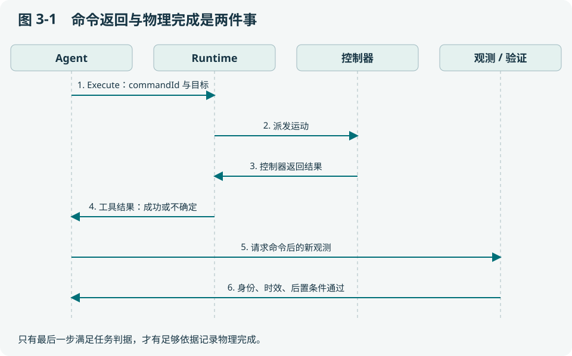

# 第 3 章 一次动作怎样获得可信的完成结论

本章用一次“导航到 B”拆解闭环。你将学会设计前置条件、后置条件和证据基线，判断工具成功与任务成功之间还差什么。

## 3.1 先写判据，再写执行函数

教学设定：B 的目标位置为 (4, 2)，允许的位置误差为 0.2 米，最后位姿必须来自命令之后的有效采集。这里数值仅为计算示例，项目实际阈值由技能与设备配置决定。最小到达判据可写为：

```text
位置误差 = sqrt((x - 4)^2 + (y - 2)^2)
到达 = 同一机器人 ∧ 同一地图依据 ∧ 新鲜采集
       ∧ 采集晚于本次动作基线 ∧ 位置误差 ≤ 0.2
```

如果机器人还要面对货架拍照，就应再加朝向或视域条件；如果是无人机，需要保留 z 和姿态。判据描述“业务需要的状态”，不能由某个工具恰好返回哪些字段反向决定。



看图时留意第 4 和第 6 条消息：工具结果会触发下一步观察，但最终记录完成仍需要验证。控制器内部已经有到达判据，并不意味着上层可以忽略任务身份和证据来源；两层回答不同问题。

## 3.2 两张同样清晰的图片，为什么只有一张有效

假设命令开始前保存 `source=camera-A, sequence=81`。动作后收到两次响应，画面看起来都在 B：第一张仍是 sequence=81，只是网络接收时间更新；第二张是 sequence=83，采集时间晚于命令，并绑定当前地图。

第一张不能证明本次动作完成。它可能来自机器人上一次到 B 的历史缓存。第二张也不是自动有效，还要核对内容、frame、来源和该技能的后置条件。清晰度、文件 SHA 正确和业务真实性分别是三个层次：SHA 证明所读字节一致，不证明采集发生在指定时刻。

当前实现的闭环机制可从 `core/closedloop/` 阅读；具体物体放置裁决还涉及 [core/harness/evaluator.go](../../core/harness/evaluator.go)。不要把一个放置 evaluator 当成所有异构机器人的通用物理验证器。

## 3.3 “不知道”应该是可保存的结果

考虑工具调用超时。可能是请求未到设备，也可能是设备已经完成、响应丢失。若执行器没有更多证据，就必须留下 unknown。这个状态的价值在于明确限制后续行为：不能按“失败等于没动”重新执行，也不能按“可能成功”推进依赖它的步骤。

| 结果类别 | 推理依据 | 允许的下一步 |
| --- | --- | --- |
| 只读失败 | 无物理副作用，来源可核对 | 在权限和预算内有界重读 |
| 明确拒绝且未产生效果 | 设备/执行层有该语义的证据 | 可评估重规划或更正参数 |
| 已确认完成 | 精确绑定的动作后证据 | 记账并推进依赖步骤 |
| 写效果未知 | 派发边界或完成证据不确定 | 停止后续写，调查和对账 |

这张表把“重试策略”变成证据驱动的决定，而不是按 HTTP 状态码统一重试。

## 3.4 Gate 的顺序为什么会影响行为

一个合理的裁决顺序是先核对身份与版本，再核对采集来源和时间，最后计算业务误差。若顺序倒过来，旧地图中看似很小的误差可能提前让系统接受错误动作。

项目的 Runner、Provider 和技能判据共同完成检查。不同路径的验证强度必须沿装配确认：例如语义目标存在，只能证明地图里登记过该地点；不能据此证明机器人已经到达。当前目标合同的 completion read 对返回值作显式检查，但这些读取背后的 Provider 必须真的产生可信观测。

## 3.5 算一遍误差，再找一个反例

观测一为 (4.1, 2.1)，误差约 0.141 米；观测二为 (4.3, 2.0)，误差 0.3 米。在其他条件相同且有效时，前者满足示例阈值，后者不满足。

现在把观测一的地图 revision 从 7 改成 6。误差仍为 0.141，但证据失效。这个练习说明：几何计算正确只是验证链的一部分。再把两次“独立样本”改成同一个 sequence 重复发送，即使数量达到门槛也不能支持稳定性结论。

## 3.6 为什么需要严格的失败样本

验证器应至少测试旧采集、错机器人、错命令、错地图、重复样本、单位不符和真实未到达。若只用成功截图测验证器，它很容易变成“输入任何成功字段就返回通过”的包装器。

2026-10-20 工作台修复提供了一个小而重要的例子：数据库 Task 为 SUCCEEDED，但工具历史为空时，页面现在报告 `SUCCESS_WITHOUT_EXECUTION_HISTORY`。UI 不修改 Task 的结果，却不再把它显示成证据完整。这体现了展示层也要区分状态与依据。

**源码练习**：阅读 [web/task_trace.js](../../web/task_trace.js) 的 `analyseAlignment` 与 `core/closedloop/` 的验证入口，列出它们分别能够证明什么。前者检查已存记录的一致性，后者参与执行闭环；两者不能互相替代。

## 3.7 分层习题

基础题 B：为什么“没有看到杯子”不等于“杯子不在盘里”？

工程题 E：为导航设计带时间、身份和误差门槛的后置条件及五个反例。

研究题 R：研究验证器同源偏差：改变一个证据来源后，如何检验完成判据是否仍有效？

作答应写明假设、判据与证据。评价要点见[附录 I](../appendix/I-exercise-guide.md)，实践路线见[附录 F](../appendix/F-learning-labs.md)。
