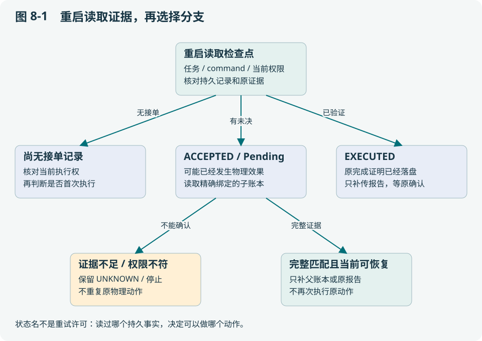
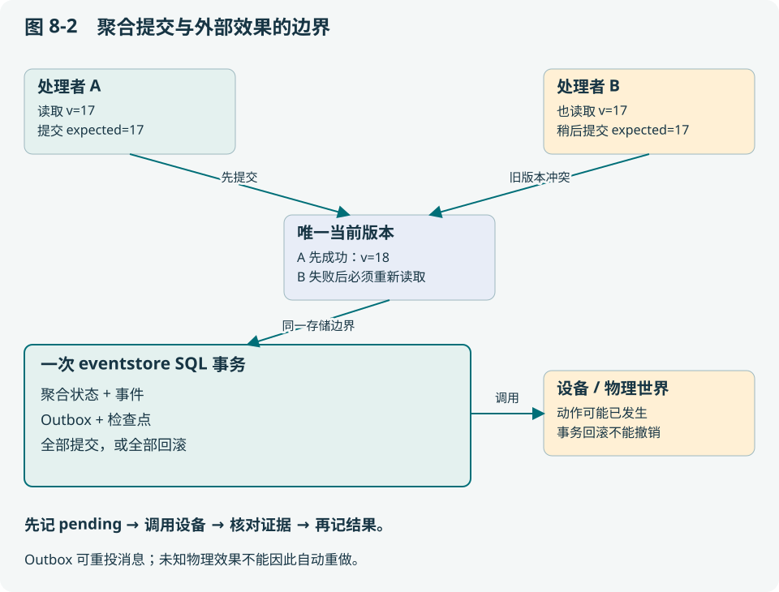

# 第 8 章 分布式故障：超时、重复与恢复窗口

本章的核心问题是：网络只能告诉我们“没收到回复”时，如何避免把一个物理动作执行两次？读完应能列举崩溃窗口，并为每个窗口指定恢复依据。

## 8.1 先推演两个看起来相同的超时

场景一：请求没有送到 Runtime，客户端超时。场景二：机器人已到 B，回包丢失，客户端超时。客户端看到相同错误，但第一次可能需要执行，第二次重做可能浪费路线、破坏物品或扩大风险。

仅靠重试次数和指数退避不能区分两者。它们解决发送节奏，不解决效果身份。系统需要稳定 commandId、设备侧 journal、执行检查点和命令后证据，才能把“不知道”缩小到确定的窗口。

## 8.2 幂等、租约和 fence 分别防什么

| 机制 | 防止的问题 | 不能代替的机制 |
| --- | --- | --- |
| 幂等键 / commandId | 同一请求重复到达造成重复处理 | 不证明设备效果已发生或已停止 |
| claim / lease | 两个 Worker 同时获得当前任务权 | 旧 Worker 在网络分区中可能仍存活 |
| fencing token | 资源拒绝旧持有者的写 | 仅在接收端实际检查时有效 |
| CAS 聚合版本 | 并发写覆盖新状态 | 不把设备动作纳入数据库事务 |
| Outbox / Inbox | 落库与消息投递之间丢通知 | 不提供物理动作 exactly-once |

例如新 Worker 使用 fence=12，旧 Worker 仍带 11；真正接收命令的边界必须拒绝 11。只在云端页面显示新持有者，对设备没有约束作用。当前租约和资源机制也不等同于 Raft 共识系统。

## 8.3 四个持久化位置决定重启行为



| 崩溃位置 | 现有证据 | 正确恢复方向 |
| --- | --- | --- |
| 持久接单之前 | 没有本次检查点 | 在当前权限仍有效时判断是否首次执行 |
| 接单后、结果确定前 | ACCEPTED 或 pending | 可能有物理效果；调查而非盲重做 |
| 子执行已验证、父记录未推进 | 精确绑定的完整子账本 | 重新核对权限后只补父记账 |
| 完成证明已落盘、上报或响应丢失 | EXECUTED 与原 completion | 补传原报告，不重做动作 |
| 完成确认已持久化 | COMPLETED | 返回已知结果 |

[edge/worker/context.go](../../edge/worker/context.go) 处理 Worker 检查点，[internal/edgeagent/recovery.go](../../internal/edgeagent/recovery.go) 处理目标内子账本窗口。表中相似原则不能使两种状态结构互换。

## 8.4 为什么先写 pending，再调用设备

考虑伪代码：

```text
提交：本步骤 pending=true，预留预算，绑定 command
调用：执行器 → Runtime → 验证
提交：保存精确结果，pending=false，推进索引
```

如果把第一次提交移到调用之后，在设备执行与落盘之间崩溃，重启会误以为动作尚未开始。先落盘虽然不能消除未知窗口，却能把它标出来。进一步用子账本的完整绑定结果缩小未知范围，而不是假装窗口不存在。

当前 [internal/edgeagent/journal.go](../../internal/edgeagent/journal.go) 使用 ExpectedVersion，将聚合状态、事件和检查点提交到同一 eventstore 事务。Runtime 的物理世界仍在事务外；外部资源 Transfer 与云端成功事务之间也存在需对账窗口，不能因此宣称端到端 exactly-once。

## 8.5 完成响应丢失后，为何不能套用新 revision

任务 revision 1 已完成并上报，但响应丢失；期间用户创建 revision 2。Worker 重传时应拿 revision 1 的原执行摘要和完成证明对照不可变回执。若拿当前 revision 2 去解释旧结果，可能把未执行的新目标标成成功。

[core/contextcontract/basis.go](../../core/contextcontract/basis.go) 通过 taskRevision、claimVersion、stepId、commandId、robotId、executionDigest 等字段表达执行依据；[fleet/coordinator/completion.go](../../fleet/coordinator/completion.go) 与 `finalization.go` 负责相应完成和收尾。digest 用于验证字段组合，仍不能代替设备真实性与通信身份。

## 8.6 用最小反例学习恢复

阅读并运行以下软件测试，不会驱动机器人：

```bash
go test ./internal/edgeagent -run 'TestDelegatedVerifiedCrash|TestDelegatedExpiredUnknown' -count=1
```

先预测三个结果：完整匹配证据、缺失 StepCompleted、相同工具但错误 binding。再看测试如何要求后两者保持拒绝。若只记得“有检查点就可以恢复”，你会在最危险的分支作错判断。

**设计取舍**：越精确的日志通常能提高自动恢复范围，但会增加写放大、存储压力和对账成本。优化方向是保留决定执行权与效果身份的最小充分记录，而不是删掉所有中间状态追求速度。

## 8.7 “保证一致性”必须指明哪一种状态

同一系统内可以同时存在强约束写入和延迟可见的观察。把“所有节点最终一致”当成统一承诺，会遗漏旧 Worker 继续驱动电机的窗口；把“所有数据必须立即一致”当成要求，又可能让一条非关键 telemetry 拖住全系统。

| 状态对象 | 需要维持的关系 | 当前机制与限制 |
| --- | --- | --- |
| 一个聚合的状态、事件、检查点 | 同一次提交一起成功或一起失败 | eventstore 事务与 ExpectedVersion；限于对应存储边界 |
| 当前动作所有者 | 旧持有者不能凭旧许可继续写 | claim/期限、fence、接收端核对；依赖每个写边界实施 |
| 一条 peer 消息 | 同身份重投不变成不同消息 | Outbox/Inbox、稳定请求身份、sequence 与冲突检查 |
| 业务覆盖视图 | 只采纳相容、有效的同行信息 | 有界 feed 与 Basis/TTL 过滤；不是全局同步地图 |
| 物理动作结果 | 结论与原命令及后置观测匹配 | journal/观测/恢复；外部效果无法加入普通 SQL 事务 |
| 模型视图 | 从指定事实版本产生，不能覆写原事实 | 投影、scope、哈希与请求归档；不是数据库副本 |

本地事务原子性、每个资源的排他权、消息去重、因果追踪和全局线性一致性是不同性质。本项目没有因此成为一个跨所有云边节点运行共识协议的全局数据库。

## 8.8 用两个并发写者推导 CAS 为什么必要

设聚合状态为 S_v，版本 v。两个处理者 A、B 都读到 v=17，并各自计算下一状态。一次合法提交应满足：

> Commit(expected=v, next=S′) 成功 ⇒ 当前版本为 v，且新版本为 v+1。　（8-1）



A 先提交版本 18；B 再带 expected=17 提交就必须失败，或遇到存储锁/事务冲突后重新读取再判断。若 B 不比较版本直接写，其旧状态可能抹掉 A 刚记录的 pending/预算，从而让同一步再次被执行。

实际 [middleware/sqlite/fleet.go](../../middleware/sqlite/fleet.go) 在事务中检查当前版本与 next=expected+1，并对已有聚合使用带版本条件的 UPDATE；事件、Outbox 与检查点在该事务内提交。调用者必须处理冲突，不能把数据库错误变成“默认成功”。该结论限于此 Store 和同一聚合，不证明另一个数据库或机器人也原子更新。

若用归纳法理解：初始状态符合约束；每次转换基于当前版本并检查不变量；成功提交序列便可保持该约束。它仍依赖正确的转换函数、持久存储和所有写者都经过此接口。绕开 Store 直接改库，或在提交前已经驱动了外部设备，都会超出这个论证。

## 8.9 消息可重投，为什么物理动作不能简单重投

把事件与 Outbox 一起落库，可以避免“状态已完成、通知永久没入队”。但发送与对方 ACK 不在本地事务里，所以重投仍然必要。

| 中断窗口 | 重启后可知什么 | 恢复动作 |
| --- | --- | --- |
| 本地事务未提交 | 没有持久 Outbox 项 | 按原业务身份重新判断/提交 |
| Outbox 已提交，尚未发出 | 已有待投递消息 | 发原消息 |
| 对端 Inbox 已提交，ACK 丢失 | 发送端无法确定是否送达 | 重发原消息；对端识别 duplicate |
| ACK 已收，业务消费者未处理 | 只知道信封已接受 | 消费者按游标处理；不能声称业务完成 |
| 业务处理含外部动作后崩溃 | 外部效果可能已发生 | 查命令 journal 与证据，不能仅重放消息 |

因此去重能提供的是某个明确定义边界内的处理语义。即使 Inbox 中 messageId 只出现一次，消费者调用的机械臂也可能在崩溃前动过。端到端应以稳定 command、持久未决状态和效果核对贯穿，而不是把消息中间件的 exactly-once 名称外推到物理世界。

## 8.10 网络分区时，一致性与继续服务的冲突在哪里

考虑 A 持有共享资源 fence=11，随后与协调端失联；协调端将资源交给 B、fence=12。如果 A 的设备接受所有命令而不检查 fence，A 与 B 都可能认为自己合法。任何“最终会同步”的方案都无法撤回已经发生的碰撞。

安全方向是让真正执行写的资源边界拒绝旧 token，并在无法确认当前权限、期限或设备状态时拒绝扩大动作。若资源边界本身分裂成两份互不协调的独立实现，单独带一个递增数字也不够；需要唯一权威、可证明的共享裁决或任务空间隔离。这个反例解释了为何网络分区下不能同时承诺“任何一端一直可写同一排他资源”和“始终唯一所有者”。它不是对本项目已经实现通用共识的证明。

Local 任务与云端 Worker 还要区分：Local 可在自己的有效批准、本机传感器与约束下运行，不依赖每步访问云端；Worker 对云端领取的任务受其 claim/Basis 与恢复规则约束。不能由“边缘自治”推导断网后旧云端授权无限有效。是否继续某个本地阶段，需要合同预先允许、期限有效且本地边界可核对。

活性和安全性分别讨论：安全性要求坏事不发生，如未知写不被自动重放；活性要求在明确前提下最终推进，如网络恢复、权限仍有效、证据可得且重试调度公平时补传能完成。安全停止可能暂时损失活性，应报告原因与持续时间，不能为了完成率掩盖停止。

## 8.11 事件顺序、因果顺序与墙钟时间

同一 stream 的 sequence 表示该流顺序；两个机器人各自的 sequence=42 没有跨流大小关系。墙钟用于年龄和 TTL，但时钟偏移意味着时间戳排序不一定是因果排序。

Lamport 的 happened-before 关系由三条规则构成：同进程先后、发送先于对应接收，以及传递性。教学逻辑时钟可用本地事件加一，收到时间 c 的消息时更新为 `max(local,c)+1`。于是：

> a → b ⇒ L(a) < L(b)，反向不成立。　（8-2）

L(a)<L(b) 也可能只是给并发事件排了顺序。向量时钟能进一步表达并发：对两个分量，(3,1) 与 (2,2) 各有一项更大，因此不可比较。它们不能直接按字典序当成“新的覆盖旧的”。概念出处见 [Lamport 原论文](https://lamport.azurewebsites.net/pubs/time-clocks.pdf)；向量例子是课堂解释。

**实现对应**：当前合同使用聚合版本、每流序号、命令/因果绑定和空间 Basis，不是完整 Lamport 或向量时钟实现。跨流分析应追发送/接收与 causation，而非假设已经有全局单调时钟。若跨域新鲜度预算要求真实年龄 ≤Δ，且时钟差绝对值有可靠界 ε，可保守要求估计年龄+ε≤Δ；没有时钟差界时，就不能只凭两台机器的墙钟证明严格年龄上界。

## 8.12 为什么有些信息可以合并，有些必须拒绝

假设同一 geometry、同一观测规则且只讨论历史观察，A 的已观察集合是 {u,v}，B 是 {v,w}。集合并集得到 {u,v,w}，满足交换、结合和幂等：

> A∪B=B∪A；(A∪B)∪C=A∪(B∪C)；A∪A=A。　（8-3）

这些性质使重排与重复消息容易处理，是学习可合并状态的好起点。但“曾经看到”与“当前可安全通行”不同：障碍可移动，地图会换版，旧观察会过期；一旦删除/撤销与时间窗加入，简单只增集合就不再足够。任务授权和当前动作所有者也不能用并集，否则两份授权会变成更大的权限。

当前 CoverageView 先检查身份、空间与任务依据，再产生 advisory，未实现通用 CRDT 地图或分布式授权合并。未来适合研究的对象是带来源的单调观察事实；合并策略应与本地执行账本分开，错配版本继续拒绝。

## 8.13 用不变量组织系统审查

下面是审查目标的形式化表达，是否成立要逐条验证接线和设备前提：

> Admit(command) ⇒ CurrentAuthority ∧ CompatibleBasis ∧ WithinBudget。　（8-4）
>
> RecordPhysicalComplete(command) ⇒ BoundEvidence ∧ FreshEnough ∧ Postcondition。　（8-5）
>
> UnknownEffect(command) ⇒ 禁止普通自动重放该效果。　（8-6）

第一个防越权，第二个防把“发出”当“完成”，第三个防重复效果。对一次失败，先指出哪条不变量受到威胁，再确定应查什么证据。实践中，物理停止也要核对控制器和实际状态；形式化箭头不会自动赋予厂商接口这些能力。

用这个框架比较方案：单节点事务易实现但不能跨设备原子；消息队列能解耦和重投但要补幂等；共识能在其故障模型内协调复制状态但增加延迟/部署复杂度，且仍不能把电机效果变成 SQL 数据；结构化账本加保守恢复适合当前边缘执行，但要接受不确定时停止与人工核对的代价。

## 8.14 分层习题

基础题 B：为什么队列ACK不等于物理成功？

工程题 E：分别在ACCEPTED、EXECUTED及中心成功后丢响应，列出可恢复事实和禁止动作。

研究题 R：设计跨存储Transfer故障矩阵，说明哪些结论需要共识/事务或对账来支撑。

作答应写明假设、判据与证据。评价要点见[附录 I](../appendix/I-exercise-guide.md)，实践路线见[附录 F](../appendix/F-learning-labs.md)。
