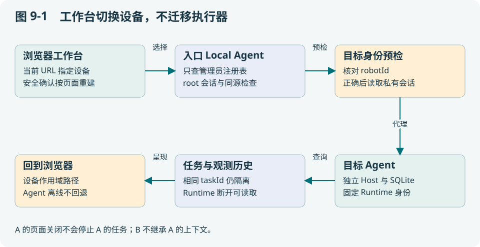

# 第 9 章 单机器人边缘系统与多机器人工作台

本章把架构落到可运行进程。读完应能说明一个边缘 Agent 的最小组成，追踪 taskId 的持久位置，并理解切换工作台设备为何不应热换 Runtime。

## 9.1 一台机器人也需要完整的系统边界

最小边缘系统包含任务入口、Host/执行器、能力与 Runtime 客户端、持久任务和检查点、观测索引及操作界面。移到单机运行只减少网络跨域，不会消除崩溃、旧数据或物理副作用。

[cmd/local-agent/main.go](../../cmd/local-agent/main.go) 是组合根：把依赖装起来，不应该塞入全部业务规则。主逻辑位于 `internal/edgeagent/`、`internal/capabilityagent/`、`tasks/` 等模块，SQLite 实现在 `middleware/sqlite/`。这个结构让相同业务核心能够被 Worker 入口复用。

## 9.2 浏览器选择 B，不能把 A 的执行器换成 B

一种危险实现是在服务器全局变量里写 `currentRobot=B`，所有 API 都读取它。两个标签页分别操作 A、B 时，最后一次切换会影响另一页；A 的迟到响应也可能显示在 B 页面。如果 A 正在执行长任务，热换 Runtime 还可能把下一步派发给 B。

当前工作台采用 URL 作用域：`/` 对应入口绑定设备，`/robots/<id>/` 对应已注册的独立 Local Agent。选择器使用整页导航清理旧页面的轮询与回调；各设备保留自己的 Host、SQLite 和控制权。



## 9.3 从一次读取看清信任边界

浏览器读取 `/robots/uav/v1/tasks/P`。入口先检查自身会话与同源，再用无凭据请求核对目标 Agent 的不可变 robotId，随后读取私有 sessionFile，携带目标令牌及预期设备身份转发。目标 Agent 再次检查身份，避免预检后端点换机。

身份错误、未注册路径、离线和会话缺失都明确失败，不回退到入口机器人。同一主机不同端口的 Console 使用不同 Cookie 名，避免相互覆盖。地图与文件标定还核对产物 robotId，防止共享目录把另一设备的“已就绪”借过来。

这些机制解决设备隔离和误路由，**没有提供用户角色授权或公网多租户认证**。相关实现为 [console/workspaces.go](../../console/workspaces.go)、[console/guard.go](../../console/guard.go) 与 [web/edge_workspace.js](../../web/edge_workspace.js)。

## 9.4 历史可回溯需要什么条件

| 情况 | 能读什么 | 不能据此推断什么 |
| --- | --- | --- |
| Agent 与 Runtime 都在线 | 当前查询和该设备历史 | 当前状态必然适合运动 |
| 已运行 Agent 在线，Runtime 断开 | 已保存任务、事件和观测索引 | 旧观测等于当前现场 |
| Agent 本身离线 | 页面保留设备选择和错误 | 入口拥有它的完整历史副本 |
| 重启 Agent | 通过运行身份检查后读取原数据库 | 自动重做未决动作 |

当前回溯基于任务留存，未新增全天候原始传感器录像。若论文需要连续轨迹，必须显式录制并记录采样、时钟和丢帧；不能从任务页面有几张图片推断全程可重建。

## 9.5 两台设备相同 taskId 的实验

运行：

```bash
go test ./console -run TestWorkspaceRealTaskHistoryAndEventsRemainIsolatedAcrossRestart -count=1
go run ./console/testdata/workspace-preview
```

第一条使用真实 SQLite 和 HTTP/WebSocket，检查不同设备相同任务编号、并发读写、会话轮换和重启历史。第二条打开明确标为样例的工作台，包含 Runtime 离线和 Agent 离线情况，executor 拒绝物理执行。退出预览按 Ctrl+C。

练习不是“点一下下拉框就成功”，而是：在 A 选择某任务，切到 B，核对请求路径和内容，再返回 A；关闭页面后观察订阅是否结束；解释为什么任务执行本身不应被取消。

## 9.6 持久化与部署的实际成本

每台设备需要独立 data-dir、Runtime 身份与产物目录。入口注册多个 Agent 使操作方便，但新增单入口依赖和代理开销；当前入口自身启动仍需要绑定自己的 Runtime，并非独立无机器人聚合服务。

未来可增加只读历史副本、独立聚合服务器和用户授权，但这些扩展应保持设备执行权不依赖浏览器选中项。按设备划分数据库的代价是全局查询复杂，收益是单机故障与上下文边界清楚。

操作配置见[工作空间部署指南](../../docs/operations/edge-robot-workspaces.md)。本章强调设计原因；实际连接设备前应按该指南配置私有会话与路径。

## 9.7 用户直接使用，系统自动组织接收历史

从产品看，用户仍在原表单输入“读取当前整机标定状态”，稍后输入“重新读取标定状态，检查相机是否仍有效”。默认 Local 为两次输入创建同一接收 session 下的不同 turn 和 Task；每个 Task 有自己的原句、批准和结果。用户无需先新建 session，也不能用第二句继承第一句批准。

需要区分此前工作空间中的 `sessionFile`：那个文件保存目标控制台访问 token，供受信代理发请求；新的 intake session 保存输入关联。前者轮换不要求删除后者，后者轮换不取消 Task。当前 `robotId + normalized adapter` 是接收分区，切换工作空间访问的是另一台 Agent 的分区；没有用户/租户维度，所以多人共用同一个 Local 时会共享该机器人的近期输入，暂不适合直接开放多人服务。

[cmd/local-agent/main.go](../../cmd/local-agent/main.go) 在绑定实际 Runtime 身份后装配 manager，并让模型设置重载继续复用同一个 manager。`Begin` 到 `Complete` 串行化的是接收与规划，不是用一个会话锁占住机器人的整个长任务。未配置 GOAL 模型时仍记录会话，但旧离线语法只解析本轮原句，没有因此获得跨轮指代理解。

可以只运行软件集成检查：

```bash
go test ./cmd/local-agent -run '^TestAutomaticSessionHTTPModelAndJournalRestart$' -count=1
```

它经过真实 HTTP handler、模型请求序列化和 SQLite 重开，但模型与机器人为 fixture。阅读断言时应找到“同一 session、新 turn/task、原句不变、未自动批准、第二轮模型含历史、副作用调用为零”，再解释为什么这些结论还不能替代 Gazebo 导航。

## 9.8 分层习题

基础题 B：为什么healthz正常但readiness为false可能是正确状态？

工程题 E：设计包含任务库、命令journal、地图和配置身份的一致备份清单。

研究题 R：比较单机与机群控制端切换的故障假设，设计不会重复派发的验证方法。

作答应写明假设、判据与证据。评价要点见[附录 I](../appendix/I-exercise-guide.md)，实践路线见[附录 F](../appendix/F-learning-labs.md)。
