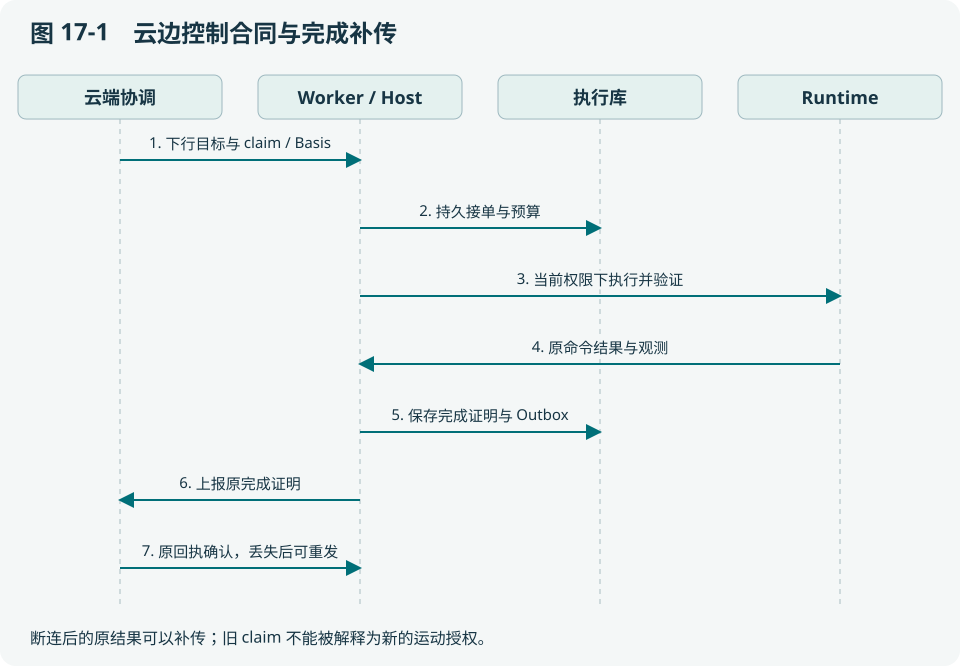
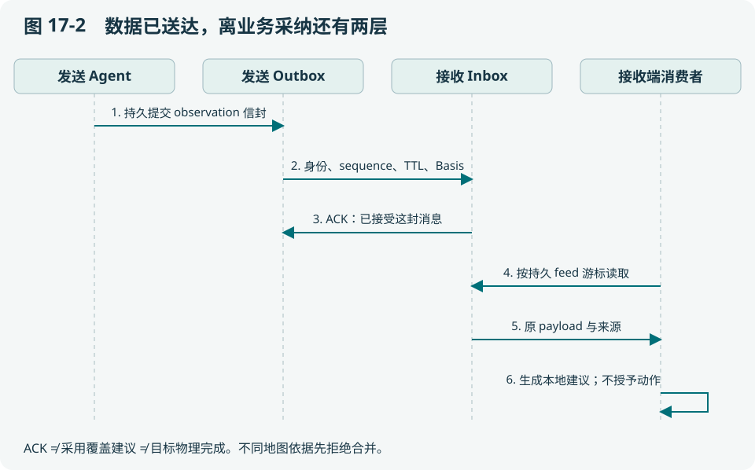
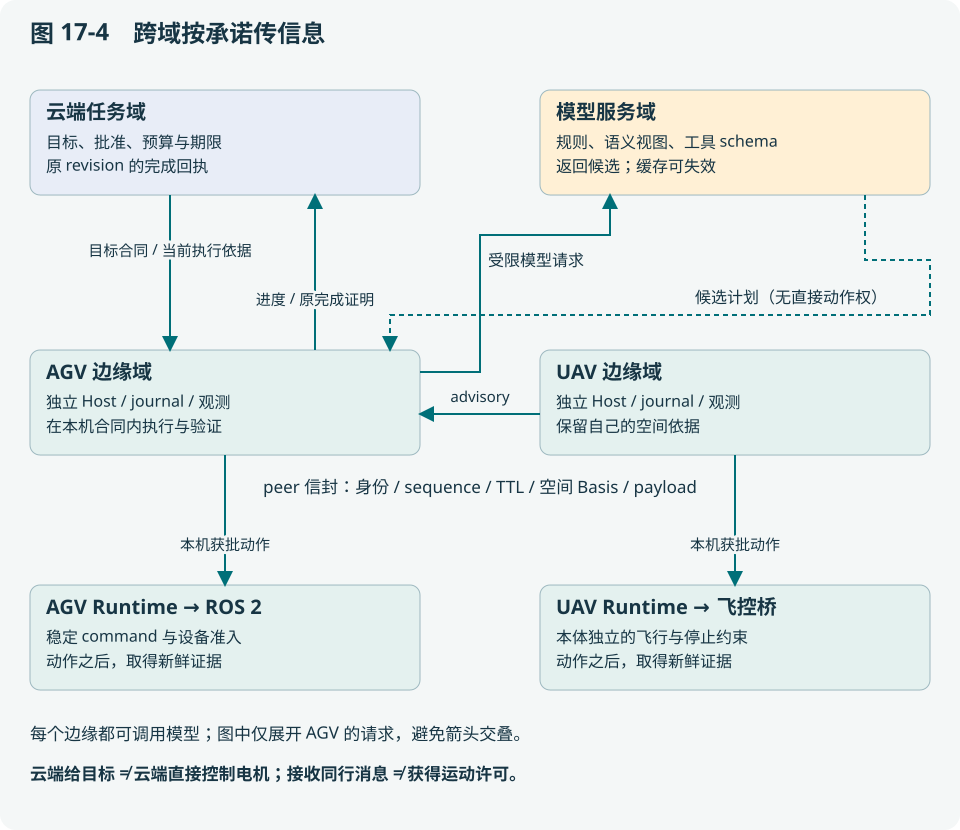
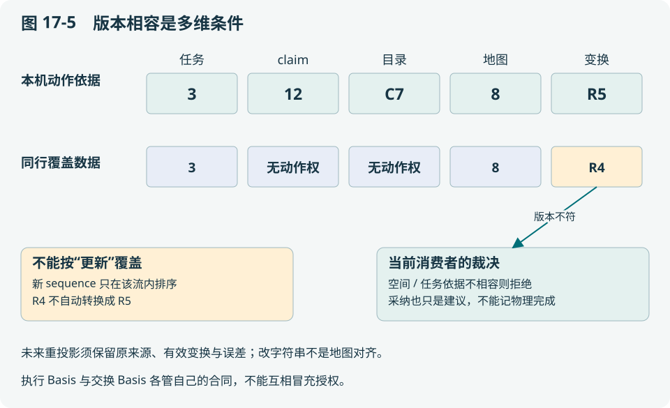

# 第 17 章 云边与机器人之间究竟传递什么

本章是全书的通信总图。读完应能为一条消息确定发送者、接收者、字段、持久化位置和 ACK 的含义，并解释为什么数据共享不会自动获得动作授权。

## 17.1 先分三条通道，再选传输技术

| 通道 | 主要内容 | 权威效果 |
| --- | --- | --- |
| 云边任务控制 | 目标合同、批准、claim、执行 Basis、完成回执 | 在合同与当前执行权内委托任务 |
| Agent 角色事件 | 原失败、诊断、恢复提案、进度 | 驱动协作；必须回查绑定与权限 |
| 机器人间数据 | 观测、地图依据、覆盖建议、经验引用 | 提供信息；不授予运动或覆盖本地权威 |

HTTP、gRPC、Redis Streams、ROS 2 都是承载方式。先问消息允许接收方改变什么，再选择传输；“用了可靠消息队列”并不能回答任务是否已完成。

## 17.2 云端给目标，边缘负责现场细化

云端提交 `robot.objective.v1`，批准目标与授权包络；Worker 领取后以当前 claim/Basis 进入共享 Host。Host 生成受限子计划，调用 Runtime，验证并留下完成证明。Local 入口也可运行同一 Host，只是没有云端领取这一步。



云端同事实现时最容易漏的是“完成上报丢响应”分支。若完成证明已经持久化，边缘应补传原证明；云端用不可变完成回执识别重复，不能要求机器人再跑一次才返回成功。

## 17.3 Basis 的字段为什么不能只留 taskId

[core/contextcontract/basis.go](../../core/contextcontract/basis.go) 的执行依据包含以下关键维度：

| 维度 | 典型字段 | 区分的冲突 |
| --- | --- | --- |
| 业务版本 | taskId、taskRevision、executionDigest | 原目标与修改后的目标 |
| 派发权 | claimVersion、resourceId、fencingToken | 当前 Worker 与旧持有者 |
| 动作身份 | stepId、commandId、intentIndex | 相同工具的不同调用 |
| 设备与能力 | robotId、adapter、catalogRevision | 错设备或能力语义变化 |
| 世界依据 | WorldBasis 内的 revision、来源等 | 用旧世界解释新动作 |

这些字段共同描述“这次动作为什么被允许”。只留 taskId，无法识别同任务的新 revision 或重复领取。序列号和 fence 还要保持精确整数，跨动态 JSON 边界时避免浮点舍入改变身份。

## 17.4 点对点数据的实际信封

[core/exchangecontract/contract.go](../../core/exchangecontract/contract.go) 的 Envelope 使用 `schemaVersion=agent.data.v1`，带 messageId、sender/recipient（agentId、robotId、domain）、stream、kind、sequence、createdAtMs、expiresAtMs、basis 与 payload。sequence 的 JSON 编码为字符串，以保留 uint64 精度。

空间 Basis 包括 worldId、frameId、transformRevision，可带 mapId/mapRevision。payload 描述具体业务，而信封负责身份、顺序与时效。发送请求的 requestId 用于稳定发布身份；重试同一请求但改变内容应成为冲突，不能默默覆盖。



发送端 Outbox 保留待投递数据，接收端 Inbox 持久接受后返回 accepted 或 duplicate。业务消费者随后按 feed 游标读取。**投递成功、业务采纳和物理完成是三个独立结果**，监控与论文指标必须分开。

下面是与实际 Envelope 字段一致的**教学消息**，不是本次抓取的运行日志。时间设为课堂时钟 T=1000000 毫秒，便于手算 60 秒 TTL；真实服务会按真实时钟拒绝这个过期示例。

```json
{
  "schemaVersion": "agent.data.v1",
  "messageId": "demo-message-42",
  "sender": {"agentId": "uav-edge", "robotId": "uav-1", "domain": "lab"},
  "recipient": {"agentId": "agv-edge", "robotId": "agv-1", "domain": "lab"},
  "stream": "coverage-M",
  "kind": "observation",
  "sequence": "42",
  "createdAtMs": 1000000,
  "expiresAtMs": 1060000,
  "basis": {
    "worldId": "warehouse", "frameId": "world", "transformRevision": "R4",
    "mapId": "M2", "mapRevision": "8"
  },
  "payload": {
    "schemaVersion": "agent.coverage.advisory.v1",
    "missionId": "M", "missionRevision": "3", "geometryId": "G7",
    "observedAtMs": 999500,
    "observedTargetIds": ["shelf-top-2"]
  }
}
```

假设 T=1001000、peer 已配置且目标属于当前集合：信封年龄是 1000 毫秒，观测年龄是 1500 毫秒，它们不是同一个数。信封未过期仍可能不满足消费者的 MaxAgeMS。例如 MaxAgeMS=1000 时，应拒绝采纳。现在只改 transformRevision，推演下一节的冲突。

## 17.5 一个跨机地图冲突的完整推演

UAV 报告目标 shelf-top-2 已观察，任务为 M/revision 3，geometry=G7，map=M2/revision 8，transform=R4。AGV 当前任务相同但使用 transform=R5。即使 payload 中坐标数值一样，也不能合并：变换版本变化可能改变实际区域。

当前 [edge/exchange/coverage.go](../../edge/exchange/coverage.go) 对 peer 身份、最新流序号、TTL、空间 Basis、mission revision、geometry、采集年龄与目标集合逐项检查。输出携带 rejected 原因，且 `advisoryOnly=true`、`grantsExecution=false`、`physicalCompletion=false`。如果持久快照被限额截断，返回空建议而不是假装读完全部数据。

代价是保守拒绝可能造成重复巡视。收益是不会为了节省路程把不兼容地图的数据当作完成依据。未来可增加经验证的坐标重映射，但必须保留变换来源和误差范围，不能简单改 revision 字符串。

## 17.6 多机器人合作还缺哪几项决定

通信让 A 知道 B 说了什么；合作还需要谁分配子目标、共享资源怎么占用、冲突如何裁决、最终联合目标怎样验证。工作台切换器只路由访问，peer 覆盖建议只传信息，二者都不是任务调度器。

当前存在按序交接和异构探索/覆盖的工程基础，但通用联合资源、任意设备动态编组、共同地图误差与无线网络故障下的实机群体长稳，仍需针对性验证。云端粗目标应给每台设备明确范围，边缘保持单机闭环并按协议上报。

## 17.7 对接时用三个故障检验协议

先丢一条通知：重新投递不能重复物理动作。再丢一条完成响应：原证明可以重传。最后让 peer 发布一条新 sequence 但旧地图依据的报告：接收方应拒绝业务采纳，不能为了“保持在线”回用更旧报告。

这些软件行为可从 [edge/exchange/coverage_test.go](../../edge/exchange/coverage_test.go)、`edge/tasksource/` 和 `edge/worker/` 测试阅读。真实无线网络的带宽、乱序、重连和证书生命周期仍需另外实验。

**本章交付**：为三条通道各画一条完整消息链，给每个 ACK 写一句准确承诺。详细字段与现有接线参见[通信、上下文与 Harness 专题](../../docs/architecture/edge-agent-communication-and-context.md)。

## 17.8 信息跨域前，先回答五个问题

本书的域是**身份、权威和数据生命周期的边界**，不只是不同机器或子网。云端任务协调、AGV 边缘、UAV 边缘、模型服务可以在一台开发机上模拟，也可以位于不同网络；不能由 IP 相近推断信任相同。


这张 AI 辅助概念插画帮助理解空间关系：每台机器人有自己的现场信息，远端只接收约定的信息。它不表示真实设备拓扑或实验结果。准确通道见下一图。



发一条消息前，发送方与接收方应共同回答：谁有权声明它；对哪台机器人/哪个任务生效；依据哪个版本；保存在哪里、多久失效；接收后允许改变什么。任何一问无法回答，就不能靠换一种消息中间件补全语义。

| 路径 | 最小必要信息 | 接收方怎样使用 | 不应附带的隐含权力 |
| --- | --- | --- | --- |
| 云→边任务委托 | 目标合同、批准范围、预算/期限、robot、任务 revision、当前 claim/Basis | Host 在包络内细化与执行 | 无界工具访问、跳过本机停止条件 |
| 边→云进度与完成 | 原任务/命令绑定、状态、失败或未知、原完成证明及引用 | 对原版本更新进度或确认回执 | 把旧 revision 的完成算到新 revision |
| robot A→robot B | agent.data.v1 身份、stream/sequence、TTL、空间 Basis、业务 payload | 先持久接收，再按业务条件决定采纳 | 代替 B 的本地动作授权 |
| 角色→角色 | 原失败、causation/correlation、诊断、恢复建议及绑定 | 确定性恢复准入后才能行动 | Ops 的文字建议直接驱动设备 |
| 边→模型服务 | 角色规则、目标/约束、有界语义事实、当轮工具 schema | 返回候选计划/调用 | 原始密钥、无限制数据库读取权 |
| Agent→本机 Runtime | command、设备与能力参数、当前执行依据、期限 | journal/设备准入、派发与反馈 | HTTP 成功即视为物理完成 |

这是语义核对表，不是把所有路径统一成一个 JSON 协议。现有云边目标、角色事件、peer 信封与模型 HTTP 请求各有自己的类型和入口；“统一通信层”应复用身份/追踪/重试设施，同时保留业务差异。

## 17.9 为什么不把整个地图、整个历史都发给所有人

教学设定：点云每帧 100000 点，每点 16 bytes，10 Hz；暂不计传输头与压缩：

> 原始速率 R_raw = N_point × bytes_per_point × frequency
> = 100000×16×10 = 16,000,000 bytes/s = 128 Mbit/s。　（17-1）

若规划者只需每秒两份、每份 2 KiB 的区域状态，速率是 4096 bytes/s，约 32.8 kbit/s。两者相差约 3906 倍。但这不是“同等信息无损压缩了 3906 倍”：区域状态丢掉了大量几何信息，不能替代局部避障、配准或事故调查。

因此按消费者分层：控制器与局部地图服务读取满足时延的传感器数据；语义规划读取障碍/区域/能力状态；任务协调读取目标进度；调查者按权限读取原始证据。模型若要识别图像，可由专门感知路径提交选定帧，不能据此声称现有文本规划请求包含了所有 RGB-D/点云。

跨域大对象宜采用“元数据+内容引用”的扩展：来源、采集时间、frame/map、内容类型、字节数、SHA、受控读取地址。**这是大对象协议的设计建议**，不是说当前 agent.data.v1 已提供通用对象存储。现有 payload 上限为 64 KiB，更适合受限消息；原始对象仍要有独立的保留策略、访问控制与丢失处理。引用失效时应报告证据缺失，不能把引用当作证据本身。

## 17.10 两种 Basis 看起来相似，为什么不能互换

执行 Basis 回答“这次动作在什么授权和状态下被允许”，含 task/claim/command/设备/目录与世界依据。数据交换 Basis 回答“这份观测在哪个空间定义中成立”，含 world/frame/transform/map。后一种并不包含足以授权运动的全部内容。

用教学版本组表达一次决策依赖：

> C = (taskRevision, claimVersion, catalogRevision, mapRevision, transformRevision)。　（17-2）

C 不是当前代码新增的一种协议对象，而是把不同合同的必要条件放在一起思考。也不能对它取一个数字 max：地图 R9 比 R8 新，不表示任务 revision 2 比 3 更合适。这里的一致性是各维度满足其合同的兼容关系，而非“全部字段取最新”。



例如本地决策用 `(3,12,C7,8,R5)`，收到同行的 mission revision 3、map 8、transform R4。任务号和地图号看似相同，但空间依据不相容；现有 CoverageView 拒绝采纳。若未来支持 R4→R5 重投影，必须先验证该变换的有效范围、时间、来源和误差，生成新的派生事实并保留原引用，不能直接改标签。

## 17.11 坐标变换的数值例子：为什么误差也要传播

以下二维截面用于解释三维同类问题，参数均为教学假设。A 机器人观测点 p_A=(1,0) m，A 到共享世界的旋转为 90°、平移为 t=(2,1) m：

> p_W = R_WA p_A + t_WA；R_WA = [[0,−1],[1,0]]。
> 因而 p_W = (2,2) m。　（17-3）

B 若错误使用零旋转，得到 (3,1) m，偏差为 √2 m。两边都把 frame 字符串叫作 map，不能使这两个位置相同。三维通常使用齐次变换 T 和带时间的变换链，来源与版本必须随数据保存。

在线性化、小误差且两类误差独立的假设下，令 Σ_p 为观测协方差，Σ_T 为变换参数协方差，J_T 为对变换参数的雅可比：

> Σ_W ≈ RΣ_pRᵀ + J_TΣ_TJ_Tᵀ。　（17-4）

存在相关性时还需交叉项。这个推导说明“配准成功”并不等于位置确定：安全距离与覆盖判断可能需要不确定性余量。**当前 peer 覆盖合同主要检查精确版本与集合，不实现这里的协方差融合**。未来扩展应同时补误差模型与消费者规则，而非只加一个 confidence 浮点数。

## 17.12 一个目标如何在云、AGV、UAV 与模型之间流动

教学目标：“AGV 巡检 B、C 后回 A，UAV 提供高位货架观察；禁止进入 D；不能确认运动结果时停止扩大任务。”它用于合同推演，不是本版新增实测，也不假设已经有通用自动群体分配器。

| 时点 | 发生的交换 | 新增的事实与下一步 |
| --- | --- | --- |
| t₀ | 云端给各边缘明确目标范围与授权 | 每台 Host 有独立目标/预算，不能用共享一句话代替分工合同 |
| t₁ | AGV 读本机进度与新鲜空间状态 | 模型看到经筛选事实与目录，输出候选计划 |
| t₂ | UAV 持久发送 shelf-top-2 观察 | Outbox 可重发；接收 Inbox ACK 只保证该信封被接受 |
| t₃ | AGV 消费同行 feed | R4/R5 不兼容则记录 rejected，不改变本地完成账本 |
| t₄ | AGV 发 command-c61，响应丢失 | 本机 pending/原 command 保留，不能根据云端催促重做 |
| t₅ | Ops 调查，取得完整匹配子证据或证据不足 | 前者按恢复规则补记，后者保持 unknown/受控停止 |
| t₆ | 边缘发送原完成证明，云端响应丢失 | 补传原证明；新任务 revision 不能吸收旧结果 |

模型可能在 t₁、t₅ 参与不同角色的候选生成，但并不拥有 t₄ 的物理事实。云端可以变更业务目标，仍不能凭一条新自然语言擦除未决命令。协作的核心是让每个角色贡献可追溯的新信息，而不是让所有角色重复思考同一段聊天。

## 17.13 三种跨域方案怎样选择

| 方案 | 优点 | 代价与适用条件 |
| --- | --- | --- |
| 中心收全部数据并逐步决策 | 全局分析方便，入口简单 | 带宽/时延与中心可用性压力大，现场停止仍需本机 |
| 所有 Agent 复制全量上下文 | 原型容易互相“看见” | 隐私、过期事实、权限混淆与冲突成本随规模上升 |
| 边缘拥有执行账本，交换受限合同和事实 | 本机闭环明确，异构差异留在 Harness 内 | 需认真设计版本、拒绝、补传与联合任务验证 |

本系统沿第三种方向构建：复用 Host 与执行生命周期，消息表达明确的业务承诺。它不意味着已经实现任意机器人、任意网络和任意联合目标的自动协作。论文可研究分配策略、压缩策略或通信调度，但应保持动作权威与物理验证不被这些策略隐式改变。

## 17.14 分层习题

基础题 B：解释Local、Fleet和Assist为何不是三套等价任务权威。

工程题 E：画出A放置到B认领的完整消息/资源/验证路径，标出丢响应点。

研究题 R：为跨Adapter合作定义节点合同和联合后置条件，比较按序与并行方案的验证成本。

评分与参考要点见[附录 I](../appendix/I-exercise-guide.md)。
