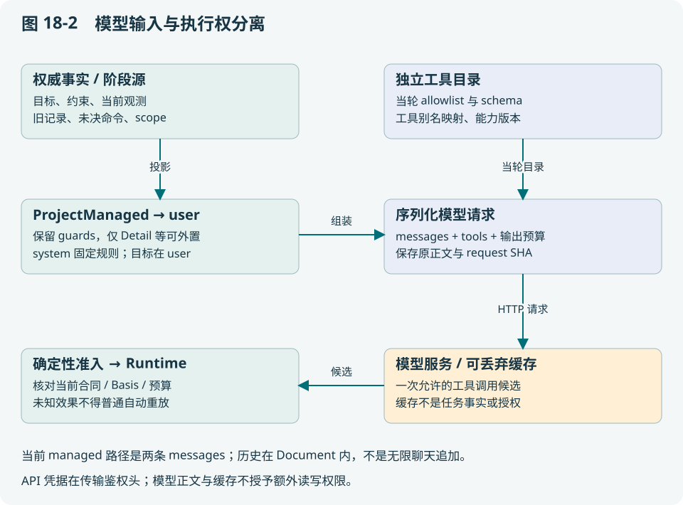
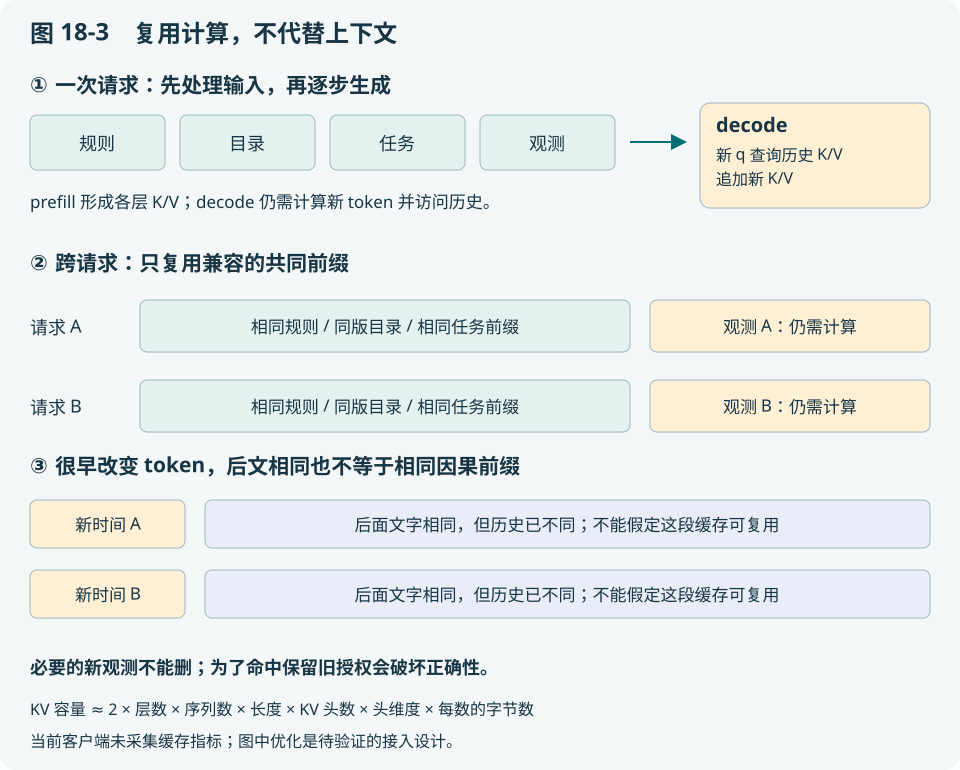
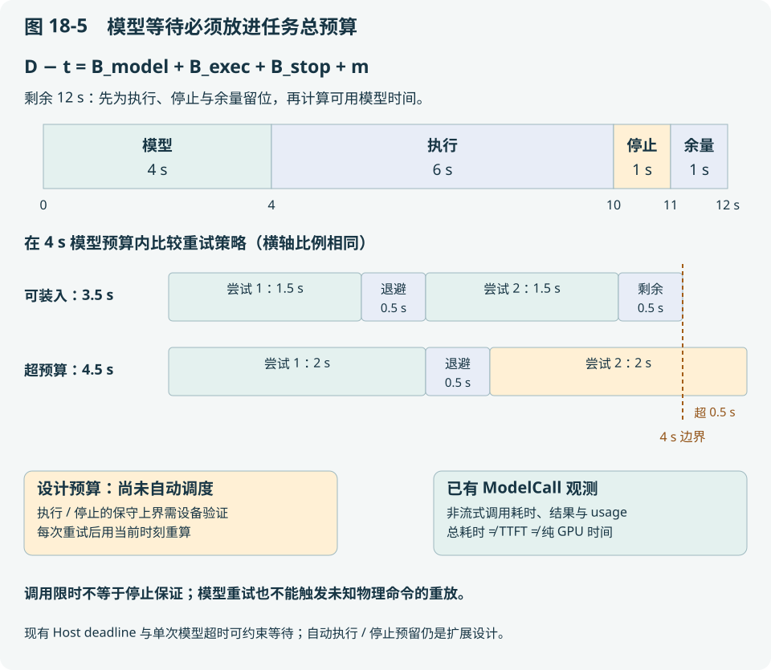

# 第 18 章 模型究竟看见什么：上下文、KV cache 与长程决策

本章沿着“第 60 步之后，Agent 如何决定第 61 步”展开。先拆一份实际模型请求，再推导上下文投影和 KV cache，最后把缓存、模型等待与现场执行放进同一时间预算。读完应能回答：模型知道什么、什么不能交给模型记忆、缓存省了哪部分计算，以及什么时候应停止等待模型。

## 18.1 先把三个容易混淆的“记忆”拆开

| 机制 | 保存什么、归谁管理 | 丢失后的影响 |
| --- | --- | --- |
| 任务状态与证据 | Host/Runtime 的账本、批准、观测、未决命令 | 可能无法安全恢复，必须持久化与核对 |
| 应用上下文 | 由事实生成的模型视图、冷档案、实际请求 | 可以从权威事实重建；归档用于回溯 |
| 模型 KV cache | 推理引擎中的各层 key/value 张量 | 通常增加重算成本，不能改变任务权限 |

因此“压缩上下文”和“启用 KV cache”解决的是不同问题。前者选择模型该读什么，可能影响决策质量；后者复用相同输入前缀的计算，原则上不应删改输入语义。缓存失效后，Agent 仍应知道哪条命令结果未知；SQLite 中有账本，也不意味着推理引擎缓存仍在。


**本版实现边界**：Host 进度投影、actionloop managed context、冷归档和精确请求归档负责上下文正确性；本轮模型客户端升级增加稳定规则前缀、可选缓存提示和调用用量记录。它们使缓存行为可配置、可观察，不证明某个推理后端已经命中，也不证明任务已经加速。18.16 的执行与停止预留预算属于进一步设计，当前不能宣称自动实现了这套调度。

## 18.2 从源码拆开一次真实请求的结构

[internal/actionloop/llmdecider.go](../../internal/actionloop/llmdecider.go) 的 managed 路径构造两条 messages：system 放稳定的角色规则，user 严格等于 `ContextSnapshot.Text`。本轮目标已由 `SnapshotFor` 纳入这份文档，不再额外拼接另一份目标。工具目录通过独立的 tools 字段传入。目标移出 system，不代表删掉目标：它仍与任务约束、当前事实一起送入模型，并由执行层独立约束。历史尝试已进入上下文文档，不是在这条路径中无限追加 assistant/tool 聊天消息。

以下是按实际外壳写的**教学节选**。占位文本不构成可运行请求，具体函数 schema 由当轮目录产生：

```json
{
  "model": "<部署配置的模型>",
  "max_tokens": 4096,
  "messages": [
    {"role": "system", "content": "<稳定角色规则，不拼入动态目标>"},
    {"role": "user", "content": "<ContextSnapshot.Text，内部已包含本次目标>"}
  ],
  "tools": ["<实际为 function schema 对象，省略>"],
  "tool_choice": "auto",
  "parallel_tool_calls": false
}
```

4096 是默认输出预算，非全部调用恒定值。上例采用默认的缓存模式，因此没有额外缓存提示字段。模型地址与 Authorization 凭据用于 HTTP 传输；凭据不应放进 messages。源代码在发送前保存实际序列化正文、模型名称与请求 SHA；发送失败也能追查准备发送的内容。新增 `Projection.ModelCall` 记录调用结果与可用的用量数据，详见 18.13。归档仍不等于记录服务商内部的分词序列、完整服务器状态或 KV 张量。



| 模型可见的内容 | 来源及意义 | 不可据此推断的事 |
| --- | --- | --- |
| 目标、约束与 guards | 本阶段 Document 与系统提示 | 提示词写了“允许”不等于系统已经批准 |
| 当前观测 | 带来源、身份与时效的记录 | 摘要中的“最新”不是新的传感器采集 |
| 旧记录与尝试 | 热视图及可查的冷档案 | 未展示的旧动作不等于从未发生 |
| 工具名、描述、参数 schema | 当轮经筛选的能力目录 | 目录存在不等于该任务有写权限 |
| 最近执行状态 | 成功、失败、未知及绑定信息 | 工具文字 success 不等于物理后置条件通过 |

在 [internal/capabilityagent/planner.go](../../internal/capabilityagent/planner.go) 的批准前规划中，scope 已绑定 robot；此时还没有正式 task/revision，不能凭空编一个。规划器只开放符合条件的只读 provider 和计划提案；写能力可作为提案的数据出现，不因此被规划阶段直接执行。只读数据经 PlanningFields 白名单生成语义视图，不把原始大点云或图像阵列默认塞进模型上下文。

读者应练习区分“这次请求有一个工具”和“这次工具会写设备”。同名能力在计划提案里是数据，在获批 Executor 中才可能成为动作。

## 18.3 模型返回之后，为什么还要再检查

客户端将不符合模型工具命名规则的名称映射为 `tool_0` 等别名，并保留映射，避免与真实名称碰撞。返回必须是当轮提供的一个工具调用；普通解释性文本不是动作授权。规划角色还有提案与 `cannot_proceed` 等控制语义，不能把它们解释为电机操作。

假设模型在 t₀ 看见地图 M2/R8，t₁ 生成“前往 C”，期间地图已变或 claim 已转移。请求归档只说明模型在 t₀ 看见什么，执行准入必须按当前权威重新核对。这个检查—使用间隔称为 TOCTOU：检查时成立不保证使用时仍成立。缓存命中也不能跳过第二次检查。

因此模型协议的合理边界是：**输入带可核对事实，输出是候选，动作由当前合同、身份和设备状态裁决**。本系统对工具 allowlist、参数、目标合同、Runtime 和观测分别设边界；模型输出格式正确只通过了其中一层。

## 18.4 长任务的热视图应当保护什么

巡检 60 步之后，最危险的不是忘记一段闲聊，而是遗失“禁止进入 D”和“command-c12 效果未知”。将事实集合记为 F，当前版本依据为 V，预算为 B，热视图为 H：

> H = P(F, V, B)　　（18-1）
>
> 必须满足：Protected(F) ⊆ H，且 size(H) ≤ B。

P 是应用投影，不是模型自行决定的忘记策略。Protected 包含当前阶段必须精确保留的约束、未决状态与执行依据；可读性摘要只能作用于允许摘要的部分。若保护内容本身超过预算，这组约束无解，应缩小任务或拒绝本次模型调用，不能静默删掉禁止区。

这也是一个受约束的信息选择问题。教学抽象中，为可选记录 i 设相关价值 vᵢ、字节成本 cᵢ、选择变量 xᵢ∈{0,1}：

> 最大化 Σ vᵢxᵢ，约束 Σ cᵢxᵢ ≤ B − Bₚ；Bₚ 为保护状态大小。　（18-2）

它解释了为何“只取最后 N 条”不一定合理：最新但重复的工具日志价值可能低于早先的未知写。不过当前 ProjectManaged 并未实现这个背包优化器，也没有可证明正确的 vᵢ。公式用于设计策略与消融，而非描述已上线算法。相关性检索若引入，也必须服从 Protected 的硬约束。

## 18.5 当前两条投影路径，不能混为一谈

[internal/edgeagent/host.go](../../internal/edgeagent/host.go) 保留完整 `cp.Completed`。提供给规划器的 progress 包含 completion、completedCount、completedDigest、recentCompleted、diagnosis；recentCompleted 最多 8 项，序列化超过 8000 字节则拒绝。已完成 60 项时，模型可见总数、摘要与最后 8 项，但执行层仍用完整账本检查旧动作与预算。

[core/agentcontext/managed.go](../../core/agentcontext/managed.go) 的 ProjectManaged 从完整 source 构造生产视图，保护 guards、constraints、steps、goals，以及所有 `Kind=observation` 的记录。较旧的可选 records 可外置；对 attempts，外置的是冗长的 **Detail**，每次尝试的 identity、完整 arguments、verdict 仍在热视图。它拒绝把已经压缩的 managed view 当成原 source，避免“摘要的摘要”逐轮损失事实。

默认上下文预算 32768 字节、实际请求预算 65536 字节、输出预留 4096 tokens。**字节不是 token**：中文 UTF-8 字节数、tokenizer、JSON 转义和工具 schema 都会改变成本。28 KiB 上下文加 30 KiB 工具与 10 KiB 包装等于 68 KiB，超过 64 KiB 请求预算；检查正文还不够，必须检查实际序列化请求。

这两条路径有共同原则，但没有完全相同的工具接线。Host 不是因存在 actionloop 的 context_read 就自动能查所有历史；能力规划器也有轮数与读取额度，并非无限循环。讨论“系统支持上下文管理”时应指明哪条入口与哪次实际调用。

**有预算上限，不等于任意长历史都装得下。** `SnapshotFor` 为每个历史回合添加精确的执行状态 guard。设固定保护信息大小为 B₀，每轮留下的 guard、身份、参数、verdict 与归档提示共占 cᵢ 字节。即使所有冗长结果都已外置，仍有：

> B_min(n) ≥ B₀ + Σᵢ₌₁ⁿ cᵢ。　（18-2a）

只要每轮 cᵢ≥c>0，这个下界至少线性增长。教学取 B₀=4096 bytes、每轮至少 256 bytes、预算 32768 bytes；由 4096+256n≤32768 得 n≤112。第 113 轮仅保护部分就装不下；实际 JSON 包装和其他记录还会更早占满预算。这里的 256 是便于手算的假设，不是对当前生产记录的测量。

长程任务需要分阶段，使新阶段依据完整账本生成足够的当前状态，并保留跨阶段的未决动作与证据引用。不能简单把第 1—112 轮删除，假定第 113 轮已经不再依赖它们。当前 Host 已用完整 `cp.Completed` 与有界进度分开保存，actionloop 则保守保留每轮状态；两者还没有一个适用于任意任务的自动阶段切分证明。扩展时应优先回答“哪些已完成事实能安全归纳为阶段完成条件”，再优化保留条数。

## 18.6 冷归档怎样做到可查、可核对、不可跨域越权

[internal/actionloop/context_read.go](../../internal/actionloop/context_read.go) 的参数是 sha256、item_id、offset、limit；scope 从本次快照捕获，不让模型自行指定另一 robot/task。单页至多 4096 字节且受当前预算限制；next_offset 表示后面还有内容，半页 JSON 不能当成全档案。

`Artifact.DataJSON` 保存精确源文本，Data 是结构化显示视图。恢复读取会核对源文本和哈希，避免中文切页损坏或通用浮点 JSON 将大整数身份改写。源 SHA、投影视图 SHA、实际请求 SHA 是三个对象：同一源可产生多个视图；相同视图配不同工具目录又产生不同请求。

一个可复核的归档链应能回答：谁在什么 scope 下，从哪个源、按什么策略生成哪个视图，实际发送了什么，模型调用了哪一页。**冷档案存在不代表模型已经读过**；第 19 章的历史实验就是一个实际发生压缩、冷分页调用却为零的例子。

跨域协作优先传“有来源的事实与受限引用”，由接收方重建适合本地角色的视图。复制对方整段聊天会同时带来过期状态、未授权细节和提示注入。引用哈希只证明字节对应，不授予读取权；跨域对象服务若以后加入，还要单独做鉴权、留存和访问审计。

## 18.7 不一致不是一种错误，而是几种不同的裁决

| 冲突 | 权威与应采取的动作 | 为什么不能简单覆盖 |
| --- | --- | --- |
| 摘要说完成，账本为 unknown | 保留原命令未知，重建视图或调查 | 摘要没有新增物理证据 |
| 任务 revision 已变化 | 拒绝旧派发；旧完成只对原回执 | 新目标没有执行过 |
| 同行地图与变换版本不同 | 按空间 Basis 拒绝采纳 | 相同坐标可能表示不同地方 |
| 同 ID 内容不同 | 冲突拒绝，不改原记录 | 否则重试身份失去意义 |
| 保护状态超过模型预算 | 拒绝请求，重新分阶段 | 压缩不能扩大权限 |
| 缓存丢失 | 重算相同有效请求或有界失败 | 缓存并非事实权威 |

多个 Agent 无需拥有相同全文，但在共同动作上必须引用兼容的事实版本。所谓一致上下文更接近“有作用域、有版本依据、能拒绝冲突”，而不是同步所有人的聊天。

## 18.8 KV cache 的第一性解释：保存的是哪个计算结果

以下推导针对使用因果自注意力的常见 Transformer 解码器，不声称适用于所有模型结构。注意力基础见 [Attention Is All You Need](https://arxiv.org/abs/1706.03762)。用单头、单层表示，输入隐状态矩阵为 X，投影矩阵为 W：

> Q = XW_Q，K = XW_K，V = XW_V。　（18-3）
>
> aₜ = softmax(qₜK₁:ₜᵀ / √dₕ)V₁:ₜ。　（18-4）

qₜ 是当前位置的查询，K₁:ₜ、V₁:ₜ 是此前及当前可见位置的键和值，dₕ 是每头维度。因果掩码禁止旧位置看见未来。在模型权重、输入前缀、位置编码等条件相同的前提下，追加一个 token 不会改变旧位置的 K、V。于是可以保留它们，每轮只计算新位置，再用新 q 查询旧 K、V。

为什么通常不把旧 Q 也叫作必需缓存？下一步输出需要的是新 q 与历史 K、V；旧 q 已经完成它对应位置的计算。第一次处理输入前缀称为 prefill；随后逐个生成称为 decode。KV cache 减少重复计算，但每个新查询仍要访问允许范围内的历史键值，并没有把长上下文注意力变成恒定成本，也不扩大模型的上下文窗口。



还要区分**同一次请求内的自回归缓存**与**跨请求的前缀缓存**。前者服务于一次生成；后者要确认新请求的前缀与已有块兼容，才能复用。[vLLM APC 文档](https://docs.vllm.ai/en/latest/features/automatic_prefix_caching/)将复用收益定位于共享前缀的 prefill，并不承诺减少输出 token 本身的 decode 工作。

## 18.9 从张量形状推导显存，为什么边缘设备尤其在意

对每层，每个序列的每个位置，要保存 H_kv 个头、每头 dₕ 个数，K/V 各一份。若 L 层、B 个等长活跃序列、长度 T、每个数 b 字节，则：

> M_KV = 2 × L × B × T × H_kv × dₕ × b。　（18-5）

这只是普通 dense KV 的容量估算，忽略块填充、量化尺度、元数据、共享前缀和并行分片；不同长度应把 B×T 换成各序列长度之和。GQA 的 H_kv 可小于查询头数，不能把 H_q 直接代入。

教学设定 L=32，H_kv=8，dₕ=128，T=8192，B=1，FP16 的 b=2：

> M_KV = 2×32×1×8192×8×128×2
> = 1,073,741,824 bytes = 1 GiB。

若 H_kv=32，结果为 4 GiB；原设定同时四条不共享的等长序列，也是 4 GiB。它们还不包括权重、激活和其他运行内存。因此“模型权重能装进边缘显存”不等于“可以无限并发长任务”。PagedAttention 研究的是 KV 的分块管理与共享效率，不能直接解释成把任务语义压缩了；参见 [PagedAttention 原论文](https://arxiv.org/abs/2309.06180)。

## 18.10 为什么云边之间默认应传事实，而不是传 KV 张量

继续上例，传 1 GiB 缓存，在理想 1 Gbit/s 链路上仅数据传输下界就是：

> T_transfer ≥ 8 × 1,073,741,824 / 10⁹ ≈ 8.59 s。　（18-6）

还未计算排队、序列化、加密和缓存布局转换。若某个部署重算前缀只需 0.4 s（教学假设），迁移就得不偿失。模型版本、tokenizer、位置、量化格式、适配器和引擎布局不兼容时，也不能直接使用这份张量。

机房内部高速互联的 prefill/decode 分离可以另行评估；它与弱网机器人把 KV 当业务协议传输不是同一个场景。对本项目，建议将模型服务作为可替换计算端：跨域传版本化事实、授权范围和证据引用，各推理端自行管理可丢弃缓存。当前 agent.data.v1 不承载 KV 张量迁移协议。

## 18.11 缓存命中率为什么不等于任务加速比

将一轮模型等待近似分成网络、排队、prefill 和 decode：

> T_round = T_net + T_queue + T_prefill + T_decode。　（18-7）
>
> 缓存节省比例 = (T_prefill,cold − T_prefill,warm) / T_round,cold。　（18-8）

教学设定网络与排队 0.5 s，冷 prefill 0.8 s，decode 1.2 s，总计 2.5 s。共享前缀后 prefill 降到 0.2 s，总计 1.9 s；减少 24%，加速比约 1.32。即使共享 4096/5120=80% 的输入 token，也不能说任务快 80%。机器人运动若另需 60 s，端到端从 62.5 到 61.9 s，只减少 0.96%。

计费也要按供应商实际分类：缓存读取、缓存写入、未缓存输入、输出可能分别计价，写入可能另收费。不能只用“命中 token×折扣”估算总费用。本书不固定某个模型的价格、最短可缓存长度或 TTL，部署时查相应版本的[官方缓存说明](https://developers.openai.com/api/docs/guides/prompt-caching)。

## 18.12 怎样布局输入才有机会复用前缀

设服务端实际 token 序列为 X、Y，共同前缀长度 p 定义为从开头起连续相同的位置数。中间某个 token 改变，后续文本即使又相同，通常也不能按同一因果前缀复用，因为其隐状态依赖前面内容。自然语言意思相似不代表 token 相同。

| 输入布局 | 缓存后果 | 正确性考虑 |
| --- | --- | --- |
| 开头写当前时间/随机 trace，后面写长规则 | 每轮很早就分叉 | trace 可以放请求元数据或动态尾部，但必要时间不能删除 |
| 固定规则与稳定工具 schema 在前，当前观测在后 | 有机会复用公共前缀 | 仍要包含当前任务全部约束 |
| 为命中而保留旧地图/旧授权 | 可能看似命中更多 | 已破坏事实有效性，不能采用 |
| 每轮给工具换顺序或换别名 | schema/token 前缀可能变化 | 保证目录语义和映射确定，不能错误复用旧别名 |

**本次改动**：动态 Goal 从 system 移到 user，system 保持同角色规则前缀稳定；managed user 仍随事实重建。工具名映射和当轮 allowlist 继续使用，工具目录的变化也纳入缓存提示键。最终请求 SHA 相同说明归档正文相同，不代表服务器肯定命中；SHA 不同也可能保留长的共同 token 前缀。

输入布局应先稳定公共规则，再考虑任务固定约束与动态状态的位置。供应商实际序列化顺序仍需验证；JSON 字段排列不必然等于引擎 token 排列。模板或 schema 变化应形成新的身份，不能为了复用隐藏更新。动态目标移出 system 也让它更清楚地属于请求数据；不过这个分层不是提示注入的完整防线，真正的动作权限仍由 Harness 判断。

## 18.13 缓存接入怎样落到配置、身份与观测

本轮实现采用显式选择后端模式的方式。GOAL、RECOVERY 阶段可配置 `AGENT_GOAL_CACHE_MODE`、`AGENT_RECOVERY_CACHE_MODE`；对应的 `AGENT_GOAL_CACHE_NAMESPACE`、`AGENT_RECOVERY_CACHE_NAMESPACE` 用于声明缓存提示的分组范围。SYSTEM 当前入口没有适合该接线的真实 scope，因此拒绝开启缓存提示，不伪造 robot/task 使配置通过。不要因为一个服务接受 chat/completions 请求，就假定它支持另一家服务的缓存参数。

| 模式 | 本客户端发送的提示 | 可以据此得出的结论 |
| --- | --- | --- |
| `off`，默认 | 不添加缓存专用字段 | 保持兼容；不代表已经关闭后端的隐式缓存 |
| `openai` | `prompt_cache_key` | 给支持该字段的后端稳定键；不是命中证明 |
| `vllm` | `cache_salt` | 给支持该字段的服务指定缓存隔离盐；仍依赖服务端 APC 配置 |

例如只为 GOAL 阶段指定一类后端，可设置 `AGENT_GOAL_CACHE_MODE=vllm` 和 `AGENT_GOAL_CACHE_NAMESPACE=warehouse-a`；RECOVERY 仍保持默认。namespace 应由部署者配置，不接收模型自由生成的值。不能因缓存请求出错就自动换一个身份域或去掉约束再提交。

这份配置还受实际传输路径约束：当前云端 `/v1/assist` 代理只接受既有白名单字段，没有接入上述缓存参数，因此 `Assist.ClientFor` 提前拒绝通过该代理开启提示。代理路径应使用 `off`，已有响应中的 usage 仍可采集；直连相应模型后端才可选择 `openai` 或 `vllm`。这避免了客户端声称已启用、代理却静默丢字段的情况，也不擅自扩大云端同事的接口合同。

提示键由命名空间、模型端点、模型名、角色、完整上下文 scope、工具 schema 摘要和模板版本形成：

> K = H(Encode(namespace, endpoint, model, role, scope, toolsSHA, templateVersion, rulesSHA))。　（18-10）

H 是摘要函数，Encode 必须保持字段边界，避免把 `ab|c` 与 `a|bc` 拼成同一身份。[model_call.go](../../internal/actionloop/model_call.go) 使用结构化 JSON，并同时计算实际 system 规则的 rulesSHA；即使漏改模板版本号，规则变化仍会改变提示键。身份相同不等于输入前缀相同：当前观测仍可变化，服务端仍应核对实际 token 前缀。反过来，不同机器人即使使用相同规则，也会因 scope 不同而得到不同键；这提供清晰的默认分组身份，可能损失跨机器人复用机会。OpenAI 提示键不是强隔离凭据；服务端是否隔离实际存储，仍须核查后端实现和认证部署。开启提示要求至少有真实 RobotID 或 TaskID；批准前 scope 可能只绑定 robot，还没有 task/revision，此时完整 scope 是“完整保存当前已有字段”，不是凭空生成一个任务身份。任务或设备身份都没有时应拒绝开启，不能让所有匿名调用落入一个假定可信的共享域。

[`Projection.ModelCall`](../../core/agentcontext/model_call.go) 让实际请求归档同时关联非流式调用耗时、HTTP 状态（获得响应时）、结果分类、请求/响应字节数和服务端 usage。计时从请求组装及预算检查完成后开始，包含 HTTP 等待、响应读取与候选解析，不含此前的上下文投影。尚未进入此阶段的配置或请求预算拒绝由上游错误报告，不能伪装成一次已发出的模型请求。记录这几个量各有目的：

| 观测 | 能回答的问题 | 不能替代的证据 |
| --- | --- | --- |
| 客户端总耗时、HTTP 状态与结果 | 时间花在一次怎样结束的调用上 | 非流式总耗时不是 TTFT，也不是纯模型计算时间 |
| 请求正文、实际读到的响应正文的字节数 | 请求预算和正文体量是否变化 | 不含传输头；错误响应可截断，不能当完整网络流量或 token 数 |
| 输入、输出及可用的缓存 token 用量 | 服务端报告了多少工作与复用 | 后端未提供的值不能推断为零 |
| scope、工具与模板身份 | 两次调用能否作为同条件比较 | 相同提示键不能证明缓存命中或模型正确 |

用量解析是观测功能，不是动作授权。若后端只报告部分合法字段，可保留这部分并使缺失字段保持缺失；若 usage 格式、数值范围或已知字段关系无效，则标记 `UsageStatus=invalid` 并不采纳整份 usage 数值，不把一个原本有效的工具候选改成另一种决策，也不能伪造零 token。候选仍须通过原有 allowlist、参数与执行准入。HTTP 错误、超时和无效候选另行保留原分类；不能因为响应附了漂亮的 usage 就算调用成功。

课堂比较三次相同 scope 请求：第一次返回输入 5000 tokens、缓存读取 0；第二次输入 5100、缓存读取 4096；第三次没有 usage。第二次的输入 token 复用比例是 4096/5100≈80.3%，第三次应标记缺失，不能记作 0%。更不能由前两次平均得到整个后端的命中率：还需规定请求样本、缺失率和 cold/warm 条件。若所接服务没有报告缓存写入量，就不能宣称这份记录能完整算出写入费用。

托管 API 的字段、最短长度、TTL、缓存写入规则随模型变更，应按官方能力配置。本次参数接入不实现 KV 张量搬迁，也不负责服务端缓存淘汰或删除。自建 vLLM 的 APC 与 salt 行为参见[前缀缓存设计文档](https://docs.vllm.ai/en/latest/design/prefix_caching/)。租户/信任域仍应有独立认证与访问控制，不能用“谁知道 cache key”充当授权；盐也不会替代日志留存和敏感数据处理规则。

最后才是性能验证：冻结模型、模板、目录和语义输入，比较服务端缓存明确启用/禁用的配置，再检查动作准入、unknown 处理与完成率没有退化。仅把客户端模式切成 `off`，未必能关闭服务端缓存，所以不能自动把这一组称为 cold。第 12 章说明如何构造可解释的实验分母。

## 18.14 压缩可能破坏缓存，何时仍值得做

长期保持原文容易获得前缀复用，却会增加上下文窗口与 KV 占用；压缩历史缩短输入，却可能使后续前缀失效。这个冲突解释了为何不能只优化压缩率或命中率。

教学决策模型：一次压缩的生成/重算额外成本为 C₀，每个后续回合节省 S，预计剩余 R 回合，冷回查累计成本为 C_read；在质量约束仍满足的前提下：

> R×S > C₀ + C_read，才有时间上的净收益。　（18-9）

若 C₀=0.9 s，S=0.08 s，预计回查成本 0.3 s，则 R>15，即至少 16 回合才可能回本。这不是项目中的实际自适应策略；它提示实验应记录剩余任务长度、重建次数与回查次数。若保护状态已放不下，正确性约束先决定分阶段，不能等待经济上回本。

## 18.15 贯穿算例：第 61 步遇到未决动作和缓存失效

设 AGV 已确认 60 项，当前另有一条效果未知的 command-c61；UAV 新报了一条跨地图覆盖建议。先查账本与 Basis，剔除不兼容的同行建议，保护未知命令。此时不能画成“把 unknown 发给模型，再继续试其他动作”的循环。当前两个入口有各自的确定分支：

| 入口或状态 | 当前接线 | 允许继续的前提 |
| --- | --- | --- |
| actionloop 收到 `callUnknownOutcome` | 设置 Escalated 并退出本轮循环 | 不能在同一次循环里换工具或继续询问模型 |
| Host 的 Ops 判定 Unknown | 默认 `BoundedRecovery` 提出 `RECONCILE`；Host 返回 `ErrOutcomeUnknown` | 保留 pending，走明确的对账/恢复入口 |
| Host 已确认失败未产生效果，`CanReplan=true` | 受限 `REPLAN_REMAINING` | 仍受原目标、当前权限与剩余预算约束 |
| 重启后存在完整匹配的原子执行证据 | 确定性恢复模块核对原 binding | 满足恢复规则后补父记录，不能重做旧物理效果 |

这里的 `RECONCILE` 是恢复建议，不表示已经启动一个能自由调查的模型 Agent。将来若增加独立诊断入口，应写明只读工具白名单、读取预算、证据来源和谁有权重新开放执行。旧版本把“可以调查”与“当前模型循环会继续调查”混写，容易让实现者在最危险的窗口放宽准入。

如果这次模板变化导致缓存未命中，仍发送相同有效事实或按预算失败；模型慢一秒不能成为重复派发 c61 的理由。若后来取得完整匹配证据，恢复模块按原绑定补记；再形成新的事实版本与下一轮视图。这里的闭环是“事实→视图→候选→准入→证据→新事实”，KV cache 位于计算优化侧，不能插入权威链充当证据。

## 18.16 什么时候应该停止等待模型


这幅概念插画帮助观察三个时间尺度：模型形成计划，边缘保存任务事实，控制器处理现场运动与停止。它不是新增仿真或实机的实验截图，也不表示断网后一切任务都能继续。

设任务的绝对截止时刻为 D，当前时刻为 t，后续执行预留 B_exec、停止预留 B_stop，另留时钟与调度余量 m。可用于新一轮模型工作的时间至多为：

> B_model = D − t − B_exec − B_stop − m。　（18-11）



如果 B_model≤0，就不应启动这轮“也许很快”的新规划。B_exec 和 B_stop 若只是均值，上式也只是估算；要形成硬保证，必须为对应场景验证它们的保守上界，并在负载、速度、设备状态变化时更新。新任务批准、工具准入和物理停止各有自己的条件，不能用一个剩余时间数字代替。

若设计允许最多 k 次模型尝试，第 i 次调用超时上限为 τᵢ，相邻尝试退避为 bᵢ，那么等待策略至少应满足：

> Σᵢ₌₁ᵏ τᵢ + Σᵢ₌₁ᵏ⁻¹ bᵢ ≤ B_model。　（18-12）

教学例：任务还剩 12 s，执行预留 6 s、停止 1 s、余量 1 s，得到 B_model=4 s。两次各 1.5 s 的调用与一次 0.5 s 退避，共 3.5 s，可装入；两次各 2 s 加同样退避，需要 4.5 s，应拒绝这一重试配置。第一轮实际消耗更多时间后，应使用新的 t 重算，而不是重新发放完整的 4 s。生成候选后仍须检查当前任务 revision、权限与观测，模型没超时不代表候选仍有效。

**哪些已经实现，哪些仍是设计？** 现有 Host 取目标期限和任务超时的较早值形成上层 deadline；LLMDecider 有单次调用超时，取消会沿 context 传播。本轮增加调用记录，方便测量等待分布。系统尚未自动估计 B_exec/B_stop、按上式调节重试次数，也不能声称默认单次超时已经给物理停止留够时间。新增重试或模型切换应先进入这个预算，不能给每次尝试重新计时。模型请求的重试也不能触发未知物理命令的重放。

为什么把停止留给本机？用一维、恒速 v、从发现故障到开始制动延迟 τ、制动减速度至少 a>0 的简化模型，反应阶段前进 vτ；积分 v(t)=v−at 得制动距离 v²/(2a)。再加定位、控制与障碍不确定性的距离余量 d_m：

> d_required ≥ vτ + v²/(2a) + d_m。　（18-13）

例如 v=0.8 m/s、τ=0.25 s、a=0.8 m/s²、d_m=0.2 m，得到 0.2+0.4+0.2=0.8 m。若把一次 2 s 的模型等待额外放进停止链，距离将再增加 1.6 m。公式不是通用无人机或足式控制器的安全证明：坡度、打滑、飞行动力学、控制饱和与移动障碍可能改变它的假设。它解释的是架构取舍——现场停止不能依赖模型及时答复，部署时必须用设备实际停止能力验证相应预算。

这两组公式连接了软件与物理世界：模型层优化 prefill、decode 和重试，任务层管理剩余期限，控制器层验证停止响应。某一层平均更快，不能抵消另一层最坏情况失控。

## 18.17 课堂实验与分层习题

先做[附录 F 的两个无硬件实验](../appendix/F-learning-labs.md)，再读 `core/agentcontext` 的 ThousandRecords、CJKPages、ProtectedState 和 SQLiteRestart 测试。它们分别研究归档、精确分页、硬约束和重开数据库；不是 KV 性能测试。课程需要实际运行时，可使用：

```bash
go test ./core/agentcontext -run '^TestManagedAcceptance' -count=1
```

基础题 B：分别解释源、视图、请求 SHA，以及任务状态、KV cache 的权威区别；复算 1 GiB 算例。

工程题 E：构造 500 个已完成动作与一个 unknown，画出两条投影路径；说明工具目录变更、换模型和跨 robot 回查怎样处理。

研究题 R：设计“投影策略×前缀缓存”的配对实验，给出分母、冷暖定义、延迟分解和正确性约束；不要把缓存命中率当完成率。

算例练习：①固定保护状态 4096 bytes、每轮至少 256 bytes、预算 32768 bytes，计算最多可容纳多少轮并说明为什么它只是上界；②沿用 12 s 期限算例，第一次调用实际花费 2 s 后，是否还能等待 0.5 s 并完整重试 1.5 s；③把停止算例的速度加倍，反应距离与制动距离分别如何变化；④同模型同工具但 robot scope 改变时，缓存提示键是否应保持原值？说明隔离与复用的取舍。

[附录 I](../appendix/I-exercise-guide.md)给出推导与评分要点，[第 12 章](ch12-evaluation-training.md)给出测量设计。所有本章数值推导均为教学算例，不是本系统新增的运行成绩。
