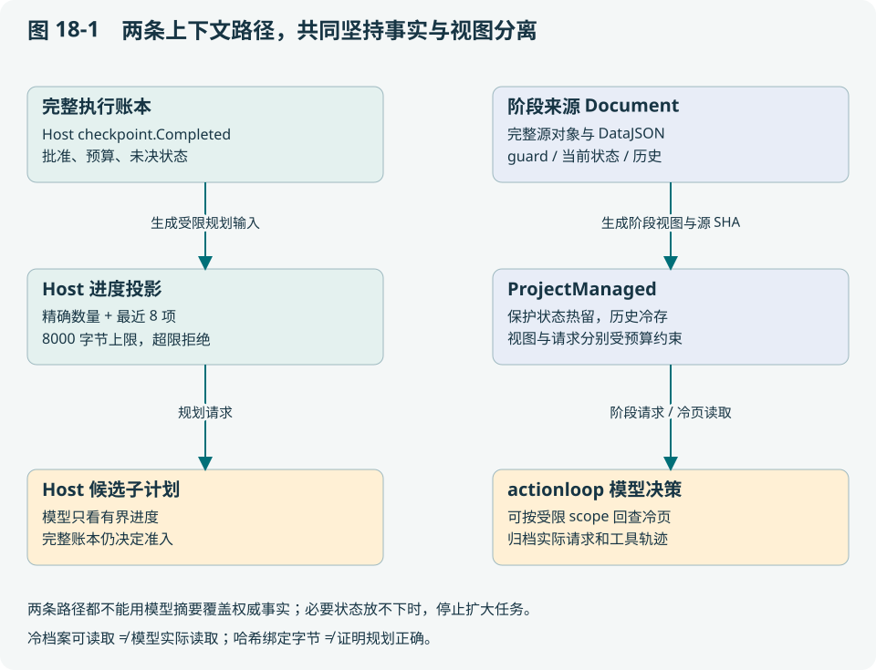

# 第 18 章 长程上下文：保留事实，控制模型可见信息

本章解决“任务越长，模型越容易忘记或重复”的工程问题。读完应能区分权威状态与模型输入，设计保留硬约束的投影，并定位项目里不同的压缩与回查路径。

## 18.1 长任务为什么不能只靠长聊天记录

巡检完成 60 个步骤后，聊天里可能有原目标、重复工具输出、过期位姿、模型猜测和失败重试。如果每轮完整发送，输入成本和延迟持续增加；如果只保留最后几条，“不要进入 D 区”和“第 12 步效果未知”可能被挤掉。

真正的问题不是如何把文本变短，而是**哪些信息决定下一步是否合法，哪些信息只在调查时需要**。把一切交给自由摘要，很难证明约束没有丢；把一切放热上下文，又难以控制成本。



## 18.2 五类状态各有自己的更新规则

| 状态 | 应如何保留 | 为什么不能用一句摘要替代 |
| --- | --- | --- |
| 目标与批准约束 | 精确版本和合同 | 摘要不能扩大授权或删掉禁止区域 |
| 已完成与未决动作 | 完整账本、计数、精确绑定 | 最近几步无法决定早期动作能否重复 |
| 当前观测与空间依据 | 来源、采集时间、序号、map/frame | 摘要不能让旧事实重新变新 |
| 诊断与推断 | 标明角色、依据、置信与版本 | “可能障碍”不是传感器事实 |
| 模型实际输入 | 归档最终请求文本与 SHA | 只有模板无法还原本次决策看见了什么 |

上下文一致性并不要求所有 Agent 拥有相同聊天历史。它要求各自做决定时能引用同一版本的必要事实，并在不一致时有明确拒绝或重建规则。

## 18.3 当前 Host 怎样控制长程进度输入

[internal/edgeagent/host.go](../../internal/edgeagent/host.go) 保留完整 `cp.Completed`，但给规划器的 progress 只包含 completion、completedCount、completedDigest、recentCompleted 和 diagnosis。recentCompleted 最多取最近 8 项，序列化结果超过 8000 字节时拒绝并要求缩小检查内容。

例如已完成 60 项，模型热视图显示总数 60、完整集合摘要和最后 8 项；**执行层仍用完整 60 项检查重复与额度**。它没有因为模型看不见前 52 项就允许再执行。摘要帮助模型理解进度，完整账本决定动作合法性。

这个路径不是无限长任务的通用分段器：合同仍限制计划、能力、读取和时间；超出范围需要新的授权设计。也不能因为另一个模块有 context_read，就声称 Host 的每一次规划都能任意翻查完整历史。

## 18.4 actionloop managed context 是另一条具体实现

[core/agentcontext/managed.go](../../core/agentcontext/managed.go) 的 ProjectManaged 每轮从完整 source 构建生产视图。源码明确保留 guards、constraints、steps、goals 和 current observation；较老的 records 与 attempts 可形成有 scope 和 SHA 的冷归档。它拒绝拿已经压缩的 managed view 再作为原 source，以避免“摘要的摘要”逐步丢失事实。

默认预算是上下文 32768 字节、最终请求 65536 字节、输出预留 4096 tokens。这些是实现默认值，不是任何模型通用的 tokenizer 估计。部署必须根据模型容量设置预算，最终请求还包括工具 schema、系统提示和协议包装。

教学算例：上下文 28 KiB 合格，工具目录 30 KiB，其他包装 10 KiB，总计 68 KiB，仍超过默认 64 KiB 请求预算。只检查正文长度会在真正发请求时失败。因此 CheckRequest 检查实际序列化请求；预算不足应减少目录或拆任务阶段，不能悄悄删 guard。

## 18.5 回查工具为什么不能让模型自己指定作用域

[internal/actionloop/context_read.go](../../internal/actionloop/context_read.go) 暴露 sha256、item_id、offset、limit；scope 从本次快照捕获，模型没有参数可以把任务 A 改成任务 B。读取验证原始文本与哈希，分页返回 next_offset，单页上限 4096 字节，并受当前上下文预算进一步限制。

这解决两类问题：跨任务误读，以及把半页 JSON 当成全部证据。调用者必须识别是否还有后页。对于中文和大整数，还要保留 UTF-8 与精确文本；用通用浮点 JSON 解码再编码，可能改变身份数字或原始输入。

`Artifact.DataJSON` 保存精确源文本，结构化 Data 是显示视图。二者不应互相冒充。模型 trace 留下请求 SHA，能回答“当时到底看见哪份输入”，但不自动证明模型推理正确。

## 18.6 上下文不一致时怎样处理

| 冲突 | 应找的权威 | 当前处理方向 |
| --- | --- | --- |
| 摘要说完成，账本仍 unknown | 原 command 与执行账本 | 不解除未知，重建投影或对账 |
| 云端发旧 revision | 当前批准与 claim | 拒绝派发；旧完成仅对原回执 |
| peer 给另一地图/变换版本 | 本地任务空间 Basis | 不纳入当前覆盖建议 |
| 相同消息 ID 不同内容 | 持久 inbox/outbox | 冲突拒绝，不覆盖历史 |
| feed 游标已被清理 | 持久 feed 与快照范围 | 显式重同步，不假装全量已读 |
| guard 自身大于预算 | 原硬约束 | 拒绝本次请求，重新划分问题 |

不要用“最后写入获胜”统一解决这张表。它适合部分可覆盖配置，不适合批准、物理结果和跨地图事实。也不要让投票多数取代传感器来源；多个 Agent 可能都引用了同一张旧图。

## 18.7 三种上下文方案的真实取舍

全历史输入简单、易回看，但成本随长度增长且噪声大；自由摘要节省输入，却难以保留精确约束和数字身份；结构化热层加冷归档增加工程复杂度，却让权限和未决状态能独立于摘要检查。项目选择第三类思想，但不同调用路径的接线能力不同，应逐路径验证。

研究可比较输入成本、重复写率、目标遗漏、unknown 误解除、回查次数和实际完成率。压缩率高不必然更好；若代价是模型频繁回查，端到端延迟可能反增。

## 18.8 一次可运行的上下文实验

```bash
go test ./core/agentcontext -run '^TestManagedAcceptance' -count=1
```

阅读 ThousandRecords、CJKPages、ProtectedState 和 SQLiteRestart 相关测试。先预测：1000 条历史怎样进入冷层；伪造 SHA 或作用域会怎样；硬约束放不下时是否报错；数据库重开后 unresolved command 是否仍存在。

课堂提交三份材料：原始事实表、模型热视图、恢复到精确冷记录的过程。再故意把一条 unknown 改成“已成功”的文字摘要，解释为何执行层仍必须拒绝。这样才能证明你理解上下文管理的系统职责，而不只是掌握一种文本压缩技巧。

## 18.9 分层习题

基础题 B：区别源哈希、视图哈希和实际模型请求哈希。

工程题 E：构造含未知/冲突与500个已完成动作的历史，说明热冷边界和拒绝条件。

研究题 R：设计上下文策略实验，固定信息与权限，报告预算、正确性和恢复指标。

评分与参考要点见[附录 I](../appendix/I-exercise-guide.md)。
