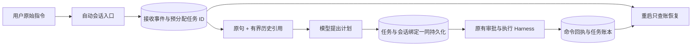

# 3.2.0 后续阅读：自动会话与机器人任务边界

本页记录 2026-11-01 的代码增量，与第 8、17、18 章配合阅读，不覆盖已发行 3.2.0 的固定源码快照和离线出版物。

## 用户不管理 Session，系统仍必须管理它

用户说“检查标定状态”，过一会儿再说“重新检查一下标定状态”。产品不必让他先建立、选择或清理一个 Session。边缘主机可以自动把同一机器人、同一入口范围内的输入组织起来，但两句话仍各自产生任务草案，各自通过准入和审批。

2026-11-01 的实现将这项职责放在 `internal/agentsession`。它借鉴 Super Agent 将会话变为内部执行细节的设计；我们的机器人任务账本仍掌握物理执行事实，不能照搬编码 Agent 的自动重试或投机执行。研究来源、源码路径及局限见[自动边缘会话设计](../../docs/development/2026-11-01-automatic-edge-sessions.md)。

这里有三个不同生命周期：

| 对象 | 负责什么 | 什么不能由它决定 |
| --- | --- | --- |
| 入口 Session / Turn | 输入顺序、短期历史、任务关联 | 机器人动作是否成功、是否允许重复动作 |
| Task / Revision / Command | 冻结计划、审批、执行证据、结果未知时对账 | 模型服务是否还缓存旧前缀 |
| 模型请求及 KV cache | 有界输入和推理计算复用 | 会话持久化、身份认证或物理权限 |

自动 Session 默认在闲置 30 分钟或达到 32 轮后轮换；这只是入口上下文的生命周期，不取消仍在执行的 Task。系统保留最多八条近期输入，每条摘要至多 512 个 UTF-8 字节，总摘要投影至多 6000 字节。原始输入保存在事件中，最多召回八条、每条原文至多 8000 字节，随后仍经过本章的 managed projection 外置与回查。因而原文载荷有上界 `8 × 8000 = 64000 bytes`，不包含 JSON、工具 schema 和其他上下文开销，也不等于 64000 tokens。长历史不递归复制上一轮模型请求。

重启存在一个容易漏掉的窗口：任务已经保存，但 Session 的“已关联任务”事件尚未保存。若重启后一律再规划，就可能产生重复任务。因此接收输入时先持久化候选任务 ID，创建任务时把 Session 绑定和任务放在同一事务中；后续接收轮次收尾失败时保留 pending。再次进入时先按候选 ID 查任务，存在且绑定一致才确认关联，不存在则记录中断，不能凭空补出执行成功。

这个保证依赖一个进程独占数据目录。SQLite CAS 防止覆盖，但不替代进程所有权；本地 `flock` 也不是跨机器分布式锁。当前实现面向一个可信本地操作范围，未增加用户账户隔离、HTTP 提交幂等键或跨信道身份映射。多用户上线前必须先建立这些边界，不能因为用户界面没有 Session 按钮，就让所有人的上下文混在一起。

为什么“继续”仍可能需要澄清？Session 关联帮助理解，却不能决定是在继续失败任务、重复成功任务，还是重发一个结果未知的命令。纯续做语句不会在新任务入口自动创造物理任务，仍须走既有任务继续或对账路径。同理，带会话上下文的规划不走仅按原句命中的 recipe exact 快捷路径，旧方案只能作提示。这会多花模型计算，但避免用另一轮含义替换本轮授权；今后若优化，应把会话语义摘要和源版本纳入可验证缓存条件。
