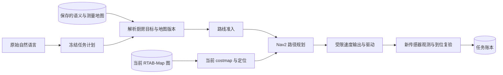
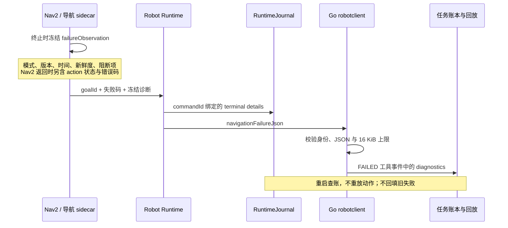

# 3.3.0 后续案例：一张地图、一次失败，为什么还不能直接重试

本页配合第 8、17、19 章阅读，记录 2026-11-04 的实际 Gazebo 排障与代码增量，不改写已发行 3.3.0 的源码快照。完整任务结果、失败次数和介入过程以[实验目录](../../docs/experiments/2026-11-04-user-simulation/README.md)为准。本页讨论设计原因，不把软件测试计为机器人任务成功。

用户在工作台输入：“先检查标定，再依次到厨房、卧室、卫生间巡检，每到一处都确认到位，最后返回客厅并确认任务完成。”系统给出包含标定读取、四段导航、逐段状态读取的九步计划，用户界面批准后开始执行。首轮在第一段导航失败；修复地图恢复后，第二轮又在途中因状态观测过期而停止。这两个故障揭示了三个容易被“Agent 会自动处理”掩盖的工程问题。

## 1. “地图已加载”必须说明是哪张地图

系统里同时存在两个目的不同的地图产品：

| 数据产品 | 回答的问题 | 不能由它证明的事实 |
| --- | --- | --- |
| workflow 的保存点云、栅格和语义标注 | “厨房”指哪个目标？保存地图中哪些空间经过观测？ | 当前 Nav2 是否加载了相应导航图、当前定位是否有效 |
| RTAB-Map 图与 Nav2 costmap | 当前坐标如何对应地图？此刻能否规划和跟踪路径？ | 用户要去哪一站、整个自然语言任务是否已完成 |

首轮启动复制了旧 workflow 地图，却没有恢复旧 RTAB-Map 库。语义侧可以解析厨房，导航侧仍只有当前视角形成的小图。Nav2 真实日志给出的原因是无法从约 `(0,-1.25)` 规划到 `(2.05,3)`；外层最初只看到 `NAV2_ACTION_ENDED`。这不是“模型没理解厨房”，也不是把全局规划容差放大就能合理解决的问题。

可以把必要条件写成：

\[
\text{CanDispatch}(g)=I\land A\land F\land L\land P(g)
\]

其中，\(I\) 表示机器人、坐标与版本身份一致，\(A\) 是本次动作的有效授权，\(F\) 是输入新鲜度，\(L\) 是当前定位满足运行模式要求，\(P(g)\) 是当前导航图支持到目标 \(g\) 的路径。语义解析成功只能提供目标和部分身份约束，推不出其余条件。Nav2 接受目标也仍不等于最终到达。

本次保留现场与失败记录，用 SQLite backup 复制已有 SLAM 库到新实验目录，再通过 `load_database(clear:false)` 载入。只读 `ComputePathToPose` 得到了 471 点、约 6.059 m 的厨房路径。这证明“此刻可规划”，不能写成“机器人已经行驶 6.059 m”。实际行驶距离必须由执行期采样计算，且里程计距离不是外部真值。

这种分层的优点是语义理解与导航算法可分别替换。代价是必须管理跨层版本、坐标和恢复过程；不能用一个绿色“地图就绪”图标代替所有条件。新环境应逐步建图探索；已有环境重启应明确恢复哪些地图产品，禁止把未知区域偷偷改为空闲来获得一条路径。

## 2. unknown 表示知识缺口，不是允许再试一次

第二轮导航实际移动了一段距离后停止。新增诊断给出了精确线索：RGB-D、里程计和 TF 尚新鲜，但 RTAB-Map 模式查询和三个 Nav2 lifecycle 查询同时过期；稍后查询又恢复了。原实现把查询过期也报告为 `INACTIVE`，造成“节点真的停了”和“此刻没有新状态证明”混淆。

修复包含两个部分：管理查询使用独立 ROS callback group，避免与地图转换及 action 回调排队；状态明确区分 `STATE_STALE` 和真实 `INACTIVE`。多线程 Executor 本身不会消除默认互斥 callback group 内的串行等待。

新鲜度不是给状态打一个永久标签。对在 \(t_q\) 发起的只读查询，系统使用请求开始时间计算保守年龄：

\[
\text{age}(t)=t-t_q,\qquad \text{fresh}(t)\iff 0\leq\text{age}(t)\leq3\text{s}.
\]

若改用响应收到时间，耗时四秒的旧响应会在送达时突然获得新的三秒有效期，掩盖查询延迟。因此本次没有通过扩大 freshness 阈值解决故障。

短暂观测丢失只允许使用已有的有界停止等待：实际速度发布口输出零，原命令仍保持运行，权限与租约仍须有效；在默认两秒内恢复新鲜证据，才可能继续同一命令。真实 inactive、感知质量不合格或等待超时仍终止。这种恢复不是重新发送一个动作。

| 情况 | 允许的处理 |
| --- | --- |
| 原命令仍运行，短暂观测过期 | 零输出等待；新证据恢复后按原命令继续 |
| 原命令已终态失败 | 保留终态；不得因稍后状态健康而重发或复活 |
| 动作实际结果缺乏足够证据 | unknown；核查命令、位置、停止状态与现场变化 |
| 明确放弃原步骤 | 追加 ABANDONED 对账，结束旧任务，再按当前状态规划 |

第二轮对账记录说明了已经发生的移动、终止回执、后续静止采样窗口和放弃原因，随后通过 UI 取消旧任务。本次由受用户授权的测试代理核查仿真证据，不是实机现场人员检查，也不是机器人系统自行解决了全部故障。`ABANDONED` 不表示动作未发生，也不表示任务成功。它说明操作者决定结束这条执行路径，并保留这个决定的身份、时间和证据说明。如此才能区分系统自主恢复、外部测试/运维介入与重新规划，论文里也不能把三者混为一个无介入成功样本。

## 3. 回溯要保存因果链，不能只留下最后一个错误词

“导航失败”有很多可能原因：目标不可达、传感器过期、生命周期状态丢失、命令取消、控制器执行错误。只保存 `NAV2_ACTION_ENDED` 会迫使开发者同时翻多份日志，且难以确认是否属于同一条命令。

本次补齐的传递链是：

这里的关键取舍是保留有界诊断，而不是把所有传感器数据塞进每条事件。诊断只包含定位原因所需的结构化摘要；图像、深度和原始观测仍按采集编号与哈希单独保存。对于 Nav2 action 返回的错误消息，限长 2,048 字符；跨 gateway/Go 的失败诊断 JSON 限制为 16 KiB，必须与当前 commandId 绑定。成功事件不接收失败诊断字段，畸形或超限诊断不能改变命令终态。

因此数据有三种不同用途：原始观测用于验证物理事实；运行时回执用于确认命令协议与状态；错误诊断用于定位原因。诊断写着“ready=true”不能替代成功证据，模型也不能从错误文本获得重新执行物理动作的权限。

另外，RTAB-Map 允许运行时切换 mapping/localization。HTTP 不能一直复述启动配置：本次增加实测 `mode`、启动 `configuredMode` 与 `modeEvidence`，真正处于 localization 时还要验证定位观测与协方差。服务不可达时返回 unknown，比保留一个看似正常的旧模式更有利于分析和正确控制。

## 怎样解释最后的成功

第三轮 `task-583c94bad756b62ba0b238c678605c39` 在修复后重新生成五项能力计划（标定读取与四段导航子任务），通过 UI 批准，最终任务账本为 `SUCCEEDED`。从进入 EXECUTING 到 LOCAL_RUN_FINISHED 为 **193.412 s**，不包含此前的规划等待与批准等待；这不能称为“从用户输入到结束”的总延迟。

导航侧四次安全摆位和四次导航目标均成功，执行窗口内 96 个独立两秒采样均 ready，未记录 observation hold。任务收尾与每站独立观测的核验仍应阅读实验审计，而不能只依据“八个目标成功”替代到位证据。

随后在同一修复批次和同一世界再次从客厅提交原始指令，第四轮 `task-86a1f1438b266353b5a9e4965ed6c1fa` 生成九项能力计划，也最终 SUCCEEDED，执行窗口为 **239.178 s**。其四次摆位与四次导航目标均成功，没有记录 observation hold。本页维护者的额外健康采样只覆盖第四轮后段，完整运动证据须使用连续 ROS 采样及主审计，不能把部分采样写成全程监控。

这些尝试是带修复和测试代理介入的开发序列，不是同分布独立样本：地图恢复状态、软件批次、起点和模型生成的能力计划都发生了变化。第三轮从上一轮停止处出发，第四轮从客厅出发，五项与九项计划的只读调用也不同，两个耗时不能直接归因为某个算法更快。记录支持“这些故障被发现、保留并修复，修复后连续两次完整路线跑通”这一结论；不能从两次成功推导稳定成功率、无人运维能力或实机可靠性。论文实验应在冻结软件、地图与任务协议后另建重复试验，并继续记录失败。

## 课堂练习

1. 保存语义图中的厨房坐标有效，而 Nav2 刚启动。分别列出可以回答的只读问题和仍不能批准的动作，并说明证据来源。
2. 导航终止前移动了三米，任务因观测过期失败。为什么“错误已修复”不能直接推出“重发相同 commandId”或“生成新 commandId 再走一次”是安全的？
3. 将一个服务查询的请求时间、响应时间和过期阈值画在时间轴上，比较两种 freshness 算法可能产生的错误。
4. 为实验报告分别设计“自动完成率”“人工对账后完成率”和“故障定位时间”的分母。如何防止只保存最终成功任务而遗漏前两次失败？

源码入口：[模式观测与 callback 隔离](../../robot/ros2_ws/src/tangying_navigation/tangying_navigation/navigation_node.py)、[有界停止等待与冻结诊断](../../robot/ros2_ws/src/tangying_navigation/tangying_navigation/http_api.py)、[Runtime 日志透传](../../robot/gateway/tangying_robot_gateway/service.py)、[Go 传输边界](../../edge/robotclient/client.go)。详细修复和验证过程见[导航故障记录](../../docs/experiments/2026-11-04-user-simulation/navigation-recovery.md)。
