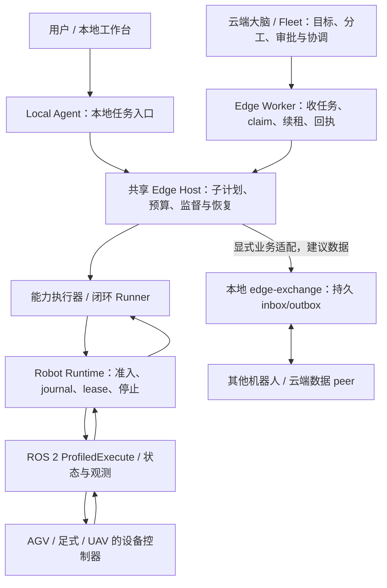
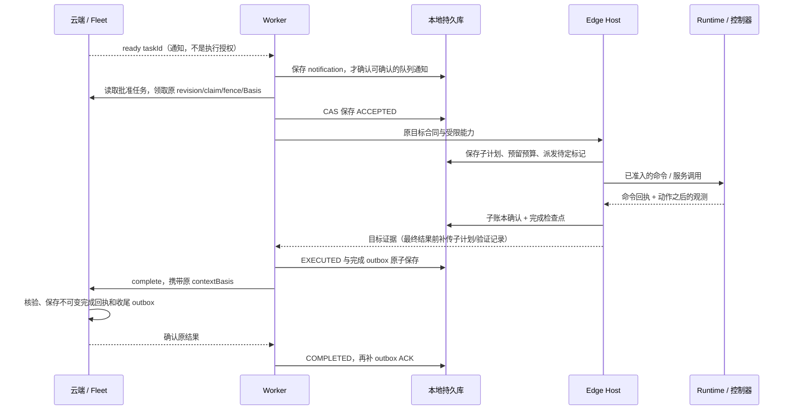

# 边缘 AgentOS：消息、上下文与 Harness 实现说明

核对窗口：2026-10-18 至 2026-10-19，源码基线 `f930437ae7f8612cef41c0ca82be084cfa7d12af`。本文是边缘开发者和云端同事的共同阅读入口，描述本次核对到的实现；[本轮测试、证据和上线判断](../development/2026-10-18-edge-communication-readiness.md)单独留存。协议字段以链接中的 Go 类型、protobuf 和 ROS 2 定义为准。

增量核对（2026-10-28）：本轮新增模型调用取证、可选缓存提示，修复授权重查、预算停止、peer 重配与凭据分配。后续行为与迁移详见[实现记录](../development/2026-10-28-edge-brain-reliability.md)及[模型交互运行说明](../production/edge-brain-model-context.md)。下文历史性能观察保留原身份，不用本轮 32 步回归替代旧 96 步性能缺口。

同日后续增量：按永久游标读取 peer 当前视图、父任务增量审计、child 私有写快照、独立模型用量账本和受校验的规划经验。配置和复用边界见[模型成本指南](../production/model-cost-and-recipes.md)，完整连续任务测试及首轮超时见[持续运行实验](../experiments/2026-10-28-edge-scalability/README.md)。经验复用和 writer 缓存不提供共享执行权，当前授权与物理观测仍各自核验。

## 1. 当前可以交付到哪一步

当前具备**异构边缘 AgentOS 的受控集成候选基础**：单机长任务宿主、持久执行、机器人间建议数据交换、云边目标委托、上下文版本绑定和故障回溯均有实现与回归。适合先在隔离环境和受控场地逐设备集成，再扩大试运行范围。

尚不能据此作为任意 DJI、Unitree、AGV 直接无人值守上线的正式验收版本。主要缺口是具体厂商驱动与物理停止、真实无线与规模负载、离线授权策略，以及跨机器人共同坐标和并发空间冲突的完整闭环。Gazebo 已有物理任务和停止实验，但使用集中式实验 hub、真值定位与通用模型；其证据不能扩展为厂家控制器或分区网络下的群体自治。详见[Gazebo 实验](../experiments/2026-10-18-gazebo-field-validation.md)。

2026-10-18 审计发现长历史性能缺口：普通回归完成连续 32–128 步软件任务，但带 race 检测的完整 campaign 在 96 步场景触发默认 10 分钟超时，见[历史审计](../development/2026-10-18-edge-communication-readiness.md#长程-race-超时与性能观察)。10-28 后续优化保留了新的整组 180 秒超时，并在修复后以相同任务规模和上限通过完整 campaign；各版本、命令和失败都在上面的持续运行实验中分别记录。历史增长仍影响授权读取和 child 序列化，软件回归通过不代表已满足目标硬件的实时性或长期资源上限。

最重要的设计判断是：**共享消息、共享执行权和共享物理事实是三件分别校验的事。** 当前实现按这个原则划分，方向合理；“所有 Agent 自动拥有同一份全局上下文”尚不是系统提供的保证。

## 2. 运行关系：Local、Worker、Host 与 Runtime

- **Local Agent** 装配本地 API、任务库、工作台和本机 Agent 协作运行时。其进程可以在机器人计算单元或受控本地计算机，逻辑上服务一个明确绑定的机器人。
- **Edge Worker** 装配云端任务源、设备身份、claim/租约、控制消息与回传。它也使用 `internal/edgeagent.Host`，粗目标的细化规划由边缘完成。
- **Host** 是 Local/Worker 复用的目标执行内核，拥有子计划和检查点。Local 原有 Task/Ops/Recovery 事件运行时，与目标通道的确定性 Ops/Recovery 不是相同的装配；不能假设所有角色、事件和模型调用完全对等。
- **Runtime** 执行已经准入的能力，驱动、传感器、实时控制和设备安全流程位于其下。模型输出不直接进入 ROS 2 控制话题。
- 同一个 Runtime 的控制入口应唯一。进程 `controllease`、云端机器人 fence、动作 lease 分别约束不同边界；启动两个独立 Host 不会自动产生全局互斥。

源码：[Host](../../internal/edgeagent/host.go)、[Worker](../../edge/worker/worker.go)、[本地装配](../../cmd/local-agent/agentruntime.go)、[角色 Harness](../../internal/agentharness/profile.go)。

## 3. 五条通道：分别传什么、承诺什么

| 通道 | 传输与身份 | 消息与用途 | 一致性 / 可靠性边界 |
| --- | --- | --- | --- |
| 同一进程内的 Agent 事件 | `agentruntime` 订阅队列；注册身份绑定发布口 | `agent.event.v1`：任务、动作、证据、诊断、恢复建议 | 每订阅者默认 256 条有界队列，优先级投递、可丢弃；sink 尽力持久化。不是远程消息总线或可靠全日志 |
| 不同机器人 / 云端数据 peer | `edge-exchange` HTTP；生产接收端 TLS 1.3 + 每 peer 独立 bearer；admin 仅 literal loopback + 独立 token | `agent.data.v1`：状态、证据、观测、地图引用；当前覆盖建议有专门消费适配 | inbox/outbox 持久化、内容 ID、序号、TTL、准确 ACK；有效期内重试与去重。允许跳号，不保证每个中间状态都送达 |
| 云边任务控制 | HTTP HTTPS + 每设备 robot/token；回环可 HTTP。另有 mTLS gRPC `FleetGateway.Register/Link` | HTTP 拉取/claim/renew/complete/fail/事件；Link 心跳、低频遥测、观测、取消/急停/ping | 身份、批准、revision、claim/fence、执行上下文和完成回执共同准入；心跳/遥测不等于完成账本 |
| Edge → Runtime | mTLS gRPC `RobotRuntime` | 能力目录、服务调用、观测流、`SkillCommand/SkillEvent`、Cancel/EmergencyStop | 命令幂等、持久 journal、deadline/短 lease、单终态；成功回执还需动作后证据 |
| Runtime → 设备 | ROS 2 DDS，经 Profile 绑定 action/service/topic | `ProfiledExecute`、driver state、定位/传感器、停止流程 | Profile/commissioning/命令/时间绑定；DDS 送达或 action 成功不单独证明物理到达、停稳、降落 |

生产 HTTPS 数据通道与 mTLS Link 是不同鉴权机制；`edge-exchange` 当前也不是 mTLS。ROS 2 网络的发现、QoS、DDS 安全及无线配置需要设备部署单独验收。

## 4. 本机 Agent 事件如何流转

Task 执行产生任务、步骤、命令和证据事件 → Task 持久事件投影到 EventBus → Ops 订阅并诊断 → Recovery 提出绑定原失败的计划 → 独立执行/复验器检查权限和账本后处理。观察角色没有机器人执行端口。

事件信封字段如下：

| 字段 | 精确用途 |
| --- | --- |
| `protocolVersion / id / topic` | 协议版本、事件身份与固定类型；同 ID 同内容去重，同 ID 异内容拒绝 |
| `agent / agentVersion` | 注册的发布者与实现版本；不能自行冒充其他角色 |
| `taskId / taskRevision / robotId / stepId / commandId` | 绑定原任务与执行尝试；缺失保持未知，不能从当前任务补造 |
| `causationId / correlationId` | 直接原因与任务关联；仅 correlationId 不足以识别一个命令 |
| `occurredAt / priority / payload` | 发生时间、投递优先级、结构化事实或建议 |

固定 topic 分为：`task.started/completed/failed`，`action.executed/preparation_failed`，`evidence.collected`，`state.transition`，`ops.anomaly_detected/root_cause_hypothesis/recovery_proposed/recovery_deferred/recovery_plan/recovery_executed/anomaly_cleared/escalation_required`，以及 `agent.registered/health_changed/permission_denied`。

恢复另核对 `RecoveryBinding` 中的 task/revision/robot/step/command/sourceEvent，并关联 anomalyEvent/planEvent；另一轮同名工具的成功不能关闭这次未知执行。`ops.recovery_executed` 由实际 executor/verifier 的受信任接线发布，Recovery 不能自己声明已经执行。

实时队列可能先投递再调用 sink；无 taskId 的广播不进入任务持久流。队列溢出和 sink 失败不能被解释成“没有故障”。执行与自动恢复须回读权威账本，关键链缺失则拒绝继续。要将所有观察事件用于长期审计，仍需补强可靠事件出口、消费游标和持久失败告警；现有本机总线本身不承诺这些。

源码：[Event](../../core/agentcontract/event.go)、[身份校验](../../core/agentcontract/protocol.go)、[发布权限](../../agentruntime/publisher_policy.go)、[队列和 sink](../../agentruntime/bus.go)。

## 5. 机器人间的数据怎么传

生产者通过本地 `POST /v1/exchange/publish` 提交 Request → 服务在 SQLite 事务中分配 stream 序号、写 outbox → 发送循环投递远端 `POST /v1/exchange/receive` → 远端校验并原子写 inbox/游标/feed → 返回 Receipt → 发送端核对后标记 delivered → 业务消费者再做任务、空间和时效校验。

| 结构 | 具体字段 |
| --- | --- |
| 本地 Request | `requestId, peerId, stream, kind, ttlMs, basis?, payload` |
| 网络 Envelope | `schemaVersion, messageId, sender, recipient, stream, kind, sequence, createdAtMs, expiresAtMs, basis?, payload` |
| sender / recipient | 完整 `agentId, robotId, domain`，与配置身份及接收凭据匹配 |
| 空间 basis | `worldId, frameId, transformRevision, mapId?, mapRevision?`；observation/map_reference 必须声明空间依据 |
| Receipt | `schemaVersion, messageId, sequence, disposition=accepted或duplicate`；只证明持久收件 |

允许 `kind` 只有 `mission_status / evidence / observation / map_reference`。这四类的通用 payload 是有界 JSON object，不代表系统已经为每种业务写好 schema、融合器或自动消费逻辑。**当前明确接线的跨机器人消费之一是覆盖建议**：`agent.coverage.advisory.v1` 带 `missionId/missionRevision/observedAtMs/geometryId/observedTargetIds`，以 `coverage-view` 校验后影响探索候选排序。任意 observation 不会自动进入 Planner 上下文或改写本机地图。

关键规则：

- 同次网络重试复用持久 `requestId`；内容或完整 peer 身份改变时拒绝复用。`messageId` 是确定性 SHA-256 内容 ID，不是签名。
- `sequence` 是 JSON 十进制字符串，按完整 sender/recipient/domain/stream 单调递增，避免跨语言 2^53 精度损失。序号允许跳跃；旧未见序号与同序号异内容拒绝。
- payload ≤64 KiB，整个 HTTP envelope ≤72 KiB；TTL ≤24 小时，未来时钟容忍 ≤30 秒；拒绝重复 JSON key、未知顶层字段和过深嵌套。
- TTL 检查消息有效期，`payload.observedAtMs` 等才表示原始观测时间。转发、重试或重新轮询不能让旧观测变新。
- 丢 ACK 重发原信封；准确 ACK 的 messageId/sequence/version/disposition 全部匹配才结束发送。每 peer 至多一个并发发送，失联云端不能占住其他 peer 的全部发送槽。
- 到期后再保留 24 小时的正文与 requestId 幂等窗口，然后 GC；stream 游标保留。不是无限期送达或无限期业务去重，长期业务结果应另存执行/应用账本。
- 用稳定 stream 类别，把 taskId 放 payload，防止游标数量随每次请求增长。视频、完整点云和高频控制不走这个有界 JSON 通道；传有权限和内容校验的引用，数据存储/取回另行实现。

可靠回溯使用 admin `GET /v1/exchange/feed?after=...&limit=...`。feed 的本地收件 `revision/next/head/prunedThrough` 与发送者 sequence 不同，均为字符串。GC 缺口返回 409；不能直接跳到最新游标。2026-10-28 起 SQLite 覆盖视图按永久 incoming cursor 选取每流最新正文，完整身份过滤后才计入最多 1,000 个当前流的上限。历史反复更新不再耗尽当前视图；最新无效/过期或已被 GC 删除也不回退旧值。真实当前流截断仍返回空建议；`completeRead=true` 是保留候选集合的完整性，不是全地图覆盖或所有 peer 在线证明。旧 Journal 无新读端口时继续使用全历史 Snapshot。详见[数据交换指南](../development/edge-data-exchange.md#历史记录与当前协作视图)。

两个机器人都叫 `frameId=map` 不表示坐标一致；需要同 world/transform/map revision 或单独验证的变换。peer 覆盖并集是建议，不能写成本机实测 coverage、解除 unknown、签发授权或证明完成。详情和固定互通样例见[数据通道](../development/edge-data-exchange.md)、[有作用域的消费](../development/2026-10-18-scoped-peer-cooperation.md)。

## 6. 云端与边缘具体交换什么

### 6.1 下行：目标和权限

推荐粗目标入口为创建并批准 `robot.objective.v1`，父能力为 `edge.goal`。创建不自动批准。云端给边缘的不是无限权限的文本提示，而是可校验合同：

| 字段 | 边缘必须执行的限制 |
| --- | --- |
| `robotId / catalogRevision / goal` | 绑定机器人、规范化能力目录和原目标；goal ≤4000 字节 |
| `grants[].tool / argumentsSchema / maxExecutions` | 白名单和参数包络；相同工具/业务参数的写效果默认最多一次，显式次数授权才能增加 |
| `effects / resources` | 效果范围；v1 只委托绑定机器人的 `robot` 资源，跨机共享资源仍归协调层 |
| `completion[]` | 只读检查工具、参数、结果 path 与 equals；全部满足才完成 |
| `budget / expiresAt` | 上限 8 代计划、128 次 Host 子能力调用、4096 次业务只读、86400 秒，部署可更低；重启不恢复额度 |

每次领取同时返回 `execution.context.v1`：`scope/taskId/taskRevision/aggregateVersion/claimVersion/intentIndex/stepId/commandId/robotId/adapter/executionDigest/resourceId/fencingToken/catalogRevision/world/digest`。world 明确是 `coordinator_world` 还是 `edge_local`，不是隐含的全局快照。

`TaskRevision` 是执行计划版本，`aggregateVersion` 是聚合并发版本，`claimVersion` 是领取身份；它们不能互换。context digest 检测混合/损坏版本，权限仍来自认证、批准和活租约。边缘每步及长操作续租继续核对权限，不能只在收件时校验一次。

### 6.2 上行：注册、进度、观测与完成

| 上行内容 | 具体携带内容 / 含义 |
| --- | --- |
| 注册 | robot/adapter/protocol/version、可用能力、工具目录与 revision、服务目录、观测来源目录及 frame/transform/freshness 描述 |
| 遥测 / 观测 | robot、采集时间、位姿、活动、急停与故障、小型语义实体/占据；规范观测另带 observation/source/sequence/world/frame/transform、causation、provenance，可选图像引用/有界预览 |
| 子计划 | `EDGE_CHILD_PLAN`：子计划身份、目录、calls、planDigest、objectiveDigest；由本地持久记录补传 |
| 子步骤证据 | `EDGE_CHILD_EVENT` 包含 childId/childStepId/kind/eventDigest/detail；`CAPABILITY_VERIFIED` 等关联实际调用和验证 |
| 目标完成证明 | 已完成调用身份、检查值、目标摘要、开始/验证时间和累计预算；云端核对已申报子计划与设备身份关联的验证事件 |
| 完成请求 | `POST /v1/tasks/{id}/intents/{index}/complete` 带原 robot/revision/aggregate/step/command/fence 与完整 contextBasis |

`context.completion.v2` 是**云端成功事务持久化的完成回执**，包含原 contextBasis、verificationBasis、completedAt 与 effects 收尾描述；并不是要求 Worker 在上述 HTTP body 中另发一个同名信封。旧 v1 回执读取兼容不等于其历史收尾窗口已被修复。

低频云端投影用于协调和展示；传感器原始高频数据与控制周期留在设备侧。具体采集图像需保持实际 capture 身份，不能用下一帧替代工具用于验证的那一帧。云端验证仍依赖可信设备观测，eventDigest 不提供硬件远程证明。

源码：[Fleet 协议](../../proto/fleet/v1/fleet.proto)、[HTTP 客户端](../../edge/cloudclient/client.go)、[上下文 Basis](../../core/contextcontract/basis.go)、[目标合同](../../core/objective/contract.go)、[完成收尾](../development/2026-10-10-cloud-edge-protocol.md)。

## 7. 一次云端目标的完整消息时序

边缘重启：无检查点才可按当前权限首次执行；`ACCEPTED` 没有完整确认时视为可能已发生效果；`EXECUTED` 只补原完成报告；`COMPLETED` 不重发动作。目标内部 `Pending` 可被完整同身份子账本证据恢复，否则隔离为 unknown。云端响应丢失后，即使当前版本已推进，也只能用原精确完成回执确认旧结果，不能套用新版本授权重跑。

云端失联时，受云 claim 约束的 Worker 停止继续并触发受控停止；当前没有委托离线继续授权。独立 Local 入口的本地任务不要求云端 claim，两种运行模式的断网行为不同。租约失效也不等于机器人已经物理停稳。

## 8. 上下文管理：五种状态，不能混成聊天历史

| 状态 | 权威来源 | 传递方式 |
| --- | --- | --- |
| 原目标、硬约束、批准版本 | Task / 不可变 Revision / objective 合同 | 下行固定合同，变更需新版本和相应审批 |
| 执行过什么、哪些结果未知 | Runtime journal、执行库、子账本、Host checkpoint | 精确命令和回执；跨云边用 Basis 与完成证明关联 |
| 当前世界 | 带来源、采集时间、序号、frame/transform/map 的观测和投影 | 规范观测 / 有界摘要或引用；必须重新判断时效 |
| 角色的推断与经验 | Ops finding、Recovery plan、版本化 belief 接口 | 事件或受控读取；推断不变成新观测或授权 |
| 模型当前可见内容 | 从原始账本生成的 `agent-context.v1` 投影 | 每次决策的准确文本、SHA、scope、归档与 trace |

当前一致性建立在**单个权威聚合事务/CAS + 不可变身份 + 执行前校验 + 证据补传**，不是跨全部机器人数据库的原子事务，也不是共享全局聊天缓存。Beads 接口是可扩展的信念层，当前实现不应被描述为已经具备跨机持久经验共识。

### 8.1 长历史如何压缩和回查

`internal/actionloop.SnapshotFor` 使用 `ProjectManaged`：默认模型热上下文 ≤32768 字节、序列化请求 ≤65536 字节、输出预算 4096 tokens，环境变量可配置。这是字节预算，不是精确 tokenizer，仍需按实际模型容量选更保守的值。

1. 从完整原始事件与 revision 重新构造，剔除旧模型输入的嵌套投影，避免对摘要反复总结。
2. 保留目标、步骤、约束、当前观测、精确参数/verdict、失败分类、未决/冲突命令 guard；身份按 task/revision/robot/step/command/tool 归约。
3. 优先把旧可选记录与冗长工具结果移入带 scope、源 ID、SHA-256 的完整 JSON 归档，保留归档索引。
4. `context_read` 仅能读当前投影捕获的归档，按 sha256、可选 item_id、offset/limit 分页；最大页 4096 字节并受当前预算约束。模型不能传文件路径或扩展作用域。
5. 精确源文本用 `DataJSON` 保留，读取校验摘要和 UTF-8 边界。未完整读取不等于不存在；归档结果仍是历史数据。
6. 必须保留的状态仍超预算时显式失败，不能截断硬约束或把未知命令压没。

另一个独立预算是 **Host 的粗目标进度投影**：原 goal 单独传入，进度包含 completion、completedCount/digest、最近 8 个确认调用和 diagnosis；progress JSON 超过 8000 字节时拒绝。全部完成历史仍参与确定性额度检查。它不是整个请求上限，也不等于 Planner 已看到全部历史详情。

各调用路径要分别核对：生产 actionloop 的 managed 投影、Host 进度投影与可选研究 renderer 是不同机制，不能因为某个路径有 context_read 就宣称每个模型阶段都有同等回查能力。源码：[managed](../../core/agentcontext/managed.go)、[任务阶段记忆](../../tasks/context_memory.go)、[回查工具](../../internal/actionloop/context_read.go)、[Host](../../internal/edgeagent/host.go)。

### 8.2 跨域不一致怎么处理

| 不一致 | 当前处理原则 |
| --- | --- |
| 旧任务 revision、不同 claim/command/fence | 执行前拒绝；已完成旧报告只能匹配原不可变回执 |
| 同事件/幂等键 ID 不同内容 | 冲突拒绝，不能覆盖已有事实 |
| 同工具的另一命令成功 | 不能解除原 unknown；完整同身份账本证据或受控对账才可继续 |
| peer 任务、几何、地图或 transform revision 不同 | 不进入当前覆盖建议；请求同依据数据或先做经验证的坐标注册 |
| 观测过期、采集时间倒退、缺失来源 | 不用接收时间补新鲜度；保持未知/降级或停止 |
| 模型摘要与账本不同 | 确定性执行层按账本与现授权判定；重建模型投影 |
| 消费游标遭 GC 缺口或快照不完整 | 显式 resync / 空建议；不能假装已消费全历史 |
| 已验证动作而完成报告丢失 | 重发原证据与回执，不重发动作 |

## 9. 核心 Harness：把模型建议变成可约束、可复核的执行

这里的 harness 有多个职责，名称相似但不能互相代替：

| Harness 层 | 核心职责 | 主要实现 |
| --- | --- | --- |
| 角色与决策 | Edge 只获得 robot.read/local/write，Server 只获得 fleet.read/draft；过滤工具、安全等级和模型路由；有界回合、审批、上下文与 trace | `internal/agentharness`、`internal/actionloop` |
| 目标宿主 | 在批准包络内生成子计划，先持久化预算和 pending，检查目录/权限/效果次数，恢复时核对子账本 | `internal/edgeagent`、`core/objective` |
| 能力执行与设备准入 | Schema、robot/profile/commissioning、目录版本、deadline/lease、幂等、fence；未知动作隔离和受控停止 | `internal/capabilityagent`、`edge/runtime`、Python Runtime 与 `ros2_profile.py` |
| 物理完成验证 | 工具成功只触发观察；核对命令后的采集、序号、来源、地图/标定和技能后置条件 | 闭环 Runner、Provider 验证；`core/harness` 的共享世界物品放置裁决只是其中一种具体实现 |
| 诊断与恢复 | Ops 观察、Recovery 建议、独立执行/复验；只读和已证实无效果失败可有界处理，未知写不自动重放 | `agentruntime`、`internal/recoveryexec`、Host supervision |
| 实验与回放 | 固定输入、源码/二进制、原始事件和测量；保留失败与篡改负例 | `scripts/run_*_harness.py`、campaign、验收分析器 |

异构复用发生在目标生命周期、合同、预算、执行身份、证据和恢复规则上。UAV 的三维路径、AGV 的二维/地形路径、足式的支撑约束各自交给 Profile/Provider 与设备控制器；更换机器人需要真实能力和观测绑定。当前通用 ROS 2 模板不能自动提供 DJI 飞控接管或 Unitree 步态控制。

源码：[RobotRuntime 线协议](../../proto/robot/v1/robot.proto)、[ROS 2 Action](../../robot/ros2_ws/src/tangying_robot_msgs/action/ProfiledExecute.action)、[ROS 桥](../../robot/gateway/tangying_robot_gateway/ros2_profile.py)、[物理 Harness 示例](../../core/harness/evaluator.go)、[设备绑定](../operations/ros2-device-bindings.md)。

## 10. 云端同事与边缘开发者的对接清单

| 责任 | 云端负责 | 边缘负责 | 共同核对 |
| --- | --- | --- | --- |
| 目标与授权 | 创建/批准目标、机器人和资源分工 | 在包络内细化，拒绝越权工具/参数 | objective schema、目录 revision、完成判据和预算单位 |
| 领取与续租 | claim/fence 与当前任务权威 | 持久通知、写前检查点、每步/长动作续租 | 断连和取消后不再派发，unknown 处理一致 |
| 观测与地图 | 保留来源/时效，按需聚合 | 真实 capture、frame/transform/map 元数据 | 同名 frame 不当作同坐标，预览不冒充测量 |
| 完成与重连 | 精确完成回执、持久收尾和幂等响应 | 原证据补传、outbox、只补报告 | 响应丢失、版本推进、数据库失败和重启窗口 |
| peer 数据 | 若作为 peer，显式实现收发合同与身份 | 稳定 requestId/stream、持久收发、业务消费 | 数据 ACK、业务采纳、物理验证分别计量 |
| 上下文 | 传明确合同与引用，不替边缘补造事实 | 本地权威账本、投影和归档 | 版本、摘要、unknown、时效与引用能逐项追溯 |

上线前优先补齐：逐设备传感器/控制/停止与崩溃重启验收；真实网络下 RTT/丢包/乱序/分区和证书生命周期；资源协调跨存储窗口；事件丢弃/落盘失败、outbox 年龄、feed 缺口、unknown 数量、上下文预算拒绝与归档可读性的告警；最后做一条“云端目标→多台实机→peer 消费→故障→恢复→最终证据”的端到端验收。当前外部资源 Transfer 与云端成功事务之间仍存在需对账的窗口，不应承诺跨存储 exactly-once。

本轮已验证与未覆盖项、实际命令和日志见[就绪审计](../development/2026-10-18-edge-communication-readiness.md)。更多操作说明：[目标接入](../guides/delegated-edge-goals.md)、[边缘部署](../operations/edge-field-testing.md)、[消息数据通道](../development/edge-data-exchange.md)、[长程协作](long-horizon-collaboration.md)。
