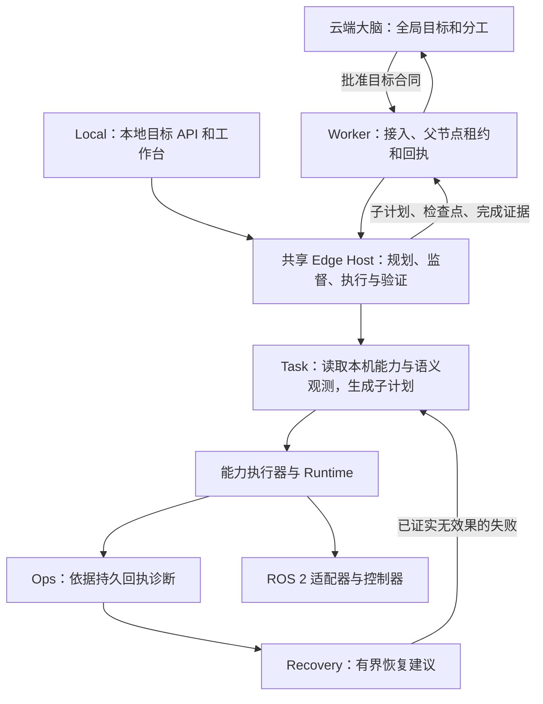

# 分层目标委托：云端目标与统一边缘 Agent

状态：2026-10-15 实现增量；基线 `b1223a08`，实施与验证见[可回溯记录](../development/2026-10-15-hierarchical-edge-objectives.md)与[实验报告](../experiments/2026-10-15-hierarchical-edge-objectives.md)。本文描述新增目标通道，原 `/v1/tasks` 的已规划任务通道继续兼容。

## 职责与部署

`internal/edgeagent.Host` 是 Local 与 Worker 共用的目标规划/执行宿主。Local 提供本地 API 和现有本地协作运行时；Worker 提供云端任务源、租约、控制消息与同步。Worker 不再要求云端预先列出目标的子工具调用。两种入口依然不能同时占有同一个 Runtime；进程的 `controllease` 与云端机器人 fence 不替代对方。

Task 规划器复用 `capabilityagent.Planner`；执行复用 `capabilityagent.Executor` 与原复合机器人闭环 Runner。目标通道的 Ops 是从子任务持久回执读取事实的确定性组件，Recovery 是无执行端口的建议组件，经宿主最终校验后才能重规划；默认策略只处理可证明无效果的失败。`RecoveryPolicy` 可替换建议实现，但不能突破宿主对未知结果、预算与工具权限的检查。这些逻辑角色不要求分别调用 LLM。Local 的原 `agentruntime` 继续存在；本次没有把其整个事件总线原样迁入 Worker，也没有新增跨机器远程 Agent 宿主。

## 目标与授权合同

`core/objective.Contract` 的版本为 `robot.objective.v1`。目标创建只持久化一个 `edge.goal` 父节点，不调用云端规划器、不自动批准。批准冻结目标、机器人、目录、工具参数包络、效果、资源、完成条件和预算；边缘由这些授权派生子计划。

创建请求必须携带 `idempotencyKey`，身份由认证调用者与键共同确定；重试返回原 Task，改合同复用键拒绝，不能重置原批准或步骤。当前在线目录准入仍适用于 API 重试，设备离线时通过已有任务查询回读事实。

| 字段 | 可检查含义 |
| --- | --- |
| `robotId`、`catalogRevision` | 精确绑定本机与规范化能力目录；不是 Runtime 低层工具目录的同名哈希 |
| `goal` | 自然语言业务目标；最大 4,000 字节 |
| `grants[].tool/argumentsSchema/maxExecutions` | 工具白名单、参数包络与每个相同写调用的次数额度（默认 1）；同时检查 Provider 输入 Schema |
| `effects/resources` | 允许的效果与资源；v1 仅允许已绑定机器人的 `robot` 资源 |
| `completion[]` | 只读服务、参数、结果键路径和必须相等的值；全部成立才完成 |
| `budget` | 最多 8 代计划、128 次子能力调用、4,096 次宿主业务只读服务请求和 86,400 秒；调用方可设更小值 |
| `expiresAt` | 绝对执行期限；与首次接受时间加超时取较早者 |

工具参数包络承载可执行约束，例如目标 ID 枚举、路线选择、距离和高度范围。自然语言限制不会自动变成已验证的安全规则。模型接触的工具和参数 Schema 已按授权收窄，执行前仍再次检查完整 Provider 合同。操作的只读状态/验证依赖可按受准入的工具合同派生；停机只允许原执行器建立的 owned-stop 作用域，不能由模型或网络报文构造。

预算计数以 Host 能力层为单位。一次 `robot.task` 可以包含多个受闭环 Runner 验证的物理子步骤，内部观测、控制器周期和遥测使用其各自的限制；不能把 `maxSteps` 解释成跨所有层的总动作数。论文和运维应同时记录能力调用数、物理子步骤、观测和控制执行的各自单位。

## 持久状态与上下文

父任务仍使用原 Task/Revision、批准、claim、context digest 和 fencing。目标宿主额外保存 `edge-goal/<task>/<revision>` 检查点，子计划保存为独立的 `edge-child/<childId>` 聚合；SQLite 原子提交状态、事件和检查点。每代计划、每个步骤都有独立身份，复合动作的前缀包含子计划 ID，不能碰撞旧动作幂等键。

规划的完整 trace 与输入上下文留在子计划中。向模型投影原目标、完成条件、完成总数/摘要、最近 8 个确认调用和当前诊断；超过投影限制时拒绝继续。完整回执从子任务账本获取，所有完成历史参与确定性额度检查，摘要不作为权限来源。父计划和授权哈希保持不变，子计划按代数生成新摘要。完成条件不足时可以继续提出剩余计划；同工具同业务参数的写调用默认只允许一次，显式授权 `maxExecutions` 才能重复，重规划不恢复次数额度。复合调用的效果摘要不包含变化的 LegacyIntent 观测元数据，避免换一份现场证据绕过重复检查。

关键状态为：接受目标 → 预留规划预算 → 绑定子计划 → 预留步骤/记录待定 → 执行和验证 → 确认检查点 → 验证整个目标 → 回传父结果。预算在操作前持久预留，重启不能恢复额度。子步骤已完成但父确认写入丢失时，宿主只读取本地子账本；只有独立 `StepCompleted` 和身份完整匹配的 `CAPABILITY_VERIFIED` 同时存在，才在重新检查当前权限和目录后写 `EDGE_STEP_RECOVERED`，继续原计划而不重发动作。单独的开始记录、回执、缺失/错配证据或后续失败均不足以解除待定。

## 故障和完成

明确 `REJECTED` 且证明未准入的写失败，或无副作用的只读失败，可经 Ops/Recovery 决策进入剩余任务重规划。同步写回执丢失、写后验证缺失、未取得完整确认的执行中断等未知结果禁止自动重放。安全检查点重启可以重新进入原父 claim，前提是仍能续租。初次运行与重启续跑使用同一 Worker 失败上报路径，未知效果均向云端报告原 claim 的 UNKNOWN_OUTCOME。

全部子动作确认后，完成条件的瞬态 gRPC `Unavailable` / `DeadlineExceeded` 可由确定性监督路径只重读条件，整个目标最多两次持久重试额度，并记录有因果 ID 的 Ops finding 与 Recovery decision；不重新规划、不重放动作。每次重读仍检查权限、目录、业务读预算和原始期限，权限拒绝、取消与总期限超时不重试。耗尽时保存阻断状态，宿主重建不能恢复额度。详见[单机鲁棒性实验协议](../experiments/2026-10-15-single-robot-robustness-protocol.md)。

云端检查最终目标摘要、时间/预算、逐条完成条件，并将每个完成子步骤绑定到已申报子计划和设备认证的验证事件。父结果提交前从本地账本补传子计划与验证，因此观测进度消息丢失不要求重放动作。已验证结果可在执行期限后补传，但不能再执行动作；过期/失效父租约仍需原协议对账。

云端在这里核验的是 Provider 证据及任务合同，仍依赖机器人侧可信观测；并未获得独立物理世界测量。`eventDigest` 是完整性/关联标识，不是硬件远程证明。

## 异构与扩展边界

目标宿主不依赖车、足式、无人机或某个 SLAM 算法。异构能力由 Runtime 注册合同、机器人 Profile 与已有 2D/地形/3D 导航适配提供；共享目标生命周期和工具接口不代表共享所有运动约束，也不等于所有实机可直接放行。

跨机器人共享物品、区域预约、并行任务分配仍由云端协调；本次目标不能取得这些资源。云断连后停止，未增加离线继续授权。任意自然语言需要边缘 GOAL 模型；确定性离线语法不保证能从进度自动构造剩余计划，无法满足时应停下要求输入。复杂复合语义路线仍受现有覆盖/冻结检查，不能凭“支持重规划”声称任意长任务都可自动恢复。
