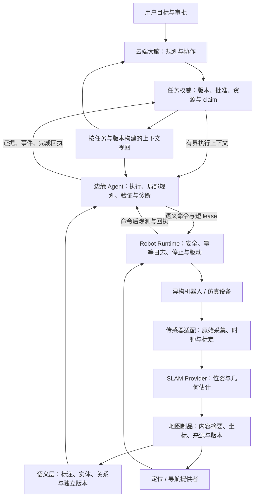

# 模块化与扩展性：云端大脑、边缘 Agent 与异构机器人

评估更新：2026-10-14；初次拆分起点为 `f5869138b81e6f8e71ba94d4925706bd1f3572bb`，本轮变化及测试见[实施记录](../development/2026-10-13-modular-extensibility.md)。后续边缘与空间增量见 [ROS 2 边缘升级](../development/2026-10-13-edge-field-candidate.md)和[空间导航实验](../experiments/2026-10-14-spatial-navigation.md)。本文是当前实现评估和后续建设路线，不是新的真机或大规模集群验收报告。

## 1. 结论与方案选择

**现有系统适合作为分布式机器人 Agent 平台继续演进。云端 Fleet 与边缘 Worker 已能同时运行，但“扩展接口存在”与“任意机器人、任意 SLAM、任意机群都可直接部署”仍有明显距离。** 最成熟的是任务版本、执行权限、命令日志和受控恢复；需要优先加强的是跨部署契约、算法提供者边界、按能力分工、坐标对齐和故障隔离。

采用“**领域模块 + 云边进程隔离 + 明确的提供者接口**”。云端负责目标和协作，边缘负责本地闭环，Runtime 负责设备控制与安全。先让替换一个模块不影响其调用者，再按算力、故障域和规模拆独立服务。

| 方案 | 当前项目中的取舍 |
| --- | --- |
| 在现有大模块内继续加型号和算法分支 | 初期快，但会让通用执行逻辑知道厂商、消息格式和算法私有状态；不作为长期扩展方式 |
| 领域模块、稳定端口、受控插件、必要的独立进程 | **本次选择**；复用已有可靠执行链，有针对性地拆除真实耦合，逐模块验收 |
| 立即将所有功能改成微服务和统一网络消息总线 | 增加部署、版本、顺序、重试和一致性问题；等性能或故障隔离证据表明确有需要时，再独立拆出模块 |

## 2. 当前能力与限制

| 维度 | 已有实现与证据 | 仍需完成 |
| --- | --- | --- |
| 云端大脑 + 边缘 Agent | Fleet 审批/任务/协调及只读 Cloud Assist；Worker 执行、日志、回执；Local Brain 可独立运行。见 `fleet/`、`edge/worker/`、`internal/localapp/` | Cloud Assist 尚非独立云端多 Agent 宿主；动态迁移推理、自动主控切换、无限离线执行均未实现；同一 Runtime 不能同时接受 Local 与 Fleet 两个控制者 |
| 多 Agent 通信 | Task/Ops/Recovery 使用带身份、任务修订和因果链的事件；恢复检查持久账本；独立 edge-exchange 提供持久 inbox/outbox、认证、去重、回执与有界 advisory 数据交换 | EventBus 是进程内有界通知，不是可靠网络消息总线；Ops/Recovery 主要为规则与目录逻辑；内存 Ledger/Beads 不是分布式知识库 |
| 云边任务一致性 | `execution.context.v1`、CAS 检查点、短 lease/fence、`context.completion.v2` 收尾；中断后重发完成回执而非重做动作 | 多主一致性、所有外部副作用的原子 fencing、多存储故障恢复与大规模压测尚未完成 |
| 异构机器人 | `robot.profile.v1`、`scene.reconstruction.v1`、PluginBackend；机械臂与移动传感平台合同测试；ROS 2 UGV/UAV/legged Profile、完整定位、路径身份与独立到达验证 | 新型号必须实现驱动、停止、反馈、感知与标定；通用工具仍是白名单；目录不自动生成厂商动作实现 |
| 多机器人合作 | 显式 robot ID、有序意图、资源监护权和已有双机交接路径 | Task 的单 Adapter、单能力计划绑定单机器人；还没有通用异构 DAG 分配、竞价、自动替补和跨机持物转移协议 |
| SLAM 与地图 | Dense 平面 RGB-D Provider、RTAB-Map/Nav2、SE3 注册测量采集/体素地图包、地形与三维几何规划、点云语义和版本绑定导航 | LiDAR/视觉惯性位姿估计仍由外部算法与适配器提供；动态避障/跟踪、跨机器人融合、实机飞行/步态和通用异构调度仍需验证 |
| 长程任务与上下文 | 确定性阶段投影、热约束、冷归档、带身份的 grounding 检查点和只读故障恢复；已有五站 Gazebo 工程案例 | 单次成功不能给出可靠性概率；真机长期运行、断网故障矩阵、异构合作和开放词汇识别需新实验 |

证据入口：[长程协作实现](long-horizon-collaboration.md)、[异构适配器](../development/robot-adapters.md)、[语义执行协议](semantic-execution-protocol.md)、[五站任务及全部失败](../experiments/2026-10-13-semantic-execution.md)。接口测试、算法测试、仿真、真机分别评价。

## 3. 模块职责与权威来源

图中为职责关系：SLAM/导航的具体进程接线仍以当前驱动为准；未来云端学习与新的 SLAM 插件不能仅凭图中的方框视为已实现。

| 模块 | 唯一负责的事实或决定 | 输入 → 输出 | 不应承担 |
| --- | --- | --- | --- |
| 目标规划 / 云端大脑 | 提出目标分解、候选计划、重规划建议 | 用户意图、有限上下文、能力目录 → 待验证方案 | 签发自己的批准、编造观测、直接控制电机 |
| 任务 / 协调器 | 已批准任务修订、分配、claim、资源监护权 | 验证后的计划和账本 → 执行授权与完成收尾 | 将通知送达当作物理完成 |
| 边缘执行器 | 当前授权内的步骤进度、局部 grounding、诊断结果 | 执行上下文、当前能力与观测 → Runtime 命令和检查点 | 修改云端批准内容、在未知结果后盲重试 |
| Runtime / Safety / Journal | 命令接纳、幂等身份、设备停止与实际结果 | 有效语义命令 → 设备动作和终态证据 | 任务级合作规划与云端模型选择 |
| 设备 / 传感器适配器 | 厂商单位转换、真实反馈、同次采集和来源身份 | SDK/ROS 数据 → profile、规范观测、受限执行 | 把缺失反馈填成成功或零值 |
| SLAM Provider | 测量到位姿/点云的估计及算法诊断 | 同次测量与标定 → 几何快照和 provenance | 决定任务是否批准、用估计轨迹冒充已验证通行 |
| 地图制品与语义仓库 | 几何不可变包；语义独立 CAS 版本 | 快照/显式标注 → 可校验地图和语义引用 | 悄悄改变旧地图坐标、自动抬高旧标签新鲜度 |
| 定位 / 导航 | 当前位姿质量、可通行性、局部障碍与目标反馈 | 地图、实时测量、目标绑定 → 可执行路径和状态 | 用历史语义标签替代实时避障 |
| 上下文投影 | 对权威数据的按范围派生视图 | 账本、修订、证据引用 → 有预算的上下文 | 成为新的任务权威或用模型摘要覆盖冲突 |
| 评测与运维 | 独立完成判据、故障归档和部署状态 | 原始记录 → 可复验结论 | 从工具自报成功推导真实任务成功 |

同一个程序可以承载多个模块，职责仍需分开。持有 Runtime 运动端口的模块应尽量少；新增观察/研究 Agent 默认只读。当前 Agent 可以注册扩展，但新增事件类别仍需同步固定 topic 词表及发布权限策略，不能宣称支持任意远程 Agent 动态加载。

## 4. 通信按含义分开管理

| 通道 | 当前落点 | 一致性与失败处理 |
| --- | --- | --- |
| Agent 本地事件 | `core/agentcontract` + `agentruntime` | 注册身份和 topic 权限；有界队列可能丢通知，事实从持久账本回读；事件 ID 与因果链保留 |
| 云边任务与控制 | HTTP 数据面 + FleetGateway mTLS Link | 设备身份、当前 claim、批准摘要、任务修订、目录和资源 fence；网络重连不得扩大授权 |
| 边缘到 Runtime | `edge/runtime` 语义端口 + `edge/robotclient` gRPC | command ID、幂等键、期限、短执行 lease、审批、安全配置；未知物理结果对账后再继续 |
| 感知与世界证据 | 规范 observation / reconstruction / telemetry | 原始来源、采集时间、序号、坐标与标定；错误机器人身份不允许通过配置重命名混入 Fleet 世界 |
| 地图、图像、归档大数据 | 地图包与当前本地证据文件 | 小消息传身份和摘要；原始流留在设备/受控服务。本项目尚无通用跨云对象存储传输层 |

共同规则是“**通知可重复，事实可追踪，动作不能靠重复投递取得可靠性**”。消息至少区分 query、proposal、command、event、ack；不能把诊断建议直接转换为新的动作授权。独立 [edge-exchange](../development/edge-data-exchange.md) 已落实 TLS 1.3、peer 凭据、持久 inbox/outbox、单调序号、TTL、去重与回执；其消息是 advisory 数据，不能直接将进程内 EventBus 暴露上网或由通知取得运动权。通用远程 Agent 动态装配和协议协商仍需另建。

云端与边缘可以分别调用模型，但共享的是任务/地图/证据版本，不是强制同步整段聊天。云端持任务权威，边缘持实际执行日志；重连时先按 claim/command/digest 对账，已 EXECUTED 的只补完成回执，ACCEPTED 且结果未知的停止待核验。冲突使用明确拒绝、重新同步或产生新批准修订，不以“最后一条消息覆盖前一条”处理物理事实。

## 5. 本次已经落实的边界改进

### 云边契约与适配器

- `core/fleetcontract` 承载双方共同理解的 IntentNode 和遥测值；`core/eventstore` 承载事件/检查点/outbox 原子存储端口。Fleet 原包保留兼容别名，调用方逐步改用契约包。
- `orchestration/handoff` 承载共享的任务执行摘要和上下文校验。它依赖任务模型；没有为了名称好看把依赖 `tasks` 的应用规则塞进 `core`。
- Redis 取任务实现独立为 `edge/tasksource`，在 `cmd/edge-worker` 组装。自定义 Go 组装代码需将 `worker.NewRedisTaskSource` 改为 `tasksource.NewRedisTaskSource`；HTTP/gRPC/JSON 与部署配置不变。Worker 依赖取任务端口，不再因引入 Worker 就导入 Redis SDK 和云端协调器实现。
- 边缘 Cloud/Runtime 使用接口，Link 仍为具体 gRPC 客户端；本轮不是切换传输协议，也未增加网络协商或云端共识。

### SLAM 算法边界

- `slam_provider.py` 定义测量会话端口和可验证输出；`dense_slam_provider.py` 封装 DenseSLAM。`RobotWorkflow` 通过显式 factory 获取实例，不再读取算法的 `frames/registrations/loops/previews` 私有布局。
- 进度读取与全量快照分开；没有为了抽象而每次采样复制整个点云。保存或生成实时网格时再读取快照。
- 本版合同明确为米制、平面 SE(2)、driver world 坐标下的测量会话，并保留点到采集帧、时间、实测里程计与估计位姿的对应。不能将 LiDAR 的 SE(3) 输出、不同坐标系的点或外部全局地图直接冒充此合同。
- 同时修复续建地图已有的坐标重复变换、来源起点错配与负索引错误清障；合并轨迹保留可配对时间，未知历史时间显式为 `null`。旧制品保留，升级不会自动纠正旧地图。
- 通用几何直接来自 `geometry.py`；语义与导航消费者不再通过 DenseSLAM 取得几何函数。新的依赖测试约束这个方向。

提供者构造和接入步骤见[SLAM Provider 开发](../development/slam-providers.md)。标准地图制品可供多算法适配复用，但当前 ROS 导航中的 RTAB-Map 启动、状态和定位质量判断仍需为新算法另写适配。

## 6. 异构机器人如何真正合作

接入一种机器人至少需要三份合同：**本体能力**（结构/关节/限位/工具）、**观测合同**（传感源/坐标/时间/标定）、**执行合同**（授权/停止/反馈/动作后验证）。只填写 profile 不能解决抓取控制、定位或实体识别。

Local Agent/Worker 已将完整 Runtime Profile、目录、设备与安全配置持久固定，并在重启和逐调用时检查；ROS 空间部署摘要还覆盖完整体素图、规划策略、定位条件和 Profile。已有历史缺 pin 时拒绝自动重建，显式无动作准入前先对账，不能通过删除历史解除拒绝。该指纹检查确认软件合同，仍不证明真实设备限幅、驱动和停止行为正确。见 [持久合同与部署](../operations/edge-field-testing.md)。

跨机器人任务应逐步演进为每个节点明确 `requiredCapabilities`、目标/实体、资源、完成判据和候选机器人；分配后冻结 robot/profile/catalog/map/transform 等身份。候选选择可以考虑工具、负载、能量和网络，但由确定性协调器验证并提交。模型可提建议，不能自行选择一台未授权机器人运动。

合作交接还需要共享实体身份和坐标对齐：A 的 `cup-1` 不天然等于 B 的 `cup-1`，两台机器人各自的 `map` 也不天然一致。应先确认空间变换与标定版本，再由发送方释放/接收方取得资源监护权；持物、放置、对方看到同一实体都需要独立证据。链路断开或结果未知时保持资源占用/冲突状态，不能仅因 lease 到期宣布交接成功。

坐标约定参考 ROS [REP-105](https://raw.githubusercontent.com/ros-infrastructure/rep/master/rep-0105.rst)：短期连续的 odom 与可校正的 map 各有职责，多机器人需要区分各自坐标并定义共同参考。本项目的 `worldFrameRevision` 和 `mapFromWorld` 是当前合同中的身份与锚点，不等于已实现通用跨机器人 TF 图或地图配准。

## 7. 不同 SLAM 如何接入

| 接入层 | 需要替换的部分 | 保留的系统职责 |
| --- | --- | --- |
| 同类平面 RGB-D 测量算法 | 实现当前 SLAM Provider，回报经过校验的快照和诊断；通过替换与保存/启用测试 | 勘测/探索流程、地图制品、语义版本、任务与 Runtime 安全 |
| RTAB-Map / 其他 ROS 定位导航栈 | 实现导航侧车的地图状态、位姿来源、质量、目标/取消反馈；替换专有消息和启动接线 | 上层语义命令、命令 journal、独立完成证据 |
| LiDAR / 视觉惯性 / 完整 SE(3) | 外部算法完成配准、同步、TF 与自体过滤；使用 slam.registered-frame.v1 / spatial.localization.v1 进入空间通道，按 volume3d 或 terrain25d 规划；不向平面 Provider 强塞 SE3 数据 | 地图身份/摘要、来源、审批和结果对账不变 |
| 跨机器人地图融合 | 版本化配准、变换质量、实体关联、冲突与回滚协议，并验证断网后重合并 | 各机器人的原始地图和证据独立保留 |

不要通过修改旧地图哈希下的内容来“更新地图”；几何优化生成新修订，旧语义引用重新认证或标为待迁移。也不要把占据网格、几何点云、语义层、实时定位和导航控制器合并为一个 SLAM 插件的隐式职责。

设备侧生命周期可借鉴 ROS 2 [Managed nodes](https://design.ros2.org/articles/node_lifecycle.html) 的显式配置、激活、停用与错误处理。这里是后续导航提供者的设计参考，不代表本次 Python Provider 已具备 ROS lifecycle 或可在运动中热切换算法。替换设备/算法应在停止与对账后进行。

## 8. 后续建设顺序与验收门槛

| 阶段 | 交付内容 | 必须通过的验收 |
| --- | --- | --- |
| A：本轮边界固化 | 契约下沉、SLAM Provider、依赖守卫、Fleet 遥测身份拒绝 | 现有完成恢复语义不变；第二实现可替换；错误身份/坐标/点来源被拒绝；线协议和存量地图读取兼容；Go/Python 组装源码按迁移说明调整 |
| B：第二个真实导航/SLAM 提供者 | 选择一套实际有设备/数据支持的算法，实现质量、地图、定位、取消适配 | 同一数据/场景配对评测；重定位、时间偏移、重启、地图变化、取消和运动中失定位均有记录 |
| C：异构协作任务节点 | 每节点能力需求与 robot/profile/catalog 冻结；显式分配和资源交接 | 至少两种本体完成同一任务；拒绝能力不足；任一节点未知时不重复搬运；交接证据与坐标一致 |
| D：云边弹性与长程恢复 | 明确离线任务预算、重连对账、主控交接、证据上传断点 | 网络分区、重复/乱序/延迟、两端重启、过期 fence、存储部分失败；验证单控制者和零非授权动作 |
| E：规模化与研究评估 | 能力索引、按机器人/区域分片、资源/队列容量、可获取数据集 | 预登记机器人数量、时长、任务难度、失败分母、吞吐/延迟/上下文/恢复指标；多种种子、对照和负例 |

每阶段先验证安全与身份不变量，再比较成功率、耗时和资源消耗。只在瓶颈测量支持时拆出独立语义服务、推理服务或地图存储；不为模块数量增加网络往返。

## 9. 开发者操作准则

新增 Agent 从[Agent 扩展指南](../development/adding-an-agent.md)开始，新增型号从[机器人适配器](../development/robot-adapters.md)开始，新增建图算法从[SLAM Provider](../development/slam-providers.md)开始。每次扩展说明：谁拥有权威状态、版本如何演进、动作权限在哪里核验、如何停止、怎样证明完成、旧记录怎样读取。

依赖方向由 `tests/architecture` 检查。合同测试证明接口互通；故障恢复测试证明既定条件下不重复派发；算法/仿真/真机实验再证明具体任务能力。部署记录、原始失败和不可用能力必须留下，不能以隐藏失败或静默降级换取“可扩展”的表象。

## 9. 当前空间通道的边界

[空间建图](../development/spatial-mapping.md)保存外部已注册测量，射线认证 free、端点 occupied、其余 unknown；它不重新估计 SLAM 轨迹。[空间导航](../development/spatial-navigation.md)对连续线段检查包络，地图、策略和定位条件进入不可变部署摘要。空中要求完整 SE3，地面使用单层支撑/坡度/阶差，足端与步态由控制器处理；未知空间、错误版本和 stale/lost 定位拒绝执行。

原点云 semantic.plan 仍为二维地面观察候选；三维几何通道没有自动获得任意三维语义区域的签名 grounding。下一轮跨通道工作需定义语义目标到空间部署的合同，而非把三维标签直接当飞行命令。三类 11 段记录式 ROS 2 任务的判据和失败见 [空间实验](../experiments/2026-10-14-spatial-navigation.md)。
