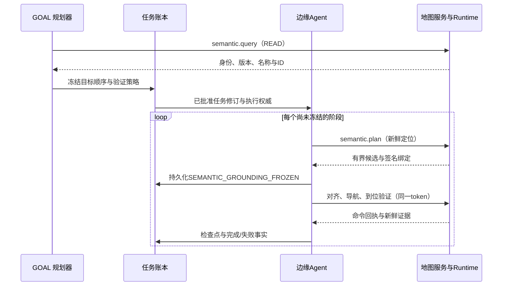

# 点云语义到长程任务的交互协议

本文定义已实现的语义导航边界：GOAL 规划器选择目标与顺序，边缘执行器逐段取得当前候选，机器人 Runtime 决定是否允许执行，并以新鲜观测确认结果。新目标通道的 GOAL 规划器位于 Local/Worker 共享 Host 内，旧冻结计划通道在审批前规划；模型 endpoint 在云端不改变边缘生命周期归属。本文不是新通信总线规范；实现复用已有能力目录、gRPC、任务账本和云边执行信封。阅读入口见[用户指南](../guides/semantic-point-cloud.md)，工程决策见[本轮实施计划](../development/2026-10-13-semantic-execution-plan.md)，通用云边机制见[长程协作导读](long-horizon-collaboration.md)。

## 1. 权威与消息边界

| 角色 | 拥有的权威 | 可以交换的内容 | 不能代替的环节 |
| --- | --- | --- | --- |
| 操作员/标注感知源 | 给出有来源的标签声明；操作员按现有流程批准任务 | 标签、范围、来源、观测时间、任务要求 | 标签不能证明目前存在目标或空间可通行 |
| GOAL 规划角色（目标通道为边缘 Task） | 从成功查询证据选择名称、ID、顺序与验证模式 | `semanticRoute`、六元身份、语义版本、有界摘要 | 不生成执行坐标，不签发执行绑定 |
| 边缘 Agent | 在当前阶段 grounding，保存冻结候选并执行任务图 | `SEMANTIC_GROUNDING_FROZEN`、命令、结果与证据引用 | 不以新候选替换旧检查点，不把工具成功等同物理成功 |
| 机器人地图/语义服务 | 校验几何包，维护本机语义 CAS 账本，规划并签发候选绑定 | `semantic.query/plan/observe` | 查询、签名和识别不直接授予运动许可 |
| Runtime 与导航适配器 | 校验机器人/目录/审批/租约/资源；执行、停止及保存命令 journal | 运动事件、`map_route`、验证回执 | 不靠标签跳过足迹、定位与动态障碍检查 |
| 观察/诊断/恢复 Agent | 消费同一任务和机器人身份的证据，解释失败并提出处理 | 观测、诊断、恢复建议与新任务修订 | 不伪造感知匹配，不直接重试结果未知的动作 |

普通服务继续使用 `ListServices/CallService`；真正动作使用原 `ExecuteSkill`/取消路径。`robot.task` 是现有复合能力，新增的是它的结构化输入分支。`semantic.plan`、`semantic.observe` 均为 READ，可用于规划；`semantic.annotate` 仍是有副作用的 CAS 写入，不能在只读规划阶段执行。没有新增绕过 Runtime 的 Python 导航服务。

## 2. 身份、坐标和修订

几何/语义身份是以下不可拆分的六元组：

```text
identity = (robotId, mapId, mapRevision, calibrationRevision, cloudSha256, frameId="map")
```

`mapRevision` 属于不可变地图包，`cloudSha256` 标识参与标注的 canonical cloud，`calibrationRevision` 标识测量标定。`semanticRevision` 独立标识标签集合及父版本。语义编辑不会改变几何版本，但所有绑定旧语义版本的目标都需要重新处理。

候选 `goalPose` 使用 world 坐标及 `[x,y,z,qw,qx,qy,qz]` 顺序。它另外绑定 `worldFrameRevision` 和实际 `mapFromWorld=[x,y,yaw]` 变换；即使地图版本字符串没变，也不能更改锚定变换后继续执行旧坐标。观察候选保留机器人实际底盘高度，不能把物体质心的 Z 当成底盘目标高度。

同一 `semanticRoute` 使用一个固定地图及语义版本。跨地图路线、跨楼层切换、跨机器人共同坐标注册和自动语义迁移不在当前契约内。不能通过替换 `robotId` 把甲机器人的点云或 token 交给乙机器人执行。

当前“根据点云导航”具体指三维语义目标驱动的地面平面导航：语义选区和测量依据来自三维点云，可达性使用已有的二维占据栅格、底盘足迹及 Nav2 动态障碍层。它不是无人机的三维自由空间路径规划，也没有实现楼梯、跨楼层路线或全身避障；更换这些运动模型必须实现相应 Provider 与执行验证。

## 3. 严格输入与规划输出

`robot.task` 只允许 `request` 或 `semanticRoute` 两个分支之一；`semanticRoute` 不接受额外字段或坐标。其必填字段为：

```text
semanticRoute:
  mapId, mapRevision, calibrationRevision, cloudSha256, semanticRevision
  targets[1..16]:
    annotationId, name, maxDistanceM, allowStaleSearch, verificationMode
```

四个摘要必须为64位十六进制内容修订。`maxDistanceM` 在0.5到5米之间，`verificationMode` 为 `arrival` 或 `object`。每个目标 ID/名称必须由本次规划 trace 中 `semantic.query` 的 `READ_OK` 结果证明，且与同一六元身份和语义版本对应。唯一的名称/别名查询可以证明该名称拼写。原句中明确命名的目标、访问顺序与重复次数均需保留。

以下为**结构示例**，摘要与 ID 必须替换为真实查询结果：

```json
{
  "semanticRoute": {
    "mapId": "scan-example",
    "mapRevision": "aaaaaaaaaaaaaaaaaaaaaaaaaaaaaaaaaaaaaaaaaaaaaaaaaaaaaaaaaaaaaaaa",
    "calibrationRevision": "bbbbbbbbbbbbbbbbbbbbbbbbbbbbbbbbbbbbbbbbbbbbbbbbbbbbbbbbbbbbbbbb",
    "cloudSha256": "cccccccccccccccccccccccccccccccccccccccccccccccccccccccccccccccc",
    "semanticRevision": "dddddddddddddddddddddddddddddddddddddddddddddddddddddddddddddddd",
    "targets": [
      {"annotationId": "inspection-cup", "name": "待检查杯子", "maxDistanceM": 1.5, "allowStaleSearch": true, "verificationMode": "object"}
    ]
  }
}
```

对应原句应明确表示前往“待检查杯子”的旧位置寻找并尝试确认该杯子。`allowStaleSearch` 是记录在批准任务中的搜索策略，不得在运行失败后偷偷由 false 改成 true。

进入每一阶段时，边缘发送：

```json
{
  "mapRevision": "aaaaaaaaaaaaaaaaaaaaaaaaaaaaaaaaaaaaaaaaaaaaaaaaaaaaaaaaaaaaaaaa",
  "semanticRevision": "dddddddddddddddddddddddddddddddddddddddddddddddddddddddddddddddd",
  "annotationId": "inspection-cup",
  "maxDistanceM": 1.5,
  "allowStaleSearch": true,
  "verificationMode": "object"
}
```

这是 `semantic.plan` 参数，不是运动命令。输出包含 `identity`、`activeMap`、`semanticRevision`、`annotationId`、`worldFrameRevision`、`frameId:"world"`、`poseObservedAtUnixMs`、`targetFresh`、`verificationMode`、`executionBindingSupported` 和候选列表。候选包含：

- `goalPose`：运行时规划得到的七维位姿。
- `geometryVerified`、`footprintRadiusM`、`pathLengthM`、`pathSha256`、`targetDistanceM`：测得栅格上的几何准入依据。
- `semanticBinding`：仅由支持该执行边界的适配器提供的不透明签名字符串。

边缘拒绝身份或版本不匹配、无 world frame、定位超过2秒、未声明执行支持、没有合法候选或超出机器人工作空间的响应。Runtime 规划时自身要求1秒内定位。候选上限4个，总输出受7,000字节限制；token 最长2,048字符。`executionAuthorized:false` 始终保留，因为签名不是用户批准、租约或资源授予。

规划中的 `GridPathPlanner` 为同一请求保留不可变栅格快照，复用距离场与有界点/线段检查缓存。距离场只能给出保守安全下界；下界不足的线段仍使用精确底盘胶囊与栅格矩形检查。计算完成后必须取得真实的第二次定位。如果新旧起点偏移不超过0.05米，且连接线段具有完整足迹净空证明，就将新起点加入已验证路径并更新路径长度和 SHA；否则以 `LOCALIZATION_CHANGED_DURING_PLAN` 拒绝。返回前再检查定位年龄、地图锚定/语义/足迹及目标 TTL，输出时间来自第二次传感器观测，禁止只刷新旧定位时间戳。这同时防止慢规划返回过时定位，以及物体在计算期间过期后仍被标记为新鲜。

## 4. 进程签名与运动准入

运行时以进程内随机 HMAC-SHA256 密钥对有界规范 JSON 签名。签名载荷绑定：六元身份、`semanticRevision`、`annotationId`、`worldFrameRevision`、实际 `mapFromWorld`、精确 `goalPose`、足迹半径、`verificationMode`、`allowStaleSearch`、标签观测时间和种类。调用者应原样转发 token；不依赖其内部编码，也不能从中修改一个坐标。

签名只证明“这个候选由当前进程签发且未被修改”。它不证明感知标签正确、路径永远无障碍或调用者有运动权限。密钥不传给中心大脑；token 随冻结 grounding 写入既有任务记录。进程重启会更换密钥，旧 token 必须失效；没有持久签名密钥、外部 PKI 或离线跨进程 token 复用机制。

运动链保持原入口：

```text
observe_scene
  → navigation.pre_position(alignYaw, semanticBinding)
  → navigation.navigate(goalPose, semanticBinding)
  → verify_arrival(goalPose, semanticBinding)
```

预对齐只允许使用签名目标的朝向，位置仍由机器人当前定位决定。导航与验证的目标必须逐值匹配签名位姿。三步共同核对地图/标定/语义/world frame/锚定变换/足迹/时效；地图包与语义历史完整性在准入和完成处验证。运行期间以50毫秒轮询检查版本和新鲜度，语义 head 只用于快速变化检测，不替代完整性校验。该轮询间隔不是硬实时停止延迟保证。

执行继续经过已有审批、catalog revision、资源 fencing、命令 journal、租约和取消机制。Gazebo home 路径先用已测栅格进行足迹与连通路径准入，再调用 Nav2。Nav2 使用在线障碍观测；目标客户端租约、速度新鲜度和观测丢失处理保持生效。语义层既不开放未知栅格，也不直接发布电机速度。

## 5. 长程检查点、云边上下文与恢复

每个目标展开为单独的顺序 intent。尚未开始的下一阶段会重新获取当前定位和候选；已经冻结的同一阶段不会在恢复时重新选点。冻结事件 `SEMANTIC_GROUNDING_FROZEN` 记录 task revision、intent fingerprint、目标身份、candidate、token 和 grounding 依据，在首个物理动作之前持久化。



云边继续使用已有任务修订、claim、执行 digest、catalog revision、fencing 和持久 outbox。新增语义 intent/plan 进入原有执行摘要，而不是另起一份可以独立漂移的坐标缓存。中心上下文保存有界摘要、身份和事件引用；原始点云/栅格留在机器人侧。观察与恢复 Agent 读取相同 task/robot/revision 的证据，不能用另一个任务的成功观测覆盖当前失败。

规划工具目录的输入约束以结构化 `oneOf` 分支表达，不再把完整 schema 作为字符串重复嵌入工具描述。用途、副作用和复验要求仍保留在说明中，实际调用仍经过完整 schema 与 catalog revision 校验。原32,768字节上下文和65,536字节请求预算保持不变；预算不足时拒绝创建可执行计划，不能通过压缩删除任务身份或执行约束。

恢复规则：已有冻结记录时复用其精确目标与 token；记录内容或 intent fingerprint 不一致时拒绝恢复；记录缺失而该阶段已有开始/完成的物理步骤时，也拒绝重新 grounding。未完成且已冻结的阶段若因 Runtime 重启、签名失效或地图变化而失去有效绑定，需要显式对账并生成重新规划的任务修订。不能新选一个候选，再跳过旧候选已经完成的导航步骤。

控制台受控恢复还检查整个阶段的子步骤 journal。若全部步骤已完成，且冻结身份和命令参数一致，整段作为历史完成事实跳过，不要求机器人重新回到那个站点。未完成阶段仍使用原 token 重新读取/验证；Runtime 重启使这一未完成阶段的 token 失效时会拒绝继续。尚未冻结的新阶段可从当前实际定位取得新候选。这些规则不能把历史到位事实当成机器人当前的位置。

持久命令 journal 保持原命令的幂等终态或未知状态。网络重连不构成动作可重试的证据；未知结果要先确认现场状态。旧命令的历史回放不证明“此刻仍在原位置”，下一阶段仍需要新鲜定位和本阶段确认。

## 6. 到位与感知证据

对象默认15分钟过期；区域默认无 TTL，但均标记需要重新观察。搜索模式可以利用旧物体位置，不能更改历史观测时间；时钟回退导致的未来观测仍拒绝。重叠歧义和低置信度不因允许搜索而放行。

`arrival` 要求到达候选观察位以及新的捕获。Gazebo home 当前到位门限为平面误差0.08米、朝向0.15弧度；这一门限不是所有异构机器人都已认证的统一指标。区域观察位可能在区域外，不能由 arrival 推导进入区域、遍历整个房间或识别目标物体。

`object` 在到位后调用内部 `entity_source`，验证 reconstruction 的机器人、传感器声明、source type/frame、标定、观测 ID/时间和同帧底盘 world pose。执行验证传入 `notBeforeUnixMs`，使早于本次验证开始的帧不能成功；普通查询仍有2秒观测新鲜度上限。实体转到当前 map 后，以类别和标注空间范围关联，容差0.15米、置信度门限0.5均为工程参数。零匹配失败，多匹配歧义失败；几何点命中本身不能确认类别或刷新标签。

导航回执 `robot_state.map_route` 增加 `semanticBindingSha256` 和 `semanticExecution`。后者保留六元身份、语义版本、annotation ID、world frame、验证模式、搜索策略和目标新鲜度。`robot_state.semantic_verification` 将验证命令、导航命令、token 摘要及新捕获关联起来；对象模式的完整感知结果保存在 `observationEvidence` 中，顶层只复制常用观测索引与 `semanticConfirmed`。

`observationEvidence.evidenceHash` 只覆盖这份嵌套字典除 `evidenceHash` 外的内容，不覆盖外层导航命令回执。重算规则：递归将有限的整数值浮点数转换为整数（含 `-0.0 → 0`，布尔保持布尔），按键排序、ASCII 转义、无多余空白的 JSON 编码，拒绝非有限数，取 SHA-256。实现以 Python 规范化函数为准，没有宣称兼容另一套标准 JSON 签名规范。源代码或哈希规则变化后必须保留旧实验的源码身份，不能修改旧证据让它适配新算法。

边缘验证命令、目标、token SHA、冻结身份和捕获时间；独立验收器还可以重算感知摘要及实际位姿误差。新物理动作清除旧的语义确认，且观察只发布与当前导航回执匹配的确认。到位率、对象确认率、任务完成率应分别统计。

## 7. 不一致处理

| 情况 | 系统行为 | 合理后续处理 |
| --- | --- | --- |
| 标注 CAS 冲突 | 拒绝覆盖；保留已有版本 | 重新读取并明确解决编辑冲突 |
| 地图/点云/标定不同 | 拒绝候选绑定；运行中变化停止 | 重新定位、核对地图身份，再规划 |
| world frame 或实际锚定变换改变 | 拒绝旧 world 坐标 | 重新取得当前候选，不能只改版本标签 |
| 语义修订改变 | 原语义目标绑定失效 | 对账后形成新任务修订；不自动迁移 |
| 目标过期 | 默认拒绝或停止；批准搜索时保留过期事实 | 重新观察，或明确按旧位置搜索 |
| 目标没看到/多对象匹配 | 对象模式不成功 | 保留本次观测；检查范围、遮挡、类别及检测器能力 |
| 无路径/动态障碍 | 导航失败或停止，不产生到位成功 | 检查现场/补扫；新的动作仍需独立准入 |
| token被修改或Runtime重启 | 拒绝旧绑定 | 核对历史动作结果后显式重新规划 |
| 动作超时、通信中断、终态未知 | 保留 journal/失败状态，禁止盲目物理重发 | 对账与现场确认 |
| 恢复时缺少冻结证据 | 不为已开始的阶段重新选点 | 恢复原证据或建立明确的新修订 |

## 8. 异构接入与未实现范围

共同契约是地图身份、语义目标、候选证据和动作后事实。路径规划仍依赖每台机器人的实际足迹、工作空间、定位和驱动。大足迹机器人不能复用小机器人的净空结论，机械臂可达性也不能从底盘候选推导。当前是平面导航上的足迹半径与栅格模型，不是支持飞行器、腿足地形或多楼层的通用三维运动规划器。

只有实现绑定验证、停止、在线导航和到位证据的适配器才能声明 `executionBindingSupported`。当前代码在 Gazebo home 适配器启用。真实 XLeRobot direct 后端仍没有此移动执行能力，真实 RGB-D sensor-only 后端也不会因为能提供点云而获得导航权限。本轮软件扩展不能作为真机长程任务完成的证明。

尚未实现开放词汇全图识别、从历史深度伪彩预览重建原始深度、自动跨视角实例融合、闭环优化后的标签自动迁移、跨机器人地图对齐、动态对象持续追踪，以及由任意新标签直接生成抓取任务。可扩展方向是带来源的 RGB-D 分割投影和对象图；必须独立评估感知关联、坐标漂移与物理执行。

## 9. 代码与回归入口

| 实现边界 | 代码 |
| --- | --- |
| 严格复合输入、查询证据与顺序冻结 | [semantic_route.go](../../internal/capabilityagent/semantic_route.go) |
| 逐段 grounding、版本/工作空间检查 | [semantic_cloud_route.go](../../edge/robotclient/semantic_cloud_route.go) |
| 冻结检查点与恢复 | [semantic_grounding.go](../../edge/agent/semantic_grounding.go) |
| 边缘证据验收 | [semantic_verification.go](../../edge/agent/semantic_verification.go) |
| 任务图与参数绑定 | [plugin.go](../../skills/manipulation/plugin.go) |
| 地图候选、签名与执行守卫 | [semantic_cloud_services.py](../../robot/gateway/tangying_robot_gateway/semantic_cloud_services.py) |
| 感知关联与摘要规范 | [semantic_cloud_observation.py](../../robot/gateway/tangying_robot_gateway/semantic_cloud_observation.py) |
| 导航与验证适配器 | [gazebo_backend.py](../../robot/gateway/tangying_robot_gateway/gazebo_backend.py) |
| 签名/篡改/停止/幂等回归 | [test_semantic_execution_binding.py](../../robot/gateway/tests/test_semantic_execution_binding.py) |
| 同帧感知与歧义回归 | [test_semantic_cloud_observation.py](../../robot/gateway/tests/test_semantic_cloud_observation.py) |

这些测试覆盖软件契约与合成运动端口，不能替代新 Gazebo 运动或真实硬件验收。具体运行版本、失败过程和实验结论以[实验索引](../experiments/README.md)中的独立报告为准。
