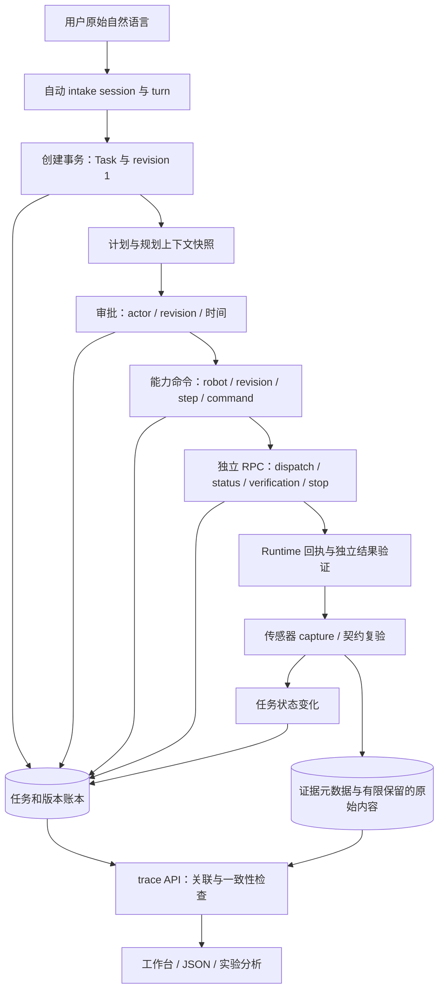

# 从原始自然语言到原子调用的任务回溯

更新日期：2026-11-02。适用范围：Local 任务库、能力执行器和工作台；数据合同为 `task.trace.v1`。本页说明软件如何保存和核对证据，不构成新的 Gazebo 或实机完成报告。

回溯需要回答三个问题：**用户最初要求什么，系统实际做过什么，支持结论的记录是否可靠。** 当前通过 `GET /v1/tasks/{id}/trace` 将不可变任务版本、原始事件、命令、底层服务调用和传感器证据索引关联起来。工作台“任务全过程回放”显示持久快照与诊断，并可下载 JSON。读取和下载都不会重新执行任务。

## 一条任务如何留下证据



自动 session 是 Local `/v1/tasks` 的输入管理层；云端目标与 Worker 不因此自动获得同一会话。完整角色边界见[云边通信与上下文](edge-agent-communication-and-context.md)。一台机器人和另一台机器人的账本分别保存，不以一个本地 trace 宣称全机群全局快照。

`edge.goal` 的分层执行另有 `children`：按父账本 `EDGE_PLAN_CREATED` 的 `childId / parentRevision / planDigest` 读取 `edge-child/{childId}` 权威聚合。先验证子 ID 属于父任务命名空间，再核对实体身份、版本和计划摘要。`EDGE_CHILD_EVENT` 只是进度镜像，不能替代原始子账本；缺声明、缺存储、摘要冲突及超过 64 个子计划都显式报告。子 `task.request` 是边缘生成的目标，不能替代根任务的用户原句。子计划没有独立 TaskRevision 表，导出保留这一来源差别，不伪造首版记录；子传感器证据尚未自动展开，仍显示范围缺口。

诊断必须按 **`findings.taskId + eventSequences`** 定位。父账本的第 7 条与子账本的第 7 条是不同事实。工作台可以展开子命令/RPC，并在父进度未变化时每 10 秒重新读取已有子计划；下载 JSON 保留完整子事件。

### 不能互相替代的身份

| 身份 | 回溯用途 | 不能拿它推断什么 |
| --- | --- | --- |
| `sessionId / turnId` | 哪一轮输入、用了哪份会话参考 | 不是审批凭据，也不是完成记录 |
| `taskId` | 定位任务账本和版本历史 | 同一句话重发仍可能创建另一个任务 |
| `revision` | 本次执行采用哪个不可变目标和计划 | 当前版本不能补写旧事件缺失的版本 |
| `robotId / stepId / commandId / tool` | 区分机器人、逻辑步骤与命令尝试 | 同名步骤的另一次成功不能替本次未知命令收尾 |
| `rpcId` | 区分一次真实服务调用尝试，包括轮询与复验 | RPC 返回成功不等于父命令完成 |
| `captureId / evidence.id` | 关联原始采集身份与存储记录 | 历史观测不证明机器人当前仍在那个位置 |

trace 的命令分组同时使用 `(revision, robotId, stepId, commandId, tool)`。缺少完整身份的事件单独保留并报告缺口；不借用当前机器人或最新计划替它猜身份。事件外层与 payload 的步骤身份冲突时，同样不能把它归入正常命令。

**原始自然语言来自 `revision 1.Request`。** 激活新版本会改变当前 `Task.Request`，所以 `originalRequest` 与 `currentRequest` 分开。缺少首版时返回明确缺口，不把修改后的目标称为原句。`originalRequest.sha256` 是原句字节的 SHA-256；`session.contextSHA256` 校验该轮参考上下文。两者均不授予权限，也不是防止有权写数据库的人篡改记录的签名机制。

## 状态、命令与 RPC 怎样持久化

### 状态与批准

`Service.Transition` 在保存任务状态时，一起写入 `STATE_CHANGED` 的 `previousState`、`state`、`revision`、`aggregateVersion` 与原因。提交成功后，observer 才收到该事件的副本。过去仅发给 observer 的前后态现已写入持久账本；关闭 SQLite 再打开仍能读取同样的事实。旧版已经缺失的字段不会凭空补齐。

`TASK_APPROVED` 增加结构化 `actor`、`approvedAt`、`revision`、`aggregateVersion`。`actor` 标识批准入口，不虚构用户账号身份。入队重试复用已保存的审批，不重新覆盖批准人和时间。内存 Repository 也隔离事件 payload 的嵌套 map、slice、array，避免读者或 observer 改动返回对象时改写存量事实。

任务状态机、命令状态和观测判据各有职责：`SUCCEEDED` 是任务执行器的持久结论；trace 检查这个结论与现有记录有无矛盾。`integrity.status=consistent` 只表示已实现的检查未发现缺口或冲突，不是重新做过物理验收。

### 一个能力命令可以有多次 RPC

例如 `mapping.build` 被接受后，执行器会查询建图状态，并按完成契约复验。所有查询属于同一父命令，但每次调用有独立 `rpcId`，保留服务名、`requestId`、阶段、操作身份、开始与结果事件序号。这样能够区分“建图请求失败”“状态查询断线”“服务已完成但复验失败”。规划期只读查询仍在既有 `planningTrace` 中；本轮 RPC 记录覆盖能力 Executor 的服务调用，不声称覆盖驱动内部每次 ROS 消息或物理控制周期。

`CAPABILITY_RPC_STARTED` 在调用前写入；`CAPABILITY_RPC_FINISHED` 记录服务结果和错误。记录还包括参数/结果的 JSON 摘要哈希、字节数与有界内容，`durationMs` 包含开始证据的写入开销，`providerDurationMs` 只测量 `CallService`。分析延迟时不要把两者混用。

| 窗口 | 执行器行为 | 回溯解释 |
| --- | --- | --- |
| 普通调用的开始记录写入失败 | 不派发该调用，返回持久化错误 | 不能声称机器人收到命令 |
| 开始记录已保存，进程随后退出 | 开始记录可能是唯一证据 | 不能断言服务已执行，也不能断言没执行 |
| 服务已返回，结束记录写入失败 | 返回证据持久化错误，保留 provider 错误链 | 不把传输成功当作完整可用结果 |
| 调用者取消后服务返回 | 使用独立、最长 2 秒的写入上下文记录结果 | 尽力保存已派发调用的结果，仍可能因存储故障失败 |
| 已持有操作所有权的物理停止遇到审计故障 | 仍尝试停止，向上报告证据错误 | 不允许日志故障阻止已有所有权的停止；缺口仍须报告 |

RPC 参数/结果先移除 `points/colors/trajectory/preview/cells` 等大数组字段；投影 JSON 超过 16 KiB 时不在事件中保存内容。`argumentsProjected/resultProjected`、`argumentsOmitted/resultOmitted` 说明发生了什么，哈希和字节数对应本进程收到的原始 JSON。**只保存哈希的内容不能据此恢复**，需要另有地图、观测或实验归档。这个投影是容量控制，不是通用敏感信息脱敏器。

## 导出与定位问题

在工作台选择正确机器人及任务，查看“持久回溯快照”“原子命令记录”“底层服务调用记录”，再下载回溯 JSON。重新读取时若事件水位不同，页面会提示；不会把读取失败显示为检查通过。

也可以使用命令行，以下变量替换成实际工作台地址与任务 ID：

```bash
TRACE_BASE=http://127.0.0.1:8897
TRACE_TASK=task-your-id
curl --fail --silent --show-error \
  "$TRACE_BASE/v1/tasks/$TRACE_TASK/trace" \
  --output task-trace.json
jq '{originalRequest,currentRequest,state,source,integrity}' task-trace.json
jq '.steps[] | {taskRevision,robotId,stepId,commandId,status,eventSequences}' task-trace.json
jq '.rpcCalls[] | {rpcId,commandId,service,phase,status,eventSequences}' task-trace.json
```

受保护部署按既有访问方式携带凭据。多机器人代理使用对应工作空间路径 `/robots/{robotId}/v1/tasks/{id}/trace`，不要把另一设备上相同任务 ID 的数据混入报告。

响应保留 `events`、`revisions`、`steps`、`rpcCalls`、`children`、`evidence`；诊断在 `integrity.findings`，每条给出问题码、严重度、事件序号和可用时的步骤 key。`source` 给出事件水位、聚合版本、读取一致性范围与快照哈希。快照哈希针对服务端读到的任务、版本、证据元数据和子聚合输入，不是下载文件自身的校验和；需要固定实验文件时另行计算文件 SHA-256。

### 示例：指令改变后，旧命令的结果丢失

以下是排障示例，不是实测数据：原句为“巡检一楼”，`revision 2` 改成“巡检二楼”。`revision 1 / command-A` 只有 `RUNNING`，`revision 2 / command-B` 有 `CONFIRMED`。查看 `.steps` 时两者分别列出；不能因为 B 成功就认为 A 已对账。

调查 A 时，先用 `eventSequences` 定位原始事件，再看对应 `.rpcCalls`。若 RPC 只有开始没有结束，`RPC_RESULT_MISSING` 说明返回证据缺失；此时查 Runtime 的命令/操作账本及现场状态。若 RPC 返回 `SUCCEEDED` 而父命令仍等待，则继续查看契约复验和观测引用。诊断记录本身不触发重复运动。

| 常见问题码 | 先检查什么 |
| --- | --- |
| `ORIGINAL_REQUEST_MISSING` | 首版是否存在；不要从当前目标或摘要猜原文 |
| `EVENT_SEQUENCE_INVALID / EVENT_ID_CONFLICT` | 账本缺口、乱序或同 ID 内容冲突；保留两份内容调查来源 |
| `STATE_TRANSITION_INCOMPLETE / STATE_CHAIN_BROKEN / STATE_SNAPSHOT_MISMATCH` | 旧字段缺失、相邻状态断链、状态快照与末条事件不一致 |
| `STEP_BINDING_INCOMPLETE / COMMAND_BINDING_CONFLICT` | 执行器是否保留机器人、版本、步骤、命令身份 |
| `RPC_RESULT_MISSING / RPC_BINDING_CONFLICT` | 同次 RPC 是否有结果；是否错误复用了调用 ID |
| `STEP_OUTCOME_UNKNOWN / SUCCESS_WITH_OPEN_COMMAND` | 未决命令与任务终态是否矛盾；先对账再恢复 |
| `EVIDENCE_REFERENCE_MISSING / EVIDENCE_BINDING_CONFLICT` | 采集是否匹配任务、版本、步骤、机器人，是否导出截断 |
| `EVIDENCE_EXPIRED / EVIDENCE_PREDATES_COMMAND` | 原始内容是否已清理；观测用途和设备时钟是否对齐 |

没有创建成功的任务不在此 API 中。规划失败若已生成 `planningAttemptId`，用既有 `GET /v1/planning-attempts/{id}` 读取失败规划证据；自动 intake session 另记录接收与结束状态。不能用 `TASK_CREATED` 不存在推断用户从未提交。

## 一致性、成本与保留期的边界

**顺序看事件序号，时间用于诊断。** trace 保留账本顺序，检查重复、缺口和时间回退。传感器采集时间与主机记录时间属于不同来源；早于命令会产生提示，不能未经时钟对齐就算成真实负延迟。已知镜像事件按既有身份规则去重，冲突不会被当作正常镜像吞掉。

**读取一致性限于本机任务、版本与已声明的子聚合。** API 在读取证据前后各读一次这些账本，比较摘要；最多尝试 3 次，持续变化返回 `503 TRACE_SNAPSHOT_BUSY` 和 `Retry-After: 1`。`source.stable` 与 `consistencyScope` 一起解释：这是 single-owner 合同下的稳定读取检查，不是跨机器事务。证据元数据分页读取属于 best-effort；读取期间保留期状态仍可能变化。

**高频写入与完整导出分别控制成本。** 能力执行事实经 `RecordEvent` 使用 SQLite 的 append-only 端口，避免每条调用事件重写全部历史；状态与批准仍走既有任务更新事务。完整 trace 当前会读取并序列化全任务事件和版本，开销随历史增长，不是固定成本的遥测接口。工作台按任务水位复用结果，手动刷新可重读；它不代替高频监控链路。

**传感器索引不等于所有传感器永久存档。** trace 只导出证据元数据，不内嵌 RGB、深度或完整重建；最多读取 20 页、每页 200 条。达到界限且存在后续记录时设置 `evidenceTruncated` 并返回 `evidenceNextBefore`，可沿 `/observations?limit=200&before=...` 继续查询。现有保留预算可能清理原始内容，保留 metadata/hash/expired 标记；原始内容校验由观测读取接口承担。实验若需长期复现，必须在到期前另外归档原图、地图和环境配置。

**模型计量沿用原始记录。** `revisions[].revision.plan` 中已有的规划 trace、上下文和任务 `events` 原样保留；专用 `model-usage.jsonl` 与报告仍按实际 `call_id`、usage 和缺失状态核算。回溯 API 不新增 tokenizer 估算，不把字节数换成 token，也不把 recipe 命中解释为免费模型响应。配置和研究指标见[模型成本与任务经验](../production/model-cost-and-recipes.md)。

## 实现入口

| 代码 | 职责 |
| --- | --- |
| [`tasks/trace.go`](../../tasks/trace.go)、[`tasks/trace_rpc.go`](../../tasks/trace_rpc.go) | 稳定读取、原始目标定位、命令/RPC 关联和完整性诊断 |
| [`tasks/service.go`](../../tasks/service.go)、[`tasks/memory_store.go`](../../tasks/memory_store.go) | 生命周期持久化与事件副本隔离 |
| [`internal/capabilityagent/rpc_trace.go`](../../internal/capabilityagent/rpc_trace.go) | 服务调用前后记录、失败窗口与容量控制 |
| [`console/trace.go`](../../console/trace.go) | 只读 HTTP 接口、无缓存响应与错误分类 |
| [`web/task_trace.js`](../../web/task_trace.js)、[`web/app.js`](../../web/app.js) | 持久快照、当前水位对照与下载 |

回归用例见 [`tasks/lifecycle_audit_test.go`](../../tasks/lifecycle_audit_test.go)、[`tasks/trace_test.go`](../../tasks/trace_test.go) 与 [`internal/capabilityagent/rpc_trace_test.go`](../../internal/capabilityagent/rpc_trace_test.go)。这些测试验证软件证据链；具体机器人控制和任务完成仍需对应版本的独立仿真或实机实验。
