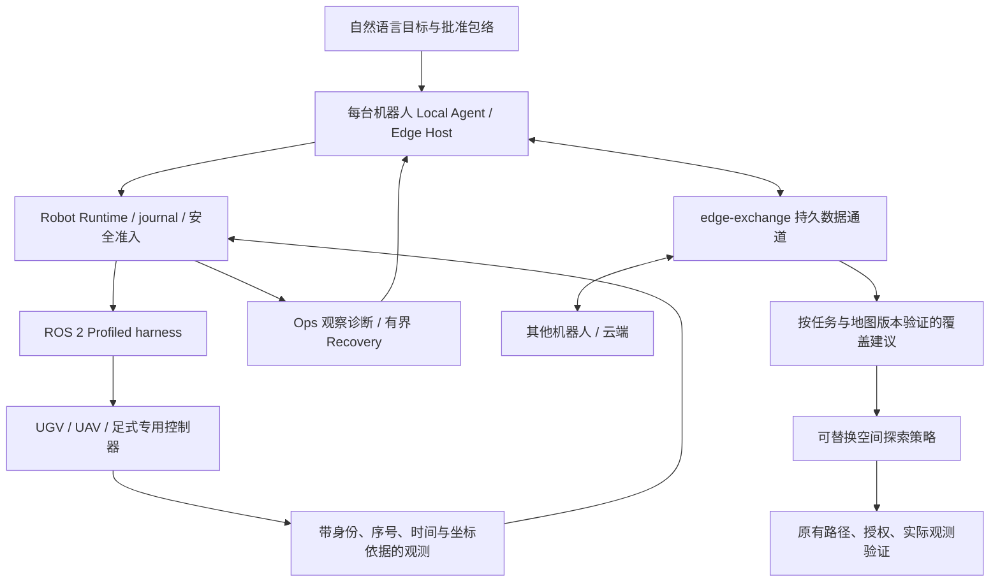

# 异构边缘 Agent、协作数据与运维就绪升级

日期：2026-10-18。起点：`c1245771d`。本轮先核验单机执行，再增强机器人间的数据消费和异常观察，最后分别测试 ROS 2 协议、长程软件任务和三机型陌生环境探索。实测入口见[验收记录](../experiments/2026-10-18-edge-swarm-readiness.md)。

## 系统评价与交付范围

系统具备可复用的边缘执行基础，但仍不足以直接宣称任意异构实机群可在陌生环境中无人值守完成自然语言任务。Local Agent、Runtime、ROS 2 ProfiledExecute 是真实存在的调用链；研究层的共同坐标、探索策略和覆盖账本不自动等于跨机器人 SLAM、动态协同避碰或厂商运动控制已经完成。

| 用户需要 | 当前承担者 | 本轮处理 | 现场仍需验证或开发 |
| --- | --- | --- | --- |
| 单机器人自然语言长任务 | Local/Worker 共用 Host、任务 SQLite、Runtime journal | 多轮三机型 ROS 2 记录式控制器验收，保留逐任务原始结果 | 具体模型的自然表达、真实导航/飞行/步态、长时间运行 |
| 异构 harness | Profile + PluginBackend + Ros2ProfileBridge | 未决命令保留、并发隔离、状态时间回退拒绝、停止关联 | 厂商驱动、坐标转换、控制器限幅、实际停止/降落 |
| 多机器人通信 | 独立 edge-exchange 与 SQLite | 可分页收件游标、缺口检测、按任务和地图依据消费覆盖建议 | 非回环无线网络、设备证书、跨机时钟与大规模负载 |
| 陌生环境探索 | SpatialExplorer、SpatialMissionRunner、Coordinator、CoverageLedger | 三形态共同任务的软件闭环及故障记录 | 在线真实 SLAM、地图对齐、实际探索控制器与动态避碰 |
| 传感器可知、自动运维 | Runtime 观测、故障合同、Ops/Recovery | 每传感器诊断、数据不可用不误报恢复、历史读取重试 | 全部真实传感器采集与告警接收链、厂商维修动作 |
| 任务回溯与论文 | 不可变任务/命令/观测、实验来源 manifest | 分层保存全部通过、失败、partial、修复尝试 | 独立场地/随机样本的性能和统计可靠性研究 |

## 运行结构与扩展位置

ROS 工具动作由设备适配器实现。UAV 体素路径、地面多层支撑路径只解决各自几何约束；无人机控制稳定性和足式接触/步态留在设备控制器。新型号实现同一 Profile/观测/执行/停止合同，无需在任务规划器加入厂商分支。导航、SLAM、感知和探索策略均保持既有 provider 边界。

协作数据与动作权限分别管理。peer 覆盖提议可影响候选排序，不能写入本机已观测覆盖事实，不能解除未决命令、签发批准或证明任务完成。没有共同地图坐标和版本的机器人必须先建立明确的对齐结果，不能仅凭 frame 名称相同合图。

## ROS 2 执行修复

原桥在异常路径结束时清空 active command，导致 Runtime 随后的停止请求丢失原命令关联。本轮保留 `uncertainCommandId`：超时、异常、无效或显式未知结果阻断新派发，停止请求携带原 command ID。单桥并发命令被拒绝，参数校验与序列化在占用执行槽前完成。状态必须同时满足递增序号和不倒退的采集时间。

`robot_state.harnessHealth` 使用 `ros2.harness.health.v1`，包含 robot/profile/commissioning、采集时间、active/uncertain command、最近执行与停止状态、控制器健康和各 sensor 的 source/frame/transform revision、sequence/observation ID、墙钟年龄、接收单调年龄和 fresh/expired/never_received。诊断只持有传感器元数据，命令证据缓存仍有界。

停止 ACK 表示已进入注册的控制器程序，`physicalStopVerified=false`。无人机进入降落程序不等于落地，足式进入保持程序不等于稳定站立；物理结束必须有独立测量。

## 运维观察不能将失明当恢复

新增回归首先复现原缺陷，再保留修复后结果：

1. Health 与异常规则同时检查观测时间和实际传感器时效，禁止用最新轮询接收时间刷新旧传感器数据；检查读取结束时的时间，继承调用者取消。
2. 任务索引和历史事件全部读取成功后才完成启动恢复；部分读取失败重试，不提前锁死初始化状态，也不重复计数已经部分导入的历史。
3. 数据库读取失败产生 `ANOMALY_OBSERVABILITY_GAP`。遥测缺失、过期，或权威故障/执行记录不可读时，原异常保留，并标出缺失证据。
4. Ops 消费 ROS harness 诊断，报告传感器过期、控制器故障和未知执行。清除异常要求匹配且新鲜的完整诊断；省略一个传感器、缺失 unknown 字段或传来另一机器人状态都不能证明恢复。
5. 独立复核补齐控制器缺失时的合法空值处理：`fresh=false` 下空健康字段不能掩盖同一诊断中的未知命令。桥重启后空的 unknown 字段也不能清除旧告警，必须有与原命令匹配的已知终态依据；当前桥不提供通过重启解除未决命令的能力。

Ops 仍只有观察/诊断能力，既有 Recovery 在 Host 权限与预算内处理允许的恢复。不能通过自动重启清空锁存、重发未知动作或改写历史证明成功。

## 通信消费与一致性

完整字段和使用方式见[边缘数据交换](edge-data-exchange.md)。本轮沿已有身份、TTL、持久 outbox/inbox 增加本地收件序号和有界分页；收件 ACK 只证明入库，业务消费另有校验。

覆盖视图只接收同 mission/revision、geometry 和 world/frame/transform/map revision 的有效数据。过期、来源不匹配、任务外 target 和不完整读取不可成为覆盖建议。保留期 GC 造成游标缺口时显式返回冲突；消费者需重新取得完整有效快照，不能把游标直接跳到末尾。建议仅改变探索偏好，不覆盖本地测量或改变任务完成判据。

当前单个任务的执行权威仍在对应 Edge Host/Runtime。三机型探索研究使用一个协调器串行验证任务，不实现多主共识、通用分布式 DAG、自动 leader 迁移或真正同时运动的时空避碰。

## 测试和现场接入顺序

每轮实验使用新目录，保留源摘要、二进制来源、输入、事件和失败。单元、真实 ROS 2 DDS 记录式控制器、回环 HTTP 通信、未知地图软件探索分别统计。开发重复运行用于回归，不当作独立场地样本；有限任务成功不能给出无限长程可靠性保证。

首轮设备族已确定为大疆无人机、宇树足式、通用 AGV，统一通过 ROS 2 控制边界接入。按[三类设备绑定与预检](../operations/ros2-device-bindings.md)选择外置绑定，再按[设备侧部署指南](../operations/edge-field-testing.md)先做只读传感器/坐标/时间验收，随后做单设备受限导航和实际停止、断连、进程退出和长任务，最后接入两台以上机器人。保留状态库、Runtime journal、Profile、标定、地图和部署摘要。具体型号、SDK/固件与现场 action/topic 仍需要绑定；厂商品牌和通用模板不能替代已实现的设备适配器。
