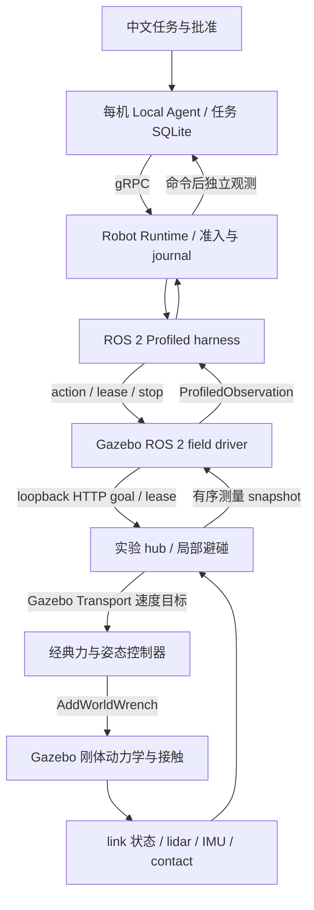

# Gazebo 物理闭环：控制、测量、停止、标定与多机避碰

日期：2026-10-18。接续[边缘 harness 与协作数据升级](2026-10-18-edge-swarm-readiness.md)，本次把记录式 ROS 2 控制器替换为接收实际 Gazebo 测量、通过物理引擎产生运动的实验适配器。实现、测试和最终实验结果分开记录；任务数量、成功或失败、停止距离、配准误差及原始证据以[本轮实验报告](../experiments/2026-10-18-gazebo-field-validation.md)为准。

## 目的与范围

本轮回答的是：已有 Local Agent、Runtime 和 ROS 2 harness 能否接入一个具有惯性、接触、传感器与命令丢失处理的仿真闭环，以及发生通信或感知异常时是否仍按合同处理。整个链路使用经典控制和确定性局部规划，没有训练、调用或评估强化学习策略。

| 层次 | 本轮实现 | 应独立评价的边界 |
| --- | --- | --- |
| 单机 Agent | 每台机器人独立 Local Agent、Runtime、ROS 命名空间、任务库和日志 | 固定中文路线由确定性 provider 解释，不是任意自然语言理解评测 |
| 控制器 | Gazebo 插件以有界力/力矩驱动刚体，读取实际位置、速度和接触 | 地面为全向力驱动 proxy；空中为推力/姿态刚体 proxy，不验证 AGV 轮胎、宇树步态或大疆飞控 |
| 定位 | `sim-state` 明示 Gazebo link 真值定位，保留采集时刻与源序号 | 不是在线 SLAM 或无 GPS 定位性能实验 |
| 局部障碍 | Gazebo 实际 lidar 极坐标回波，经配置外参与测量底座位姿转入公共坐标 | 不读 lidar `worldPose` 作为感知输入；有界降采样、视场和过滤仍限制障碍可见性 |
| 同伴避碰 | 用测量位置、速度、包围半径和时效进行短时连续碰撞预测 | peer 状态由同一实验 hub 提供，不是无线分布式地图交换的部署验收 |
| 标定与地图对齐 | 独立配准模块、真实回波输入、残差/重叠/退化及证据准入 | 当前估计结果不自动写 TF、不接入控制、不替换配置标定 |

## 从自然语言到物理运动的实际链路



代码入口如下：

- [field_ros_controller.py](../../sim/gazebo/field_ros_controller.py)：实现 `ProfiledExecute`、`CommandLease`、`EnterSafeStop` 和带来源的观测发布。
- [field_hub.py](../../sim/gazebo/field_hub.py)：管理实验目标、租约、感知输入、避碰与仿真步进；这是隔离实验协调服务，不是新的生产 Fleet 服务。
- [field_transport.cc](../../sim/gazebo/field_transport.cc)：连接 Gazebo Transport，收集测量、发送控制请求和步进请求。
- [field_controller.cc](../../sim/gazebo/field_controller.cc)：在 `PreUpdate` 施加 `AddWorldWrench`，在 `PostUpdate` 读取引擎积分后的实际状态；不使用位姿赋值或 Python 内存坐标代替运动。
- [field_scan.py](../../sim/gazebo/field_scan.py)、[dynamic_avoidance.py](../../robot/gateway/tangying_robot_gateway/dynamic_avoidance.py)：分别负责测距到障碍约束的转换和可替换速度选择。

地面控制器根据速度误差计算有界水平力；空中控制器计算推力方向、姿态误差和有界力矩。零速度目标只是控制输入，实际速度如何下降由惯性、控制增益、重力、摩擦和接触决定。空中停止策略是保持/悬停，不称作已降落。

## 命令、时钟与完成证据

Driver 同时验证 robot、adapter、profile revision、commissioning、command、批准、deadline 和能力参数。一次只接收一个活动命令，重复 command 或已使用的运动幂等键不能重新派发。本轮不接空间路径计划合同，非空 `navigation_plan_json` 被拒绝，不能把尚未执行的路径说成已经遵循。

DDS 租约必须绑定活动命令，且 deadline/lease 声明与该命令一致。旧采集时间的重复租约被拒绝；转发到 hub 的是剩余有效期，不会在每次转发时获得一个全新的完整时间窗口。hub 在墙钟/单调时钟上管理命令期限，物理插件另在仿真时钟上检测控制目标丢失。两者分别记录，不能把仿真秒直接当作真实运行秒。

续租还区分“上一次已确认的有效窗口”和“本次没有收到回复”。传输超时可能发生在 hub 已收到续租之后，因此只要上一个 ACK 确认的窗口仍有效，就保留现有健康状态，并等待**新的 DDS 租约**转发；不自动重发运动目标，也不把超时当作续租成功。确认截止时间从发出请求的单调时钟计算，避免响应延迟增加寿命。上个窗口到期、hub 明确拒绝或身份不符时，driver 记录独立的 lease fault 并停止；晚到 ACK 不能复活已过期命令。新测量只能恢复测量故障，不能清除租约故障。

每次 snapshot 包含源序号、采集墙钟和仿真时间。同一 snapshot 重读只复用原 observation ID 和原时间；冻结仿真不会因为 HTTP 轮询而产生新鲜观测。Driver 的定位来源明确为 `gazebo_ground_truth_link_state`。正式 `robot_state_json` 使用既有严格白名单；额外仿真时钟、速度和来源说明写入 journal 与实体属性，避免偷偷扩展消费者合同。

读取吞吐也需要预算：driver 的状态发布周期为 100 ms、执行轮询间隔为 50 ms，同一 driver 在 50 ms 内合并重复 snapshot 请求。合并只返回仍有效的原测量，不改采集时间、不重新发布 observation。租约回调不持有测量读取锁；减少重复 GET 不应阻塞控制授权续期。

导航成功同时要求：当前 command 的 hub 状态到达、命令之后的新源序号和仿真时间、足够新的墙钟采集、测量位置误差与速度满足验收阈值，以及姿态误差合格。`verify_arrival` 重新读取测量，不把上一步 action 成功当作自己的证据。初始目标、最终位姿、观测 ID 和源序号均留在日志中。

`EnterSafeStop.accepted` 只表示停止程序已进入，保留 `physicalStopVerified=false`。物理停止实验需要另取速度时间序列、停止距离和持续静止窗口；操作 ACK 不能充当停止结论。HTTP 派发结果丢失或活动命令被 hub 阻断时保留未知结果并请求停止，不自动重发动作。

### 2026-10-28 增量：停止锁存与就绪诊断

新一轮复测为 hub 的 `/snapshot` 增加只读 `stoppedRobots` 列表，用于区分“测量仍在刷新”和“当前允许接受运动目标”。[停止检查脚本](../../scripts/run_gazebo_stop_checks.py)在发送测试运动前核对该列表：任一待测机器人已经锁存停止时，返回 `setup_failure`、列出 `latchedRobots` 并记录 `motionCommandsSent=false`。这属于试验前置条件未满足，不能记作已测得物理制动失败或成功。

显式停止和自然语言控制器退出均可能留下停止锁存。停止实验应使用独立的新试验世界，或在自然语言控制器退出前安排；检查脚本不会自动解除锁存，也不能靠重置位姿或清除停止状态取得通过结果。hub HTTP 拒绝会保留状态码与有界响应正文，帮助区分准入拒绝和运动后的停止测量问题。空中停止仍只验证测得的悬停，不因此获得落地或旋翼关闭证据。

这部分是后续诊断能力增量，不改写本页 10-18 任务结果。新增试验范围、失败与重测见[2026-10-28 任务复测](../experiments/2026-10-28-edge-task-validation/README.md)，应使用各自的源码和运行记录解释结果。

## 经典避碰与并发边界

局部策略读取测量状态、期望速度、同伴轨迹及测距障碍，选择限幅速度。每段相对运动使用连续最近距离，而非只检查路径端点；包围体之外还保留反应时间、制动距离和测量年龄余量。时间过期、坐标依据不匹配、测距不可用时请求制动。

正面相遇采用共同的右侧通过偏好；交叉冲突按稳定 robot ID 给出让行优先序。无冲突时，已通过扫掠检测的期望速度就是当前代价函数的最优候选，可直接返回；有冲突时才展开速度采样。优先序改善确定性，不能解决所有窄通道调度、互锁或全局路径问题。

当前候选是世界坐标下的全向速度。真实差速车辆应增加符合 `(v, ω)` 与转弯半径约束的轨迹候选；不能把全向速度的横向分量直接丢掉后继续声称原扫掠证明成立。无人机、足式同样需要各自可执行运动模型。

空地混合避碰还必须统一包围体语义。地面盒体尺寸为 0.5×0.4×0.3m，水平外接圆约 0.3202m，完整三维外接球约 0.3536m；原 0.33m 声明不能供空中三维策略作为完整包围球使用。独立审查后将地面声明统一提高到 0.36m，空中保持覆盖其三维角点的 0.34m，并用实际 SDF 的八个角点回归验证。修改前的运行不重标半径；分析器另从冻结世界几何重算保守间距，修改后使用新运行验证。

实验中多个 Local Agent 可以同时产生动作，并共享一个 Gazebo 世界，但同伴测量和步进仍由集中式 hub 汇集。它可验证并发物理交互和边缘 harness 复用；设备间网络分区、独立时钟、跨机 TF/地图变更、所有权转移和分布式冲突消解，需要以真实部署拓扑另行验证。现有 `edge-exchange` 的覆盖建议通道没有因为本轮实验而变成实时避碰控制通道。

## 配置标定、估计标定与跨机对齐

控制回路中的 lidar 外参来自明确版本化的仿真配置。配置值与生成世界一致，是接线依据；它不是算法估计结果。底座公共位姿使用 Gazebo 真值，因此主控制实验不评价漂移、重定位或跨机地图误差。

[registered_alignment.py](../../robot/gateway/tangying_robot_gateway/registered_alignment.py) 单独提供对应点 SE3 估计和点云注册，保存输入证据、参数、残差、重叠和结果摘要，并拒绝退化或歧义结果。`validate_alignment_for_use` 还要求源/目标 robot、frame、map revision 与时间符合调用者声明；摘要用于检测内容变化，不代替远端身份认证。

[field_calibration.py](../../sim/gazebo/field_calibration.py) 使用实际 lidar 回波与独立静态 CAD 进行已知场景标定。它读取静态碰撞几何，不读取机器人或传感器真值位姿来生成估计。拟合点与保留验证点分离，后者对解析 CAD 表面计算误差；只有提供独立测量的底座到世界变换，才能由估计的 sensor-to-world 推导 sensor-to-base。

因此需分别报告：配置外参是否正确应用、估计误差与保留集结果、两机点云是否能可靠对齐、估计是否实际被控制器使用。本轮最后一项尚未接入，不能把独立注册实验的通过写成闭环使用了估计地图。无先验未知环境 SLAM、在线环闭合和地图变更后的持续对齐仍是后续工作。

另有[共同已知 CAD 锚点路径](measured-se3-registration.md#同一已知-cad-锚点的跨机关系)：当两机各自对同一已知场景的标定都被接受，`field_shared_anchor.py` 可组合两份估计，得到扫描时刻的传感器间关系。它保留直接点云注册的原始拒绝，不重新拟合、不读取真值生成变换，也不算新增独立采集。它依赖共同先验，不能替代陌生地图直接对齐；本轮同样未接入控制。

## 发现的问题与修复记录

| 问题 | 修复与回归入口 |
| --- | --- |
| Driver 在严格 ROS state 中加入未注册字段，消费者拒收 | 保留原状态合同，额外诊断进 journal；`test_navigation_state_matches_existing_gateway_strict_contract` |
| 已有有效 lease 时，取消请求可能在 goal 派发之后才检查 | 派发前再次检查取消/停止；`test_cancelled_before_dispatch_never_sends_goal_even_with_live_lease` |
| 转发旧租约时重新获得完整有效期 | 只转发剩余寿命，拒绝采集时间重复/倒退；`test_forwarding_lease_preserves_remaining_lifetime_not_new_full_window` |
| hub 已停止命令，driver 仍等到整个任务 deadline | 识别 `blockedReason`，转未知结果并锁停；`test_hub_watchdog_block_cannot_turn_into_success_or_wait_until_task_deadline` |
| 密集测距下全采样占用过长，妨碍续租与 HTTP 状态读取 | 无冲突采用等价快路；hub 在锁外计算候选，派发前再校验活动命令/停止/期限；对应避碰与 hub 回归 |
| 错误 command ID 的停止请求可能先修改 hub 锁停状态 | 先验证命令关联再修改停止状态；对应 hub 身份回归 |
| 重读同一个仿真状态被误当新观测的风险 | 序号、物理时间和原采集时间共同约束；同身份变内容、时钟回退或暂停物理重盖时间均拒绝 |
| 单次测量 GET 传输超时使 driver 立即不健康，正在移动的任务被转成未知停止 | 只读瞬态失败可复用仍在原有效期内的实测 capture，保持原 ID/时间、不重发观测；记录 `MEASUREMENT_READ_RETRY`。源实际过期、HTTP 拒绝或内容非法仍失败；动作 POST 超时仍是未知效果 |
| 续租 POST 的单次传输超时同样污染共享健康字段，尚有确认有效期时任务被提前停止 | 按上一次 ACK 的窗口有界等待新 DDS 租约，记录 `LEASE_FORWARD_RETRY` 与 `confirmedRemainingMs`；独立 lease fault 到期锁存，拒绝晚 ACK 和 HTTP 错误复活；`test_timed_out_renewal_preserves_only_previous_confirmed_window`、`test_renewal_ack_arriving_after_prior_window_does_not_resurrect` |
| 同一 driver 的 timer 与 action 高频重复读取相同物理帧，增加 HTTP 服务负载 | 50 ms 以内合并 snapshot，降低 timer/执行轮询频率；保持原 source 身份，续租不等待 sample lock；`test_snapshot_requests_are_coalesced_for_at_most_50ms_without_retimestamping`、`test_lease_callback_does_not_wait_for_snapshot_read_lock` |
| 两个步骤之间旧目标租约已过期，但物理循环尚未写入 `blockedReason`，新目标被误判为抢占活动目标 | `/goal` 在同一锁内检查旧目标的单调时钟与 deadline，原子记录过期再接纳新 command；旧租约不延长、同 ID 动作不可重放，未过期活动目标仍拒绝替换；`test_new_command_atomically_retires_expired_goal_before_physics_tick` |
| 地面二维轮廓半径被空中策略当作完整三维半径 | 地面统一采用覆盖三维盒体的 0.36m；从生成与落盘 SDF 校验全部角点；保留旧运行声明与独立几何审计结果 |

早期正式尝试中的两台地面机器人终态接近，并不足以诊断“避碰死锁”。按命令与时间回查后，先出现的是测量读取超时与安全停止；另一台随后继续绕行已停止的同伴。诊断应先检查停止前的 `clearCandidates`、动作与观测日志，再决定是否修改规划策略。本次没有为绕过该故障而缩小机器人包围半径或制动余量。

后续一轮保留了只读重试修复，两台地面机器人完成完整路线，空中任务则暴露续租传输超时的同类误判。此失败保留为独立样本，再引入确认窗口与读取合并修复开展新一轮；不增大原租约、测量有效期或任务期限来掩盖故障。每轮结果、运行标识与代码摘要由实验报告对应，本文不将后续结果倒填到失败样本中。

再后一轮的空中任务提供了两个不同结果：一次续租传输超时在仍有约 409 ms 已确认有效期时恢复，随后继续完成导航；之后第五个目标在派发时收到 HTTP 400。后者来自步骤交接竞态：第四个目标已经实测到达，独立 `verify_arrival` 也完成，但旧目标租约在第五个目标到来前过期。hub 的 `arrived` 已因租约失效变为 false，物理循环却还没写入过期标志。修复将过期判断纳入 `/goal` 的原子准入，而不延长旧授权或重试未知运动动作。该轮未执行的后续 seed 不能计为已测通过或已测失败。

单测的假消息和合成几何仅用于复现协议与算法缺陷。开发运行、正式运行以及具体失败原因保留在[实验记录](../experiments/2026-10-18-gazebo-field-validation.md)，不能用单测数量替代物理验收。

## 复现与扩展入口

先运行不需要 Gazebo 服务的合同回归：

```bash
.venv/bin/pytest -q \
  tests/scripts/test_export_gazebo_field_evidence.py \
  tests/scripts/test_gazebo_field_ros_controller.py \
  tests/scripts/test_gazebo_field_hub.py \
  tests/scripts/test_gazebo_field_scan.py \
  tests/scripts/test_gazebo_field_world.py \
  tests/scripts/test_field_calibration.py \
  tests/scripts/test_field_shared_anchor.py \
  robot/gateway/tests/test_dynamic_avoidance.py \
  robot/gateway/tests/test_registered_alignment.py
```

物理复现需使用隔离的 Gazebo Harmonic、ROS 2 Jazzy 和已编译 `tangying_robot_msgs` 环境，并先加载对应 ROS 安装的 `setup.bash`。以下 Python 命令使用已安装项目依赖、`grpcio` 和 `rclpy` 的同一解释器；`PYTHONPATH` 还需包含仓库的 `robot/gateway`、`python` 与根目录。世界、transport/hub 和 campaign 继承同一个 `GZ_PARTITION` 与隔离 `ROS_DOMAIN_ID`，插件目录加入 `GZ_SIM_SYSTEM_PLUGIN_PATH`；具体值见实验报告。构建目标位于 `sim/gazebo/field_validation/CMakeLists.txt`；新一轮必须使用新目录，保留失败目录。

```bash
python sim/gazebo/build_field_world.py --output /tmp/field-validation.sdf
cmake -S sim/gazebo/field_validation -B /tmp/field-validation-build
cmake --build /tmp/field-validation-build -j2
# 将 /tmp/field-validation-build 加入 GZ_SIM_SYSTEM_PLUGIN_PATH。
# 在独立终端启动世界；不要加 -r，hub 拥有物理步进。
gz sim -s --headless-rendering /tmp/field-validation.sdf
# 保持 Gazebo 进程运行，在另一终端启动 hub；上述环境变量必须一致。
python sim/gazebo/field_hub.py \
  --transport /tmp/field-validation-build/field-transport \
  --output artifacts/experiments/my-gazebo-field/hub --port 18118
# 另一个终端，使用同一隔离 ROS 环境；binary 必须是本次记录来源的 Local Agent。
python scripts/run_gazebo_field_campaign.py \
  --binary /path/to/local-agent \
  --output artifacts/experiments/my-gazebo-field/tasks \
  --hub http://127.0.0.1:18118 --robots ground-a ground-b uav-a --seeds 3 7 19
```

`--short` 是开发冒烟入口。正式任务的 seed 只改变故障注入时序，不能当作不同地图或随机机器人总体样本。后续替换控制器、引入估计定位、将 peer 状态迁移到真实网络时，应分别新增实验，而不覆盖这次基线。

公开证据必须在所有写入进程结束、SQLite 关闭后导出。导出工具保留完整失败与正式记录，排除 `console-session` 和 dotenv 文件，以已读取的会话密钥及简单 dotenv 凭据字面值审核其余内容；发现匹配、符号链接、特殊文件或来源变化即拒绝。这是已知凭据审核，不是通用秘密识别器。

```bash
.venv/bin/python scripts/export_gazebo_field_evidence.py \
  --source artifacts/experiments/gazebo-field-validation-20261018-001 \
  --extra artifacts/experiments/gazebo-measured-alignment-20261018-001 \
          artifacts/experiments/gazebo-measured-alignment-20261018-002 \
          artifacts/experiments/gazebo-measured-alignment-20261018-003 \
          artifacts/experiments/gazebo-measured-alignment-20261018-003-shared-anchor \
  --output artifacts/experiments/my-gazebo-field-public
python artifacts/experiments/my-gazebo-field-public/verify.py
```

输出包括 `evidence.tar.gz`、原件与公开成员的 SHA256/字节数清单、归档摘要、`redactions.json` 和可独立运行的 `verify.py`。校验器不解包即可检查每个成员、缺失项、重复项和内容改变。应另行保存 manifest 摘要；哈希只提供相对于该清单的完整性，不证明实验真实性或发布者身份。
