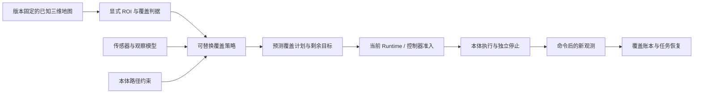

# 已知地图三维覆盖与多层地面导航：设计和变更记录

日期：2026-10-18。基线：`d984b77bf` 的异构三维探索、持久覆盖账本与配对软件基准。本次继续扩展已知地图覆盖、多层地面可达性和独立消融；原[三维探索报告](../experiments/2026-10-18-spatial-exploration.md)及冻结证据保持原身份，不因本次升级改变数据或扩大样本数。教材阅读见[本轮补充](../../book/updates/2026-10-18-spatial-coverage-upgrade.md)。

## 1. 解决什么问题

上一轮 `SpatialExplorer` 对未知体素计算信息收益，用于“第一次进入环境，下一步应观察哪里”。一张已知地图可能已经没有 unknown，却仍需要检查设备表面、重新观察规定区域或按任务要求巡检；这些任务不应由“未知空间耗尽”代替完成判据。

本次将两类任务分开：

| 任务 | 规划目标 | 可以说明完成的证据 |
| --- | --- | --- |
| 未知环境探索 | 减少地图中的 unknown，寻找有收益的 frontier/NBV | 新采集的注册观测和固定任务范围；无候选不能证明全环境覆盖 |
| 已知地图覆盖 | 在固定地图和显式 ROI 目标上选择合法观察位姿 | 规划阶段只得到预测覆盖；执行阶段需要每个目标的新观测 |
| 多层地面移动 | 在可靠支撑面及显式层间连接上寻路 | 几何路径加设备控制器对车辆/步态、实时环境与停止的验收 |

`spatial_coverage.py` 提供独立的已知地图覆盖策略，[本地规划脚本](../../scripts/plan_spatial_coverage.py)提供可复核入口。它们是几何规划与执行端口的扩展，没有集成 ROS 1 OmniPlanner，也不自动接通飞控、足式控制或并发多机避碰。本轮接口/软件试验、实际 ROS 2、Gazebo 与硬件证据分别报告。

## 2. 统一世界、显式任务范围和覆盖含义

输入沿用 `navigation.volume.v1` 的共同世界、网格与地图版本，未知和占据仍不可通行。覆盖任务另外声明 ROI/目标集合；不能把全部地图体素、某张视图中已知体素或“规划器恰好找得到的点”偷偷作为分母。

`coverage.scope.v1` 只包含 `schemaVersion/geometryId/targetVoxelIds`，其中 `geometryId` 绑定共同世界与网格；目标为非空、唯一、有界的体素整数 ID，采用 x 最快的平展索引。`coverage.request.v1` 包含 `missionId/scope/robots` 与可选 `config`；每个机器人提供自身 `volume/policy/pose/sensor`。同一网格中最多 16 个不同 robot ID；路径继续绑定各机器人的地图、快照与标定，不把共同目标身份误作共同设备身份。

规划器基于已知地图、相机量程/FOV、候选观察位姿和机器人移动约束预测能看到哪些目标。这里的地图是合法已知输入，不是未知探索时提前读取隐藏真值；使用任何真值信息都要按当前任务假设区分。

| 量 | 含义 | 不能替代 |
| --- | --- | --- |
| 声明目标数 | 运行前固定的任务范围 | 不能随失败删除目标 |
| 预测可覆盖目标数 | 有限候选与传感器模型下计划覆盖的目标 | 不等于实际观测或连续空间最优解 |
| 计划后剩余目标 | 遮挡、本体约束、离散采样或预算下没有纳入计划的目标 | 不能一律称为物理不可达 |
| 新观测证实目标数 | 采集来源、时间、网格和目标对应均有效的执行证据 | 不能由路径或工具 ACK 直接增加 |

有限候选、有限方向或搜索预算用尽时，应报告模型和预算下的部分结果。要声称目标不可达，需要明确限定图模型并给出足够的连接性证据；要声称完整表面覆盖，还需要表面片、朝向、分辨率、距离、入射角与多视角质量要求。当前体素观察指标不能自动升级为表面重建精度或任意全场景保证。

## 3. 本次模块边界



图中规划到设备执行之间存在显式准入边界。文件内的路径摘要不是动作授权；CLI 输出没有批准、Runtime 命令 lease 或控制器握手就不能让机器人移动。高频控制、飞行动力学、车辆非完整约束与足式步态仍归设备侧；Host 管理低频目标、预算、工具选择和恢复。

| 模块/端口 | 拥有的职责 | 允许替换的部分 |
| --- | --- | --- |
| 已知地图覆盖策略 | 候选、预测目标收益、顺序和有界路线 | 贪心覆盖、图搜索、优化器或学习策略 |
| 观察模型 | 从位姿与地图估计可见目标 | 不同传感器、遮挡与质量模型 |
| 路径规划器 | 按本体约束认证路线 | 空中、单层/多层地面、曲率或动力学后端 |
| `SpatialMissionRunner` | 版本、预算、任务与采集闭环 | 地图、驱动、报告和策略工厂 |
| `CoverageLedger` | 有来源和版本的实际覆盖事实 | 独立指标导出，不由策略改写历史 |
| 研究基准 | 公平条件、故障、独立评分与来源 | 场景、种子、消融与新指标 |

所有插件都需要保留身份、输出大小与预算、路径合法性和明确失败。替换评分策略不关闭未知禁行、包络碰撞、支撑、世界版本或未知动作 fence。插件注册使用可信本地代码；这不等于任意远程模块自动加载。

`SpatialCoverageExplorer` 接受 `planner_factory` 和 `observation_model`。路径插件实现 `RoutePlannerPort.plan(start_pose,goal_pose)`，返回当前快照的 `navigation.path.v1`；默认独立 `SpatialPathPlanner` certifier 继续检查路径身份、起终点、航点预算和每段包络通行性，插件不能将未经认证的捷径变成执行依据。观察插件返回有界合法 `observedVoxelIds` 及预算诊断；它影响预测，不绕过真实 capture 的完成判据。

分层规划和路径接口参考 [NTNU 统一自主栈的规划边界](https://ntnu-arl.github.io/unified_autonomy_stack/planning/)与 [OMPL 的状态空间/约束接口](https://ompl.kavrakilab.org/core/spaces.html)。它们是设计资料；当前路径和覆盖模块为仓库自研实现，没有将这些规划栈或 ROS 1 OmniPlanner 作为已集成依赖，也不以此声称复现其性能。

`CoverageConfig` 支持 `gain_per_meter` 与 `nearest`。默认每台机器人每次 propose 最多 96 个观察位姿、8 次候选寻路，每候选最多 49 射线和 8192 次体素步进；整份计划最多 32 条 leg、200 m 几何路线额度，另以 `max_total_plan_calls=256`、`max_total_viewpoint_evaluations=3072` 限制全任务计算。`planCalls` 统计候选路径后端调用，不等于所有独立准入函数或真实动作次数。候选从合法移动节点按网格地址确定性分层采样，地面只改变水平主方向，空中增加上下方向。`viewpointSamplingTruncated/pathSamplingTruncated` 分别表示位姿与路径候选未穷尽；全局预算用尽报告 `global_planning_budget`，这不是连续空间最优覆盖算法。

## 4. 多层地面与空中移动如何共存

原 `terrain25d` 每个 XY 只有一个高程，无法同时表达桥上、桥下或同一建筑不同楼层。`terrain_layered` 使用 `terrainLayers` 中显式分层支撑面及层间连接；地面规划在这些支撑节点上移动，不把自由体素自动当作可落脚地面，也不因上下层 XY 相同就直接跳层。

`terrainLayers.schemaVersion=navigation.terrain.layers.v1`，包含 `sourceId/observedAtUnixMs/layers/connections`。每层有唯一 `layerId` 与按 `nx*ny` 展开的 `heights/supported/slopeRadians`；`supported=false` 时高程与坡度必须为 null。`layerId` 是拓扑身份，不表示高低顺序。

连接端点为 `[layerId,x,y]`，两端都需实测支撑、属于不同层且 XY 四邻接；连接为双向，重复或反向重复拒绝。同 XY 的垂直 portal、对角跳层、未知层或无支撑端点拒绝。层内使用四邻接，层间只使用声明连接；连接仍受完整包络扫掠、同层完整足迹支撑、坡度和步高约束。端点需唯一匹配支撑高度加 `referenceHeightM`，误差不超过 0.02 m；不猜最近层，悬空或歧义直接拒绝。

最多 32 层，`nx*ny*层数` 与连接数量分别不超过 250,000。策略字段沿用地面 `maxSlopeRad/maxStepM/referenceHeightM`、本体包络、margin 和搜索/路径预算；输出仍为 `navigation.path.v1`，`mode=terrain_layered`，没有通过修改旧 `terrain25d` 的含义实现兼容。

空中 `volume3d` 仍在自由体积寻路。单层地面、分层地面与空中可以共用世界和覆盖目标，分别使用合法候选与路线。楼梯、坡道、门洞或电梯等跨层通行需要与实际本体匹配的连接信息；标记一条连接本身不能证明任意车辆或足式平台能通过。

本次不从点云自动推断楼层语义、承载力、摩擦或落脚点。地形来自明确测量或实验配置；层间连接、坡度/台阶及包络检查属于几何准入。真实支撑、飞行姿态、相机云台、外参、步态和制动由 provider 与控制器实测验收。

空间测量 provider 的 `volume(terrain_layers=...)`、`publish(...,terrain_layers=...)` 和 `publish_spatial_map(...,terrain_layers=...)` 接受外部支撑图；`load_spatial_map` 在重建与加载时保留并验证 `terrainLayers`，地图包内容摘要覆盖层与连接。该摘要证明保存字节的完整性，不是独立地形测量证明或签名。当前 `build_spatial_map.py --terrain` 仍为单层 `navigation.terrain.v1`，没有新增 `--terrain-layers`；分层发布通过 Python provider API 装配。

## 5. 计划如何进入现有执行链

覆盖提案使用 `expectedObservedVoxelIds` 表示“预期可观察的显式目标”；旧探索提案的 `visibleUnknownVoxelIds` 继续表示未知空间收益。两者不是同一种物理事实，不能靠字段改名让旧任务获得完成证据。

Runner 使用当前注册地图与新鲜定位派发目标，驱动仍经原 Runtime/控制器检查。本次计划文件不是可绕过接口的执行脚本。实际到达以后，`capture` 提供带来源、序号、时间、世界/网格和 evidence ID 的新测量，覆盖账本才增加已证实目标。仅当显式完成判据被新观测满足时才能报告 coverage completed；计划预测完整、路线完成和实际覆盖分别保存。

已知地图中的某个体素历史上被分类，不等于当前任务已经重新检查。覆盖账本应以任务的采集时间与证据起点累计，不能把旧 map package 或规划射线当成本轮 capture。旧消息/版本、冲突、过时定位、未知动作结果继续拒绝或停止对账；有限候选耗尽返回部分结果。

ROS 2 已有 `navigation.navigate` 路径：`Ros2ProfileBridge` 从当前完整定位和空间部署生成 `navigation_plan_json`，控制器以 `navigation_plan_id` 回执，随后核验动作后的 XYZ/朝向。CLI 的预制路线不会自动替代这一步重新准入。当前 `Profiled` Runtime 尚未因本次研究文件自动获得一个会移动的 `coverage.run` 服务。

## 6. 本地使用与可回溯制品

使用入口为 `scripts/plan_spatial_coverage.py`。它读取可信本地 `coverage.request.v1` JSON（最多 32,000,000 字节），生成新目录中的预测计划与来源信息。不会为了规划启动新的 Docker 容器，也不修改已有 Gazebo 场景或旧实验。

```bash
.venv/bin/python scripts/plan_spatial_coverage.py \
  --request examples/coverage/mixed-air-ground.json \
  --output artifacts/experiments/coverage-MY-RUN

.venv/bin/python scripts/plan_spatial_coverage.py \
  --verify artifacts/experiments/coverage-MY-RUN
```

仓库示例：[空地互补](../../examples/coverage/mixed-air-ground.json)、[315 体素房间 ROI](../../examples/coverage/full-room-coverage.json)、[显式坡道跨层](../../examples/coverage/layered-ramp.json)、[没有跨层连接](../../examples/coverage/disconnected-floors.json)。它们使用明确标记的合成已知地图与本体配置，便于检查预测、部分结果和拒绝，不是现场地图或实机标定。房间 ROI 的配置名不代表任意全场景覆盖保证。接入自己的任务时，用合法地图、显式目标和本体配置构造请求，不能直接复制任意旧地图版本的别名。输出目录必须不存在；`--verify` 不接受新的输出目录。计划生成不会连接机器人或使能设备。

每次规划至少固定输入地图/部署内容摘要、共同网格、目标集合、本体约束、传感器、策略/插件版本和全部预算；输出保存计划摘要、每条路线、预测目标集合、剩余目标与停止原因。复验检查已保存字节、输入身份与计划内部一致性；重新规划需要新的输出目录。

`coverage.plan.v1` 的 `predictionOnly=true`，状态为 `predicted_complete|partial`；包含 `targetVoxels/predictedCoveredVoxels/predictedCoverage/unresolvedVoxelIds`、按 robot 归属的 `legs`、几何路程和诊断。`observedCoverage=null`、`physicalValidation=false`、`continuousSceneCompletenessProven=false` 保留原意。`predicted_scope_covered` 是预测满足；`leg_budget` 或 `bounded_search_no_admissible_viewpoint` 是有界停止，未完成目标不会被删除。

制品包括原始 `request.json`、`plan.json`、`source/` 中五个实现文件与 `manifest.json`。`coverage.artifacts.v1` 固定源码、文件字节/SHA、Git HEAD、Python/platform/NumPy；输出形成前检查源码未变。`--verify` 校验字节与当前/冻结源码一致，再重新运行确定性规划比较整个计划。它与旧探索基准仅重聚合事件的回放不同；换了实现后需恢复原冻结源码才能进行此种严格复验。

可在机器人接入前运行真正调用 `SpatialMissionRunner` 的软件 fixture。它使用理想已知地图采集、虚拟驱动与确定性时钟，验证计划、派发、新 capture、账本和停止恢复的闭环；不会控制真实机器人。

```bash
.venv/bin/python scripts/run_spatial_coverage_fixture.py \
  --request examples/coverage/full-room-coverage.json \
  --output artifacts/experiments/coverage-fixture-MY-RUN

.venv/bin/python scripts/run_spatial_coverage_fixture.py \
  --request examples/coverage/full-room-coverage.json \
  --unknown-step 3 \
  --output artifacts/experiments/coverage-recovery-MY-RUN

.venv/bin/python scripts/run_spatial_coverage_fixture.py \
  --verify artifacts/experiments/coverage-recovery-MY-RUN
```

该入口保存命令、capture、报告、覆盖和协调事件链及源码快照。复验检查字节/源身份、链、任务/路径绑定、从 capture 独立重算的 ROI 与账本一致性、未知动作后的正向停止回执和预算，不重新执行实体控制。虚拟毫秒不是实测任务耗时，fixture stop ACK 不是实体速度归零。它拒绝 unknown 占据、机器人之间不一致的注册地图和重叠初始包络；不替代未知环境探索试验。

开发者不能把计划 JSON 直接送到裸 ROS 速度话题，也不能为了形成演示而跳过现有批准/租约。真实执行接线应使用已调试的地图/驱动端口，并另外记录新鲜观测、实际停止与任务完成。

## 7. 消融与论文指标

本轮把团队协作的子机制分开：**分配重叠处理**和**共享覆盖收益指引**分别设置对照，地图交换与安全 fence 保留。旧报告中的联合 `no_coordination` 按原定义引用，不能在新论文中改称两项独立消融。

新基准配置使用 `cooperation.assignment_overlap/shared_coverage_guidance` 两个布尔开关；变体分别为 `no_assignment_overlap`、`no_shared_coverage_guidance`，联合关闭仍名为 `no_coordination`。探索策略的最近目标、绕障重定位和可见收益对照保留。延迟地图交换在同一实验块中固定，不能把通信变化与目标选择变化混成一个效果。

共享覆盖 ID 通过显式消息传递，消息数/字节与地图上传、下行和重连 snapshot 分开留痕。`mapExchangeDelayRounds` 只延迟占据地图下行，单位是离线决策轮，不是实测网络时延。事后机器人原始日志联合得到的 `coverageFraction` 与协调器当时实际收到的 `coordinatorCoverageFraction` 分别保存，不能用事后全知汇总声称调度器实时拥有全部知识。

[开发配置](../../examples/experiments/spatial_exploration_development.json)与[留出配置](../../examples/experiments/spatial_exploration_holdout.json)分别声明 seed 分区和 `selectionFreeze`。开发场景用于调参；留出前冻结源码、配置、主指标和选择规则。配置中的 `selectionFreeze=null` 本身不能证明盲测；本轮正式运行另保留[选择冻结记录](../experiments/evidence/2026-10-18-spatial-coverage-upgrade/study/selection-freeze.json)，在查看留出策略结果前按事前规则选出 baseline。它是本地操作记录，没有独立盲测或时间戳认证。

新矩阵是开发 `5 families × 4 seeds × 7 arms = 140 episodes`、留出 `5 × 6 × 7 = 210`，最多 18 轮，地图下行延迟 2 个决策轮。family 为货架通道、错位门洞、高处遮挡、封闭空腔和延迟交换故障；后者复用门洞几何并加故障，因此标签数不等于独立布局数。新配置与运行前冻结、独立评分和 split 身份见[实验配置说明](../../examples/experiments/README.md)。[实际报告](../experiments/2026-10-18-spatial-coverage-upgrade.md)保留全部 350 个 partial、40 个不同占据几何，以及另行验证的两次 315/315 已知地图 Runner 软件闭环；不混成一个成功率。

这组探索场景的地面支撑仍为平面 fixture；多层能力由独立分层路径/已知覆盖请求验证，不能把本轮五类探索配置写成已经完成多层在线自主探索。封闭空腔保留在事前分母内，部分结果正是需要报告的模型边界。

每个策略调用前，`truth/`、`preregistration.json` 和 `scoring-contract.json` 固定场景、起点、故障、分母与评分源码。`studyDesignHash` 绑定跨 split 共用设计，`studyImplementationHash` 另绑定实现；数据接口将真值与策略隔离，但不是恶意策略的进程沙箱。新研究图支持七个变体并保留逐点数值/来源，绘图不增加观测或样本。

后续研究按任务分级比较：

| 研究层 | 主指标 | 必须保持的边界 |
| --- | --- | --- |
| 已知地图规划 | 预测覆盖/剩余目标、几何路程、规划开销、采样拒绝与预算 | 预测不是实际完成；没有普适最优保证 |
| 合成闭环软件 | 新观测覆盖、重复率、有效/无增益腿、故障施加与恢复 | 隐藏真值与策略隔离；固定几何去重 |
| ROS 2 记录控制器 | 合同、定位/版本、路径身份、停止/重启行为 | 记录回执不证明动力学或实体停止 |
| Gazebo/实体 | 跟踪误差、碰撞/近失、实际时间、能耗和真实停止 | 本轮必须有新的实际执行才报告 |

新增场景、更多种子和独立布局分别计数。图像或 occupancy 内容相同但标签不同不增加独立几何。所有变体使用同一地图、起点、传感器、预算和故障时序；已知规划不能与未知探索直接混成同一成功率。

完整数据保留 planned/applied/skipped 故障、失败与拒绝、未完成样本和缺测 null。使用 Pareto 比较覆盖、路程、计算与通信成本；小样本中未支配不等于最优。实际结果应另写报告，不能用新增接口或单元测试数量推导机器人任务成功率。

## 8. 迁移和后续工作

原二维 SLAM/Nav2、`terrain25d`、`volume3d` 与未知探索入口保持独立，旧地图与报告不被自动转换。新层地形采用显式 schema 与策略模式，部署摘要和 Profile 准入同步覆盖新内容；改变支撑图、连接或坐标依据后不能复用旧路径审批。

后续优先完成真实 provider 的地图/质量/标定合同、单机已知覆盖执行与独立停止，然后才进入真实多机并发、动态障碍和跨地图融合。这里的扩展点服务于可替换、可归因的研究与工程接线，不以模块名称代替未完成的实机验证。
