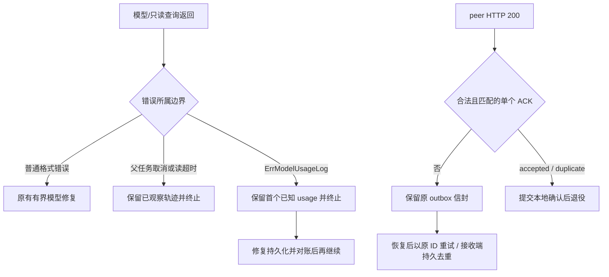

# 2026-10-28 任务复测后的边缘故障修复

基线 `a98c0681d524a6db7036a7a5bbe121df6f8e239d`。本轮以实际任务和异常输入检查上一轮成本/经验增量及通信、设备边界，完整成功和失败材料见[实验报告](../experiments/2026-10-28-edge-task-validation/README.md)。不新增数据库表，不迁移已有任务/通信账本，不变更物理执行授权和导航判据。

## 问题、实现与效果

| 触发 | 原行为与风险 | 修改位置与新行为 | 验证 |
| --- | --- | --- | --- |
| 普通规划的 Provider 读取期间取消 | 继续制造模型重试轨迹，最终错误丢失 `context.Canceled` 身份 | `internal/capabilityagent/planner.go` 每轮前、模型返回后及只读调用后检查上下文；读取自身错误在 cancel() 前取值；保留轨迹并用 errors.Join 返回原取消/超时 | 连续成本实验取消情景，当前条件重验证取消仍不发模型请求 |
| 明确启用的模型 usage 账本写失败 | 当成可修复输出继续询问模型，后续 start 失败掩盖首个已知 usage；公用 Loop 甚至返回 nil | `internal/actionloop/usage_log.go` 定义 `ErrModelUsageLog`；LLMDecider 在 start/result 两处包装 sentinel 和底层错误；Planner 与 Recovery/System Loop 均保留首轮并终止 | 真 HTTP + 写失败注入，取消/计量前后对照；Loop 不执行工具 |
| 小发送批次遇到多个离线 peer | 较旧 FIFO 头反复占名额，健康 peer 饥饿 | `edge/exchange/service.go` 对 PendingFor Journal 获取每个当前配置 peer 的一个头，以进程内互斥游标轮转，再应用本次 limit；上限 256 peer | 三 peer 两消息、limit=1、离线恢复与双端 SQLite 重开，10 轮；并发调用与旧 Journal 兼容 |
| 重复字段、别名或超长 ACK | JSON 最后值/大小写兼容和截断 EOF 可隐藏歧义，让 outbox 错误退役；未知字段名进入日志 | `edge/exchange/http.go` 读最多 4097 字节，拒绝 >4096；ValidateJSON、恰好四个精确字段、严格类型和单文档；通用错误不回显远端内容 | 六类异常 ACK、4096/4097 边界、重启后 duplicate/FIFO 各项；原始失败保留 |
| 在已锁存停车的世界运行停止专项 | 把“状态时间推进”误作可运动；HTTP 400 缺正文，错误归为物理 trial failure | `sim/gazebo/field_hub.py` 快照显式返回 stoppedRobots；`scripts/run_gazebo_stop_checks.py` 就绪时检查锁存，直接 setup_failure；保留最多 4KiB HTTP 拒绝正文 | 23 项最小回归；最终相关 113 项；独立新世界按原判据完成 6/6 停止 |

## 错误分类决定是否继续

格式错误可能由另一轮输出修复，持久化基础设施故障不能交给模型“改写答案”解决。账本写失败后可能已经产生付费，未知结果不能算零消耗。取消只停止当前计算，不销毁已观察轨迹。通信的原始信封与接收回执是持久事实，调度顺序只是提示，二者不混为全局一致性协议。

## 兼容与运维影响

- ACK wire 合同未加字段：`schemaVersion`、`messageId`、`sequence`、`disposition` 必须精确匹配。以前侥幸被接受的重复/别名/额外字段现在被拒绝；发送端保留待发而非丢消息。
- 当前 edge-exchange CLI 的 Dispatch limit 为 1000。小 batch 公平性修复主要保护公开 Service 集成者，不将该复现扩大为默认 CLI 的已发故障。游标不持久化，重启重新轮转；旧 Journal 没有新增公平保证。并发 Dispatch 仍可重复同一信封，依赖接收端去重。
- ErrModelUsageLog 仅在明确配置 usage 持久化而写失败时产生；未启用计量文件的兼容行为保留。调用方可 errors.Is 区分基础设施失败与模型输出失败，不匹配错误文本。
- 快照新增 stoppedRobots 是可观测字段，不提供解除停止功能。新停止脚本需要配套新版 hub；缺字段时拒绝宣称就绪。HTTP 正文诊断仅用于当前 loopback 仿真 hub，不是向外部任意 endpoint 开放原文日志的通用策略。
- 任务正常结束导致控制器停车是预期安全行为。停止专项应使用独立新世界；不为测过而清除停止锁或放宽阈值。

## 验收与剩余缺口

最终 11 个 Go 包 race：446 passed、1 个历史外部 fixture 未启用而 skipped；明确排除四个已于同日上一轮验证的 SingleRobot 长链 campaign。Gazebo 相关 Python 回归 113 passed，异构 Runtime 合同另组 111 passed。通信最终重复验收 185 次顶层执行全通过，各组有重叠；准确命令和源码身份在实验目录。

实际 Gazebo 三台完整路线 3/3，30 导航 + 30 独立确认；新世界停止 6/6。主任务二进制仍为本轮基线，未物理运行新的模型/通信补丁；这些补丁由软件集成验证。UAV 接触通道覆盖未证实，严格安全指标仍 false。真值定位、集中式 hub 与通用刚体无法代替真实 SLAM、无线分布式故障和 DJI/宇树/AGV 厂商动力学验收。

维护指南同步到[模型成本与经验](../production/model-cost-and-recipes.md)、[数据交换](edge-data-exchange.md)、[Gazebo 物理闭环](2026-10-18-gazebo-field-validation.md)。本轮保留教材 3.2.0 版次，不将新结果写回已发布历史实验。
