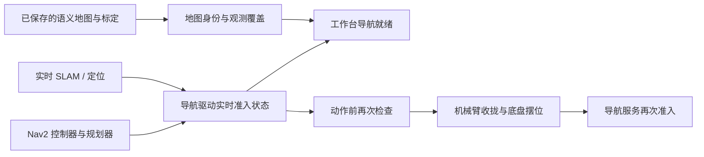

# 工作台用户流程与执行收尾修正

本轮从真实浏览器操作家庭 Gazebo，发现“保存了地图”与“导航驱动现在可用”混为一谈。首条自然语言巡检在前置摆位失败，暴露出页面就绪、规划指标、失败回放和执行收尾的多个边界。实验输入、失败及重测材料见[工作台验收](../experiments/2026-10-28-user-workbench-e2e/README.md)。不修改已有物理到达、停止和未知结果判据。

## 就绪状态必须对应实际执行依赖

- `GazeboNavigationClient.readiness()` 读取实际导航 HTTP map 状态，保留独立的驱动身份和阻塞码。通信异常、缺少合法布尔值或存在阻塞时，不能返回就绪。
- `RobotWorkflow` 注入可选 `navigation_readiness`，把静态地图与实时驱动分开；Gazebo 的 `navigation.status` 通过 `navigationDriver` 显式给出依赖状态。其他设备可按自身驱动实现该接口。
- Gazebo Runtime 在 `prepare_navigation` 之前检查依赖，避免导航不可用时先执行机械臂预定位。最终 goal 准入仍须复查，前一次就绪不能授予永久执行权。
- Nav2 的 action server 存在不等于控制器已激活。controller、planner、bt_navigator 各自必须提供新鲜 ACTIVE 响应；三秒有效期从查询开始计算，不能由迟到响应续期。单节点发现或请求异常只将该节点置为未知，不能中断其他依赖的检查。
- Console 增加独立“导航运行依赖”项。已有标定在启动时主动读取；缺少状态不能推成必须重新标定。导航依赖失效时，地图提示不能让用户通过继续移动“补图”来处理进程故障。

传感器可用与导航可用分开：相机读取、诊断及停止不应因为 Nav2 失效而全部失去入口。工作台综合就绪是引导信息；设备动作前检查才是最后一道准入边界。

## 同意执行、进入队列与实际执行是三个事实

队列满时，批准已经持久化，而入队失败。以前任务会停在 `READY + approved`，前端却永久禁用批准按钮。

现在同一已批准 `READY` 任务可以显式“重试启动”，保留原批准人、时间和单条批准事件。`App` 的排队/执行去重阻止重复派发；并发 16 次重试仍只执行一次。其他状态不能借这个入口重新批准或重放动作。未知物理结果仍必须走原有对账流程。

## 收尾记录与状态变化分开

`SUCCEEDED`、`RECOVERABLE_FAILURE` 等状态可能先于最后的审计记录被 HTTP 轮询读到。本地执行新增 `LOCAL_RUN_FINISHED`，在执行循环和失败材料写入尝试结束后、释放本次执行所有权之前保存实际 `state` 与 `taskRevision`。成功路径同时保留 `LOCAL_RUN_SUCCEEDED`。

这个标记表示**本次执行尝试结束**，不是成功证书：暂停、等待用户或失败同样会写结束标记。它也不声称异步监督 Agent 永远不会追加新事件。写入失败必须保留为收尾证据缺失，不能补一条虚假的成功记录。

收尾期间本地取消、恢复与结束标记的读取、写入、执行所有权释放使用同一互斥边界；普通事件和异步监督事件并不全部经过这把锁。已经返回但仍在保存审计的能力执行不能接受一个再也无人处理的取消请求。客户端应等待实际所有权释放，再决定恢复或取消。

`ABANDONED` 是操作员放弃该步骤的对账结果，不是“未执行”。恢复视图明确返回 `STEP_ABANDONED` 和 `canResume=false`；其他对账结果仍须通过原执行器的恢复检查。未批准的草案没有执行尝试，因此取消草案不会伪造 `LOCAL_RUN_FINISHED`。

## 相机画面必须绑定当前设备

建图页原先读取没有数据的旧帧缓存，随后第一次修复又遗漏了直接打开 `#mapping` 时适配器未初始化的情况。真实接口与理想化 fixture 的差异使第二个缺陷逃过了首次测试。

现在直接打开建图页会先读取 Runtime，核对 `RobotID` 与当前工作空间，再用明确的 `Adapter` 读取已注册相机。使用同一次原子采集的 RGB 与深度，检查来源、坐标变换版本、采集时间及新鲜度；不从历史设备列表任意选择，不回退到旧图像。相机每 500ms 尝试刷新，状态每 1500ms 刷新；单请求去重、离页取消和过期规则独立生效。本次家庭相机配置 `maxAgeMs=1000`，通用实现上限为 `min(sensor.maxAgeMs, 5000)`。浏览器实测必须确认图片已解码且设备身份正确，HTTP 200 本身不够。

## 回放与指标对应新能力链路

- 能力计划展示 `robot.task` 内冻结的完整路线；`navigation.status` 显示为只读状态查询，不套用旧物体搬运描述。
- `navigation.pre_position` 属于改变世界的动作。失败或未知结果不能显示“只读无需证据”，存在未核对物理结果时也不能写“全部证据通过”。
- 导航经验投影只有在任务成功且每个目标存在匹配的到达确认与观测证据时完成；普通只读工具确认不能冒充路线完成。
- 规划失败保留 `planningAttemptId` 和证据链接，即使没有创建任务也能追踪失败。
- 编排统计明确 `population=persisted_tasks_only`。GOAL 的模型调用尝试、决策拒绝、提案、冻结提案和经验命中与旧规划器候选分母分开。无提案时接受率为 `null`；存储读取失败不返回一组貌似有效的零值。
- 旧 `orchestrationScore` 仅为兼容指标，不能用于跨架构质量或论文成功率比较。模型调用尝试不等于供应商 HTTP 次数，更不等于计费 token。
- 当前状态统计单列 `cancelledTasks`，取消草案不能计为执行失败。`endToEndSuccessRate` 兼容字段仍使用全部已创建任务作分母，页面明确写“成功占比（含待执行、取消）”。它不等于实验成功率：失败后人工取消的任务，当前状态是取消，而历史执行失败必须从事件账本统计。

## 实验分析不接受缺失或矛盾证据

Gazebo 指标分析增加有限数值、机器人/时钟/世界/坐标系身份、测量时间先后和完整配置集合检查。任务终态可与只读、完整的 SQLite 快照交叉核对；缺失日志或旧格式身份时保留可计算数值，但完整闭环与安全结论标为未验证。

新增计划任务分母、未观察任务数、采样间隔、传感器计数覆盖和停止失败阶段。一次未能进入运动状态的试验不是一次真实制动失败；缺少接触消息也不是没有碰撞。严格复算没有更改原来的到达、速度、停稳或间隙阈值。

## 探索续段与操作包络

续段原来只采一次首帧；深度不足便立即在空栅格上报告 `no_frames`。现在在八秒预算内最多读取三个不同曝光，重复读同一传感器曝光不重复累计拒绝。迟到 provider 返回即使图像新鲜，也不能在首帧预算结束后集成。仍缺少本段实测栅格时，只允许花一次现有环视预算使用原受控驱动；安全拒绝、取消、租约到期和持续缺测仍然终止。继承地图不能冒充本段的新观测。完整负例和回归见[续段审计](../experiments/2026-10-28-user-workbench-e2e/exploration-audit/README.md)。

桌边停止还暴露出两种半径混用：探索规划使用 0.32m，而家庭仿真的 bounded-step 控制器使用 0.355m。不能简单把所有半径都改成较大值，因为已走轨迹所认证的自由空间也会被错误放大。

因此保留原 `footprint_radius` 作为本体/已走自由空间的证据半径，另设 `operational_radius` 作为规划和操作所需净空。家庭仿真共用 0.355m 操作常量，前沿、路径、语义目标及绑定复验读取当前操作净空；旧图字节和 0.32m/0.33m 观测证据保持原范围，重载时重新验证目标。其他 harness 未显式配置时保持原足迹默认行为。

这项一致性修复覆盖家庭 bounded scan 与地图/语义准入，**没有修改 Nav2 自身 costmap 足迹或控制器，也没有实现底盘退让**。当前停止姿态的保护圈已包含桌边实测点，不能通过这个补丁继续移动。定位误差、地图分辨率、控制延迟和制动距离的余量仍应按实际设备验证，而不是把仿真的常量直接当作实机安全参数。
