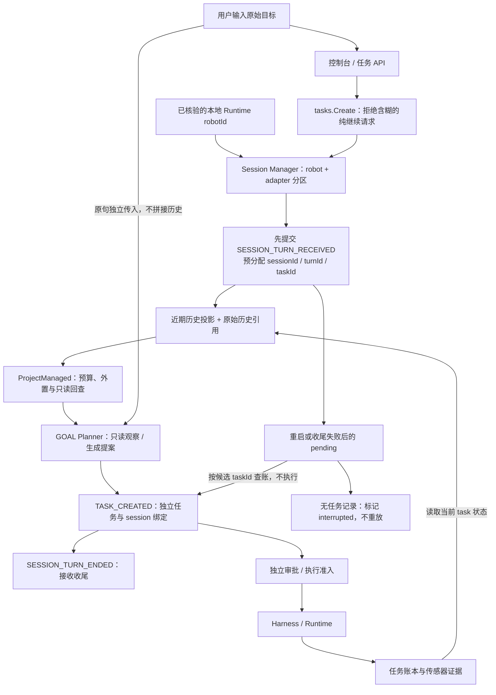
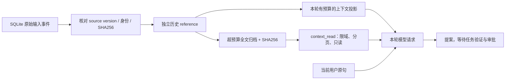

# 自动边缘会话：从自然语言输入到可恢复的任务接收

日期：2026-11-01。范围：`local-agent` 的自然语言任务接收、规划上下文与接收过程恢复。本页记录本次设计依据、代码路径、验证对象和明确边界；不把接收流程测试等同于 Gazebo 或实机运动验收。

本次升级使操作者直接输入任务即可：Local Agent 自动分配会话、记录输入轮次、提供有预算的历史参考，并在进程重启后核对未收尾的接收记录。操作者不需要创建、选择或手工压缩模型 session。机器人动作仍由独立任务、审批、执行契约和 Harness 管理。

## 1. 调研来源与采用范围

用户提供的[知乎文章](https://zhuanlan.zhihu.com/p/2099987320443237060)在本次访问中返回 403；阅读材料使用[同文公开转载《Super-agent 设计探索：迈向更自主的 Agent 系统》](https://www.uied.cn/posts/922127)，再与 [DeepSeek 官方 Super-agent 原型](https://github.com/deepseek-ai/dsh-superagent-prototype)和 [DeepSeek Harness 的 session 文档](https://github.com/deepseek-ai/deepseek-harness/blob/master/docs/subsystems/session.zh.md)交叉核验。这里不声称直接读到了知乎原文，也不把转载中的描述视为官方生产能力承诺。

官方仓库明确将其定位为研究原型，公开实现与文章讨论并非完全一致。本项目采用其中“会话由系统管理”“持久记录与模型视图区分”“上下文不能授予执行权限”等机制；没有整体移植其 Router/Worker、消息源订阅或异步后台作业系统。机器人具有物理副作用，恢复时不能仅凭对话语义重复动作。

| 参考机制 | 本轮在机器人系统中的对应实现 | 范围限制 |
| --- | --- | --- |
| Session 是执行内部细节 | Local Agent 自动管理 intake session，任务 API 不要求用户传 session ID | 不是多渠道消息 Router；接收会话与执行任务不一一对应 |
| 不可变输入与可追溯关系 | `SESSION_TURN_RECEIVED` 保存原始输入、摘要、session/turn/候选 task 绑定 | 没有通用外部 Trigger 去重协议 |
| 从持久记录生成模型视图 | 小型近期投影、完整历史引用与现有 `ProjectManaged` 预算机制结合 | 不承诺无限期历史自动召回 |
| 上下文不增加权限 | 历史是 reference，当前原句独立解析，新任务独立审批 | 不继承旧任务批准，不自动重试未知物理结果 |
| 单写者及恢复 | 本地数据目录排它锁、事件版本 CAS、pending 查账 | 不是跨主机主从选举或分布式共识 |
| Watchdog、异步 Worker | 本轮没有引入新的执行调度器 | 会话恢复不能修复物理故障或判断动作已经完成 |

这些对应关系是本项目的工程取舍，不表示两个系统拥有相同 API 或数据模型。官方原型对输入、Thread、Ticket 和 Mandate 的区分见[领域文档](https://github.com/deepseek-ai/dsh-superagent-prototype/blob/main/docs/001-domain.md)，授权边界见[授权文档](https://github.com/deepseek-ai/dsh-superagent-prototype/blob/main/docs/002-authorization.md)。

## 2. 先区分四种“会话”与状态

| 对象 | 解决的问题 | 不能代表什么 |
| --- | --- | --- |
| 控制台访问 token | 请求是否被允许访问本地控制台 | 不是多用户身份，也不是机器人动作批准 |
| Intake session / turn | 当前机器人最近收到过哪些目标，本次输入如何关联 | 不是执行 lease，不是任务成功证明 |
| Task / revision / command | 被批准的任务定义、执行版本、动作与结果 | 不能由聊天摘要覆盖 |
| 模型上下文 / KV cache | 本轮推理看什么，供应商能否复用计算 | 不是持久任务库、权限库或跨机器人共享记忆 |

一个 session 可以产生多个独立任务。一次 turn 从接收开始，到“任务创建成功”或“规划失败”等接收结论结束；此时机器人任务可能尚未审批，也可能仍在执行。因此 `SESSION_TURN_ENDED` 的含义是**接收轮次收尾**，不能显示成“机器人完成任务”。任务完成只能读取任务账本及相应执行证据。

## 3. 数据流与责任边界

图中的恢复箭头表示读取任务是否已创建，不表示重新提交 `TASK_CREATED`，更不表示重新执行机器人动作。Session Manager 不调用移动、抓取、起飞等能力。

### 3.1 自动归属与轮换

入口先验证 Runtime 身份，再把本地绑定的 `robotId` 传给 Session Manager。会话分区键由机器人 ID 和规范化 adapter 计算，用户自然语言不能指定另一机器人的会话。能力规划得到的机器人身份还要与绑定再次匹配。

当前参数固定在实现中，尚未提供管理面板或运行时调参接口：

| 规则 | 当前值 | 理由与代价 |
| --- | ---: | --- |
| 空闲轮换 | 30 分钟 | 避免很久以前的操作意图持续影响新任务；这是产品启发式，不是权限过期规则 |
| 轮次数轮换 | 32 个接收轮次 | 限制单会话跨度；失败轮次也计入接收历史 |
| 近期记录上限 | 8 个轮次 | 控制日常检索和模型参考范围 |
| 单条预览上限 | 512 UTF-8 字节 | 预览保留身份和概貌，完整原句另存 |
| 近期投影上限 | 6000 UTF-8 字节 | 放不下时逐条移除最旧投影，并记录省略数量 |
| 当前输入上限 | 8000 UTF-8 字节 | 超限或非法 UTF-8 在接收前拒绝 |

6000 字节不是 6000 token，也不是整个模型 HTTP 请求上限。模型上下文和完整请求仍受既有 `TANGYING_CONTEXT_MAX_BYTES`、`TANGYING_MODEL_REQUEST_MAX_BYTES` 等预算约束，见[长程上下文记录](2026-10-09-long-horizon-context.md)。

轮换只重置活跃会话的近期视图，不删除历史 source events，也不结束正在执行的任务。首版不会自动把旧 session 的历史召回到新 session；用户明确的任务引用和跨会话检索属于后续接口能力。

### 3.2 先记账，再规划

接收时一次性生成 `sessionId`、`turnId` 和候选 `taskId`，在调用规划器前提交 `SESSION_TURN_RECEIVED`。该事件包括原始指令、原文 SHA256、绑定、投影及轮换原因；状态快照保存 pending 与近期预览。

任务创建使用预分配的同一个 task ID，并在 `TASK_CREATED` 中记录 session 绑定。这样即使“任务已经写入，但进程没有来得及完成会话收尾”，重启后仍能沿确切 ID 找到任务，而不依赖相似文本猜测。

关键绑定可表示为：

\[
B=(sessionId,turnId,taskId,robotId,adapter,sequence,H(context))
\]

接受绑定时检查身份、轮次和摘要一致。SHA256 用于检出内容损坏或不匹配；它不是数字签名，也不能代替请求认证和操作授权。

事件提交使用 `ExpectedVersion` 做 CAS，同一会话的状态与事件一起提交。进程内 gate 串行化任务接收，消除同一 manager 内两个输入覆盖 pending 的竞争。它不会自动串行化所有机器人物理动作，也没有实现云端多副本的写者协调。

### 3.3 模型读历史，但不能把历史变成指令

历史引用接入 GOAL 模型规划路径；未配置该模型时，离线 legacy grammar 仍只解释当前原句。自动记账不等于规则解析器具有跨轮指代和自然语言对话能力。

当前目标始终是用户本轮原句。会话摘要作为独立 `reference` 记录进入规划上下文，带有“仅供参考”的约束；历史任务状态由账本现读，不能把上轮“成功”冒充此刻的传感器事实。

完整历史原句与小投影分开传递：manager 通过保存的 source event 版本读取至多 8 条近期原始输入，核对事件类型、turn/session 关联、绑定和原文摘要。读取损坏、来源缺失或身份冲突时，阻止新一轮规划，不静默接受缺失的历史。

历史全文作为模型上下文中的独立 reference，可以由 `ProjectManaged` 在超预算时外置为带摘要的归档，再由规划循环的只读 `context_read` 按范围回查。读取属于本次规划捕获的归档集合，不是让模型任意搜索文件系统或其他机器人的任务库。原始 source event 仍保留，压缩视图不能取代它。

这里继承了既有“每轮从源数据构建视图”的做法，避免摘要的摘要逐渐改变事实。DeepSeek Harness 同样将追加事件记录与模型消息视图区分；本项目复用自己的事件库和上下文组件，没有兼容导入 DeepSeek session 文件格式。[官方 Harness session 说明](https://github.com/deepseek-ai/deepseek-harness/blob/master/docs/subsystems/session.zh.md)

重复任务记忆也作了保守调整：存在自动会话参考时，不能仅凭当前目标文本相同就走“跳过模型”的精确 recipe 快捷路径；已有 recipe 仍可提供参考。代价是部分重复请求会多一次规划调用，但不会把不同历史背景误视为同一任务的授权或相同执行条件。

## 4. 崩溃恢复：恢复关联，不重放动作

| 中断位置 | 下一次接收如何处理 | 是否自动重做 |
| --- | --- | --- |
| source event 提交失败 | 返回接收错误，规划尚未开始 | 否 |
| source event 已写，尚无对应任务 | 按候选 task ID 查账，记 `interrupted` | 否；用户可明确提交新目标 |
| 任务已持久化，会话收尾未成功 | 验证 `TASK_CREATED` 的精确绑定，记 `task_created` | 否；继续使用已有 task |
| task ID 存在但机器人或 session 绑定冲突 | 停止恢复并返回错误 | 否 |
| 原始事件或摘要不一致 | 拒绝生成新的历史视图 | 否 |
| 原任务存在 pending / UNKNOWN 物理动作 | 会话层不改变执行事实，走原任务的 resume/reconcile 流程 | 否 |

会话 finalizer 使用脱离请求取消、但有 5 秒超时的上下文清理 pending。若任务已经创建，会话收尾失败不会把已创建任务改成“可重试的创建失败”；下次接收再核对 pending，避免鼓励客户端因一个收尾故障创建第二个任务。

这并不等于 HTTP 幂等：客户端超时后把相同 POST 再发一次，仍可能产生新的 turn 和新的 task。当前事件的 `IdempotencyKey` 防止同一内部事件重复提交，不能识别外部两个请求是否代表同一次操作。真正的重试去重需要后续明确的客户端 request ID、认证主体和原响应保存策略。

数据目录在启动时取得 `.agent-owner.lock`，防止两个本地进程把同一数据库当作各自的恢复状态；已有 Runtime 控制锁继续保留。文件锁与 CAS 的目标是本地单写者一致性，不应将此目录放在不保证相同锁语义的网络共享盘上充当多节点数据库。官方原型也将单写者、数据库事务与恢复协调放在引擎边界，详见[架构文档](https://github.com/deepseek-ai/dsh-superagent-prototype/blob/main/docs/007-architecture.md)。

## 5. 用户例子与不可越过的边界

### 例一：两次明确请求，自动拥有连续参考

1. 用户：`读取当前整机标定状态。`
2. 系统生成 turn 1 和 task A，保持原句，读取当前状态并按任务流程收尾。
3. 用户：`重新读取当前整机标定状态，检查相机标定是否仍有效。`
4. 系统生成 turn 2 和 task B；B 的规划可以看到 A 的请求和读取时的任务状态，但必须重新查询当前条件，不能直接把 A 的历史结果当作本轮结果。

用户没有选择 session，仍然能够沿 B 的 session/turn 绑定回到 A 的 source event。A 和 B 各有独立任务记录、审批与证据。

### 例二：机器人执行中收到“继续”

`继续`、`继续上一个任务`、`再来一次`、`retry` 等纯续跑请求不会由自动历史猜测要执行什么。任务创建入口返回需要澄清，不创建新任务；操作者应进入确切任务记录，使用已有 resume/reconcile 操作。

这是针对物理系统的取舍：省掉 session 选择，不等于省掉任务身份和未知动作结果核对。当前纯续跑识别是明确短语规则；其他复杂歧义仍依赖规划约束与提案验证，不能宣称能识别所有自然语言歧义。

### 例三：切换机器人或执行 adapter

AGV 的会话不能成为足式机器人的授权来源。不同本地 `robotId + adapter` 使用不同分区，能力目录的机器人身份必须匹配。但分区本身不构成租户隔离：当前部署按本地单操作员设计，没有用户 ID、组织 ID 或跨渠道权限模型。多人共用同一 Local Agent 时，仍会共享该机器人分区内的接收历史；部署成多用户服务前必须先补齐认证主体与隔离策略。

### 例四：进程重启后用户再次提交

task A 已写入，但服务在发送响应前退出。重启后的 manager 能把旧 pending 与 A 核对起来，不自动重复 A；用户若再次提交同一句完整指令，当前 API 会将其视为新请求，可能创建 B。操作界面应先查看任务记录；后续应通过明确的幂等请求协议解决“响应丢失”的重发问题，而不能用文本相似度阻止用户合法重复巡检。

## 6. KV cache 与 token 成本

DeepSeek 的上下文缓存是供应商侧计算复用：稳定且相同的前缀可能命中缓存，命中不是持久性保证，缓存也会失效。应记录供应商返回的 `prompt_cache_hit_tokens` 和 `prompt_cache_miss_tokens` 等实际用量，而不能根据会话存在就推断 token 已缓存。[DeepSeek 官方缓存指南](https://api-docs.deepseek.com/guides/kv_cache/)

本次会话工作直接控制的是“哪些历史进入请求”和“历史过长时如何按需读取”。系统不会把 KV 当数据库，不保存或跨 agent 复制供应商 KV；session ID 也不是缓存命中凭证。会话记录、任务 recipe 与 KV cache 分别服务于事实追溯、规划经验复用和推理计算复用，指标必须分别统计。

建议后续实验至少区分：每轮输入/输出 token、缓存命中 token、历史内联字节、外置字节、回查次数、规划延迟、澄清率、接收恢复结果，以及经过真实执行验证的任务成功率。不能用“任务创建成功率”替代机器人完成率，也不能把缓存命中提升单独当成系统准确率提升。

## 7. 代码定位与验证范围

| 代码 | 主要职责 |
| --- | --- |
| `core/agentsession/context.go` | 不可变 binding、完整历史引用在调用上下文中的传递及校验 |
| `internal/agentsession/manager.go` | 会话分区、轮换、事件/状态提交、有界投影与 pending 查账 |
| `tasks/creation_session.go` | 原始目标保留、task ID 绑定、纯续跑拒绝、独立创建和清理 |
| `internal/capabilityagent/planner.go` | 将历史作为 reference 接入规划，验证 robot 与摘要 |
| `internal/capabilityagent/recipe_memory.go` | 会话存在时 recipe 降为提示，不只按目标文本跳过规划 |
| `internal/controllease/lock.go` | 数据目录及 Runtime 的本地排它控制 |
| `cmd/local-agent/main.go` | Runtime 身份绑定后创建 manager，连接真实任务入口 |

新增测试覆盖目标如下；实际执行结果以本轮最终测试日志为准，本表不是 Gazebo 或实机成功声明：

| 测试位置 | 验证内容 |
| --- | --- |
| `core/agentsession/context_test.go` | binding 校验、历史副本隔离 |
| `internal/agentsession/manager_test.go` | 重启查账、缺失任务、取消、并发输入、轮换、预算、完整原句、摘要损坏、绑定冲突 |
| `tasks/creation_session_test.go` | 原句不变、独立审批、预分配 ID、错误清理、无授权续跑拒绝 |
| `internal/capabilityagent/session_context_test.go` | 历史进入 reference、全文外置与分页回查、作用域/摘要/重复历史拒绝、recipe 降级 |
| `internal/controllease/data_test.go` | 同目录排它与锁释放 |
| `cmd/local-agent/session_test.go` | 真实 HTTP 序列化、任务入口、SQLite 重开及模型请求中的历史关联 |

HTTP 集成测试的模型服务是 fixture，机器人 Provider 也用于验证没有副作用；它能证明数据流与恢复路径，不能证明公网模型稳定性、Gazebo 导航成功或真实设备安全。

本轮实际执行、独立审查发现的 legacy 机器人作用域问题及修复、完整日志和源码摘要见[软件验证报告](../experiments/2026-11-01-automatic-edge-sessions.md)。

### 部署与已有数据

会话复用已有 SQLite aggregate/event 表，没有新增网络中间件或独立数据库迁移。新版 `local-agent` 启动后自动为新输入建立会话，不推断导入历史任务的聊天关联。升级时先正常停止原 Local Agent，再以原数据目录启动新版；旧二进制不检查新的数据目录锁，不能依靠新版锁阻止尚未退出的旧进程。锁文件保留是正常现象，所有权随进程退出释放，不应通过删除锁文件或任务库解除占用。本轮只修改并验证源码，未替换正在运行的 Gazebo 或原 Local Agent 进程。

## 8. 后续扩展次序

1. **请求协议**：加入认证主体和客户端幂等 request ID，保留原响应，明确冲突与保留期限。解决响应丢失重发，而不是按文本去重。
2. **明确引用路由**：支持 `replyToTaskId` / `replyToTurnId`，先验证身份与权限，再关联历史；主题相似度只作为澄清建议，不能授权续跑。官方原型也对附加到已有工作设置明确匹配条件，见[提示词与路由规则](https://github.com/deepseek-ai/dsh-superagent-prototype/blob/main/docs/004-prompts.md)。
3. **多入口隔离**：在 robot + adapter 之外加入用户、组织、渠道身份与可见性规则，定义跨域消息可传的摘要和引用；本地单操作员会话不能直接升级为多人共享记忆。
4. **异步接收与监督**：引入有界队列、明确的任务订阅和外部事件；监督器报告停滞、模型超时和断连。任何物理恢复仍走任务契约、实时状态与结果核对，不能由 watchdog 凭聊天记录重放。
5. **保留与实验**：设计原始输入、传感器证据、归档的保留/删除策略；增加 session 开关、预算和召回策略消融。原始指令可能含敏感信息，数据目录的访问控制、备份和清理必须纳入部署方案。

本轮首先建立“无需操作者管理的接收会话”，同时保留可追溯任务与执行权限边界。完整跨渠道 Super-agent 调度、长期语义记忆和分布式会话写者协调仍是后续独立能力，不能由本次会话层替代。
