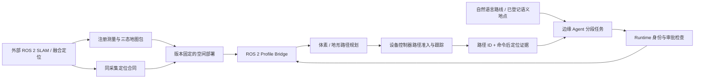

# 统一 2D、地形与 3D 导航

阅读顺序：先读[异构机器人与 ROS 2](heterogeneous-mobility.md)，再读本页；建图数据格式与发布见[空间测量建图](spatial-mapping.md)。本页描述当前实现，实验结果和未测项见[2026-10-14 实验记录](../experiments/2026-10-14-spatial-navigation.md)。

2026-10-18 增加[已知覆盖和多层地面](2026-10-18-spatial-coverage-upgrade.md)：显式 ROI 的预测观察计划、可替换后端与 `terrain_layered` 支撑图。下述旧三类 ROS 2 记录式任务仍按原版本引用，不计作新分层导航或实体覆盖验证。

2026-10-17 新增[异构三维探索研究层](2026-10-17-heterogeneous-spatial-exploration.md)：`SpatialExplorer` 共用本页几何可达性，`SpatialMissionRunner` 通过地图/驱动/报告端口接线，任务协调与覆盖账本支持恢复和[配对消融](../experiments/2026-10-17-spatial-exploration-protocol.md)；[10-18 实际软件结果](../experiments/2026-10-18-spatial-exploration.md)单独保存。它不自动启用 ROS 2 三维探索，不替代本页定位、部署、控制器与路径握手；当前离线几何任务不证明实机动力学。

## 导航通道

| 通道 | 地图与定位 | 适用机器人 | 负责执行的模块 |
| --- | --- | --- | --- |
| 现有平面 2D | SE2 SLAM、二维栅格、Nav2 | 平面无人车；提供平面导航控制器的足式平台 | 既有 `tangying_navigation` / Nav2 |
| `terrain25d` | 体素障碍 + 单层高程、支撑、坡度；完整七元定位 | 无人车、足式；按各自限值准入 | Profiled ROS 2 地面控制器 |
| `terrain_layered` | 体素障碍 + 多层支撑面和显式相邻跨层连接；完整定位 | 有对应地面控制器的无人车、足式 | 分层几何规划 + Profiled 控制器准入；本轮不证明真实楼梯/步态能力 |
| `volume3d` | 三态三维体素 + SE3 定位 | 声明 air/se3 的无人机 | Profiled ROS 2 飞行控制器 |

**保存三维点云不等于具备三维导航。** 点云是表面测量，导航还需要可通行空间、可靠定位、机器人包络和可执行路径。旧 `RobotWorkflow`、Dense SLAM、二维 `semantic.plan` 和 Nav2 接口继续明确限定平面；没有通过删除 z 校验将它们改称 3D。

空间导航采用独立模块，允许地图、SLAM 算法与设备厂商独立扩展。注册测量融合器不估计位姿、不进行闭环优化；外部 ROS 2 SLAM/VIO/LIO 适配器负责这些工作。`terrain25d` 继续保持单层语义；多层楼板与桥上桥下使用显式 `terrainLayers` 支撑图，不能自动从占据体素或 XY 重叠推断跨层边。任意落脚、承载力和步态规划仍由设备侧完成。

## 从任务到动作



自然语言使用现有已登记的 `semantic.navigation.v1` 地点，`goalPose` 始终为 `[x,y,z,qw,qx,qy,qz]`。每段在边缘规划路径、下发、独立确认到达，再继续下一段。云端或其他 Agent 可传递地点、地图依据和任务提案，但不能用消息替代本机的定位检查、控制器准入和动作租约。

任务规划阶段不把完整体素塞进模型上下文。地图留在有界本地缓存，任务保留地图/部署版本、目标、步骤和执行证据；控制器日志保留具体路径。路径改变必须对应新的路径 ID；地图或策略内容变化会改变 Runtime 目录及持久准入指纹，旧审批和任务不会静默继承新环境。

## 地图、定位与坐标一致性

`navigation.volume.v1` 包含 `robotId/mapId/mapRevision/frameId/worldFrameRevision/calibrationRevision`，以及 `resolution/origin[xyz]/shape[nx,ny,nz]/cells`。数组按 x 最快、然后 y、z 展开，状态仅允许 `-1/0/100`，依次为未知、自由、占据。最多 250,000 体素；未知与地图外不可通行。`mapRevision` 是外部地图修订标识，地图包摘要与部署摘要另外覆盖内容；不可仅信任一个同名修订字符串。

定位 `spatial.localization.v1` 放在 `ProfiledObservation.robot_state_json` 的 `spatial_localization` 键下：

- 来源：`robotId/sourceId/sourceType/sourceFrameId`，固定到部署允许的定位源。
- 坐标：`frameId=world`、地图、世界和标定版本，单位为 m/rad。不同机器人的 `world` 字符串相同不代表坐标系相同；跨域地图需先由适配器完成有版本的配准。
- 采集：`observationId/sequence/observedAtUnixMs` 与同消息 reconstruction 完全一致；既检查 Unix 采集年龄，也检查本地单调接收年龄。重播不延长寿命。
- 位姿：`poseModel=se2|se3` 与 Profile 相同，正规化七元位姿；SE2 拒绝 roll/pitch，不默默截断。ROS 常见 `xyzw` 四元数必须由适配器显式转成 `wxyz`。
- 质量：`quality.state=localized`，三个位置方差和三个姿态方差均在阈值内。`degraded/lost` 不授权移动。

网关从已验证定位派生 `base_pose/base_pose_frame=world`，拒绝同消息中的矛盾值。SLAM 回环或重定位改变世界依据时，应产生新修订并停止旧部署；当前采用显式重启和重新准入，不提供运动中的自动地图热替换。

## 规划与控制器职责

`SpatialPathPlanner` 是确定性的有界几何 A*。空中使用 26 邻接；地形使用地面节点，无法跳到自由空中的节点。所有连边、起终点连接及最终路径均检查完整扫掠。它将障碍和未知体素按机器人轴对齐包络外扩，再做线段与盒的相交检测，阻断对角穿角和接触边界。

`bodyHalfExtents` 加上 `margin` 是调试时确定的保守包络。空中必须包住所有允许姿态下的机体、旋翼和负载；不能直接填写未经旋转处理的三轴尺寸。地形模式检查的是参考点周围的主体包络，轮地/足底接触和包络外摆腿必须由设备控制器另外验收，当前算法不计算落脚或摆腿轨迹。这个模型可能拒绝实际可过的窄通道；不能以主体无碰撞证明整机可走。

地形模式另外检查整个扫掠足迹的支撑与坡度、相邻高程步高、参考点相对地面的高度。高程和支撑来自明确的测量来源，不能从二维俯视无障碍推断。起终点须接近所登记的支撑高度，不能用大的步高限值授权悬浮。控制器仍负责实时障碍、轨迹跟踪、制动、非完整约束、飞控稳定或足式步态；几何路径不证明动力学可达。Ackermann 等车辆需控制器拒绝无法跟踪的折线，或后续接入专用曲率约束规划器。

分层地面使用层内四邻接及显式层间边；跨层边仅连接相邻 XY 且两端有支撑的不同层，仍检查完整扫掠和坡度/步高，禁止同 XY 垂直 portal。起终点必须唯一匹配对应层，不能以“最近层”默默解释歧义。格式、层数/节点预算与可替换规划端口见[本轮记录](2026-10-18-spatial-coverage-upgrade.md#4-多层地面与空中移动如何共存)。

## 部署配置

先完成具体机器人 Profile 的型号、标定、限幅、workspace、停止程序和调试。仓库 `examples/robots/*.commissioning.profile.json` 是待替换模板，示例包络数值不适用于任何具体设备。

原 ROS 2 gateway 配置增加可选 `spatialNavigationPath`：

```json
{
  "profilePath": "/etc/tangying/robot.profile.json",
  "commissioningId": "site-a-uav-commission-1",
  "namespace": "/uav_01",
  "spatialNavigationPath": "/etc/tangying/spatial/deployment.json"
}
```

空间部署文件示意（字段需按实测调试值填写）：

```json
{
  "schemaVersion": "spatial.deployment.v1",
  "volumePath": "map-revision-1/volume.json",
  "policy": {
    "mode": "volume3d", "bodyHalfExtents": [0.4, 0.4, 0.25], "margin": 0.15,
    "maxExpanded": 20000, "maxWaypoints": 1024
  },
  "localization": {
    "sourceId": "uav-01/localization", "sourceType": "sensor_fusion", "sourceFrameId": "base_link",
    "maxAgeMs": 500, "maxPositionVarianceM2": 0.01, "maxOrientationVarianceRad2": 0.01
  }
}
```

单层地形策略将 `mode` 改成 `terrain25d`，并必须提供 `maxSlopeRad/maxStepM/referenceHeightM`；地图必须附带 `navigation.terrain.v1` 支撑、高程和坡度数组。多层使用 `mode=terrain_layered` 和 `terrainLayers` 中的 `navigation.terrain.layers.v1`，沿用上述地面限值；最多 32 层且总 XY 层节点、连接数分别不超过 250,000。`referenceHeightM` 必须大于 `bodyHalfExtents[2] + margin`；起终点参考高度距相应支撑面加 referenceHeightM 的误差上限固定为 0.02 m。机器人 Profile 的域、位姿模型和 workspace 必须允许对应路线。

相对路径以部署文件所在目录为基准。若 `volume.json` 旁有 `manifest.json`，加载器验证整个测量包和重放结果；坏包不能退回未校验的普通文件。独立体素文件作为外部调试地图输入，全内容仍参与部署摘要；它本身不证明来自实测。

启动方式沿用 `TANGYING_ROS_PROFILE_CONFIG` 与 `tangying_ros_gateway.profiled_node:create_backend`，见[实机测试手册](../operations/edge-field-testing.md)。新消息定义需要网关和设备控制器两端重新构建 `tangying_robot_msgs`。

## ROS 2 路径握手与故障行为

1. 控制器周期状态 `ProfiledDriverState.spatial_navigation_revision` 必须等于网关计算的部署摘要；部署未启用时该字段为空。
2. `ProfiledExecute.Goal.navigation_plan_json` 含 `navigation.path.v1`，绑定地图、部署、commandId、定位 observationId/sequence/time、完整航点和 `planId`。摘要采用排序键、紧凑 UTF-8 JSON、禁止非有限数值，并排除自身 `planId`。
3. 控制器验证地图、部署、命令、期限、租约、审批、路径与自身可跟踪能力；运行时还要检查实时障碍。测试用 `verify_plan` 会按同静态规划合同重算路径，不替代生产控制器的动态判断。
4. Result 返回 `navigation_plan_id`；不匹配即不认可完成。成功还要求确切命令后的新定位证据：XYZ 距离不超过 0.05 m，四元数角差不超过 0.10 rad。
5. 导航期间每次续租等待都会重新核对就绪和定位。失效进入已登记的控制器停止流程；已派发但结果不确定保留未知执行结果，不自动重新发同一物理动作。

旧部署不启用空间配置时，新增路径字段为空，原行为仍有回归；这是行为兼容，未重编译的旧 DDS 消息类型不保证能直接互通。

## 扩展位置与当前边界

| 要扩展的能力 | 应实现的位置 |
| --- | --- |
| 新 SLAM / 原始传感器、TF、回环与重定位 | 外部 ROS 2 provider；输出注册测量和统一定位 |
| 新地图表示、分块/八叉树、大场景 | 空间地图模块和新的版本化规划 provider |
| 地形承载力、摩擦、足端接触、步态 | 地形感知 provider 与足式控制器；当前 support 布尔值不覆盖这些物理量 |
| 非完整车辆曲率、轨迹时间参数化 | 专门运动规划器与控制器准入 |
| 新无人机飞控、厂商底盘、足式平台 | Profiled ROS 2 controller adapter，保留命令/路径/证据协议 |
| 多机器人联合避碰、跨地图融合 | 显式世界配准、资源与协调模块；当前数据通信不自动产生联合轨迹 |
| 三维 frontier/NBV、覆盖、异构目标分配 | [spatial_exploration / spatial_mission](2026-10-17-heterogeneous-spatial-exploration.md)；替换策略或 provider，保留世界/网格、路径与观测合同；目前有序协作，不含联合避碰 |

当前交付可作为 ROS 2 空间导航的联调与实机前软件验证基础。体素预算、静态地图、有限单层/显式分层支撑和保守包络是明确约束；长期运行、动态复杂环境、具体设备飞行/步态以及小时级可靠性需要单独实验，不能由本页的软件测试替代。
