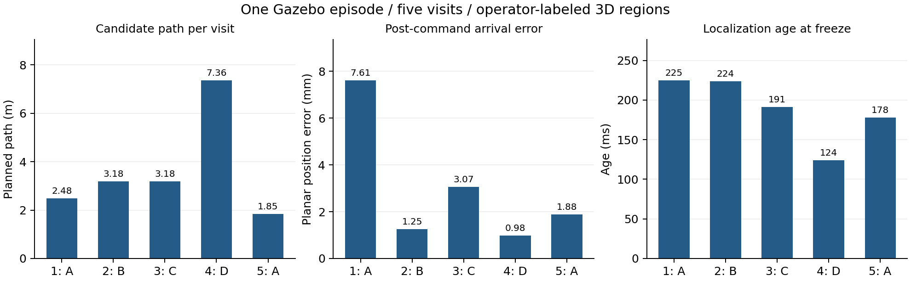

# 点云语义驱动的长程巡检：2026-10-13 实验记录

本实验对应[实施计划](../development/2026-10-13-semantic-execution-plan.md)、[用户指南](../guides/semantic-point-cloud.md)和[交互协议](../architecture/semantic-execution-protocol.md)。基线为 `56309f667983c08c04dae004b9f60d92f2b08709`，在同一功能分支继续开发。上一轮离线点云实验与本轮真实 Gazebo episode 分开保留，历史失败不改写。

## 研究问题和范围

验证能否把点云上的有来源标注转换为同一条自然语言任务中的有序导航检查点，并在一次执行期只读通信故障后通过 Task/Ops/Recovery 协作继续执行。接受任务前核对全部目标、顺序和策略；完成后从原始命令回执、采集时间、位姿、地图身份及持久化 grounding 独立验收。

这是三维语义目标驱动的单层地面导航，不是三维自由空间规划。当前语义来自人工标注，检测器只支持已接入的类别；本任务的 `arrival` 不要求目标对象重新识别。运行使用真实 Gazebo/ROS 2/Nav2 进程，不使用模拟成功回执。真机、跨机器人配准、开放词汇识别、多楼层和多人安全运行均不在本次验证范围内。

## 环境与预登记

- 场景 `home_furnished`；Gazebo Runtime `127.0.0.1:50361`，只读故障代理 `50362`，Console `8917`，Nav2桥 `18841`。这些服务属于本次独立输出目录，不干扰已有 Redis/MySQL。
- 前两轮 episode 标识 `1013`，第三轮重启为 `1014`。它是 episode 标识，不是确定性物理随机种子保证。
- 从停止的历史实验复制有效 RTAB-Map 与 workflow 地图；不复制旧任务数据库、命令 journal 或导航 goal 数据库。`imported-maps.json` 保留291个来源文件、大小和 SHA-256，合计1,573,634,397字节。地图复用不代表重新运行建图。
- 激活地图 `scan-b0591a4b9ab9`，canonical cloud 71,980点。地图、点云、标定摘要以及实际 Runtime 镜像/源码与 Go 二进制 SHA 存入证据包。
- 使用已有模型配置：GOAL/INTENT/PLANNING/RECOVERY 经 OpenAI-compatible 接口调用 `deepseek-flash`，服务地址 `https://api.deepseek.com`。没有改模型、设置更大上下文预算或保存 API 密钥。
- 人工通过正式 `semantic.annotate` CAS 服务提交四个测量点云 AABB，分别为“巡检点甲/乙/丙/丁”，点数766/754/758/983。它们合计覆盖3,261点，约4.53%，不能称为全图自动理解。
- `semanticRevision=47fd1fc19a4ce336610f5a98cce50d39735b5a085bfabce5f5846b49f5b2c73c`。每站 `maxDistanceM=0.65`、`allowStaleSearch=false`、`verificationMode=arrival`。

预登记自然语言原句：

> 执行时先读取导航状态，然后根据三维点云标注依次前往巡检点甲、巡检点乙、巡检点丙、巡检点丁，再次前往巡检点甲；每站前往距标注中心不超过0.65米的可达观察位，确认抵达并取得新鲜RGB-D观测，不要求识别具体物体；最后再次读取导航状态。

`preregistration.json` 与 `expected-route.json` 在首次任务创建之前写入。验收器在批准前要求恰好一个 `robot.task`，结构化路线必须逐字段等于预登记的地图身份、五个有序目标及策略。计划必须来自实际 GOAL 模型，不允许用手写计划替代失败规划。

只读故障代理只匹配执行请求的 `task-` ID，对第一次 `navigation.status` 在转发之前拒绝，最多一次；规划时的读取、运动与其他服务不受注入影响。代理原始 JSONL 与 Task/Ops/Recovery 协作事件必须同时存在，才能认定发生自动恢复。

## 验收判据

1. 同一任务最终 `SUCCEEDED`，执行计划和批准计划完全一致。
2. 五个目标按甲→乙→丙→丁→甲顺序分别完成，不能把重复目标折叠，也不能用原先房间预置坐标代替点云候选。
3. 每段 `SEMANTIC_GROUNDING_FROZEN` 先于物理动作持久化；候选、签名绑定与实际命令一致，恢复不更换已经冻结的候选。
4. 导航/到位命令各有动作后的、同任务/修订/步骤/机器人的 RGB-D 捕获。每次到达平面位置误差≤0.08米、朝向误差≤0.15弧度。
5. 签名摘要、地图六元身份、语义版本、目标 ID、world frame 与前置导航命令相互一致。独立验收不持有运行时 HMAC 私钥，只验证保存证据的一致性，报告 `signatureIndependentlyVerified=false`。
6. 注入的一次只读失败具有诊断、恢复建议、重新读取和成功复验的同任务证据；不得重复已确认的物理动作。
7. 所有响应、原始图片和任务账本保留 SHA-256 manifest；离线复验不联网、不修补原始证据。

## 失败、修复与复测

### P01：规划上下文预算失败，零动作

首次尝试 `attempt01` 在21.249秒后返回 HTTP422，未创建可执行任务或批准/运动。保留 planning attempt `planning-attempt-3ee394e826256f94fba2679a93e40948` 的完整来源 trace 与摘要。

轨迹为：一次多工具模型输出被拒绝；成功读取 `navigation.status`、`semantic.map`、`semantic.query`；之后模型请求65,552字节超过65,536字节预算；模型尝试回读外置上下文后，必要上下文35,447字节超过32,768字节。根因是完整服务 schema 同时被嵌进工具描述和结构化工具参数，语义查询后重复目录耗尽预算。

修复把工具名和参数 schema 表达为 `propose_capability_plan.calls.items` 的结构化 `oneOf` 分支。描述仅保留能力用途、副作用、资源、操作和复验契约，完整执行校验与 catalog fingerprint 不变；超过16种能力时按受支持的 schema 分组保留所有分支。没有提高预算、截掉能力或跳过语义证据。增加等规模目录与读取历史的回归及小预算拒绝测试。

### E02：第一站到达，第二站定位过时拒绝继续

`attempt02` 创建实际模型计划 `task-d111e6d5ebe77f21b5d1e557`，工具顺序为状态读取→五站 `robot.task`→状态读取。94.406秒后验收失败，任务进入 `RECOVERABLE_FAILURE`。

这次只读故障确实自动恢复：事件16/17由 Ops 定位 `navigation.status` 瞬时错误，事件18产生恢复计划，事件19由 Recovery 执行并验证 `execution.read-history`，事件20按 `OPS_DIAGNOSIS_AND_VERIFIED_READ_ONLY_RECOVERY` 重读，事件24确认成功。随后第一站对齐、导航与到位均有 `CONFIRMED` 回执。

事件60记录第二站只读 grounding 失败：`semantic plan requires fresh localization`。第二站没有物理动作，系统没有盲目重发第一站导航。虽然只读服务恢复链成立，整个任务失败，因此此尝试的 `automaticTaskRecoveryObserved=false` 保持不变，不能报告为完整任务恢复成功。后续检查定位时间戳与多候选路径规划耗时，不放宽定位新鲜度门限。

修复共享单次请求内的不可变 grid、距离场和有界碰撞检查缓存。EDT快速判据只在保守下界足够时证明净空，不确定时仍进行精确胶囊/栅格矩形检查。计算结束重新取得真实定位，验证与原搜索起点之间≤5厘米的安全连接，再重算路径摘要；如果位置变化较大、连接不安全、坐标或地图身份改变，则拒绝该候选。返回前再次校验目标 TTL，不能将旧 capture 的时间戳改成当前时间。

同一保留地图、起点与第二站输入的无插桩复播结果：

| 实现 | 第1次/秒 | 第2次/秒 | 第3次/秒 | 中位/秒 |
| --- | ---: | ---: | ---: | ---: |
| 修复前 | 1.94365 | 1.88761 | 1.91674 | 1.91674 |
| 修复后 | 0.197277 | 0.199684 | 0.202471 | 0.199684 |

局部候选规划中位加速约9.60倍，四个候选路径 SHA 均保持一致。这是同机、确定性输入的三次复播，不是不同场景的随机试验，也不用于计算整个系统或模型推理的加速比。cProfile 另存，不能把插桩耗时与无插桩数据混算。

独立标量几何 oracle 还覆盖18幅地图、7,254条线段、1,374次快速证书，并另测15个接近恰切的边界：未发现不安全放行、额外拒绝或正反向不一致。这是软件几何抽样，不代表连续空间证明、Nav2控制误差界或真实硬件认证。

### 开发期间交叉审查发现的边界

- 旧 world 坐标只绑定 `worldFrameRevision` 不够：实际 `mapFromWorld` 变化也必须进入签名与运行守卫。
- 新动作不能继续发布上一次的语义确认；到位证据必须与当前导航命令/token 对应。
- 对象证据改为嵌套 `observationEvidence`，哈希仅覆盖定义的观察摘要；整数值浮点经 Protobuf/Go JSON 传输后采用明确的数值归一化。
- Runner 不只信成功码，进一步检查语义命令证据；恢复要求有持久化候选且不得复用旧动作完成记录到新候选。
- 初次联合单测暴露旧 hash 复算测试未应用数字归一化，原始失败日志保留，修正测试复算规则后复验。
- 基线远程 CI 的 README 测试函数计数过时；按源码重新统计并通过原 Go 文档检查，没有降低判据。

## 最终结果与证据索引

修复后完整任务及冻结验收器离线复验均通过；前两轮失败完整保留。机器可读汇总见 [JSON](2026-10-13-semantic-execution.json) 与[尝试 CSV](2026-10-13-semantic-execution.csv)。

### E03：修复后完整五站任务通过

新 episode `1014` 重建 Runtime 后运行同一预登记请求；它不是恢复 `attempt02`，没有改写前两轮失败。任务 `task-55e6dffc1453c3f6c1db58c1` 的实际模型计划包含状态读取、一个五站 `robot.task`、最后状态读取。任务创建于03:39:55.118 UTC，03:43:57.380 UTC完成，耗时242.262秒；验收驱动包含模型规划、等待与证据采集，共280.960秒。

| 站次 | 点云标注 | 候选规划路径/米 | 冻结定位年龄/毫秒 | 到位平面误差/毫米 | 到位朝向误差/弧度 |
| --- | --- | ---: | ---: | ---: | ---: |
| 1 | 巡检点甲 | 2.478 | 225 | 7.615 | 0.02475 |
| 2 | 巡检点乙 | 3.184 | 224 | 1.246 | 0.02779 |
| 3 | 巡检点丙 | 3.183 | 191 | 3.065 | 0.00186 |
| 4 | 巡检点丁 | 7.360 | 124 | 0.984 | 0.02615 |
| 5 | 巡检点甲 | 1.848 | 178 | 1.876 | 0.02884 |

合计18.053米是候选规划路径长度，不是实走里程计距离；实际 Nav2 可随动态避障改变路线，路径 SHA 不证明逐点执行了该候选路径。误差是动作后回执位姿相对候选目标的误差，不是 SLAM 绝对定位精度。各站都位于标注中心0.65米处，`arrival` 完成而 `semanticConfirmed=false`；没有混算为对象识别成功。



图由原始冻结事件与独立复验输出派生，源表见[逐站 CSV](2026-10-13-semantic-execution-visits.csv)。图中的 A/B/C/D 对应甲/乙/丙/丁。

一次 `navigation.status` 在发送到 Runtime 前被代理注入 `UNAVAILABLE`。Ops 定位同任务、同修订与同命令的异常，Recovery 限定只读诊断并验证 `execution.read-history`，Task 按策略重读一次后继续原计划。因整个任务随后完成，`automaticTaskRecoveryObserved=true`。10个物理步骤（五次对齐、五次导航）各派发一次，没有物理重放。193条账本事件中，除预登记注入外没有其他执行失败。

规划实际经历一次多工具输出拒绝后自行修正；未手工替换模型计划。六个受管理上下文中，规划最大19,398字节，Recovery 最大32,658字节，均小于原32,768字节预算；最多23条记录外置。复验验证模型请求与归档摘要，`verifiedContextReadPages=0`：本轮使用了压缩/外置，但未观测到模型主动回读归档页面，不宣称已实测这一分支。

冻结在 `source-attempt03/` 的独立验收器复验通过：329个文件、217,443,068字节、248个任务快照、193条事件、25份观测与40张图像；验证3个顶层能力、20个子步骤、5次到位，以及协议、上下文、故障和自动恢复链。HMAC 密钥不向验收器开放，`signatureIndependentlyVerified=false`。该复验是对保留数据的一致性检查，不是第二次运行任务。

## 实现变化与扩展点

- 规划层：从同轮 `semantic.query` 成功证据冻结标注 ID、名称、顺序、重复访问及地图/语义版本。`robot.task` 接受严格结构化 `semanticRoute`，模型不能提交导航坐标。
- 边缘执行层：每站用当前定位查询可达候选，持久化 `SEMANTIC_GROUNDING_FROZEN` 后才执行。完成站点经过检查点、命令身份和全部子步骤核对后可在受控恢复时跳过；未完成站点保持原候选及 token，不能悄悄换点。
- Runtime：地图/标定/语义版本、坐标锚定、足迹和目标时效绑定到候选签名；命令前后校验，运动期持续检查。签名仅证明候选绑定，审批、租约、fencing、journal 和安全监督继续决定动作准入。
- 感知层：增加真实内部传感器读取 `semantic.observe`，区分到达位置与唯一对象确认。对象匹配要求已注册类别、几何关联、来源和新鲜采集；开放词汇模型和多视角掩码融合是后续扩展。
- 异构与云边：云端传递版本化目标与任务身份，边缘持有本机坐标、标定和当前候选。适配器必须明确声明执行绑定能力；当前仅 Gazebo home 支持此通路，接口存在不等于真实底盘已具备能力。

## 可复现性与研究限制

运行命令、每轮源码快照、Runtime源码/镜像与 Go 二进制摘要见证据根中的 `provenance-before-attempt*.json`、`source*/working-change-manifest.json` 及 `attempt*/run-config.json`。成功轮 Runtime源码摘要为 `e01d2dccafe153491353ebeca59c44e73c06e07da5c466a6d86624d8e6c56ed7`，Go二进制摘要为 `51428c4d7a9c1d9a7128d6d85dc706f25ca8961b2601f3160cb44ab5c8f62c9c`。使用源码快照而非最终文档提交标识区分三轮实现。

解包原始证据后可独立复验（不需模型或运行中的 Gazebo）：

```bash
.venv/bin/python artifacts/experiments/semantic-execution-20261013/source-attempt03/scripts/revalidate_long_horizon.py \
  --evidence artifacts/experiments/semantic-execution-20261013/attempt03 \
  --output /tmp/semantic-execution-revalidated.json \
  --expected-arrivals 5 --required-source llm --require-auto-recovery \
  --require-fault --require-managed-context --require-model-context --require-protocol
```

重跑现场实验需有效模型配置、Docker/ROS/Gazebo 与保留地图；使用相同路线另建输出目录，不能覆盖旧目录。只读故障代理、标注脚本和全部参数随证据保存。密钥、Console 会话及导航令牌不归档。

本轮是开发过程中失败→修复→复测的工程案例，不是三次同版本独立随机重复；不能用“1/3”或最后一次“100%”估计可靠性。模型服务版本、主机负载、时间与 episode 均可能影响复现。尚未测量对象语义准确率、开放词汇泛化、动态物体长期跟踪、多机共用地图、真机完成率，以及小时级/天级连续任务。下一步应固定软件版本、预登记不同场景与随机故障的重复实验，并将实体感知与真正的硬件试验单独报告。

## N01/N02：冻结之后更改语义版本的实际负例

初次负例脚本 `version-conflict/` 在任何标注修改或批准前误把“计划只能有一个调用”作为条件。实际模型生成 `robot.task` 后还有合法只读 `runtime.readiness`，脚本失败并取消草稿任务 `task-18f921857cf0a10e1147237e`。这是测试脚本缺陷，不算系统拒绝旧地图的证据。原脚本、报告和响应均保留。

`version-conflict-v2/` 根据能力目录校验恰好一个语义 `robot.task`，允许其余已声明只读调用；没有修改模型计划。实际任务 `task-c63b14c6c3636a6759d8aa79` 冻结后，通过正式 CAS 仅修改 `/0/source/reference`，语义版本从 `47fd1fc…` 更新到 `bfe1f535…`，再批准旧版本计划。约0.85秒后，第一段 grounding 因 `SEMANTIC_REVISION_CONFLICT` 停止，状态为 `RECOVERABLE_FAILURE`。

包括对齐动作在内，物理派发0、冻结候选0、未知物理步骤0；10秒诊断观察期内没有自动恢复或继续运动。48份文件摘要一致，计划从草稿至最终状态完全一致。复合能力的顶层分类仍保守显示 `UNKNOWN_OUTCOME`，具体恢复状态中无未知子步骤：本轮不把此分类当作发生过物理动作的证据，也不放宽自动重试规则。语义改动只在隔离实验地图副本发生，原成功任务证据不改变。

## 验证与交付

- 最终 Gateway 全套：1,172通过、4跳过，日志 `logs/gateway-tests-v3.log`。
- 受影响的 Go 规划、Runner、RobotClient、Worker、上下文、Console、协调器和 LocalApp 分阶段通过 race 检查；各轮日志保留，不把有交集的测试数相加。
- 独立语义证据验收覆盖错序、篡改、缺失检查点、旧捕获、身份错误、对象证据和恢复修订；最终文档/验收器241项通过，Go文档检查与 Ruff 通过，原日志与命令范围见机器可读索引。
- 冻结成功轮的35个 Go/Python 文件与提交前对应源码摘要一致。最终修改文档索引不改变实测二进制。未重跑无改动的前端全套，也未宣称全仓所有测试通过。
- Runtime、故障代理和 Agent 在采集结束后正常停止；仅本次 Gazebo 容器/网络清理，既有 Redis/MySQL 保持运行。

原始证据包保存在本机 `artifacts/experiments/semantic-execution-20261013-evidence.tar.gz`，1,304,845,226字节（约1.30GB），SHA-256：

```text
2a0f84814852d8edf8324ac605294ba69e4dc584a72c7e15caa6060ea2420f03
```

归档包含历史导入地图、停止后的 Agent 数据库、Runtime journal、三轮任务证据、负例、性能输入/源码、图表生成脚本与测试日志。逐文件从压缩包读回验证1,009份文件、1,962,568,231字节；数据库在关闭且无 WAL 后以只读 immutable 模式通过完整性检查。会话、导航凭据及 Python 缓存排除，并扫描已知凭据字节。摘要/指标/图表随 Git 提交，1.30GB原始包仅本机保存、未上传远程；论文正式发布数据集前仍需另行托管并保留此摘要。
