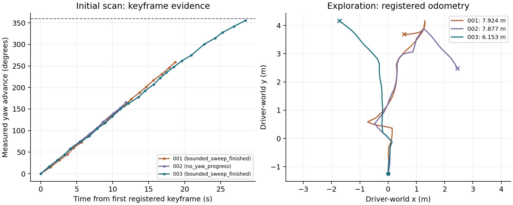
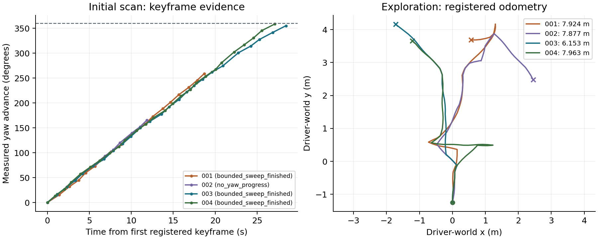

# 首次未知场景探索：Gazebo 工程实验记录

日期：2026-10-17。基线 `980e8b4d8`，工作分支 `codex/exploration-first-scan`；每次实际运行的冻结源码逐文件 SHA-256 与 dirty patch 独立归档。本报告按运行追加事实，不把功能分支结果当成正式发布或实体机器人验收。

## 目标与方法

依据[预登记协议](2026-10-17-exploration-first-scan-protocol.md)，使用实际 Gazebo / ROS 2 / RGB-D / RTAB-Map / Runtime 链路，在新的独立地图目录、数据库、端口、ROS domain 中执行 `mapping.build(mode=explore,maxTravelM=8,maxLegs=1)`。没有导入旧图或给 frontier 提供固定房间路线。环境为同源 XLeRobot 装修家庭；位姿来自 Gazebo 里程计及 IMU 融合，不是 GPS 拒止实体定位验证。ROS 侧 RTAB-Map 提供在线导航地图；本轮 `mapping.build` 归档的 SLAM provider 是 `planar-rgbd-icp-posegraph v1`（`rgbd_slam`），最终地图由 Gateway 该 provider 的快照发布，并非直接导出 RTAB 数据库。

镜像固定为 `sha256:c7ad7cea987aba8308699ed3226531cd597d58fb99221dee616f2086e68b4a67`，挂载各次冻结的 Python Gateway 与 proto；ROS 二进制保持镜像基线。episode 数字是标识，不是 Gazebo 物理随机种子。旧 episode 有已保存地图，不能作为首扫样本；确认原扫描已完成后暂时 pause 旧容器，新实验结束再恢复，旧地图和原实验目录不改写。

这是 Runtime 长操作验收，30 秒租约、2 秒轮询/续约、900 秒外部时限，不包含新的自然语言 Host/模型运行。新 Harness 拒绝复用输出目录，先落预登记，记录完整请求/响应与轨迹；超时取消后等待同一 operation 终态，响应不确定则只读等待租约失效，不能取消别人的会话。

## 全部实际尝试

### 001：预算内建图通过，发现角度容差累计

本地原始目录 `artifacts/experiments/exploration-first-scan-20261017-001/`。ROS domain 169、Runtime 50571、导航 18971，episode 标识 1017。

操作从空地图库存和 mapping 导航模式开始，耗时 **288.471263 秒**，最终 **132 帧、7.923569592 米**，按 `travel_budget` 停止。地图 `scan-1c45121a6905`、revision `3ad7a696ac562554659602ea0345af0718b34436568da323d19a5df6c36cf516`，产物哈希校验、在用地图身份与导航加载通过，运行期间冻结源码未变化。

初始扫描请求四个 quarter-turn，但实测绝对转角只有 **4.711702319 rad，约 270°**；新增 18 帧，深度不足累计 7 帧、结束时连续失效为 0。原代码用请求角度扣减剩余值，驱动提前接受到位容差，误差在小命令间累积。`completedSweeps=4` 在这版仅表示请求批次结束，不能作为实际一圈证据；保留该原始字段，不追改旧 JSON。

本次 Runtime 验收通过仅证明有界探索及地图发布/加载，**初始完整转角目标未达到**。据此修复带方向的实测 yaw 闭环，各 quarter 共用累计目标，增加无进展与命令上限。

### 002：实测反馈进入控制死区，保留部分扫描

本地原始目录 `artifacts/experiments/exploration-first-scan-20261017-002/`。全新 ROS domain 170、Runtime 50572、导航 18972，episode 标识 1018。除转角反馈外，也包含连续深度失效动作前检查、换段不清除取消 Event 的修复。

初始实测推进 **3.032369140 rad** 后以 `no_yaw_progress` 停止环视；没有将请求角度补算为覆盖。总目标残差为 3.250816168 rad；当时第二个 quarter 的剩余角约 0.109 rad，受驱动到位容差和捕获时延影响，两次微小请求未形成有效推进，说明单纯减去实测角仍会卡在控制死区。

修复将剩余修正命令保持在 0.2–0.5 rad，实测的少量超调计入后续累计目标；保留每个 quarter 的 8 次命令、帧、120 秒、取消及深度失效上限。新增控制死区 fixture，后续使用新的源码及 episode 复测。本次完整操作耗时 **220.245083 秒、122 帧、7.876806724 米**，按 `travel_budget` 停止；地图 `scan-96f3c4bdaf2b`、revision `a5d96cd3c32d605ba9990b20d7f52c56e74ad36a6d59aaaf2fd746531179d998`，独立产物校验与导航加载通过。Runtime 通过与初始转角目标未达到同时保留。

### 003：初始角度目标达成，暴露共同短首段停滞

本地原始目录 `artifacts/experiments/exploration-first-scan-20261017-003/`；ROS domain 171、Runtime 50573、导航 18973，episode 标识 1019。初始扫描实测 **6.256606816 rad（约 358.48°）**，目标残差 **0.026578491 rad**，满足冻结的 0.1 rad 角度容差；20 次命令、29.050 秒、新增 24 帧，未发生平移。

完整操作耗时 **197.719082 秒、96 帧、6.152849973 米**，以 `no_progress` 保存实测部分。地图 `scan-6988e3096845`、revision `633ce95043d2a10bcc7df571abb7ef1825abeb71c632a3c2a15279a278aee589`，独立校验与导航加载通过。首扫角度达成，整体扫描仍是部分结果，不能改写成 8 米预算耗尽或全环境已探索。

进一步从本次传感地图与独立观测流复现：机器人实际位置 `(-1.771218666,4.191613961)`，多个目标的共同首段点距离仅 **0.035519682 米**，另外几个为 **0.041844103 米**，小于执行器 0.05 米最小步，12 次退役远端目标也无法离开。该位置仍有 8,487 个可达格，非断连或安全层拒绝。

原 `next_waypoint` 从量化格心检查直线，实际机器人不在格心。用同一通行 mask 从真实位置检查，0.103790 米和 0.174020 米处候选均安全可见，更远拐角仍不可见。修复增加 `robot_xy/min_step_m`，只选择从实测位置验证且达到执行最小距离的候选；没有可执行点时明确 `no_executable_waypoint`，不得跳过碰撞检查。粗网格候选需要在前视距离内插值，同样检查整条直线。后续用全新会话验证此修复，保留本次提前停止原始记录。

### 004：首扫与预算停止复测通过

本地原始目录 `artifacts/experiments/exploration-first-scan-20261017-004/`；ROS domain 172、Runtime 50574、导航 18974，episode 标识 1020。新源码包含从真实位置检查的可执行航点及内部最小步配置。

初始扫描 **6.269289208 rad（约 359.20°）**，残差 **0.013896099 rad**；19 次命令、27.112 秒、新增 25 帧。随后自主探索 **221.804525 秒、130 帧、7.963161393 米**，按 `travel_budget` 保存地图，未再出现003那类短首段提前停滞。最后状态同时保留 `minStepM=0.05`、`waypointDistanceM=0.6` 供复核。

地图 `scan-d438ab8bb420`、revision `e8387c7b0a88f3e65f4bb722e9f187b81e125bd50ed9b5d0ac8442b07ce2a72b`。空地图库存、独立产物校验、导航 ready/localized 与加载 revision、一段与总里程预算、运行期间冻结源码不变均通过。正式导航图内已知面积 **65.665 m²**，不是全环境可覆盖面积或覆盖率。单次工程复验不足以估计统计可靠性。

四次新容器均已正常停止；旧容器已 unpause，未改写原地图或重置旧 world。启动/停止状态及独立观测流摘要保存在各次归档。

### 004 后：续建坐标帧修复的软件验证

最终审查另外发现非零 `mapFromWorld` 续建路径中三处帧混用：map-frame waypoint 被当成 driver-world 发出，进展比较把两个不同 frame 的位置相减，环视未知比例查询使用 driver-world XY。修复在驱动边界逆变换一次平移目标，进展始终比较 planning-frame pose，未知查询先转换到 map frame；yaw 差使用环绕归一化。

非零平移/旋转锚点测试核验 `base=(1,2)`、map anchor `(10,20,π/2)` 时仍只发 driver-world `(1.5,2)` 的半米命令；静止不因锚点偏移而被当成进展，环视查询位置匹配地图。**这批续建帧修复只有软件回归证据，没有新增非零锚点的真实 Gazebo 续建任务。** 004 的冻结源码与所有原始结果保留原身份，不宣称它测过最终提交的每一条分支。

## 软件回归与反例

已验证的确定性反例包括：全未知/全障碍没有自由格不得报完成；首帧不足仍可有界换视角；取消/帧/里程/时间/持续深度失效在动作前检查；反向 yaw 不算覆盖；控制死区不制造完整旋转；定位/急停/未知驱动错误不当几何障碍；换段中租约失效保留取消并释放资源；视点无增益只禁选，不封死路径；self footprint 不重新打开障碍/拒绝区；大隔离簇不占满可达候选预算；直线路径不穿障碍角缝。

初次算法联测曾使完整房间夹具停止在约 22.6% 未知。隔离实验确认是旧逻辑把“无增益视点”写入真实几何拒绝表，而旧 footprint OR 又悄悄重新开放该区域。修复将 `exclude_viewpoints` 和 `avoid_xy` 分离后恢复房间完成。另修正旧拒绝 fixture：拒绝首个有平移的动作，避免把初始环视拒绝冒充路径拒绝；没有放宽生产安全门禁。

初始记录器配置生成还发生一次 `Path.open(opener=...)` API 使用错误，在容器启动前失败，无运动；改为内置 `open` 且文件权限 0600，记录在环境预登记中。发布测试的无视差深度夹具没有配准，先拒绝 `SCAN_TOO_SMALL`，随后显式模拟 provider 接受用于测试 provenance 写入，不计作 SLAM 质量结果。

## 指标与结论边界

`travelledM`/`operationTravelledM` 是注册关键帧里程定义；独立 Runtime 观测流和底层 bounded-step journal 保留为交叉核对来源，不将两种采样路径长度混为一项精确真值。001 的独立观察在初始扫描结束后才启动，不足以独立重建首段旋转；该首段以工作流实测转角与驱动记录核对。

当前栅格 free/occupied/unknown 及已知面积不等于全场景覆盖率，栅格会随探索扩张；本轮没有独立真值覆盖评分，记为 `not_measured`。地图加载不证明几何精度、全房屋可达、无人机/足式探索或实体长任务通过。EGO/FUEL 未接入，信息收益保留窗口启发式，候选视点的已知障碍可视检查不等于全三维可见体积优化。

所有数字按各次源码和停止类型分别报告，不合并为统计成功率。tracked 脱敏 Runtime 证据与完整归档地图包见[逐文件证据目录](evidence/2026-10-17-exploration-first-scan/README.md)。ROS 原始日志、独立完整观测流、数据库和全源码快照保留本地，另记大小与 SHA，不宣称它们已全部进入远程仓库。

## 可复核资料

四次运行的逐项指标见[JSON](2026-10-17-exploration-first-scan.json)和[CSV](2026-10-17-exploration-first-scan.csv)，保留保存前 live 栅格与重锚后的正式导航图两套统计。原始证据的每次 manifest 含 29 份文件摘要，可按各次目录独立复核。

左图来自注册关键帧，采样比控制/观察流稀疏，不代替状态中的累计转角；右图是 driver-world 注册里程计。不同软件版本、初始观察导致不同路线，这张图不构成配对统计的覆盖优劣对照。绘图源码为 [`plot_exploration_first_scan.py`](../../scripts/plot_exploration_first_scan.py)，输入摘要、绘图依赖与 [CSV](assets/2026-10-17-exploration-first-scan/registered-odometry.csv)保存在同一 assets 目录。

四次汇总图在新的 assets 目录生成，前三次图及当时绘图源码保留。颜色仅表示不同尝试/软件版本，不表明统计显著的路线或覆盖优势。

001 的正式图内已知面积为 69.0225 m²，004 为 65.665 m²，面积没有随修复单调增长；缺少独立可覆盖真值和同版本重复样本，不能据此宣称覆盖率提高或显著耗时优势。本轮可支持的结论是初始转角反馈修复、短首段死锁消除，以及预算、停止、地图来源可复核。

## 最终验证

`make build && make lint && make generate-check && make test` 通过：Makefile 维护的 Go 包全过，Python 主套件 3515 项及单列跨运行时边界 2 项通过、40 项跳过，前端 517 项通过。Python 的 20 个警告为 2 个 pytest 插件重写提醒及 18 个既有 NumPy matrix 弃用提醒。266 项针对性回归与全量套件重叠，不另加到总数。另有独立出版环境的 52 项 book/docs 检查、`go test ./tests/docs`、`make book-check` 及目录一致性检查通过。

四次地图包及 381 条底层 ended 动作的零速度命令发布回执独立核验通过；完整全量日志与软件验证摘要见 `docs/experiments/evidence/2026-10-17-exploration-first-scan/post004-software/`。这些检查不升级为新的实体、全环境覆盖或非零锚点物理续建认证。
