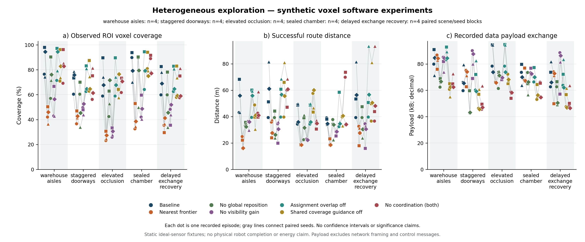
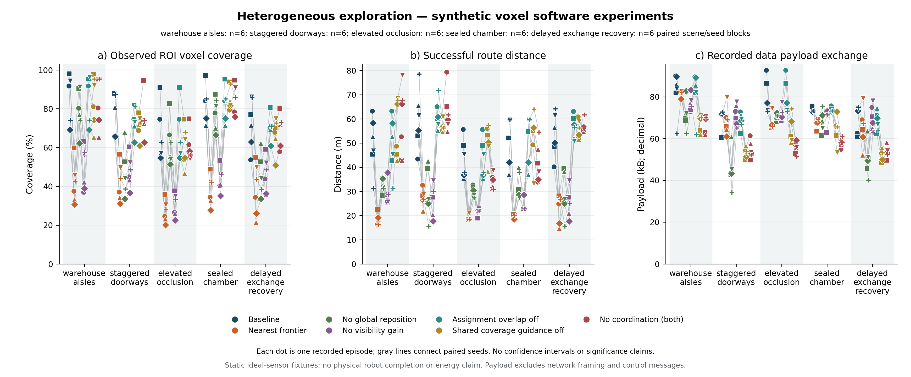

# 已知覆盖、多层导航与扩展探索消融：实际软件实验记录

执行日期：2026-10-18。基线提交：`d984b77bf`；本轮源文件另按冻结快照识别。

本轮新增已知地图显式 ROI 覆盖、分层地面路径、受认证的策略/传感器插件和可回放 Runner 入口。结果分三类：**四个静态预测计划；两次实际调用 Runner 的已知地图软件闭环均观测 315/315；350 个未知环境探索 episode 全部为 partial。** 它们的信息条件和完成判据不同，不能合并成一个成功率。没有新的 Gazebo、ROS 2 控制器、硬件、真实网络或自然语言模型执行证据，也没有任意连续全场景覆盖或普适最优结论。

[设计与精确 CLI](../development/2026-10-18-spatial-coverage-upgrade.md) · [教材补充](../../book/updates/2026-10-18-spatial-coverage-upgrade.md) · [机器可读报告](2026-10-18-spatial-coverage-upgrade.json) · [350 次逐次 CSV](2026-10-18-spatial-coverage-upgrade.csv) · [证据说明](evidence/2026-10-18-spatial-coverage-upgrade/README.md) · [主清单](evidence/2026-10-18-spatial-coverage-upgrade/master-manifest.json)

## 已知地图计划：预测完整和部分结果均保留

固定已知占据图、任务目标、传感器和本体约束，使用有界观察位姿及独立路线认证。四例均通过 `plan_spatial_coverage.py --verify`；输出 `predictionOnly=true`、`observedCoverage=null`、`physicalValidation=false`。复验重新执行确定性规划，验证的是该源码与离散模型的计划一致性。

| 请求 | 预测结果 | 预测覆盖 | leg 数 | 路程 m | 候选路径调用 |
| --- | --- | ---: | ---: | ---: | ---: |
| `mixed-air-ground` | predicted_complete | 2/2 | 2 | 0.000 | 15 |
| `layered-ramp` | predicted_complete | 1/1 | 1 | 3.236 | 8 |
| `disconnected-floors` | partial | 0/1 | 0 | 0.000 | 8 |
| `full-room-coverage` | predicted_complete | 315/315 | 14 | 20.604 | 224 |

空地互补例通过原地改变观察方向覆盖目标，0 m 不代表物理能耗为零。分层坡道使用显式连接；断开的楼层返回 `bounded_search_no_admissible_viewpoint` 并保留目标，不能把该有限候选结果推广为连续空间不可达证明。[各例计划、输入、源码与验证摘要](evidence/2026-10-18-spatial-coverage-upgrade/coverage-plans/results.json)独立保存。支撑来自明确 fixture，不是从现场点云独立推定的承载力或步态可通过性。

## Runner 软件闭环：完成来自新的 capture

最终采用 `spatial-coverage-fixture-20261018-003`（正常）和 `004`（第 3 次命令返回 unknown）。使用实际 `SpatialMissionRunner`、版本/预算检查、事件链、地图/驱动/capture/报告端口；理想已知地图射线为新采集提供测量。两机分别使用 `volume3d` 和 `terrain25d`，不是多层在线探索或实体无人机控制。

| 最终 fixture | 实际新观测覆盖 | 命令/成功/unknown | 正向停止回执 | capture 数 | fixture 已执行路线 m | 保守计费命令路线 m | 规划调用/位姿评价 |
| --- | ---: | --- | ---: | ---: | ---: | ---: | --- |
| 正常 003 | 315/315 | 12/12/0 | 0 | 25 | 28.507 | 28.507 | 96/4139 |
| 恢复 004 | 315/315 | 13/12/1 | 1 | 25 | 27.505 | 28.505 | 104/4149 |

正常分工为 UAV 7、UGV 5 条命令；恢复时 UAV 7、UGV 6。unknown 的一条命令不增加成功路线，但仍消耗保守命令预算。恢复记录中 unknown receipt 在虚拟 1035 ms、显式 stop ACK 在 1036 ms、下一派发在 1037 ms；持久化 stopped 后才继续，不能通过 lease 到期假定已停止。这些是确定性虚拟时间与软件回执，**不是实测耗时或实体速度归零**。

[正常 summary](evidence/2026-10-18-spatial-coverage-upgrade/fixture/normal/summary.json)与[恢复 summary](evidence/2026-10-18-spatial-coverage-upgrade/fixture/recovery/summary.json)均为 `completed/coverage_complete`，目标未被缩减。正常 ROI 总观察 1811、重复 1496；恢复总观察 1763、重复 1448。复验从 capture 独立重算 ROI，对照覆盖账本、事件链、任务/路径绑定和停止顺序；不重新驱动物理系统。早期 001/002 在最终 lint 条件合并前保留，最终 003/004 的 summary 分别与其相同，不扩大独立样本数。

## 未知探索的设计、分区与选型

探索器只读各机器人当前局部知识，初始地图仅含合法传感观测。隐藏占据与 ROI 评分集合在策略外；独立环境可以用隐藏真值拒绝碰撞，但不给策略泄漏占据或替代路线。每轮先成批提案/分配，再逐机执行；停驻同伴包络与未知动作 fence 保留，没有并行 4D 避碰或飞行动力学验证。

| 分区 | families × seeds × arms | episode | 配对任务块 | 不同占据几何 | completed / partial |
| --- | --- | ---: | ---: | ---: | --- |
| development | 5 × 4 × 7 | 140 | 20 | 16 | 0 / 140 |
| holdout | 5 × 6 × 7 | 210 | 30 | 24 | 0 / 210 |

开发 seeds 为 `[3,7,19,43]`，留出 seeds 为 `[101,137,173,211,257,293]`。五类为货架通道、错位门洞、高处遮挡、封闭空腔、延迟地图交换与恢复；故障类复用门洞占据几何。跨分区占据几何 hash 重复数为 0，共 40 种几何、50 个任务块；350 个 episode 不是 350 张独立地图。

每次最多 18 轮，地图下行延迟 2 个决策轮，固定 ROI 包括自由与占据体素，并保留封闭内部。不同地图 ROI 不同，开发分母范围 819–1573，留出 693–1815；覆盖是事前 ROI 的体素分类观测比例，不是表面重建、可达空间百分比或连续全场景覆盖。地面支撑仍是平面 fixture，不把新增分层代码记作该探索基准已测试多层地面。

`no_assignment_overlap` 只关闭分配重叠处理，`no_shared_coverage_guidance` 只关闭共享覆盖收益指引；`no_coordination` 联合关闭两项。占据地图交换、安全准入和执行 fence 不随消融关闭。最近目标、无全局重定位、无可见收益三项保持独立。

[选择规则](evidence/2026-10-18-spatial-coverage-upgrade/study/selection-protocol.json)在留出执行前固定：完整覆盖比例降序、平均覆盖降序、成功路线升序、记录载荷升序、变体名。开发结果全部未完整覆盖，第二项选出 baseline；[冻结记录](evidence/2026-10-18-spatial-coverage-upgrade/study/selection-freeze.json)时间为 2026-10-18 00:48:19 +08，声明当时未查看留出策略结果。它绑定开发 manifest、设计、实现与源码，属于本地操作证据，没有外部盲测或时间戳认证；留出排序不用于重新选型。

## 开发集和留出集全部结果

每行包含本分区所有 episode，partial 不被剔除。开发每臂 N=20：

| 变体 | 完整覆盖 | 平均 ROI 覆盖 | 平均成功路线 m | 规划总耗时均值 ms | 记录载荷均值 kB |
| --- | ---: | ---: | ---: | ---: | ---: |
| `baseline` | 0/20 | 77.21% | 49.44 | 551.35 | 75.51 |
| `nearest_frontier` | 0/20 | 37.49% | 23.37 | 432.16 | 71.26 |
| `no_global_reposition` | 0/20 | 63.06% | 33.65 | 328.07 | 62.06 |
| `no_visibility_gain` | 0/20 | 44.55% | 28.72 | 433.71 | 76.90 |
| `no_assignment_overlap` | 0/20 | 76.61% | 50.55 | 547.55 | 76.52 |
| `no_shared_coverage_guidance` | 0/20 | 73.94% | 49.05 | 523.85 | 58.44 |
| `no_coordination` | 0/20 | 74.76% | 49.47 | 666.59 | 57.37 |

留出每臂 N=30：

| 变体 | 完整覆盖 | 平均 ROI 覆盖 | 平均成功路线 m | 规划总耗时均值 ms | 记录载荷均值 kB |
| --- | ---: | ---: | ---: | ---: | ---: |
| `baseline` | 0/30 | 76.72% | 50.94 | 527.28 | 74.70 |
| `nearest_frontier` | 0/30 | 37.41% | 21.32 | 428.34 | 70.08 |
| `no_global_reposition` | 0/30 | 61.68% | 30.51 | 321.11 | 60.94 |
| `no_visibility_gain` | 0/30 | 43.30% | 25.45 | 473.23 | 72.09 |
| `no_assignment_overlap` | 0/30 | 75.17% | 51.97 | 492.53 | 74.31 |
| `no_shared_coverage_guidance` | 0/30 | 73.64% | 54.52 | 462.89 | 60.44 |
| `no_coordination` | 0/30 | 74.54% | 50.77 | 499.46 | 57.83 |

`pathLengthM` 只累计成功几何腿，未知动作的物理路程未测；规划耗时为本机墙钟软件耗时，不能当作任务执行时间。通信统计实际发送的 canonical JSON 数据载荷，包含占据上传/转发/重连和显式 coverage-ID delta/snapshot，不含未发送排队数据、任务租约、控制器流量、网络帧或 TLS。分析表字段 `meanObservationJSONBytes` 是兼容旧名，实际均值取 `episode.messageBytes`；[最终方法说明](evidence/2026-10-18-spatial-coverage-upgrade/analysis/holdout/method.json)解释扩展口径，冻结输入 manifest 的旧简述不改变已记录的逐通道计数。

两分区 350 个 episode 均正常产出 partial：335 个以 `round_budget`、15 个以 `no_executable_candidate` 停止。不能用上一轮简单场景 315/315 的结果代替本轮更大、遮挡和封闭 ROI 的未完成数据。baseline 在此留出集覆盖均值约 76.72%，最近目标约 37.41%；较短路线对应较低覆盖，不能仅按路线宣布优胜。两个协调单项的覆盖差较小且存在成本取舍，不能从本组数据宣称普遍增益或最优。

每个点为真实 episode，灰线连接同场景同 seed 的七个臂。开发图 [SVG](assets/2026-10-18-spatial-coverage-upgrade/development/paired-exploration.svg)、[图中数值](assets/2026-10-18-spatial-coverage-upgrade/development/plotted-values.csv)、[来源](assets/2026-10-18-spatial-coverage-upgrade/development/provenance.json)；留出图 [SVG](assets/2026-10-18-spatial-coverage-upgrade/holdout/paired-exploration.svg)、[图中数值](assets/2026-10-18-spatial-coverage-upgrade/holdout/plotted-values.csv)、[来源](assets/2026-10-18-spatial-coverage-upgrade/holdout/provenance.json)。图无误差条或显著性标记。

## 配对差、几何聚类和描述性区间

分析先在完全相同 scene/seed 上计算“变体减 baseline”，再对同一 `occupancyGeometryHash` 的条件差取均值，使每个不同几何等权。开发 16、留出 24 个 cluster；故障条件复用的地图不因重复出现增加几何权重。使用 seed 20261018、5000 次 cluster 有放回重采样，保留每 cluster 内的全部配对条件/臂/指标，给出 2.5/97.5 百分位的描述性区间。主表是 episode 等权平均，下面是几何等权差，不能直接将两者相减互换。

留出覆盖差以百分点 pp 表示：

| 关闭项/变体减 baseline | 几何等权覆盖差 pp | 描述性 95% bootstrap 区间 pp |
| --- | ---: | ---: |
| `nearest_frontier` | -40.22 | [-43.57, -36.76] |
| `no_global_reposition` | -10.97 | [-16.70, -5.96] |
| `no_visibility_gain` | -34.51 | [-38.51, -30.43] |
| `no_assignment_overlap` | -1.02 | [-2.91, 0.85] |
| `no_shared_coverage_guidance` | -2.13 | [-5.98, 1.82] |
| `no_coordination` | -1.79 | [-4.99, 1.58] |

这是固定经验地图集的描述，不作显著性判定、没有多重比较调整或总体泛化保证；完成比例均为 0、其差区间为 0 也不证明等效。精确各指标差见[paired-effects.csv](evidence/2026-10-18-spatial-coverage-upgrade/analysis/holdout/paired-effects.csv)、[summary](evidence/2026-10-18-spatial-coverage-upgrade/analysis/holdout/summary.json)、[方法](evidence/2026-10-18-spatial-coverage-upgrade/analysis/holdout/method.json)和[分析来源](evidence/2026-10-18-spatial-coverage-upgrade/analysis/holdout/provenance.json)。

## 故障、拒绝与修复可回溯性

开发计划/实际/跳过故障为 84/84/0；留出为 126/126/0。每个故障 episode 有观测交换分区、驱动拒绝和 unknown。开发记录 28 个 unknown、28 个停止 ACK、28 个后续成功恢复、28 个重连 snapshot；留出各为 42。分区只切断 observation exchange，scheduler 和停止通道仍可用，不能称完整云端失联自治。停止 ACK 是 fixture 明确回执，后续成功 leg 才计恢复；不是物理停止测量。

独立隐藏环境碰撞准入开发拒绝 2 次、留出 0 次，拒绝保留于逐次 CSV；0 次拒绝不能推出真实无碰撞。计划、实际施加与 skipped 原因、无增益腿、剩余地图包和协调器当时覆盖均另留原始日志。离线事后合并得到的覆盖不能追溯成调度器当时已知的覆盖。

本轮修正/增加的拒绝包括：多层含混端点与非法跳层、支撑图篡改、插件越界/错误路径、全任务搜索预算、missing scope 或预测目标越 scope 时派发前拒绝。最终 lint 将 scope 条件的嵌套 if 合并，语义不变但源码 hash 改变，因此 350 个探索样本保留原冻结源，四个计划和 fixture 003/004另用最终源码重新验证。没有以修复为由改写旧证据。

## 版本、验证与复验

350 个探索样本共同设计 hash 为 `555ebb629a12910a70bf19865541f469c672f1fbdb6bb2caddedb3377635e09f`，实现 hash 为 `9c52dc90ffa51f74c84c28dffd524ce27b3f9cb8d85ae423c5b55196c7cd72c7`。冻结 `spatial_mission.py` 为 `ef0bcd538cb1aee2a258bddfce99e20e892d4ae1db7427e3434100035e322351`；最终计划/fixture 的同文件为 `4e795ba453c96eb2a81b02bbcb7adfc412c731b40dc0296db1223c618fc81f68`。其他源码、输入字节、环境与事件身份见各 manifest 和 JSON 报告。Git HEAD 只标记采集基线，不能替代未提交实现的源码快照。

探索运行环境为 Python 3.11.9、macOS 26.6.2 arm64、NumPy 2.4.6、SciPy 1.17.1。墙钟数值受主机负载影响；[执行上下文](evidence/2026-10-18-spatial-coverage-upgrade/study/execution-context.json)与每个 split 的 environment 独立保存，不能外推跨硬件速度。

本轮完整 Python 主命令原始结果为 **3713 passed / 1 failed / 40 skipped / 20 warnings**，563.08 s，退出码 **1**。唯一失败是 `test_readme_leads_with_the_single_robot_home_loop`：研究介绍把 `make home-furnished` 挤到 README 前 2500 字之后。保留测试约束，将两段研究增量移到快速启动例子后；修复后整份 README 回归 **15 passed**（0.04 s）。原全量命令的失败记录保留，不能改写成全量退出码 0。

独立 Runtime boundary **2 passed**（2.71 s）；最终聚焦 **128 passed**（1.84 s），包含全量收集后新增的两项 scope 插件派发前拒绝。15 与 128 中的已有用例和主集合重叠，不累加成新的总通过数。最终 lint 第二次通过，Go 测试、build 与 generate-check 通过；文档/书籍 **52 项**、Go docs、书籍 **31 个固定章节**和目录检查通过。机器可读报告为 `validation.state=completed_with_documentation_regression_fixed`，不沿用上一轮通过数。

开发/留出完整运行及回放、四个计划 verify、正常/恢复 fixture verify 已完成；从压缩归档解压的 8 项复验全部通过（140 + 210 个 episode、4 个计划、2 个 fixture），临时复验目录已清除，重复校验不增加样本数。软件实验与全量回归分别记载；原始状态、修复和聚焦日志统一在[验证记录](evidence/2026-10-18-spatial-coverage-upgrade/validation/README.md)。

主清单记录可读副本和压缩归档身份；原始 source、truth、事件与修复前记录在 [raw-evidence.tar.gz](evidence/2026-10-18-spatial-coverage-upgrade/raw-evidence.tar.gz)。按[证据 README](evidence/2026-10-18-spatial-coverage-upgrade/README.md)解压到新的本地目录后，分别使用 benchmark 的 `--replay`、计划 CLI 的 `--verify`、Runner fixture 的 `--verify`。benchmark 回放验证冻结源码完整性并重算事件指标，不重新执行规划/传感器；计划 verify 重规划；fixture verify 重聚合 capture 与绑定。后两者还要求当前工作区与其冻结源码匹配，不直接混用前后源快照。

本报告可用于软件方法、模块边界、部分覆盖、配对消融和复现性说明。下一步应针对未覆盖 ROI 分解遮挡/本体不可达/候选预算原因，再以新预登记验证改动；真实定位误差、动态障碍、通信传输、跟踪、能耗和停止必须另做 ROS 2/Gazebo/硬件实验。当前缺测项保留 null。
