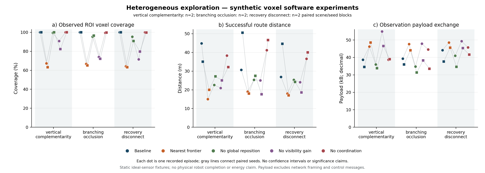

# 异构三维探索与配对消融：实际软件实验记录

执行日期：2026-10-18。设计与协议开始于 2026-10-17。

本轮完成三维探索核心、异构合法候选分工、覆盖与任务日志、可恢复执行端口和研究基准。**这是确定性合成体素环境的闭环软件实验，没有进行新的 Gazebo、无人机飞行、足式步态、真实网络或硬件验收；不是 OmniPlanner 性能复现。** 现有平面 `mapping.build` 不被替换为未经调试的飞行探索。

[方法与变更](../development/2026-10-17-heterogeneous-spatial-exploration.md) · [预登记协议](2026-10-17-spatial-exploration-protocol.md) · [机器可读报告](2026-10-18-spatial-exploration.json) · [逐次 CSV](2026-10-18-spatial-exploration.csv) · [完整证据](evidence/2026-10-18-spatial-exploration/master-manifest.json)

本报告的表格、CSV、源码摘要与最终图引用 **`spatial-exploration-20261018-002`**。修复前 `001` 保留于 [pre-byte-capacity-campaign](evidence/2026-10-18-spatial-exploration/pre-byte-capacity-campaign/manifest.json)，最终 `002` 位于 [campaign](evidence/2026-10-18-spatial-exploration/campaign/manifest.json)；两次不是新增独立种子，不合并成 60 个独立 episode。原 `001` 图另存 `pre-byte-capacity-figure`，当前 assets 的具体来源以 provenance 为准。

## 任务、场景与真实执行范围

任务描述用于理解场景，本次由确定性配置和两个机器人端口执行，没有调用自然语言模型或验证新的多 LLM 通信流程。`ugv` 使用地面支撑约束，`uav` 使用三维自由体积几何约束；两者采用独立局部观测图，任务先批量分配、再串行执行。

| 场景 | 任务描述 | 实际范围 |
| --- | --- | --- |
| `vertical_complementarity` | 空地协作扫描低障碍及其上方、背后区域 | 两种低障碍位置、理想射线与固定平面支撑 fixture |
| `branching_occlusion` | 在遮挡和分支中持续探索并补齐观测 | 与前项不同的全高遮挡布局、绕行与局部视点选择 |
| `recovery_disconnect` | 发生观测分区、驱动拒绝及结果未知后继续探索 | 复用分支几何，加入固定故障时序；本地 scheduler 与停止回执端口仍可用 |

3 个场景标签 × seeds `[7,19]` × 5 个变体，共 **30 个 episode、6 个配对任务块、4 个不同占据几何**。每场景每变体只有 2 个 seed；分支与故障场景共享占据几何，不能声称 6 个独立环境或 30 个独立场景样本。每个最多 14 轮，分辨率 1m，地图为 `[11,9,7]`。共同世界配准与准确位姿是实验条件，未评价 SLAM/跨图配准误差。

预登记 ROI 是外壳内的 **315 个体素**，包含自由和占据体素。分母事前固定，规划器不接收真值 ROI 或隐藏占据。`completed` 仅表示事后独立 evaluator 确认 ROI 分类观测覆盖达到 1.0；不意味着实机任务、表面重建或连续全场景覆盖已完成。停止原因仍独立保存，达到覆盖阈值的 episode 也可能以轮次预算或候选耗尽停止。

## 每次实验与汇总结果

全部 30 个 episode 完整保留：**10 个 completed，20 个 partial，0 个软件异常退出**。下表每行 N=6，仅作本组配对软件样本的描述。

| 变体 | 达到 ROI 阈值 | 平均 ROI 覆盖 | 平均成功路线 m | 每 episode 规划总耗时均值 ms | 观测消息载荷均值 kB |
| --- | ---: | ---: | ---: | ---: | ---: |
| `baseline` | 6/6 | 100.00% | 38.73 | 558.54 | 38.34 |
| `nearest_frontier` | 0/6 | 64.92% | 17.82 | 434.64 | 46.72 |
| `no_global_reposition` | 1/6 | 96.19% | 25.34 | 327.84 | 35.22 |
| `no_visibility_gain` | 0/6 | 78.36% | 21.87 | 499.96 | 47.00 |
| `no_coordination` | 3/6 | 99.79% | 39.13 | 536.11 | 40.48 |

`pathLengthM` 只累计成功几何腿，未知动作的实际行程未测；不是总物理里程。通信只按真实记录的观测上传、转发与重连 snapshot JSON 载荷计数，不含分配消息、DDS/TLS 或无线开销。耗时是在完整 Python 验证、最后日志修复及 96 项聚焦验证之后，本机采集的墙钟软件耗时；环境及负载见 [002 执行上下文](evidence/2026-10-18-spatial-exploration/validation/campaign-002-execution-context.json)。Python 3.11.9、macOS 26.6.2 arm64，NumPy 2.4.6、SciPy 1.17.1 等版本见 [冻结环境](evidence/2026-10-18-spatial-exploration/campaign/environment.json)。这不是飞行时间或跨硬件性能结论。

完整配置在本组 6 个块中均达到 315/315；最近目标配置虽然路线较短，但覆盖约 64.92%。关闭绕行的配置平均覆盖 96.19%、路线较短，显示覆盖要求与资源成本存在权衡。关闭协调的覆盖差异在该小样本中很小，不能据此宣称显著增益。配置复杂度、计算量和路程不构成单一胜者：`summary.paretoLabels` 仅描述本样本的非支配集合，置信区间与显著性检验均为 null，未识别普适最优系统。



图中圆点为 seed7、方点为 seed19；灰线连接同场景同 seed 的不同变体。保留 [SVG](assets/2026-10-18-spatial-exploration/paired-exploration.svg)、[图中数值](assets/2026-10-18-spatial-exploration/plotted-values.csv)与[绘图来源](assets/2026-10-18-spatial-exploration/provenance.json)，没有生成误差条、显著性或实体完成表述。

## 故障实际施加与恢复

故障场景的 10 个 episode 共计划 30 项，实际施加 30 项、跳过 0 项：每次均包括观测交换分区、驱动拒绝与未知执行结果。逐项类型、轮次、taskId 与原因保存于 `faultPlan/faultApplications/faultSkips`；计划数量不替代实际应用证据。

- 观测交换分区持续 3 轮；记录了 10 次重连 snapshot。该注入不切断 scheduler 或停止通道，不能写作完整云断联自治试验。
- 10 次未知执行都保留 fence，不以 lease 过期推断停止；收到 10 次 fixture 显式停止回执后才能继续。不是实测速度归零。
- 10 次恢复由该机器人随后另一个 leg 成功证明；不把 stop ACK 本身计作任务恢复成功。
- 协调消融同时关闭 assignment overlap 和 shared coverage guidance；地图交换、未知空间阻断、支撑/包络检查及执行 fence 始终开启。它不是单独关闭网络通信的实验。

## 实现与方法审查中修正的问题

在 `001` 冻结前修正并回归：共享目标不再绑定机器人特有标定/地图修订；整数与浮点网格表达统一 hash；恢复时绑定 geometry 和累计预算；旧/重复/冲突观测不覆盖事实；四元数 norm 数值偏差不虚报到达；日志不可写时仍请求控制器停止并保留未持久化 fence。

实验基础设施另修正：实际 fault 与计划分离；布局 hash 不含 seed 标签；成功/无增益视点不反复记作探索进展；首台机器人结果未知不使下一台的租约时钟倒退；JSON 体素 key 的 hash 在回放前后保持一致。这些修正发生在 `001` 冻结前。单元 fixture 与开发 smoke 不计为 30 个正式 episode。

`001` 完成后，最后审查发现 journal 只在读取时限制 100,000,000 字节，写入可能产生重启后无法恢复的过大文件。最终修复将字节上限纳入写前准入，并把反例加入既有 IO 测试；测试总数仍为 96。随后冻结新源码并完整重跑 `002`，保留 `001` 和其原始图，不覆盖历史结果。

`002` 的 `spatial_mission.py` SHA-256 为 `8c764aedd78d4eb9dccb8c81c1b37acde75a4f00f285c6b6447361dfcacd249c`；完整四文件身份见 [002 manifest](evidence/2026-10-18-spatial-exploration/campaign/manifest.json)和机器可读报告。核对两组相同任务的覆盖、成功路线、消息、实际故障/恢复计数和停止原因均一致；墙钟耗时分别保存，本表只使用 `002`。这次修复复测不增加独立任务块或几何样本数。

## 验证与可回放来源

- 最后日志字节准入修复前：Python 主集合 **3591 passed /40 skipped /20 warnings**，Runtime boundary **2 passed**，研究脚本 **20 passed**，合计不重叠 **3613 passed**。96 项新功能测试已包含其中，不重复相加。已有跳过项与 NumPy/pytest 警告保留于日志。
- 同一阶段 Go 维护包测试、build、lint、generate-check 通过；前端 **517 passed**；书籍校验 **31 个固定章节**，增量教材放在 book/updates。不能将这组全量 Python 结果写成最后单文件修复后又完整重跑。
- 最后修复后：[96 项聚焦回归](evidence/2026-10-18-spatial-exploration/validation/final-focused.log)通过，[最终 lint](evidence/2026-10-18-spatial-exploration/validation/final-lint-attempt02.log)通过；新反例并入既有测试，96 不增加到全量通过数。
- `002` [campaign 与回放](evidence/2026-10-18-spatial-exploration/validation/campaign-002-status.json)退出码均为 0；[回放](evidence/2026-10-18-spatial-exploration/validation/replay-002.log)验证 **30 个 episode**、原始字节/源代码摘要、事件链与独立指标重聚合。回放不重新模拟传感器可见性、物理动力学或每条路径的安全。

可直接复核仓库中的冻结证据：

```bash
.venv/bin/python scripts/spatial_exploration_benchmark.py \
  --replay docs/experiments/evidence/2026-10-18-spatial-exploration/campaign
```

重跑必须使用新输出目录；实际执行命令与依赖版本、四个实现源文件 bytes/SHA、全部观测/候选/执行/通信/故障与失败原因，均在证据目录。主清单固定每个文件字节与摘要。源代码采集基线 HEAD 是 c688ea931，完整新源码已单独冻结；不能只依据该旧 HEAD 重建本次实现。

## 后续论文实验的使用边界

当前结果可以支持方法节的模块接口、拒绝语义、实验可复现性和小样本消融示例。下一阶段应预登记开发/留出地图、更多几何和配对种子，分别隔离协调子机制，增加真实传感与定位误差、动态障碍和实际通信数据面，再独立开展 ROS2/Gazebo/硬件试验。未知物理量仍为 null，当前结果不支持普适最优、真实多机并发避碰或实机长期稳定的结论。
