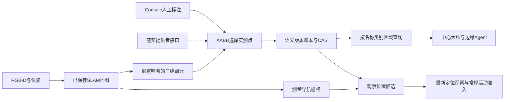

# 三维点云语义地图：标注、查询与观察位置规划

这项功能把已保存的 SLAM 点云变成可标注、可查询、可追溯的语义地图。地图中除了原有的“厨房导航点”，还可以表达“这一组测量点是操作台”“这个三维范围是待检查区域”，并查询某区域里登记了哪些物体。所有标签都保留人工或感知来源，不把几何形状直接解释为物体类别。

适用：注册 `RobotWorkflow`、具有有效地图包及标定的 Runtime，包括当前 Gazebo 路径。它复用现有三维点云和二维导航栅格；没有更换 SLAM 后端，也没有增加未经测量的自由空间。实现计划见[开发记录](../development/2026-10-13-semantic-cloud-plan.md)。

## 地图的三个层次

| 层 | 内容 | 权威与用途 |
| --- | --- | --- |
| 几何层 | XYZ/RGB 点云、栅格、SLAM 轨迹、关键帧 | 不可变地图包与 artifact 哈希；保存测量几何 |
| 语义层 | 物体/区域标签、点集合摘要、空间关系、来源与时间 | 机器人侧追加版本账本；支持标注、检索、歧义检查 |
| 执行层 | 定位、足迹净空、连通路径、动态障碍、动作后验证 | 现有 Runtime/导航/任务契约；语义标签不授予运动权限 |



“覆盖率”仅为已标注的已测点数量占 canonical cloud 点数的比例。未知空间、未看见的物体、房间功能识别准确率不包含在这个指标里。把全部点标成一个“区域”，也不代表机器人理解了整个环境。

## 操作步骤

1. 启用有效 SLAM 地图，在 Console 的地图页面选择相同的已保存地图。
2. 打开“点云语义标注”面板并读取机器人语义层。只有地图编号、几何版本和标定一致时才允许提交。
3. 通过两次双击点云选择三维包围盒，或填写地图坐标系中的最小/最大 XYZ；查看线框并精调范围。
4. 填写唯一名称、类别、物体或区域类型、证据来源与观测时间。点云采集时间和本次编辑时间是两回事；旧图中的物体不能因为今天编辑就声称今天观察到了它。
5. 保存到机器人。服务从真实 canonical cloud 重新选择点；空选区、非法范围、重名、错误版本会被拒绝。保存不移动机器人。
6. 查看点数、质心、实测范围、冲突及过期状态。多客户端同时编辑时，后提交者必须重新读取并人工处理冲突；界面不会自动覆盖或重放超时写入。

原有浏览器本地标记仍是阅读辅助。新面板保存到 Runtime 的 `semantic-cloud.sqlite`，因此 Agent 能查询，重启也能恢复。地图优化、续建或切换会改变地图身份，旧标签不会静默迁移到新图。

编辑已有记录保留其来源类型和置信度，修改名称不会把 `perception` 自动升级为 `operator`，也不会提高低置信度。新建人工标注默认使用 `operator` 与置信度1；这仍只是操作员声明，不是识别正确率。来源引用可显式修改，变更通过语义版本留档。

## 服务协议

服务通过现有 gRPC `ListServices/CallService` 动态发现；Console 复用 `GET /v1/robot/services` 与带操作员会话的 `POST /v1/robot/services`，无需新增传输协议。JSON 示例只展示业务参数；调用时还要使用当前 robotId、唯一 requestId 及既有认证。

| 服务 | 输入 | 输出与约束 |
| --- | --- | --- |
| `semantic.map` | 可选 `mapRevision` | 完整可编辑标注快照、版本、类别摘要、点覆盖率；GOAL 仅看到小型规划投影 |
| `semantic.query` | `name/category/kind/regionId`、可选 `includeStale/maxAgeMs`、`limit/offset/semanticRevision` | 有界记录；默认最多4条，按字节预算缩页，使用真实 `nextOffset` 续读 |
| `semantic.annotate` | `mapRevision`、`expectedSemanticRevision`、完整 `annotations` | CAS 替换本次集合，追加历史，不修改几何地图；删除是新集合中去掉对应项 |
| `semantic.history` | 可选 `mapRevision/limit` | 当前地图身份的最近版本摘要；结果过长时显式 `truncated` |
| `semantic.plan` | `mapRevision/semanticRevision/annotationId`、可选 `maxDistanceM` | 通过栅格足迹与连通路径检查的观察候选，最多4个；不执行动作 |

标注示例（坐标和时间必须来自你的地图与证据，不能照抄）：

```json
{
  "id": "inspection-table-1",
  "name": "待检查台面",
  "category": "table",
  "kind": "object",
  "aliases": ["检查台"],
  "bounds": {"min": [1.0, 2.0, 0.6], "max": [1.8, 2.8, 1.0]},
  "source": {"kind": "operator", "reference": "现场标注记录编号"},
  "confidence": 1.0,
  "observedAtUnixMs": 1791851086091
}
```

服务计算 `pointCount/centroid/measuredBounds/pointIndicesSha256`，不接受调用者伪造这些派生结果。包围盒包含边界点；索引摘要为 canonical cloud 顺序中被选点的升序 uint64 little-endian 字节 SHA-256。浏览器加载的粗 LOD 可以辅助选区，最终选择始终在 manifest 的 `artifacts.cloud` 上完成。不同 LOD 或重新生成的点云不可交换点索引。

`semantic.query` 返回空间范围、来源、几何摘要与时效；别名用于匹配，完整编辑字段从 `semantic.map` 读取。对象默认15分钟过期，过期对象只有 `includeStale:true` 才返回。区域默认无 TTL，但两者始终 `requiresReobservation:true`。未来时间拒绝，时钟回退时已有证据按时钟不一致处理。置信度是来源声明，不是系统标定过的识别正确概率。

## 多 Agent、云边一致性与冲突

每份语义版本绑定六元身份：`robotId/mapId/mapRevision/calibrationRevision/cloudSha256/frameId`。`semanticRevision` 是语义内容、父版本、身份和更新时间的哈希；语义变化不改变几何 `mapRevision`。SQLite `BEGIN IMMEDIATE` 与预期版本检查使两个并发写入者只能有一个基于旧版本成功。

边缘 Runtime 是这份账本的写入权威。中心大脑、边缘 Agent 和操作员可以通过现有服务共享相同身份与版本。云端只缓存有界摘要、版本及证据引用，需要细节时重新查询。离线写入不能默认为成功；恢复后需重新读取。跨机器人地图拼接、跨楼层坐标标定、分布式账本复制和 CRDT 自动合并均不在本轮实现范围内。

追加式是受支持 API 的写入行为。SHA 链可检测未重算摘要的内容破坏和链内缺口，但数据库管理员可以删除尾部或恢复旧备份；本地链没有数据库外的可信最新 head，不能提供防回滚保证。论文证据应另外归档语义 head 与实验 manifest；更高等级部署需要外部签名 checkpoint 或只写归档存储。

同类标注选择了相同点时，记录 `same_kind_point_overlap`，相关项 `ambiguous:true`；系统不按置信度自动选赢家。物体选中点全部落入某区域所选点时，生成 `within` 关系。这是**测量点集合包含关系**，不是语义推理或对完整物体边界的保证。`regionId` 查询通过该关系找成员。

提交前切图会拒绝写入。若切图恰好发生在数据库提交之后，返回 `committed:true, activeMapChanged:true`，说明已写入原地图的历史账本；不能谎报无副作用的拒绝。客户端应重新读取当前地图。进程内 requestId 回执与持久语义 CAS 是两层机制；跨重启或超时不要换新 requestId 盲目重放，应先查版本与历史。

## 观察候选与运动边界

`semantic.plan` 需要相同几何/语义版本及新鲜定位。过期物体、重叠歧义、低于0.5的来源置信度均拒绝；0.5只是工程准入阈值，不是统计校准。候选从标注质心周围有界采样，使用当前机器人的足迹半径、未知/占用栅格和完整路径检查。返回 world 坐标、worldFrameRevision、定位时间、路径长度与摘要，避免只给一个没有坐标身份的数字点。

该服务保留 `executionAuthorized:false`、`visibilityVerified:false`、`manipulationReachVerified:false`。点云质心不一定是空地或抓取点；连通也不表示无视线遮挡。无候选只表示本次有限采样没有得到合格位置。现有 `semantic.resolve` 与已认证导航目标保持独立；把任意新标注直接接入自动导航/抓取还需要候选执行契约、在线重识别与独立物理验收。

## 实现与资源预算

- `semantic_cloud.py`：点集合编译、关系、时效、追加版本与完整性校验。
- `semantic_cloud_services.py`：地图验证、服务契约、规划投影、候选路径与身份复核。
- `robot_workflow.py`：注册上述服务，复用机器人地图/标定生命周期。
- `web/semantic_map.js` 与 `web/src/map_viewer.js`：标注编辑、实测点选择、三维线框与 CAS 状态。
- Go GOAL 和 Console 使用已有动态服务接入；回归验证审批前只读、原始点云隔离和操作员认证。

每次最多128个标注、200万个点，canonical cloud 文件上限32MB；语义文档上限2MB。每个地图身份最多512个版本、累计64MiB，达到上限后明确拒绝新增版本并要求归档处理，不删除证据或自动覆盖。模型查询与历史响应按7,000字节预算裁剪，受 Go 8KiB规划视图上限进一步约束。原始点云不进入模型上下文。

点云哈希与标注计算不占用工作流的停止/租约锁；计算前后复核身份。实际解码的点云字节再次核对长度与 SHA，避免第一次校验后文件被替换。数据库连接有明确关闭边界，读取和写入都有容量限制。

## 后续扩展

感知提供者可提交与人工相同的标签契约及真实 evidence reference；下一步可以从 RGB-D 分割掩膜投影至地图，并保存关键帧/位姿图节点锚点，再在回环优化后重新融合。当前仅提供接口，没有内置或验收这种视觉模型。更大地图可扩展为体素/子地图索引；语义账本、查询和执行权限仍应独立。

真实设备部署还需相机内外参、时间同步、坐标系重启策略、底盘尺寸和动态物体更新的现场验收。本轮点云语义功能的测试不能替代这些实验。
