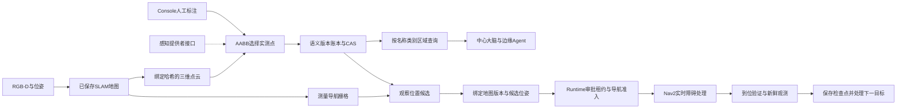

# 三维点云语义地图：从标注到长程导航与现场复核

架构位置：语义点云提供版本化查询和候选 grounding，任务规划可发生在原审批前能力入口，也可由 Local/Worker 的[共享目标 Host](../architecture/hierarchical-edge-objectives.md)在批准包络内完成。`semantic.plan` 仍是地面二维候选；SE3/地形几何导航属于独立[空间通道](../development/spatial-navigation.md)，三维标签本身不是飞行授权。

这项功能把已保存的 SLAM 点云变成可标注、可查询、可追溯的语义地图。地图中除了原有的“厨房导航点”，还可以表达“这一组测量点是操作台”“这个三维范围是待检查区域”，并查询某区域里登记了哪些物体。所有标签都保留人工或感知来源，不把几何形状直接解释为物体类别。

适用：注册 `RobotWorkflow`、具有有效地图包及标定的 Runtime。地图查询与执行能力分别声明；当前实现语义导航执行的是 Gazebo 家庭适配器，真实机器人尚未完成此闭环验收。系统复用现有三维点云和二维导航栅格，没有更换 SLAM 后端，也没有增加未经测量的自由空间。实现过程见[语义地图计划](../development/2026-10-13-semantic-cloud-plan.md)、[执行扩展计划](../development/2026-10-13-semantic-execution-plan.md)；跨组件契约见[语义执行协议](../architecture/semantic-execution-protocol.md)。

## 地图的三个层次

| 层 | 内容 | 权威与用途 |
| --- | --- | --- |
| 几何层 | XYZ/RGB 点云、栅格、SLAM 轨迹、关键帧 | 不可变地图包与 artifact 哈希；保存测量几何 |
| 语义层 | 物体/区域标签、点集合摘要、空间关系、来源与时间 | 机器人侧追加版本账本；支持标注、检索、歧义检查 |
| 执行层 | 定位、足迹净空、连通路径、动态障碍、动作后验证 | 现有 Runtime/导航/任务契约；语义标签不授予运动权限 |



“覆盖率”仅为已标注的已测点数量占 canonical cloud 点数的比例。未知空间、未看见的物体、房间功能识别准确率不包含在这个指标里。把全部点标成一个“区域”，也不代表机器人理解了整个环境。

## 操作步骤

1. 启用有效 SLAM 地图，在 Console 的地图页面选择相同的已保存地图。
2. 打开“点云语义标注”面板并读取机器人语义层。只有地图编号、几何版本和标定一致时才允许提交。
3. 通过两次双击点云选择三维包围盒，或填写地图坐标系中的最小/最大 XYZ；查看线框并精调范围。
4. 填写唯一名称、类别、物体或区域类型、证据来源与观测时间。点云采集时间和本次编辑时间是两回事；旧图中的物体不能因为今天编辑就声称今天观察到了它。
5. 保存到机器人。服务从真实 canonical cloud 重新选择点；空选区、非法范围、重名、错误版本会被拒绝。保存不移动机器人。
6. 查看点数、质心、实测范围、冲突及过期状态。多客户端同时编辑时，后提交者必须重新读取并人工处理冲突；界面不会自动覆盖或重放超时写入。

原有浏览器本地标记仍是阅读辅助。新面板保存到 Runtime 的 `semantic-cloud.sqlite`，因此 Agent 能查询，重启也能恢复。地图优化、续建或切换会改变地图身份，旧标签不会静默迁移到新图。

编辑已有记录保留其来源类型和置信度，修改名称不会把 `perception` 自动升级为 `operator`，也不会提高低置信度。新建人工标注默认使用 `operator` 与置信度1；这仍只是操作员声明，不是识别正确率。来源引用可显式修改，变更通过语义版本留档。

## 服务协议

服务通过现有 gRPC `ListServices/CallService` 动态发现；Console 复用 `GET /v1/robot/services` 与带操作员会话的 `POST /v1/robot/services`，无需新增传输协议。JSON 示例只展示业务参数；调用时还要使用当前 robotId、唯一 requestId 及既有认证。

| 服务 | 输入 | 输出与约束 |
| --- | --- | --- |
| `semantic.map` | 可选 `mapRevision` | 完整可编辑标注快照、版本、类别摘要、点覆盖率；GOAL 仅看到小型规划投影 |
| `semantic.query` | `name/category/kind/regionId`、可选 `includeStale/maxAgeMs`、`limit/offset/semanticRevision` | 有界记录；默认最多4条，按字节预算缩页，使用真实 `nextOffset` 续读 |
| `semantic.annotate` | `mapRevision`、`expectedSemanticRevision`、完整 `annotations` | CAS 替换本次集合，追加历史，不修改几何地图；删除是新集合中去掉对应项 |
| `semantic.history` | 可选 `mapRevision/limit` | 当前地图身份的最近版本摘要；结果过长时显式 `truncated` |
| `semantic.plan` | `mapRevision/semanticRevision/annotationId`、可选 `maxDistanceM/allowStaleSearch/verificationMode` | 通过栅格足迹与连通路径检查的观察候选，最多4个并受字节预算约束；支持执行的适配器附带签名绑定，调用本身不移动 |
| `semantic.observe` | `mapRevision/semanticRevision/annotationId`、可选 `requireMatch/notBeforeUnixMs` | 从机器人内部感知源复核标注，返回来源、同帧身份、唯一匹配与证据摘要；不接受客户端提交识别结果，不修改标注 |

标注示例（坐标和时间必须来自你的地图与证据，不能照抄）：

```json
{
  "id": "inspection-table-1",
  "name": "待检查台面",
  "category": "table",
  "kind": "object",
  "aliases": ["检查台"],
  "bounds": {"min": [1.0, 2.0, 0.6], "max": [1.8, 2.8, 1.0]},
  "source": {"kind": "operator", "reference": "现场标注记录编号"},
  "confidence": 1.0,
  "observedAtUnixMs": 1791851086091
}
```

服务计算 `pointCount/centroid/measuredBounds/pointIndicesSha256`，不接受调用者伪造这些派生结果。包围盒包含边界点；索引摘要为 canonical cloud 顺序中被选点的升序 uint64 little-endian 字节 SHA-256。浏览器加载的粗 LOD 可以辅助选区，最终选择始终在 manifest 的 `artifacts.cloud` 上完成。不同 LOD 或重新生成的点云不可交换点索引。

`semantic.query` 返回空间范围、来源、几何摘要与时效；别名用于匹配，完整编辑字段从 `semantic.map` 读取。对象默认15分钟过期，过期对象只有 `includeStale:true` 才返回。区域默认无 TTL，但两者始终 `requiresReobservation:true`。未来时间拒绝，时钟回退时已有证据按时钟不一致处理。置信度是来源声明，不是系统标定过的识别正确概率。

## 多 Agent、云边一致性与冲突

每份语义版本绑定六元身份：`robotId/mapId/mapRevision/calibrationRevision/cloudSha256/frameId`。`semanticRevision` 是语义内容、父版本、身份和更新时间的哈希；语义变化不改变几何 `mapRevision`。SQLite `BEGIN IMMEDIATE` 与预期版本检查使两个并发写入者只能有一个基于旧版本成功。

边缘 Runtime 是这份账本的写入权威。中心大脑、边缘 Agent 和操作员可以通过现有服务共享相同身份与版本。云端只缓存有界摘要、版本及证据引用，需要细节时重新查询。离线写入不能默认为成功；恢复后需重新读取。跨机器人地图拼接、跨楼层坐标标定、分布式账本复制和 CRDT 自动合并均不在本轮实现范围内。

追加式是受支持 API 的写入行为。SHA 链可检测未重算摘要的内容破坏和链内缺口，但数据库管理员可以删除尾部或恢复旧备份；本地链没有数据库外的可信最新 head，不能提供防回滚保证。论文证据应另外归档语义 head 与实验 manifest；更高等级部署需要外部签名 checkpoint 或只写归档存储。

同类标注选择了相同点时，记录 `same_kind_point_overlap`，相关项 `ambiguous:true`；系统不按置信度自动选赢家。物体选中点全部落入某区域所选点时，生成 `within` 关系。这是**测量点集合包含关系**，不是语义推理或对完整物体边界的保证。`regionId` 查询通过该关系找成员。

提交前切图会拒绝写入。若切图恰好发生在数据库提交之后，返回 `committed:true, activeMapChanged:true`，说明已写入原地图的历史账本；不能谎报无副作用的拒绝。客户端应重新读取当前地图。进程内 requestId 回执与持久语义 CAS 是两层机制；跨重启或超时不要换新 requestId 盲目重放，应先查版本与历史。

## 观察候选与运动边界

`semantic.plan` 需要相同几何/语义版本及新鲜定位。默认拒绝过期物体，也拒绝重叠歧义和低于0.5的来源置信度；0.5只是工程准入阈值，不是统计校准。候选从标注质心周围有界采样，使用当前机器人的足迹半径、未知/占用栅格和完整路径检查。返回 world 坐标、worldFrameRevision、定位时间、路径长度与摘要，避免只给一个没有坐标身份的数字点。

候选搜索共享一次不可变栅格快照、距离场和有界几何检查缓存。搜索完成后再次读取真实定位；若位置偏移不超过5厘米，且新旧起点之间的完整底盘扫掠区域安全，就把该连接加入路径并重算摘要。更大的偏移或不安全连接要求重新规划。响应前再次校验定位在1秒内、语义目标的实际时效及版本身份，不能把旧观测的时间戳改为当前时间。即使目标在计算期间刚好过期，也只有显式允许搜索旧位置时才能返回，且 `targetFresh:false`。

该服务保留 `executionAuthorized:false`、`visibilityVerified:false`、`manipulationReachVerified:false`。签名证明候选由当前机器人侧规划器生成，运动仍需要既有任务批准、安全配置、租约与资源权威。点云质心不一定是空地或抓取点；连通也不表示无视线遮挡。无候选只表示本次有限采样没有得到合格位置。现有 `semantic.resolve` 的已登记地点路径继续独立工作。

`allowStaleSearch:true` 表示“去旧位置寻找”，过期状态仍通过 `targetFresh:false` 返回。它不会更新 `observedAtUnixMs`，也不会证明物体仍在。时钟不一致仍拒绝。搜索模式要作为任务参数明确记录；希望确认物体存在时，还必须选择 `verificationMode:"object"`。

| 验证模式 | 可用目标 | 完成的含义 | 不证明什么 |
| --- | --- | --- | --- |
| `arrival` | 物体或区域 | 到达运行时选择的观察位，通过位置/朝向验证并取得新帧 | 不证明物体被识别，不证明已进入区域边界 |
| `object` | 有感知源的物体标注 | 满足到位条件，且新鲜 RGB-D 中有唯一类别与空间范围匹配 | 不证明任意开放词汇识别、实例永久身份或可抓取性 |

区域观察位可以位于区域外围。当前“巡检区域”应理解为到达其观察位；“进入指定三维区域”“检查房间全部角落”是不同完成条件，尚未由本接口实现。对象模式不能用于区域标签。

## 发起自然语言长程任务

先完成标注并使用地图中的明确名称。例如：

> 依次前往“北区观察点”和“东侧观察点”，每处取得新的观测，再次前往“北区观察点”。

负责本次能力规划的 GOAL 规划器在本次规划中调用 `semantic.query`，取得目标名称、ID、六元身份和同一 `semanticRevision`。规划器只接受这次真实成功查询的结果；不能自行添加目标、交换顺序、省略重复访问或填写导航坐标。当前首版要求目标名称在原句中明确出现。返回未持久化的原始起点尚不支持，应明确最后一个标注名称。

下面是 `robot.task` 的结构示例；四个64位摘要必须替换为同次查询的真实值，不能照抄。`request` 与 `semanticRoute` 恰选一个。一次路线最多16个目标，每项都显式写出距离、搜索策略和验证模式。

```json
{
  "semanticRoute": {
    "mapId": "scan-example",
    "mapRevision": "aaaaaaaaaaaaaaaaaaaaaaaaaaaaaaaaaaaaaaaaaaaaaaaaaaaaaaaaaaaaaaaa",
    "calibrationRevision": "bbbbbbbbbbbbbbbbbbbbbbbbbbbbbbbbbbbbbbbbbbbbbbbbbbbbbbbbbbbbbbbb",
    "cloudSha256": "cccccccccccccccccccccccccccccccccccccccccccccccccccccccccccccccc",
    "semanticRevision": "dddddddddddddddddddddddddddddddddddddddddddddddddddddddddddddddd",
    "targets": [
      {"annotationId": "north-observer", "name": "北区观察点", "maxDistanceM": 2.5, "allowStaleSearch": false, "verificationMode": "arrival"},
      {"annotationId": "east-observer", "name": "东侧观察点", "maxDistanceM": 2.5, "allowStaleSearch": false, "verificationMode": "arrival"},
      {"annotationId": "north-observer", "name": "北区观察点", "maxDistanceM": 2.5, "allowStaleSearch": false, "verificationMode": "arrival"}
    ]
  }
}
```

这个对象是 Agent 内部复合能力的输入，不是新增的 HTTP 端点；日常操作仍从 Console 的自然语言任务入口发起，并使用现有批准流程。

每个目标展开为一个顺序阶段。进入该阶段时，边缘 Agent 才读取新的 `semantic.plan`，核对机器人、地图、标定、点云、语义版本、world frame、定位时间和工作空间，从有效候选中选取一个。这样第二站使用的是第一站完成后的定位，而不是启动任务时一次性算出的整程坐标。

候选和目标身份先保存为 `SEMANTIC_GROUNDING_FROZEN`，然后进入现有任务图：`observe_scene → navigation.pre_position → navigation.navigate → verify_arrival`。对齐、导航和到位验证携带同一个不透明 `semanticBinding`；导航位姿必须逐值匹配运行时签发的候选。Gazebo 执行器继续使用测得栅格准入、Nav2、在线障碍层、租约和取消机制。其到位判据为平面误差不超过0.08米、朝向误差不超过0.15弧度，并要求新的捕获；对象模式再调用真实感知复核。

## 中断、恢复与回溯

运行期间改变地图、标定、语义版本、world frame、实际 `mapFromWorld` 锚定变换或机器人足迹，会使原绑定失效；没有允许旧位置搜索时，物体跨过时效也会停止该段。系统保存失败原因，不能因为另一个候选仍可达就自动把旧检查点移到新坐标。

同一任务修订的恢复读取原始冻结候选及 token，不重新采样后复用已经完成的步骤。如果冻结记录缺失而物理步骤已经开始，恢复被拒绝。运动结果未知时先对账；不能换命令ID重新发送。Runtime 的 HMAC 密钥只存在于当前进程，重启后旧 token 失效，需要显式对账和重新规划；持久命令 journal 对已经完成的原命令仍按原字节回放，不能将这种历史回放当作当前现场确认。

回溯时对齐三类证据：

- `SEMANTIC_GROUNDING_FROZEN`：用户要求、版本身份、该阶段的候选、token、定位时间及候选来源。
- `robot_state.map_route`：实际导航命令、目标位姿、地图准入、`semanticBindingSha256` 与 `semanticExecution`。
- `robot_state.semantic_verification`：到位验证命令、对应导航命令、相同 token 摘要及新捕获；对象模式附带 `observationEvidence`，其 `evidenceHash` 只覆盖这份嵌套感知结果。

新物理动作会清除旧的语义确认。Agent 和独立验收器核对命令、绑定和捕获身份；不能只看最后一条 `success`。详细字段、哈希规则和冲突处理见[交互协议](../architecture/semantic-execution-protocol.md)。

## 实现与资源预算

- `semantic_cloud.py`：点集合编译、关系、时效、追加版本与完整性校验。
- `semantic_cloud_services.py`：地图验证、服务契约、规划投影、候选路径、进程签名与执行身份复核。
- `semantic_cloud_observation.py`：真实感知源、同帧身份校验、类别/范围关联与有界证据。
- `gazebo_backend.py` 与 `contracts.py`：运动参数约束、执行中版本守卫、到位与物体确认回执。
- `robot_workflow.py`：注册上述服务，复用机器人地图/标定生命周期。
- `web/semantic_map.js` 与 `web/src/map_viewer.js`：标注编辑、实测点选择、三维线框与 CAS 状态。
- `internal/capabilityagent/semantic_route.go`、`edge/robotclient/semantic_cloud_route.go` 与 `edge/agent/semantic_grounding.go`：查询证据冻结、逐段规划和持久恢复绑定；复用已有云边任务通道。

每次最多128个标注、200万个点，canonical cloud 文件上限32MB；语义文档上限2MB。每个地图身份最多512个版本、累计64MiB，达到上限后明确拒绝新增版本并要求归档处理，不删除证据或自动覆盖。模型查询、历史和候选规划响应按7,000字节预算裁剪，受 Go 8KiB规划视图上限进一步约束。签名 token 最长2,048字符，加入 token 后可能少于4个候选。原始点云不进入模型上下文。

点云哈希与标注计算不占用工作流的停止/租约锁；计算前后复核身份。实际解码的点云字节再次核对长度与 SHA，避免第一次校验后文件被替换。数据库连接有明确关闭边界，读取和写入都有容量限制。

## 后续扩展

感知提供者可提交与人工相同的标签契约及真实 evidence reference；下一步可以从 RGB-D 分割掩膜投影至地图，并保存关键帧/位姿图节点锚点，再在回环优化后重新融合。当前仅提供接口，没有内置或验收这种视觉模型。更大地图可扩展为体素/子地图索引；语义账本、查询和执行权限仍应独立。

真实设备部署还需相机内外参、时间同步、坐标系重启策略、底盘尺寸和动态物体更新的现场验收。本轮点云语义功能的测试不能替代这些实验。

## 与完整三维导航的关系

本页 semantic.plan 仍生成经过二维占据/足迹/连通性校验的地面观察候选，签名执行绑定也沿该通道。最新 [空间建图](../development/spatial-mapping.md)与[地形/三维导航](../development/spatial-navigation.md)提供独立体素、完整定位与 ROS 2 路径合同；标签的三维选区不会自动获得三维自由空间或飞行可行性。

若要将新语义目标交给 UAV，先定义目标到空间部署的版本绑定及观察姿态合同，再以 volume3d 验证路径、设备 workspace 和实际完成证据。当前 11 段 UAV 实验使用规范地点目标和合成地图，没有验证开放词汇全图理解或任意点云标签自动飞行。
