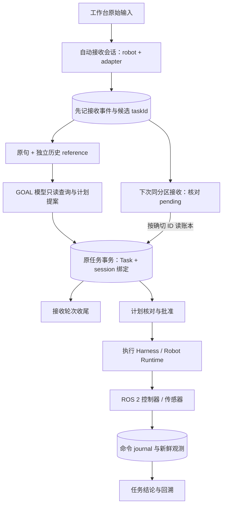

# 当前系统速读：从一句话到可追溯的机器人任务

核对源码：`27cbbbaf96e2d76e1a17a1ea1befc8a8d8db14ce`，日期 2026-11-02。本页帮助新人建立对象关系；接口字段见[API](../production/api-reference.md)，当前操作见[自动会话手册](../operations/automatic-edge-sessions.md)，深入学习见[教材 3.3.0](../../book/README.md)。

## 1. 一次本地请求发生什么

用户在工作台选择已连接的机器人，输入“读取当前整机标定状态”。前端仍提交原始 request 和 adapter。Local Agent 绑定经过 Runtime 核验的机器人身份，自动记录这次输入；用户无需创建 session。

pending 分支表示读取原 task 是否存在，不是再创建一次 task。一次 turn 结束只说明接收得到结论；机器人任务可能还没批准。没有配置 GOAL 模型时，旧规则解析仍只理解本轮原句，自动记账不会让它获得跨轮指代理解。

## 2. 六个经常混淆的对象

| 对象 | 谁维护 | 它回答什么 |
| --- | --- | --- |
| Console 访问 token | 控制台 | 请求能否访问当前本地操作入口 |
| Intake session / turn | Local Session Manager + SQLite | 哪台机器人收到了哪些输入，各轮关联哪些任务 |
| Task / revision | 任务服务和执行器 | 本次冻结目标、批准版本、步骤与状态是什么 |
| Command / journal | Runtime 与设备侧 | 某个动作是否接单、执行、取消或结果未知 |
| 模型上下文 | 本轮规划器的有界投影 | 本轮模型能看到哪些约束、事实和参考 |
| Recipe / KV cache | 本机规划经验库 / 模型供应商 | 可参考哪些旧计划 / 是否能复用前缀计算 |

历史可以帮助理解，但不能批准运动、证明传感器仍有效或将 UNKNOWN 改成成功。Task、command、会话和缓存的生命周期可以不同，不能靠一个“会话结束”按钮统一处理。

## 3. Local、Worker、Host 的实际分工

Local 是本地工作台与任务入口；Worker 接收云端批准目标、维护 claim/续租并回传结果；两者复用边缘 Host 的目标执行核心。自动接收会话目前接在 Local 的 `tasks.Create`，没有自动推广到云端 `/v1/objectives` 或 Worker，也没有把所有机器人合成一个全局聊天历史。共同协议见[分层目标架构](../architecture/hierarchical-edge-objectives.md)和[消息与上下文](../architecture/edge-agent-communication-and-context.md)。

设备侧继续以 ROS 2 Profile、能力合同和停止/观测接口支持 AGV、足式和 UAV。相同 Harness 表示复用检查与追溯机制；具体控制器、定位误差与停止能力仍按设备集成。地图、定位、导航分别有明确职责，见[空间导航](../development/spatial-navigation.md)。

## 4. 长历史和成本如何控制

自动会话每 30 分钟空闲或 32 轮轮换，近期保留八条；小投影最多 6000 UTF-8 字节，每条预览最多 512 字节。完整输入另有 source event，单条最多 8000 字节；至多八条原文引用经过原有 managed context 预算，长内容外置后按需读取。这些是字节限制，不是 token 保证。

Local 带会话参考时，旧 recipe 只作提示；没有会话的 Worker 精确复用仍须按原规则重验证。供应商 KV 缓存需要稳定前缀并以实际 usage 确认命中。记录真实 token、缺失 usage、延迟和任务结果，才能评价是否节省费用；见[模型成本指南](../production/model-cost-and-recipes.md)。

## 5. 出错后看哪一本账

| 现象 | 首先核对 | 处理入口 |
| --- | --- | --- |
| 任务创建响应丢失 | 任务列表、原始输入与 taskId | 先查询，旧 POST 创建无通用重发去重 |
| 会话留下 pending | 精确候选 taskId 与 TASK_CREATED 的绑定 | 下次同分区 Begin 查账；不会重放动作 |
| 用户输入“继续” | 确切任务、未决 command 与当前状态 | 进入任务恢复/对账；会话不猜测重复运动 |
| 地图显示正常却不能导航 | 新鲜定位与 Nav2 依赖状态 | 按[机器人工作流](../guides/robot-service-workflow.md)准备 |
| 一台机器人看到另一台的历史 | 本地绑定、adapter、数据目录、部署用户范围 | 当前为单操作员；多人隔离需要独立认证主体设计 |

源码阅读顺序：`cmd/local-agent/main.go` → `internal/agentsession/manager.go` → `tasks/creation_session.go` → `internal/capabilityagent/planner.go` → 原审批/执行路径。一次只追一条输入，再追一次中断恢复，比先阅读所有模块更容易建立全貌。

## 6. 怎样读实验结论

最新[会话软件验证](../experiments/2026-11-01-automatic-edge-sessions.md)用真实 HTTP/SQLite 和模型 fixture 检查关联与恢复；[家庭巡检续测](../experiments/2026-10-30-patrol-continuation.md)记录独立 Gazebo 中的失败、续建和卧室→卫生间→客厅成功路线。两组证据有各自源码身份，不能把旧物理任务成功当成新会话已通过现场验收。本轮文档出版不新增运动或真实模型性能数据。
