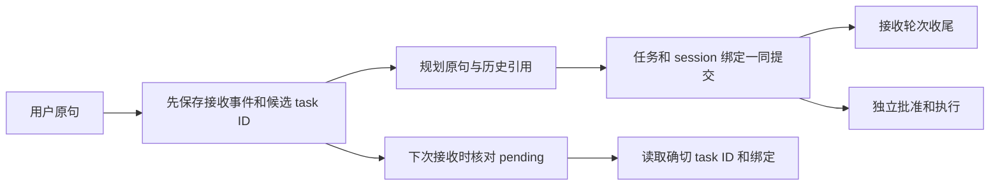

# 自动边缘会话：使用、部署与排障

核对：2026-11-02，源码 `27cbbbaf96e2d76e1a17a1ea1befc8a8d8db14ce`。适用新版 `cmd/local-agent` 的 `POST /v1/tasks` 自然语言任务入口。设计与开发过程见[实现记录](../development/2026-11-01-automatic-edge-sessions.md)，实际测试见[软件验证报告](../experiments/2026-11-01-automatic-edge-sessions.md)。

## 1. 用户直接输入任务

在工作台输入完整目标，查看草案并按原流程批准。客户端继续发送 `request/adapter`，无需建立、选择或传入 session ID。系统按当前已核验的机器人和规范化 adapter 记录会话、输入轮次及任务关联。

例如先提交“读取当前整机标定状态”，之后提交“重新读取当前整机标定状态，检查相机标定是否仍有效”。第二个任务拥有新的 task/turn 身份，GOAL 模型可看到近期请求和读取时的任务状态；本次条件仍需重新查询。会话关联并不继承第一次任务的批准或观测结果。

以下四种对象分别管理：

| 对象 | 使用者需要知道的含义 |
| --- | --- |
| 控制台 token / `console-session` 文件 | 本地写请求与工作空间代理的访问凭据；不是聊天历史，也不提供多用户身份 |
| Intake session / turn | 系统收到过哪些目标、它们关联哪些任务；接收结束不表示机器人执行完成 |
| Task / revision / command | 原始目标、批准、版本、动作与结果的权威记录 |
| 模型上下文 / KV cache | 本次推理的有界视图，以及推理服务可能提供的前缀计算复用 |

当前部署面向本地单操作员。多人共用同一 Local Agent 时，会共享该机器人分区内的近期输入；它尚不是具有租户、用户和渠道隔离的聊天服务。浏览器重启或控制台 token 轮换不会清空 SQLite 中的接收历史。

## 2. 哪些入口拥有自动历史

| 入口 | 当前行为 |
| --- | --- |
| Local 工作台、Local `POST /v1/tasks` | 自动建立接收会话；GOAL 模型使用独立历史引用 |
| 其他通过该 Local Task Service.Create 的兼容入口 | 使用同一自动接收与任务绑定机制，仍保留各入口自己的参数及审批规则 |
| Local/Fleet `POST /v1/objectives` | 原有粗目标合同、幂等键、批准包络与 Host 检查点；未由本轮会话层接管 |
| Fleet/Worker 云边目标执行 | 继续使用父目标、claim、revision、子计划与预算；没有自动继承本地接收会话 |
| 无 GOAL 模型的离线规则解析 | 记录会话，但只解析当前原句，不因此获得跨轮指代理解能力 |

新建任务时仍应说清目标。纯“继续”“重试”“再来一次”等已列明短语返回 422 澄清，不创建新 turn/task。要恢复已有任务，进入确切任务记录，使用安全暂停、继续或结果对账入口。更复杂的自然语言歧义仍受规划和验证约束，这个短语检查并不识别所有歧义。

## 3. 历史预算和任务经验

当前参数固定在代码中，没有会话管理面板或运行时配置开关：

| 项目 | 上限或规则 |
| --- | --- |
| 会话轮换 | 下次接收时，距最后活动满 30 分钟，或已接收 32 轮，分配新 session |
| 近期历史 | 最多 8 轮；单条请求/错误预览最多 512 UTF-8 字节 |
| 历史摘要投影 | 最多 6000 UTF-8 字节；必要时丢弃较旧投影并标明省略数 |
| 当前原始请求 | 非空、有效 UTF-8，最多 8000 字节；adapter 规范化后最多 128 字节 |
| 历史原文 | 保存于源事件，至多回取 8 条近期原文，核对源事件版本、身份及 SHA256 |

历史作为独立 reference 进入 GOAL 规划，不拼入本轮原句。长内容经既有 `ProjectManaged` 外置后，由 `context_read` 在本次捕获的归档集合内分页读取；模型不能任意读取其他机器人或文件系统。6000/8000 是字节数，模型请求仍受独立的上下文、整请求和输出预算限制。

会话轮换不取消正在执行的任务，不删除旧事件，也不自动召回旧 session。近期模型视图有界，磁盘审计历史仍需容量、备份与保留管理。

默认 Local 会话会向规划提供非空参考，因此即使 `AGENT_GOAL_RECIPE_MODE=validated`，该路径的精确 recipe 也只提供提示，不能按同一句文字直接跳过 GOAL 模型。未接入会话的 Worker 等路径仍可按原条件重验证精确经验。会话、规划经验和 KV 缓存分别处理输入关联、候选复用和计算复用；本轮升级不保证降低真实 token 或费用，计量方式见[成本与任务经验](../production/model-cost-and-recipes.md)。

## 4. 创建中断与重启

| 中断或结果 | 当前处理 | 操作员怎么做 |
| --- | --- | --- |
| 接收事件提交失败 | 不开始规划 | 检查磁盘、权限和 SQLite 故障；保留原输入 |
| 接收已存，任务尚未保存 | 下次接收时按候选 task ID 查账，标记 interrupted | 查询任务记录，确认没有对应任务后明确提交新目标 |
| 任务已存，会话未收尾 | 下次接收核对 `TASK_CREATED` 的绑定，恢复 task_created 关联 | 使用已有 task；不要因为缺少响应就盲目重发 |
| 任务已形成，会话收尾写入失败 | 仍返回已创建任务，保留 pending 供下次查账 | 保留返回的 task ID，检查持久层健康 |
| task ID、robot、adapter、历史原文或摘要不一致 | 停止新一轮规划 | 保存数据库和日志，调查来源与配置；不手工补摘要掩盖冲突 |
| 任务有 UNKNOWN 物理结果 | 会话层不改变它 | 先核对 Runtime journal 与现场结果，再走原任务 reconcile/resume |

恢复发生在该 robot/adapter 下一次接收输入时，不能把“重启后关联可恢复”解释成后台自动恢复所有任务。系统不会因缺少任务记录而补发动作。

当前 `POST /v1/tasks` **没有外部创建幂等键**。HTTP 响应丢失后重新提交相同全文，仍可能产生新的 turn 和 task。会话内部事件的幂等身份只防同一内部事件重复提交；它不能识别两个外部 POST 是否为同一次操作。相同句子也可能是用户明确要求的新一轮巡检，因此不能靠文本相似度去重。

## 5. 部署、升级与回滚

1. 每台机器人使用独立数据目录、Runtime 身份和控制端。备份原 `agent.db`、Runtime journal、合同绑定及相应地图/标定，保留未决任务。
2. 正常停止原 Local Agent，确认当前任务、持物和停止状态后启动新版。旧二进制不检查新的目录锁，升级时必须先停旧版；不要同时开两个进程来验证锁。
3. 新版启动先取得数据目录的 `.agent-owner.lock`，再打开本地状态与 Runtime 客户端；核验 Runtime 身份后仍取得原有 Runtime 地址控制锁。
4. 使用原数据目录启动即可，接收会话复用已有 SQLite aggregate/event 表，不需要 MySQL、Redis 等新中间件或单独迁移命令。旧任务不会被推断导入聊天会话，新输入开始自动记账。
5. 回滚也先停止新版，保留全部账本与证据；旧版没有新增会话机制和目录锁保证，不能将其作为绕开错误或未知动作结果的手段。

锁文件留在目录内属于正常情况，进程退出时释放所有权。出现 `agent data directory already has an owner`，先确认目录和仍在运行的进程，按正常服务流程停止冲突所有者；不要删除 `.agent-owner.lock`。该锁是本机文件锁，不是网络共享盘上的多节点租约或跨主机共识。Runtime 不同地址别名、跨主机控制者唯一性仍由部署方案保证。

多机器人工作空间代理的 `sessionFile` 继续读取控制台凭据，不是本页的会话文件。设备切换、凭据更新和隔离见[工作空间部署](edge-robot-workspaces.md)。

## 6. 回溯与取证

先从工作台任务记录或 `GET /v1/tasks/{id}` 查原始 `request`、当前状态和 `TASK_CREATED.payload.session`，再关联 sessionId、turnId、taskId、robotId、adapter、sequence、context/contextSHA256。它是接收时的不可变绑定；任务状态继续从当前任务账本读取。字段说明见[数据契约](../production/data-contracts.md#自动接收会话与任务绑定)。

接收聚合另外保存 `SESSION_TURN_RECEIVED`、`SESSION_TURN_ENDED` 和 `SESSION_TURN_RECOVERED`；没有公开的 `/v1/sessions` 管理或跨会话搜索 API。规划失败可以有接收事件而没有 task。研发取证应使用受控数据库备份与已有失败规划记录，不能把未保存任务等同于输入从未到达。

原始输入、模型请求归档和历史参考可能含业务敏感内容。分享故障材料时保留必要身份、时间、版本及哈希，移除控制台 token、模型密钥、设备凭据和无关用户文本。现有验证使用本地模型和机器人 fixture，只支持数据流、恢复与拒绝规则结论；公网模型、物理导航和真实硬件分别验收。
