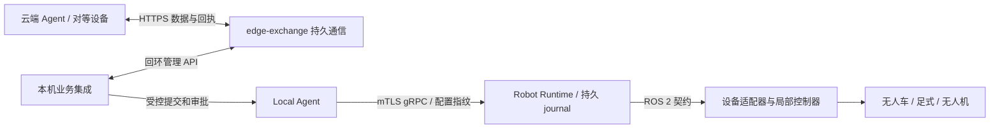

# 边缘 Agent 实机测试部署

2026-10-15 目标委托增量：[统一边缘核心与合同](../architecture/hierarchical-edge-objectives.md)、[新 API 与模型配置](../guides/delegated-edge-goals.md)允许 Worker 在父目标授权内规划；新增 goal/child SQLite 聚合必须随原执行库保留和备份。设备目录变化、待定动作和失效租约仍停止对账。新版功能测试不替代本页要求的现场停止和设备验证。

2026-10-14 空间导航增量：可选 `spatialNavigationPath` 启用[三维/地形路径准入](../development/spatial-navigation.md)，[ROS 2 空间建图入口](../development/spatial-mapping.md)保存外部已注册测量。升级需两端重建 `tangying_robot_msgs`，控制器声明完全相同的空间部署摘要并执行路径协议。新地图、定位源或策略改变目录指纹，按本页第 3 节保留历史并重新准入；不要替换旧任务的地图后直接续跑。

仿真迁移说明：MuJoCo 任务目录改为 `<artifacts>/mujoco/agents/<scene>/<perception>/seed-<seed>`，避免 RGB-D 和 ground-truth 共用 Runtime 指纹。旧 `<artifacts>/local-agent` 保留供回溯，不自动迁移或清空；同模式重启复用同一新目录。真实设备的数据目录与准入规则未放宽。

核对日期：2026-10-13。本页针对无人车、足式机器人、无人机均使用 ROS 2 的设备侧集成。当前交付是软件测试候选版，具体设备的驱动、控制器、感知和现场停止试验仍须绑定真实型号完成。完整变更与本轮证据见[实施记录](../development/2026-10-13-edge-field-candidate.md)。

## 1. 建议部署与责任

优先使用单机 Local Agent：批准计划、分段执行、任务历史、上下文和恢复都在设备侧。模型可部署于本机；配置成云端推理的阶段仍依赖云端可达，不能声称完全离线。Fleet Worker 是云端拥有派发权时的另一种入口，不与 Local Agent 同时控制一台 Runtime。



通信进程没有 Runtime 控制连接。收件箱数据不会自动覆盖任务、地图、世界状态或审批。本机业务集成必须核对来源、时效、任务版本及坐标依据，再通过已有任务 API 提交；无人值守业务若要自动审批，需要另行限定策略和现场验证，不能让 `mission_status` 自报完成代替观测。

| 状态 | 权威组件 | 重启与失联行为 |
| --- | --- | --- |
| 已批准计划、步骤、上下文与证据 | Local SQLite / 不可变任务版本 | 从持久事实重建；未知物理结果先对账 |
| 已派发命令、结果和安全锁存 | Runtime journal + 设备控制器 | 不靠 Agent 重启解除锁存，不重放未知动作 |
| 接口、型号、限幅、安全策略 | Profile + 目录指纹 + Agent 准入文件 | 不一致拒绝执行，重新调试和批准 |
| 对等 Agent 与云端数据 | exchange inbox/outbox | 原信封重传，重复确认；过期/冲突拒绝 |
| 低层姿态、步态、驱动制动、失联动作 | ROS 2 设备适配器 / 飞控 / 控制器 | 必须独立于 Agent 网络和模型运行 |

## 2. 构建与安装

```bash
make build fleet-build
make edge-orin-build
./bin/local-agent --config /path/to/edge.env --check-config
./bin/edge-exchange --config /path/to/exchange.json --check-config
```

`--check-config` 不接触电机，也不证明实时传感器和停止链路已就绪。`edge-orin-build` 只交叉编译 Linux ARM64；目标板的性能、ROS 驱动和模型内存仍须实测。原有 `tangying-orin-local-agent.service` 使用 `/var/lib/tangying-robot-agent-os/edge`。使用 Fleet 时选择 `tangying-orin-edge-worker.service`，不得同时开启两个派发者。

可选通信服务配置与 systemd 文件位于 `deploy/edge-orin/`。每个远端 Agent 使用独立收发凭据，管理接口只绑定 `127.0.0.1` 或 `::1`，密钥由服务用户读取、权限 0600。生产远端收件接口要求 TLS；显式回环 HTTP 仅供开发测试。原始点云/视频不要塞入 64 KiB 数据载荷，传递有身份和摘要的引用，由独立数据通道访问。

容器镜像支持 `edge`、`worker`、`exchange` 三种设备侧角色。使用 `deploy/edge-orin/compose.yaml --profile edge --profile exchange` 时，准备 `edge.env`、`exchange.json` 与 `exchange-secrets/`，将 exchange 的 `database` 配置为 `/var/lib/tangying-agent/exchange.db`；其凭据路径需映射到容器挂载路径，0600 文件所有者须匹配容器 UID 65534。两个状态卷各自持久保存。Fleet 容器显式覆盖 systemd 示例中的数据库/指纹路径，沿用原 `/var/lib/tangying-agent/fleet-execution.db`，避免升级时意外新建空 journal。

## 3. 首次准入与升级

Local Agent 在 `--data-dir/runtime-contract.json` 持久保存 `edge.runtime-pin.v1`；Fleet 默认为 `EDGE_EXECUTION_DB.runtime-contract.json`，可通过 `EDGE_RUNTIME_CONTRACT_FILE` 指定绝对路径。

记录包含 robot/adapter/version、协议版本、目录 revision、完整 Profile 摘要、能力描述摘要与安全 profile。临时 READY、离线和 capability blockers 不改变指纹。首次有效连接创建已刷盘记录，后续连接、重启、动作和注册服务调用核验一致性；目录变化不会自动更新该记录。独立 emergency stop 通道保持可用，但是否达到安全姿态必须由设备侧证据判断。

首次自动记录只表示建立软件信任基线，不能证明以前的任务已对账。已有非空执行数据库却缺少准入文件时，正常启动拒绝自动建立新基线（包括从旧版本迁移和误丢文件）。先停派发，备份任务库、Runtime journal、标定、地图、配置和准入文件；核查所有未决动作。新的完整 Profile 目录指纹会使旧批准的目录失效，必须重新核对并批准。若硬件/软件/配置确实要变更，保留旧指纹作为历史附件，完成对账与现场检查后建立新准入记录；不能通过清空状态解决拒绝。未决动作不清除。

完成对账后，用原服务的配置和数据目录执行 `local-agent --config /path/to/edge.env --data-dir /path/to/edge-state --admit-runtime-contract`；Fleet 使用原环境运行 `edge-worker --admit-runtime-contract`。这两个命令只查询 Runtime 并记录缺失指纹后退出，不领取任务、不执行动作、不覆盖已有指纹，也不修改历史或解除 Runtime 锁存。整个状态目录都丢失无法仅靠本地软件识别为新站点，恢复必须使用完整备份并与设备侧 journal 核对。

同一设备的 Local/Fleet 切换应使用一致的控制锁目录和 Runtime 身份，先停止旧派发者、检查 journal，再启动新派发者。这一文件锁只协调同一主机；跨主机控制权仍依赖 Runtime 的 lease/fencing 与部署隔离。

## 4. ROS 2 异构接入

按[异构运动契约](../development/heterogeneous-mobility.md)选择 `examples/robots/` 中 UGV/UAV/legged Profile 模板，替换机器人、传感器、标定、安全策略与限幅。模板仅描述接口，不会把任何设备自动置为 armed。

车和足式机器人的平面任务可接已有导航栈；足式机身稳定、步态和地形风险由局部控制器负责。无人机使用专属 3D 目标与飞控桥接，不把已有二维 SLAM/Nav2 执行链直接用于飞行。ROS 的四元数 xyzw 与 Agent 的 wxyz、ENU/NED/机体坐标必须由适配器显式转换并验证标定。控制器还必须实际执行 Profile 里的速度/范围限制；声明字段本身不是限速器。

同一 `emergency_stop` 软件入口调用的是已登记的设备安全过程。地面车可制动或保持；足式应保持平衡或执行厂商过程；飞行器由飞控执行经过调试的受控降落/厂商失联过程。不能将发布零速度或断电等同于所有设备的安全停止，也不能把“收到停止请求”写成“已经落地”。

## 5. 长程任务与云端对接

一条长任务保留同一任务 ID，并按批准的不可变版本执行有界阶段。完成记录可以跳过已验证历史步骤；动作结果未知必须阻断。恢复诊断只读、有限重试；地图、标定、目标或 Profile 改变时重新校验，不能靠压缩摘要消除冲突。模型上下文仍使用现有热状态/冷归档及预算，不复制跨域聊天作为第二份任务真相。

给云端同事的接口分两类：

- 数据：遵循[边缘数据交换协议](../development/edge-data-exchange.md)，明确 ACK 是“已持久接收”，不表示消费、任务完成或执行许可。接收后仍需业务级证据校验。
- 执行：如采用 Fleet，继续使用 `execution.context.v1`、claim/fence 与 v2 completion/outbox。不能用数据消息绕过它们。Redis 通知由边缘落盘后 XACK；HTTP 当前领取 API 缺少可重放 delivery receipt，响应到本地落盘之间的崩溃窗口仍需云端协议补齐。本次边缘 journal 保护落盘后的重连与重启。

现场依次做：无动作连接与传感器/坐标验证；低速受限单动作；暂停恢复；动作超时/未知结果；断网/重启/证书失效；有限长程任务；长稳运行。每次记录真实软件提交、Profile/目录/标定/地图、task/command ID、原始结果、停止响应和失败原因。当前软件证据及未测项见实施记录，不把模板、模拟控制器或仿真次数计入真实试验。
