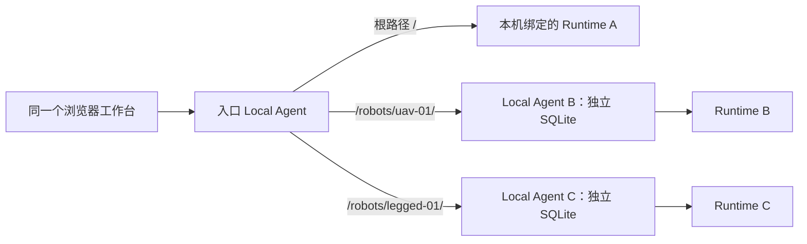

# 边缘机器人工作空间：切换、回溯与部署

更新：2026-10-20。对应[实现与验证记录](../development/2026-10-20-edge-robot-workspaces.md)。先按[Local 安装](../install/local.md)运行一台机器人，再按本页添加其他边缘 Agent。Agent 间的任务合同、通信与模型上下文另见[消息与 Harness 专题](../architecture/edge-agent-communication-and-context.md)。

## 1. 切换的是工作空间

一个 Local Agent 进程始终绑定一个 Robot Runtime，拥有自己的数据目录和任务执行权。工作台顶部的机器人选择器只切换查看和操作的目标，选择后的任务、实时状态、相机、地图、事件与历史都请求该机器人的 Agent。切换不会暂停、取消、迁移或重启另一台机器人的任务；离开的页面也不会成为任务执行器。



根路径 `/` 表示入口进程自己控制的机器人；`/robots/<id>/` 中的 `id` 是运维配置的工作空间别名，真正的设备身份是 `robotId`。别名不能替代 Runtime 身份。当前入口仍是一个完整 Local Agent，启动前必须连接并核对自己的 Runtime；尚未提供无需绑定机器人的独立聚合服务器。其他机器人可以离线注册，待其 Agent 恢复后再进入工作空间。

同一 Runtime 继续遵守 Local Agent 与 Fleet Worker 的单控制端规则。AGV、足式、无人机可以使用相同工作台与任务协议，实际工具、运动约束、观测和安全能力由各自的 Runtime/ROS 2 Profile 提供，页面切换不改变设备适配能力。

## 2. 每台机器人单独运行

为每台机器人准备独立的 `--data-dir`、监听地址、Runtime 地址、设备证书与配置。每个目录保存自己的 `agent.db`、Runtime 合同绑定、检查点以及 `console-session`。不要把一个已经有任务历史的目录改接另一台机器人，也不要让多个进程共写同一目录。

明确配置 `LOCAL_ROBOT_ID` 或 `--robot-id`，并与 Runtime 返回的身份一致。启动会核对 Runtime 身份和持久合同，身份冲突时拒绝启动；运行中的请求也携带绑定身份。默认 `robot-local` 是兼容入口，启动后仍会绑定实际 Runtime 身份，多机器人部署应使用明确的设备 ID。

以下是已有配置及设备证书之后的启动形状；路径仅为示例，需在实际主机上准备对应文件：

```bash
go build -o bin/local-agent ./cmd/local-agent

TANGYING_MAP_ROOT=/srv/tangying/agv-01/maps \
TANGYING_CALIBRATION_STATUS=/srv/tangying/agv-01/calibration/session.status.json \
TANGYING_CALIBRATION_DOCUMENT=/srv/tangying/agv-01/calibration/calibration.json \
TANGYING_INCIDENT_DIR=/srv/tangying/agv-01/incidents \
./bin/local-agent \
  --config /srv/tangying/agv-01/local.env \
  --data-dir /srv/tangying/agv-01/agent \
  --robot-id agv-01 \
  --listen 127.0.0.1:8787 \
  --workspaces-file /srv/tangying/workbench/workspaces.json
```

`local.env` 提供该设备的 `ROBOT_ADDRESS`、TLS 配置与可选模型配置。上述 `TANGYING_*` 路径是**进程环境变量**，由 shell、systemd/launchd 或容器环境传入；只写进 Local Agent 的配置文件不会自动成为这些模块的进程环境。Runtime/地图生产端也必须写入相同的设备专属目录或正确挂载的数据卷。

| 本机产物 | 隔离要求 |
| --- | --- |
| `TANGYING_MAP_ROOT` | 每台机器人独立目录；地图 manifest 的 `robotId` 必须匹配。列表和直接制品读取均排除外机或无身份地图 |
| `TANGYING_CALIBRATION_STATUS`、`TANGYING_CALIBRATION_DOCUMENT` | 文件须声明匹配的 `robotId`；缺失或外机身份返回不可用。生产配置有 Runtime 标定服务时，标定文档优先从已绑定服务读取 |
| `TANGYING_INCIDENT_DIR` | 指向该机器人的事故记录目录，保持记录来源和 Runtime/任务身份一致 |
| `--data-dir` | 独立 SQLite、任务观测、合同绑定和会话，不靠浏览器筛选来隔离数据 |

旧产物缺少身份时保留原文件，重新核对来源后按该设备流程重新导出。不要只补一个 `robotId` 来把他机地图或标定变成当前机器人可用的依据。

## 3. 注册其他边缘 Agent

入口进程支持 `--workspaces-file`，也可在配置或进程环境设置 `LOCAL_WORKSPACES_FILE`。注册表是管理员提供的静态 JSON；修改后按正常升级流程重启入口进程。浏览器不能写注册表、指定任意上游地址或读取会话文件。

```json
{
  "schemaVersion": "edge.workspaces.v1",
  "workspaces": [
    {
      "id": "uav-01",
      "label": "无人机 · 测试场",
      "robotId": "uav-01",
      "url": "http://127.0.0.1:18788",
      "sessionFile": "/srv/tangying/workbench/credentials/uav-01.console-session"
    },
    {
      "id": "legged-01",
      "label": "足式 · 实验室",
      "robotId": "legged-01",
      "url": "https://legged-agent.example.org",
      "sessionFile": "/srv/tangying/workbench/credentials/legged-01.console-session"
    }
  ]
}
```

配置限制：文件不超过 64 KiB，最多 32 个远端；`id` 采用小写字母开头、字母/数字/短横线且长度不超过 48，`local` 保留；别名、设备 ID 和上游地址必须分别唯一，远端设备 ID 不能与入口自己的 Runtime 重复。URL 只能是 HTTP(S) origin，不含用户名密码、路径、查询参数或片段。

`sessionFile` 是**入口服务器可读取的绝对、规范化路径**，内容是对应远端 Agent 当前 `<data-dir>/console-session` 的单个令牌。它不是 JSON，也不是浏览器上传文件。文件必须为无组/其他用户权限的普通文件（建议 `0600`），不能是符号链接、管道或目录，不超过 4096 字节。同机部署可直接引用远端私有文件；跨机部署通过现有安全运维通道同步到入口私有目录。远端重启会轮换令牌，入口每次请求重新读取文件，更新后无需重启入口。

HTTP 仅接受字面量 loopback IP，例如 `127.0.0.1` 或 `[::1]`；`localhost` 和普通局域网明文 HTTP 不被接受。远端可先经 SSH 隧道映射到 loopback；直接 HTTPS 使用正常 CA 和主机名校验，不提供跳过证书校验选项，也不使用环境代理转发凭据。HTTPS 反向代理前的访问认证与授权由部署方提供。

所有参与切换的 Agent 必须升级到支持 `/v1/workspace` 身份接口和 `X-Tangying-Robot-ID` 校验的版本。旧 Agent、身份错误或端口被另一设备复用都会明确失败，不退回本机机器人。

## 4. 消息、会话与身份怎样走

| 接口或字段 | 内容与边界 |
| --- | --- |
| `GET /v1/workspaces` | 返回 `edge.workspaces.v1`、`currentId` 及 `id/label/robotId/href`；不返回上游地址、服务器文件路径或令牌 |
| `GET /v1/workspace` | 当前 Local Agent 的 `edge.workspace.v1`、已绑定 `robotId`；Agent 已启动后，即使 Runtime 暂时断开仍能说明自己是谁 |
| `/robots/<id>/v1/...` | 入口选择已注册 Agent，转发该作用域的现有 API；任务、观测、地图、服务和 WebSocket 均保留此作用域 |
| `X-Tangying-Robot-ID` | 每次读写的预期设备 ID；上游不匹配直接拒绝，防止预检之后端点换机导致误写 |
| `X-Tangying-Session` | 非浏览器客户端的会话守卫；入口替换为目标 Agent 的令牌，不转发浏览器提供的上游凭据 |

一次远端请求顺序为：入口检查自己的会话和同源要求 → 无凭据访问远端身份接口（3 秒超时）→ 核对 schema 和设备 ID → 读取私有会话文件 → 携带目标身份与目标会话转发请求。原浏览器 Cookie 和任意附加认证头不会透传。上游重定向、Cookie 和可执行网页内容不会被植入入口工作台，静态页面始终由入口版本提供。

跨工作空间的读取和 WebSocket 也经过入口会话守卫。浏览器 Cookie 名按 host 与 port 区分，避免同一主机不同端口的 Agent 覆盖会话；服务端仍核对 token 和 Origin。这个机制证明请求来自加载过该 Console 的客户端，**没有提供用户账户、角色权限或多租户认证**。公网访问仍需独立认证入口；设备 ID 校验也不能替代 TLS 和部署信任。

配对必须在目标 Agent 的直接管理入口完成；远端作用域拒绝 `POST /v1/robots/pair`。切换机器人不会改变现有任务批准、恢复审查或急停语义。

## 5. 回溯与上下文隔离

切换使用整页导航，销毁上一页的轮询、WebSocket 与待处理界面回调，避免 A 的迟到响应出现在 B 的页面。返回某机器人时可恢复该浏览器会话中最后查看的任务；任务 ID 相同也不会跨机器人读取另一份历史。

任务与 World WebSocket 会监听连接关闭，及时结束旧页面对应的服务端轮询/订阅。工作空间身份初始化完成后会重新进入当前标定或建图页，写操作始终等待身份确认，异步路由校验阻止重复轮询；这些清理只释放观察页面资源，不取消 Agent 的任务执行。

| 信息 | 保存与切换行为 |
| --- | --- |
| 当前任务、步骤、事件、观测 | 来自目标 Agent 的持久 SQLite 与现有证据接口，原有时间、命令与任务因果关系保留 |
| 模型上下文与执行检查点 | 留在各自 Agent/Host；工作台不拼接、迁移模型记忆，也不授予另一台机器人继续执行的权限 |
| 最近查看任务、地图手工标记等本地状态 | 按工作空间路径及设备 ID 分区；不会把 A 的任务选择或地图编辑状态恢复到 B |
| 操作前安全确认 | 切换后重新确认当前设备，不能沿用另一机器人的页面确认状态 |
| 实时状态与历史观测 | 界面区分当前连接检查和过去采集证据；旧观测不会因回放而获得新时间戳 |

“Agent 已连接”说明任务服务可达；“Runtime 已连接”说明本次运行时查询成功，相机可用性单独显示。能否动作仍取决于观测新鲜度、地图/标定、能力目录、租约、安全门禁及 Harness 校验。`/healthz` 仅表示进程存活。

回溯页面同时检查任务状态与执行记录。标为 `SUCCEEDED` 但没有工具步骤的任务会提示 `SUCCESS_WITHOUT_EXECUTION_HISTORY`，说明无法据此确认执行证据完整；不把数据库中的成功状态自动当成完整证据链，也不会由界面擅自改写任务状态。

已运行的 Agent 在 Runtime 断开时仍可提供自己的任务历史。整个 Agent 离线时入口没有复制它的数据库，不能在线读取其历史；需恢复该 Agent 或按备份流程离线审计。Agent 重新启动仍需先通过 Runtime 身份验证。当前回溯基于任务、事件和已留存观测，**没有新增全天候原始传感器/视频录制器**；论文实验仍需按[实验保留规则](artifact-retention.md)单独采集原始数据。

## 6. 常见情况与扩展边界

| 情况 | 处理 |
| --- | --- |
| 只能看到一个工作空间 | 检查入口 `LOCAL_WORKSPACES_FILE`/启动参数；其他机器人应先各自部署 Local Agent |
| `WORKSPACE_UNAVAILABLE` | 检查目标 Agent、隧道/TLS 和配置地址；保留该设备选择，不转向其他设备 |
| `WORKSPACE_IDENTITY_MISMATCH` | 核对注册 `robotId`、Runtime 合同及端口归属；不能通过换个令牌绕过 |
| `WORKSPACE_SESSION_UNAVAILABLE` 或远端 401 | 检查当前会话文件内容、私有权限、路径和远端重启后的令牌更新 |
| 地图或标定不可用 | 检查每个进程的产物路径及产物 `robotId`，不能把其他设备的就绪状态借用过来 |

新增机器人主要是增加独立设备部署和注册项，不增加 UI 中按型号分叉的控制逻辑。跨机器人合作继续使用已有目标合同和 `edge-exchange`；工作空间选择器不是任务分配器、消息总线或统一地图对齐服务。当前静态注册表、单入口代理和逐请求身份预检适用于受控边缘集成；大规模设备发现、多用户授权、中心只读历史副本和独立无 Runtime 聚合服务是后续独立扩展点。

## 7. 复现界面验收

在仓库根目录运行以下程序，不需要连接机器人、ROS 2 或 Docker：

```bash
go run ./console/testdata/workspace-preview
```

打开终端打印的 `UI integration fixture (no robot control)` 后方 loopback 地址；每次运行随机分配端口。程序使用内存样例数据，创建临时注册表和私有会话文件，Ctrl+C 退出后清理。样例不能用于运动或任务执行实验。

| 选择项 | 预期界面 |
| --- | --- |
| 本机 `preview-agv` | 展示本机样例任务和 Runtime 身份，明确无物理连接、未就绪 |
| 无人机 `preview-uav` | 经远端作用域读取该设备的样例任务，任务 ID 与其他设备相同但记录归属不同 |
| 足式 `preview-legged` | Agent 可达、Runtime 离线；仍能查看该设备已保存任务 |
| `preview-offline` | Agent 不可达，显示连接问题，保留切换入口，不显示本机任务作为替代 |

分别查看任务列表、最近任务恢复、回溯、设备状态与标定/建图页；切换时确认 URL 的 `/robots/<id>/` 和页面设备身份一致。检查缺少执行历史的成功样例会提示证据不足；缩小窗口检查选择器与任务区域。实际执行结果与截图以[本轮验证记录](../development/2026-10-20-edge-robot-workspaces.md#验证记录)为准。
