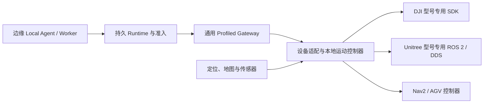

# DJI、Unitree 与 AGV 的 ROS 2 设备绑定

核对日期：2026-10-18。首轮面向 DJI 无人机、Unitree 足式与通用 AGV，统一接入现有 `ProfiledExecute` harness。当前新增的是**可校验的外置设备绑定、Gateway 配置和只读预检**；型号未确定时保留明确的待填写项，不生成可以直接执行的厂商驱动，也不声明实机已经验收。

## 三类设备如何接入

| 设备 | 设备侧集成路线 | 本轮模板的边界 |
| --- | --- | --- |
| DJI 多旋翼 | 按确切型号、固件和接口许可选择厂商 SDK，由机载或现场控制器转换为本项目 ROS 2 契约 | 不假定所有 DJI 原生支持 ROS 2；SDK 名称、型号兼容证据和控制器实现版本必须填写；不虚构一个通用 DJI ROS topic |
| Unitree 足式 | 支持的型号使用官方 `unitree_ros2` / SDK2 接口，运动控制器负责步态、平衡、路径跟踪和故障流程 | 模板中的 Sport 接口来自官方 Go2 示例；不推断所有 Go、B、H、G 系列可使用同一消息或动作 |
| 通用 AGV | 现有 Nav2 的 `NavigateToPose` 或设备路径控制器，经设备适配层实现本项目工具契约 | `/navigate_to_pose` 不是本项目 `ProfiledExecute`，需保留命令身份、租约、取消、去重和独立到达测量；Ackermann/全向底盘需改 Profile |

DJI PSDK 官方文档将支持能力与机型矩阵关联，飞控还涉及控制权获取、控制模式及周期性控制指令。具体型号选择相应 SDK 后，仍需实现本地控制循环与失联流程。参阅 [DJI PSDK](https://github.com/dji-sdk/Payload-SDK)、[飞控接口](https://developer.dji.com/doc/payload-sdk-api-reference/en/module/flight-controller.html)及[支持产品和固件](https://developer.dji.com/doc/payload-sdk-tutorial/en/)。

Unitree 官方仓库说明基于 Cyclone DDS 的 ROS 2 接入，并提供 `/api/sport/request` 和 `/sportmodestate` 的 Sport 示例。模板采用 `unitree_api/msg/Request`、`unitree_go/msg/SportModeState`；部署前核对确切型号、版本和实际 topic。参阅 [unitree_ros2](https://github.com/unitreerobotics/unitree_ros2)。AGV 的标准导航入口参考 [Nav2 NavigateToPose](https://api.nav2.org/nav2-humble/html/classnav2__bt__navigator_1_1NavigateToPoseNavigator.html)，具体 ROS 发行版与导航栈版本另行固定。



边缘 Agent 复用任务编排、上下文、恢复和回溯；厂商差异留在设备控制器。停止、安全流程和周期性控制不交给模型推理。多个机器人共享任务数据使用 [edge-exchange](../development/edge-data-exchange.md)；不把不同设备的底层控制 topics 无条件互通。

## 文件、职责和版本绑定

| 文件 | 用途 |
| --- | --- |
| [dji-uav.binding.json](../../examples/robots/bindings/dji-uav.binding.json) / [Gateway 配置](../../examples/robots/bindings/dji-uav.gateway.json) | DJI 的 SDK 适配声明，air / SE3 / volume3d |
| [unitree-legged.binding.json](../../examples/robots/bindings/unitree-legged.binding.json) / [Gateway 配置](../../examples/robots/bindings/unitree-legged.gateway.json) | 型号依赖的 Unitree Sport 接口，ground / SE3 / terrain25d |
| [agv-nav2.binding.json](../../examples/robots/bindings/agv-nav2.binding.json) / [Gateway 配置](../../examples/robots/bindings/agv-nav2.gateway.json) | 差速 AGV、Nav2 action 和 odometry，ground / SE2 / 2d |
| [预检脚本](../../scripts/ros2_device_preflight.py) | 离线检查绑定、Profile、Gateway，输出输入字节 SHA-256 和缺失字段；不连接 ROS |

`robot.ros2.device-binding.v1` 单独保存厂商/型号/固件/SDK/桥实现版本、坐标约定、定位源、标定、ROS domain、预期端点和停止声明。`profileRevision` 使用现有 `ros2_profile.profile_revision()` 的标准化 SHA-256；不得用 JSON 文件字节散列替代。Gateway 配置与 binding 必须指向同一 Profile 文件，并使用相同 commissioning ID。型号、标定、停止和失联上限不一致时预检失败。

绑定文件供部署预检与回溯使用，**当前 Runtime 不自动读取 binding**；Gateway 仍只读取 `TANGYING_ROS_PROFILE_CONFIG` 指定的 `*.gateway.json`。`rosDomainId` 也不会自动设置进程环境，部署者须在设备、Gateway 及采集工具之间显式设置一致的 `ROS_DOMAIN_ID`。模板中的 21、22、23 是隔离示例，并非厂商设备默认值。某些设备的原生 DDS domain/网络配置需要单独确认；使用 ROS 2 namespace 不会自动重命名厂商固件的 `/api/sport/request`。

网关端点必须位于独立非根 namespace 中，避免多台设备默认名称碰撞。不同物理设备的厂商控制端点还需独立 DDS domain、网络或经过验证的路由隔离。需要跨域汇总业务数据时复用 edge-exchange，不依赖 DDS domain 本身完成鉴权。

`controller.integrationId` 是可扩展的本地集成标识；新增厂商可以保留相同核心契约、增加绑定文件和驱动实现。`requiredVendorInterfaces` 是有界的显式名称、消息类型和设备端角色列表，允许按型号替换。`navigationDimension` 支持 `2d`、`terrain25d`、`terrain_layered`、`volume3d`，必须与形态及可选空间部署一致。仅填写这个字段不会启动 SLAM 或自动加载地图。

## 只读预检

在仓库根目录运行：

```bash
.venv/bin/python scripts/ros2_device_preflight.py examples/robots/bindings/dji-uav.binding.json --template
.venv/bin/python scripts/ros2_device_preflight.py examples/robots/bindings/unitree-legged.binding.json --template
.venv/bin/python scripts/ros2_device_preflight.py examples/robots/bindings/agv-nav2.binding.json --template
```

三份模板应输出 `configurationValid=true`、`configurationComplete=false`。`--template` 只允许保留显式占位字段；不放宽身份、坐标、形态、端点、Profile 摘要和停止参数校验。取消 `--template` 后，尚有占位项返回退出码 **2**。结构或语义不合法返回 **1**。退出码 **0** 只说明所选离线检查通过，输出始终为 `motionAuthorized=false`、`hardwareValidated=false`。

复制配置到现场管理目录后，填写实际型号、固件/SDK/桥实现版本、兼容性依据和标定，修改 Profile 并更新 binding 的摘要，保持 gateway 中相对路径一致。新的 Profile 目录指纹会使旧审批失效；遵循[实机操作流程](edge-field-testing.md)，保留原任务与执行 journal。

可选 `--graph /path/to/inventory.json` 检查最近 30 秒内、同 robot/namespace/domain 的离线 ROS 接口清单：

```json
{
  "schemaVersion": "ros2.interface.inventory.v1",
  "robotId": "site-agv-1",
  "namespace": "/agv_1",
  "rosDomainId": 23,
  "observedAtUnixMs": 1792281600000,
  "endpoints": [
    {"name": "/agv_1/profiled_execute", "rosType": "tangying_robot_msgs/action/ProfiledExecute", "role": "action_server"}
  ]
}
```

上例只展示格式，不是完整或当前有效的观测。清单必须从现场实际的 `ros2 action info`、`ros2 topic info --verbose`、service 信息等只读检查整理，包含所有要求的接口；不能把 `expectedEndpoints` 直接复制作为发现证据。脚本不会自动调用这些命令，也不对操作者提供清单的真实性做认证。缺少端点、错误类型或角色输出 `graphSnapshotStatus=mismatch` 并返回 2；过期、未来时间、重复端点或错误设备身份直接拒绝。清单匹配仍不能证明 QoS 可通信、驱动健康、消息新鲜或硬件可运动。

## 设备控制器需要完成的功能

统一 ROS 2 端点由控制器提供，预检报告中的角色均从设备控制器看：`ProfiledExecute` action server、`ProfiledDriverState` 和 `ProfiledObservation` publisher、`CommandLease` subscriber、`EnterSafeStop` service server。详细合同见[异构移动接入](../development/heterogeneous-mobility.md)。

- 将世界坐标 `world / right_handed_z_up / m / rad` 转换到实际厂商坐标，绑定校准版本；不能只重命名 frame。DJI 的机体系/地理系、Unitree 的状态位姿和 AGV 的 map/odom 都需显式解释。
- 对每个命令保留 robot、Profile、commissioning、command/idempotency、deadline、lease 和 fencing；重复请求不能产生第二次动作，未知结果必须先停止和对账。
- 导航 action 成功后读取独立定位证据验证到达，提供命令之后的采集 ID、序号、采集时刻和标定；不能将目标位姿回填成观测。
- 实现设备独立看门狗。DJI 进入经过调试的受控降落或厂商安全流程；足式维持经过验证的平衡/保持策略；AGV 落实底盘制动。Nav2 cancel、Unitree StopMove 和 ROS 服务 ACK 都不能单独证明物理停止。
- 发布真实驱动/传感器状态，让 Ops Agent 区分失联、旧数据、驱动故障与未知动作；Ops 检测不会自动解除锁定或重试未知命令。

本轮离线增量有 36 项针对性测试，覆盖三种模板、修改后的配置、身份/摘要/坐标/停止不一致、跨设备端点、错误/过期 graph、重复 JSON key 和 FIFO 输入拒绝。此前的真实 DDS 记录式控制器实验在加入厂商 binding 之前完成；这些新配置不改变其冻结源码，也不将其结果升级为 DJI、Unitree 或 AGV 的实机成功。整体结果和未测边界见[本轮实验报告](../experiments/2026-10-18-edge-swarm-readiness.md)。
