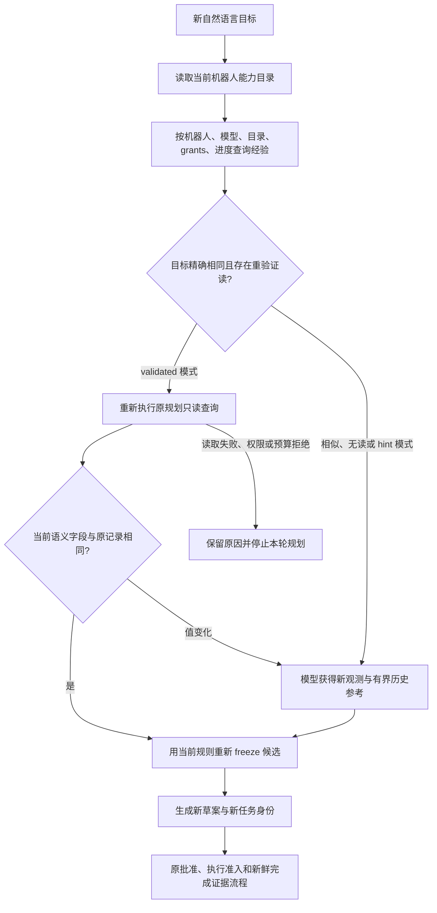

# 模型成本与任务规划经验

本页对应 2026-10-28 的边缘升级。先读[模型输入与调用留痕](edge-brain-model-context.md)，再用这里的配置管理重复规划与成本。GOAL 规划和 RECOVERY 决策复用 action-loop；旧 INTENT/PLANNING 和外部独立模型客户端的覆盖范围需要分别检查，不能把局部记录当作整个云账户账单。

## 1. 分开管理输入、输出与后端缓存

| 手段 | 直接控制什么 | 不能据此宣称什么 |
| --- | --- | --- |
| 语义字段、受保护状态与冷归档 | 减少不必要的模型输入；保留约束和未决动作 | 请求字节不是所有模型通用的精确 token 数 |
| GOAL / RECOVERY 输出上限 | 限制单次响应的请求预算 | 不能限制所有进程的总账单；后端是否接受字段要实测 |
| `CACHE_MODE=openai/vllm` | 向支持的后端提供作用域/工具/模型隔离的缓存提示 | 提示不保证命中，也不是共享机器人上下文 |
| 规划经验 `hint/validated` | 为相似任务提供候选；精确复用可减少模型调用 | 不复用过去的动作、物理完成或运动权限 |
| usage 留痕与汇总 | 记录实际返回的用量、结果、耗时和缺失情况 | 未返回 usage 不能记作 0；没有价格表就不计算金额 |

输出预算应先按任务复杂度设置，再对照 `invalid_decision`、重试轮次、完成率和真实 usage 调整。把输出上限调得过低可能截断工具参数，反而触发额外决策；不能只比较一次调用的 token。必要上下文装不下时应缩小任务阶段或工具目录，不能删掉批准范围或未决动作。

## 2. 规划经验的生命周期

第一版保留的是**通过 `freezeCalls` 校验的规划草案**。它不是“已成功执行的技能库”：保存计划时机器人可能尚未被批准。经验中只保留目标、作用域摘要、候选调用和规划阶段语义查询，来源和本轮使用方式进入 `PlanningTrace`。完整任务和实际执行证据继续由原任务库管理。



关键规则：

- **精确复用**：原始目标文本精确相同；机器人、目录指纹、工具参数授权、剩余进度和模型命名空间相同；至少一条原规划查询，且每条投影非空。重新执行全部查询，比较白名单中的完整语义结果，再运行当前 `freezeCalls`。任何一步都不执行物理动作。没有查询或存在空投影的旧草案最多作为提示，不能以“没有条件”直接命中。
- **相似复用**：本地字符 bigram Jaccard 仅用于找一个候选，阈值大于 0.55；不调用 embedding API。模型仍判断新目标、否定词、顺序和参数差异。参考 JSON 超过 4 KiB 就不放入提示，不靠截断破坏结构。
- **预算连续**：重验证读取占用本轮同一份最多 6 次 Provider 查询额度和 10 轮决策预算；值变化后进入模型，不能再获得全新的读取额度。权限、取消、读失败和非法观测不作为普通缓存 miss 绕过。
- **存储失效**：经验库读取/写入失败不使有效的新模型草案失效，也不重发已有模型调用；留存 `RECIPE_UNAVAILABLE` / `RECIPE_NOT_SAVED`。经验始终是可丢弃的加速数据。
- **容量与时效**：每个机器人/模型命名空间最多 32 条，单条至多 64 KiB，有效期 24 小时；写入时清除过期项并保留较新项。命中不会把旧查询变成新证据，也不无限延长原条目的期限。命名空间变化的旧 aggregate 不主动删除，后续仍需按数据保留策略管理数据库。

`RECIPE_HIT` 意味着本轮没有 GOAL 模型请求，不创建假的 ModelCall 或“0 token 响应”。`RECIPE_HINT` 仍有模型请求。`RECIPE_REVALIDATION_MISS` 表示新语义与原参考不同，后续模型使用新查询结果。每条使用记录有 recipeId 和来源时间；本次 task/revision、批准、命令 ID、动作后证据仍独立产生。缓存源来自模型，计划 `source=llm` 的审批语义保留，具体复用路径看 trace。

如果候选包含 `intent` 绑定的旧能力，重新 freeze 仍会调用当前 `ParseLegacy`；配置为模型 INTENT 路由时可能继续产生独立模型调用。这条旧客户端不在本页 JSONL 总账中，因此不能把 recipe 命中解释为全流程零模型消耗。

## 3. 启用与回退

Local Agent 的私有配置文件支持：

```text
AGENT_GOAL_RECIPE_MODE=hint
AGENT_GOAL_OUTPUT_TOKENS=2048
AGENT_RECOVERY_OUTPUT_TOKENS=1024
AGENT_MODEL_USAGE_FILE=/var/lib/tangying-agent/model-usage.jsonl
```

Worker 的 GOAL 使用同名环境变量；当前 Worker 没有模型 RECOVERY 接线，RECOVERY 额度用于 Local。显式设置阶段输出上限前，先将对应模型路由配置为 `openai`（兼容服务），确定性路由会拒绝该额度配置。先用 `hint` 对照测试，再为已知重复目标启用 `validated`；`off` 或不设置维持原规划行为。Local 和 Worker 均保存到自己的原 SQLite 数据库，无额外网络服务。配置检查拒绝未知模式；变更模型路由后使用新的经验命名空间。无 GOAL 模型的确定性解析不启用经验流程。

Local 启动和工作台模型设置重载都会读取私有配置中的 recipe 模式；重载先验证全部替代对象，失败保留原运行设置并回滚本次设置文件。单独编辑文件不会自动触发监听，需通过现有模型设置保存流程重载或重启。模式变更影响新规划；已经开始的调用仍完成其原本的配置快照。Worker 的环境变量变更需要重启进程。

阶段 `OUTPUT_TOKENS` 显式配置范围为 128–16,384，不配置则沿用 `TANGYING_MODEL_OUTPUT_TOKENS`，再缺省为 4,096。这是 OpenAI 兼容请求的 `max_tokens`，并非本地统一 tokenizer；INTENT 和旧 PLANNING 不接这个阶段开关。现有输入上限仍为 context 32 KiB / 整请求 64 KiB，可由原 `TANGYING_CONTEXT_MAX_BYTES` 与 `TANGYING_MODEL_REQUEST_MAX_BYTES` 设置。

计量路径要求绝对路径。先由运行 Agent 的用户创建私有父目录；它不能由组/其他用户写入，文件为该用户所有的 `0600` 常规文件，不接受软/硬链接。进程间加锁、整行追加并同步落盘；锁等待有界。不要指向共享临时目录或拿无关文件当账本。未设置路径时继续只记录原任务上下文中的 ModelCall；不会凭空生成统一账户账单。

退回 `off` 仅停止读取和写入规划经验；当前任务的原批准、检查点和证据仍须保留，不能为清缓存删除整个任务数据库。减少输出上限可逐阶段回退；计量文件保留并按实际部署归档，不公开目标文本或凭据。

### 调用计量与报告

每次模型尝试使用独立 `call_id`，计量行只含 `schema_version/event/call/scope`，不含 prompt、响应原文、服务 URL 或 API Key。`start` 在发 HTTP 前持久化，`result` 保存结束状态与服务真实返回的 usage。`start` 没有对应 `result` 表示未完成取证，是否发送及最终消耗均不能假定为零。`duration_ms` 包含 start 落盘及 HTTP/解析，在 result 落盘/锁等待前结束，因此不是 TTFT 或整个 Decide 的墙钟耗时；完整输入继续按原机制保存在任务上下文中。

```bash
python3 scripts/model_usage_report.py /var/lib/tangying-agent/model-usage.jsonl \
  --output /var/lib/tangying-agent/model-usage-report.json
```

可以同时输入多个归档文件，按 call ID 去重。报告按阶段、模型、endpoint 摘要、robot、结果和缓存模式分组；usage 中每个字段分别给出已知样本数及总和。重复且内容一致的事件不重复计数，冲突、缺失、非法或未结束记录单列。`response_truncated` / `finish_reason` 有助于判断输出额度是否过小。

启用计量后，调用前写入失败就拒绝发新请求；结果落盘失败时保留真实 ModelCall 并拒绝消费候选，不把已发送请求记成“未调用”。尾行不完整会阻止继续追加：先保存原文件和失败痕迹，离线核对后切换到新账本，不静默截断。计量文件没有自动轮转，应监测磁盘并归档；不能在活动写入时用复制/截断制造遗漏。

### 区分模型可修正错误、计量故障与取消

显式启用的计量账本属于本次调用必须满足的运行条件。写入失败返回可由 `errors.Is(err, actionloop.ErrModelUsageLog)` 识别的错误；GOAL 规划器和 RECOVERY / SYSTEM 共用的 `actionloop.Loop` 都保留当前 round / ModelCall 后立即终止。Loop 同时返回 `Escalated=true` 和原错误，不将它改成普通拒绝后的 `nil` 错误。修复文件权限、磁盘或日志完整性前，再请求一个模型回答无法解决此故障。

| 情况 | 留存的事实 | 后续处理 |
| --- | --- | --- |
| 普通模型输出不符合工具协议 | 原请求、响应状态和拒绝原因 | 在原决策/无进展预算内允许修正；不增加预算或执行无效候选 |
| `start` 落盘失败 | 本次客户端准备记录、`usage_log_status=write_error`；尚未发出 HTTP | 返回 `ErrModelUsageLog`，停止本轮，不请求模型解释文件故障 |
| 已收到 HTTP 响应，但 `result` 落盘失败 | ModelCall 中保留 HTTP 状态、解析结果和已返回 usage；独立账本可能只有 `start` | 返回 `ErrModelUsageLog`，拒绝消费候选，不重试模型来覆盖缺失记录 |
| 父任务取消或期限耗尽 | 已有规划 trace；在途 Provider 读取或模型尝试的状态 | 结束本轮并保留 `context.Canceled` / `context.DeadlineExceeded` 身份，不继续发起规划决策 |

普通规划在进入下一轮、模型返回后和 Provider 读取返回后检查父 context；即使底层读取在取消后仍返回结构化结果，也不能凭该结果继续规划。取消与计量失败都不是“模型没有听懂”，不能把它们反复反馈给模型要求修复。模型自身的临时传输/格式错误仍按原有有限重试策略处理，不据此承诺所有网络错误都能恢复。

例如，服务已返回 100 个 prompt tokens，而本机 `result` 写入失败：任务 trace 可以保留这个已知字段，独立 usage 报告则将对应 start 列为 unfinished。二者记录的是不同的证据完整性，不能将报告中的未知字段补成 0，也不能把请求重发后的一条成功记录当作原失败不存在。另需区分 **ModelCall 客户端尝试数**和**服务实际收到的 HTTP 请求数**：取消的 context 可以在 HTTP 发出前阻止请求，尝试记录本身不证明服务已计费。

可复现的取消、计量故障、SQLite 重开与重复规划场景见[本轮成本路径验证](../experiments/2026-10-28-edge-task-validation/cost/README.md)。它验证实际 HTTP/SQLite 接线，usage 是 fixture 数值，且只完成规划，没有执行机器人动作。

## 4. 如何比较效果

用相同目标、机器人目录、初始语义条件和配置分别执行 `off`、`hint`、`validated`；再加入状态变化、不同目标、重启、超期、权限拒绝和取消负例。至少记录：模型调用数、Provider 查询数、请求字节、返回的 prompt/completion/cached tokens、usage 缺失率、规划耗时、计划有效率、任务最终结果以及 unknown/拒绝次数。

对实际返回 prompt 与 cached 两字段的样本集合 \(S\)，可以计算 \(\sum_{i\in S}cached_i / \sum_{i\in S}prompt_i\)；分母为零时指标未定义。不能把只返回 completion 的样本加入 prompt 分母，也不能把重复归档的同一个调用计费两次。相似提示是否省 token 需测量：它本身增加少量输入，只有减少重复查询或修正轮次时才可能降低总成本。

当前实现与真实验证结果见[升级记录](../development/2026-10-28-edge-scalability.md)。软件测试的 mock usage 只检验字段和计数，不代表某个商用模型的账单、缓存命中率或成本收益。
